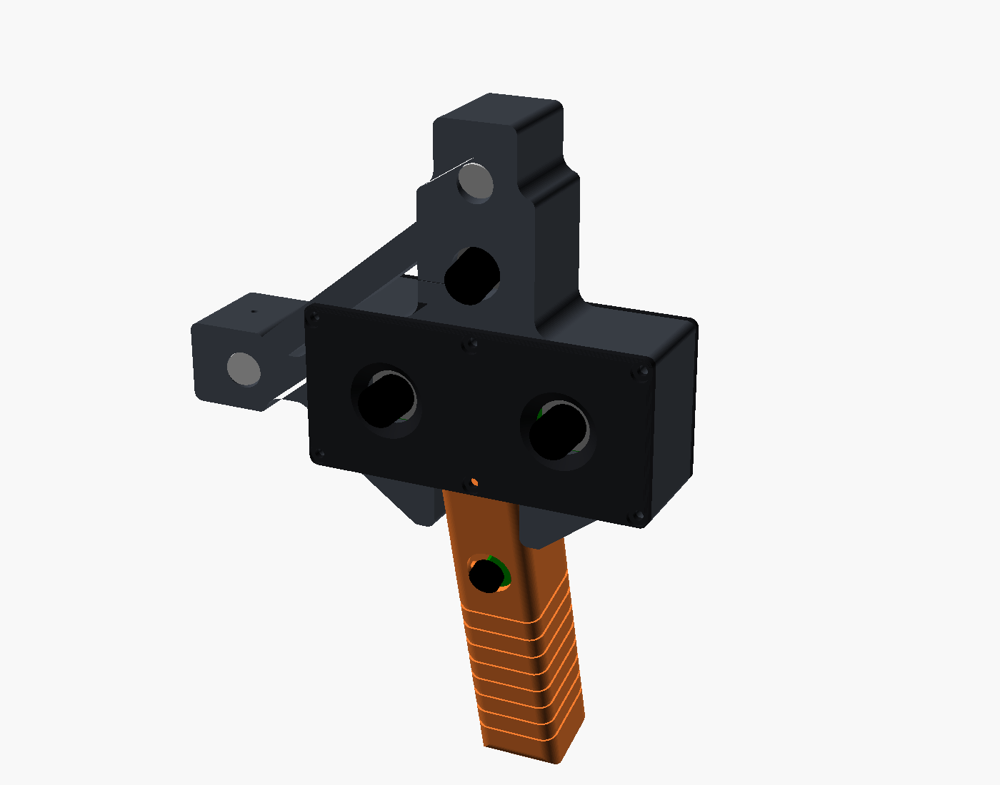
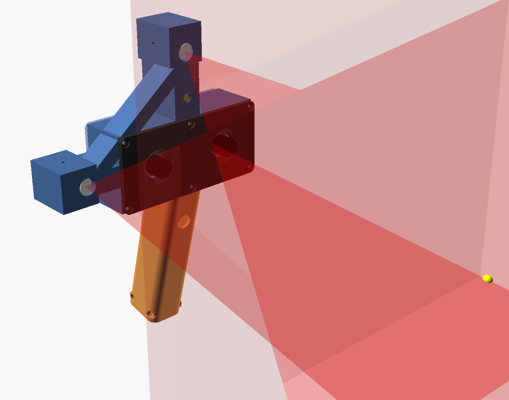

# OpenHandScan: handheld 3D scanner (markerless + marker modes)

An open-source handheld scanner built from off-the-shelf parts and a 3D-printed housing.
It's designed for automotive work: scanning parts, panels and interiors, and living in a car.



## How it works

| Sensor | Job |
|---|---|
| **Hardware-synced stereo pair** (2× OV9281 global shutter, one USB cable) | Dense depth on every frame, for markerless tracking and fusion |
| **Random-dot pattern projector**, two options: **A** 650 nm dot laser + 10,000-dot DOE, or **B** red LED + printed random-dot mask + 3.6 mm M12 lens | Puts texture on plain surfaces (painted panels, plastic trim) so stereo can match |
| **Cross of line lasers** (vertical sheet at right, horizontal sheet at top) | Laser-plane triangulation for sub-mm accuracy along the "+" |
| **IMU** (6-axis, on the back cover) | Motion prior, which keeps tracking alive through fast moves and featureless spots |
| **Pico microcontroller** | Turns lasers and projector on/off, reads the trigger and the IMU |

**Modes**
- **Markerless (default):** stereo depth plus ICP tracking against a fused model. Fine for parts, brackets, interiors, engine-bay components.
- **Marker-assisted:** stick printed AprilTag stickers (20 mm, made with `ohs printables`) on large smooth areas such as a whole door or hood. They lock out drift over long panels. Same hardware, different software setting.

Laser-sheet geometry: both sheets cross on the centre axis 250 mm in front of the faceplate. The useful range is about 150–400 mm.



---

## Parts to order

**The order list with links is in [PARTS.md](PARTS.md).**

Summary:
- **Optics/electronics:** ELP synced OV9281 stereo camera, 2 line lasers and 1 dot laser (650 nm 5 mW, Ø12 mm), Lasermate DOE-RD10K650, Raspberry Pi Pico, Adafruit LSM6DSOX IMU, 16 mm momentary button, MTS-102 toggle, 3× PN2222 + 3× 1 kΩ, silicone wire, heat-shrink, micro-USB data cable.
- **Hardware:** 22× M3×5.7 heat-set inserts. **M3×8 flat-head (countersunk)** ×12 for the faceplate and back cover, so they sit flush. Socket-head screws: **M3×10** ×8 (grip→head: 4 from above, 4 through the yoke), **M3×12** ×3 (laser pinch), **M3×16** ×2 (grip halves). Also M2×6 ×4 (camera), M2×5 ×4 (Pico) and M2.5×5 ×4 (IMU).
- **Consumables:**
  - **ASA** filament (~350 g). A closed car reaches 70–80 °C; PLA warps and PETG is marginal.
  - **AESUB Blue** vanishing spray, for glossy paint, chrome and black trim.
  - Removable label paper for AprilTag stickers.
  - A Letter frame with real glass for the calibration board.
  - Calipers.

**Tools:** soldering iron (also used to press in the inserts), hex keys, small screwdriver, flush cutters.

**Rough total:** $230–300 plus filament.

---

## Stereo board measurements

ELP doesn't publish the lens spacing or mounting holes, so the **faceplate** is a separate part, and it's the only part that depends on them. Measured on the real board (2026-11-12) and set at the top of `hardware/scanner.scad`:

- PCB 80 × 16.5 mm (`st_board`)
- Lenses 60 mm centre to centre (`st_base`), 14 mm across, 16 mm above the PCB
- Four M2 holes, one per corner, their edges 0.8 mm in from the board edges (`st_holes`)
- Posts 10 mm tall (`st_standoff_h`), so the lenses stand about 2 mm proud of the faceplate and can be turned to focus

If your board differs, edit those values and re-export `faceplate.stl`. The head, grip and back cover accept a board up to about 104 × 38 mm.

---

## Printed parts

STLs are in `stl/` and already oriented for printing. **No supports needed.**

| Part | Orientation | Notes |
|---|---|---|
| `head.stl` **or** `head_led.stl` | front face down | Projector option A or B. ~166 × 138 mm footprint, 36 mm tall. 5 walls, 40 % gyroid. The two cheeks under the camera block (the yoke) clamp the top of the grip. |
| `led_cartridge.stl` | front face down | Option B only: holds the mask, the LED star and the lens holder |

**The build currently follows option B (the LED projector):** print `head_led.stl` and `led_cartridge.stl`. Option A stays available.

Option B parts come in two versions:
- `head_led.stl` + `led_cartridge.stl` fit the **Arducam metal M12 holder** (20 mm hole spacing, 10 mm tall).
- `head_led_cla020.stl` + `led_cartridge_cla020.stl` fit the **Commonlands CLA020** holder.

For a holder of a different height, set `holder_h` in `scanner.scad` and re-export.
| `faceplate.stl` | front face down | Made for the measured ELP board (see above). Four camera posts and two alignment pins point up |
| `back_cover.stl` | outside face down | IMU standoffs and two alignment pins point up; the name is sunk into the first layers |
| `grip_left.stl`, `grip_right.stl` | outer face down | The right half has two pins that locate the left half |

The faceplate and back cover are countersunk for flat-head screws. To keep socket-head screws there, set `flush_screws = false` in `scanner.scad` and re-export those two parts.

**Alignment pins:** the faceplate, the back cover and the right grip half carry printed pins (3 mm and 4 mm) that drop into holes in the mating part, so each part finds its place before the screws go in. One hole of each pair on the head is a short slot, so a slightly shrunk print still fits. If a pin is tight, ream the hole with a 3 mm or 4 mm drill bit by hand.

ASA settings: 0.2 mm layers, enclosure on, no part-cooling fan (or ≤20 %), brim on the head.

---

## Wiring (Raspberry Pi Pico)

```
                     ┌── toggle (back cover) ──┬── V-laser  red
Pico VBUS (pin 40) ──┘                         ├── H-laser  red
                                               └── dot-laser red
V-laser black ── C  Q1 PN2222A  E ── GND     B ── 1kΩ ── GP2 (pin 4)
H-laser black ── C  Q2 PN2222A  E ── GND     B ── 1kΩ ── GP3 (pin 5)
Dot-laser black─ C  Q3 PN2222A  E ── GND     B ── 1kΩ ── GP6 (pin 9)
Trigger button: GP15 (pin 20) ── button ── GND (pin 18)    (internal pull-up)
IMU (LSM6DSOX): VIN ── 3V3 (pin 36)  GND ── GND  SDA ── GP4 (pin 6)  SCL ── GP5 (pin 7)
```

- PN2222A pinout is **E-B-C** with the flat face toward you and the legs down. Check the datasheet for the part you actually receive; some "2N2222" parts are C-B-E.
- **Projector option B (LED):** the LED replaces the dot laser and its transistor.
  - VBUS → toggle → LED **+**; LED **−** → 8.2 Ω 3 W resistor → IRLB8721 drain; source → GND.
  - Gate → GP6 directly, plus a 10 kΩ pull-down from gate to GND.
  - The Pico's USB port then supplies ≈0.45 A in total.
- Solder the transistor circuits on a small perfboard scrap, or dead-bug them with heat-shrink, and tuck it inside the grip. The 8.2 Ω resistor gets warm (~1 W), so give it air.
- Wires from the head to the grip run through the slot under the camera: camera USB, 1× +5 V, 3× laser returns, 4× IMU.

---

## Assembly

1. **Inserts:** press M3 inserts into the head (6 front, 6 back), into each grip-half ledge (2 + 2 from above, 2 + 2 from the sides), and into the left grip half's bottom bosses (2).
2. **Grip:** screw the Pico onto the standoffs in the right half, with USB pointing down. The 16 mm trigger button sits in the split front hole. Spin its nut down to leave a ~2.5 mm gap under the bezel, then close the halves around it; the right half's two pins find the left half.
3. **Grip → head:** join the halves at the bottom with M3×16 and slide the top of the grip up between the head's two cheeks (the yoke). With the head's camera opening still empty, drop M3×10 screws through the pocket floor into each half's ledge. Then put 4× M3×10 through the cheeks from the sides. These side screws are what stops the head rocking on the grip.
4. **Line lasers:** slide them in from the back. Focus each one sharp at about 25 cm. Rotate the right laser until its line is exactly **vertical** and the top laser until its line is exactly **horizontal**. Snug the M3×12 pinch screws; don't over-tighten.
5. **Pattern projector, option A (laser + DOE):** drop the DOE disc down the top-arm bore from the back with tweezers so it sits in the recess behind the front lip. Slide the dot laser in until it stops, then pinch. You should see a field of dots on the wall.

   **Pattern projector, option B (LED + mask):**
   1. Cut the cleanest mask from the printed sheet. Lay a 10×10 mm piece of diffusion film in the cartridge's front recess, and put the mask on top of it.
   2. Screw the M12 lens holder over both films from the cartridge's back; this clamps them. Use 2× M2×6 for the Arducam holder, or M1.6×6 for the Commonlands one. If the holder's holes aren't threaded, add nuts on the holder side. Then thread in the 3.6 mm lens.
   3. Slide the cartridge into the projector bay from the back, lens first, and fix it with 4× M2×8 into the ledge.
   4. Drop the LED star into the cartridge's back pocket, with its leads through the notch. Press the heatsink onto it with its thermal tape.
   5. Turn the lens until the dots are sharp on a wall 25 cm away.
6. **Camera:** screw the stereo board to the faceplate standoffs, focus both lenses at about 25 cm, lock them with a dab of nail polish, seat the faceplate on its two pins and screw it on (M3×8 flat-head).
7. **Back cover:** mount the IMU and the kill toggle, wire everything per the diagram, seat the cover on its two pins and close with M3×8 flat-head.

## In-car notes

- Store the scanner in a bag in the trunk or footwell, not on the dash.
- Heat cycles can shift lens focus slightly, so re-run the 1-minute calibration check before an important scan.
- Use AESUB Blue on glossy or dark surfaces. On whole doors or hoods, add a few AprilTag stickers and use marker mode.

## Files

- `hardware/scanner.scad`: single parametric source for every part (all dimensions are at the top). `projector = "led"` (option B) is the default; set `projector = "laser"` for option A.
- `stl/`: print-ready parts
- `renders/`: previews

License: MIT (see [LICENSE](LICENSE)). It covers the hardware design, firmware, software and docs.
