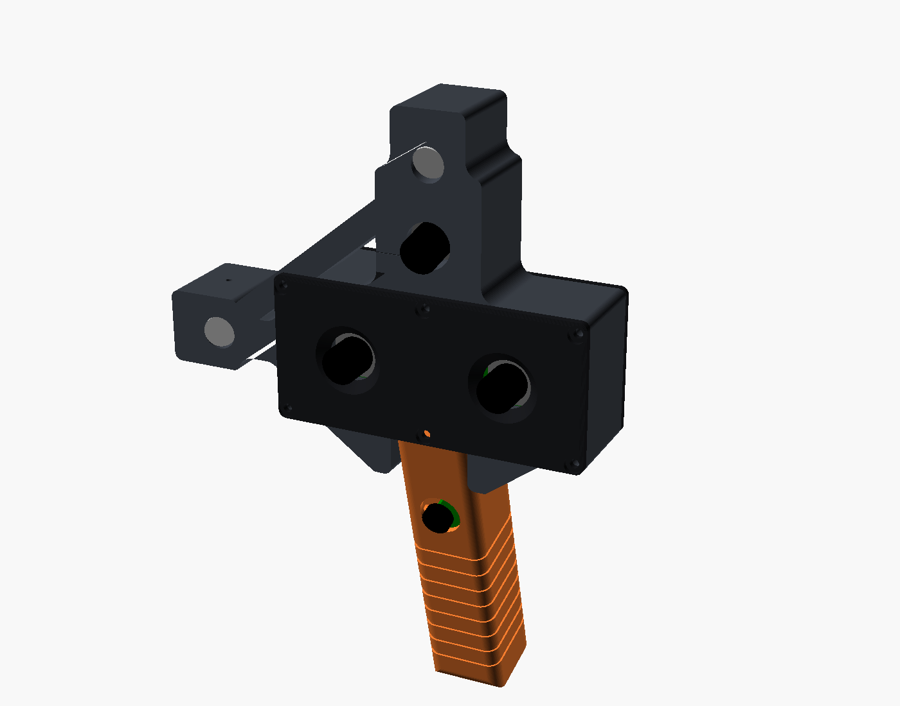
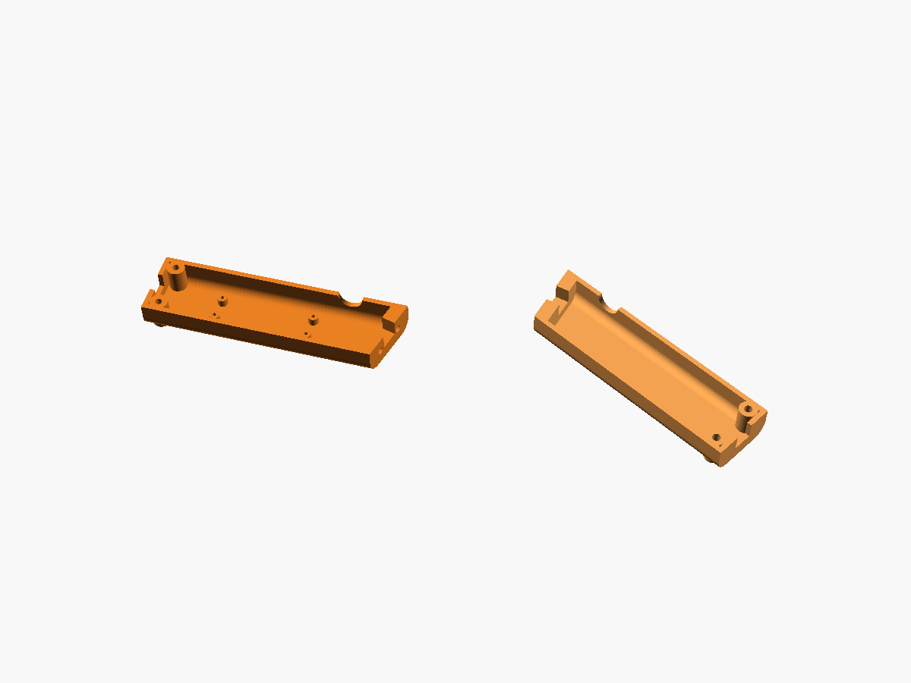
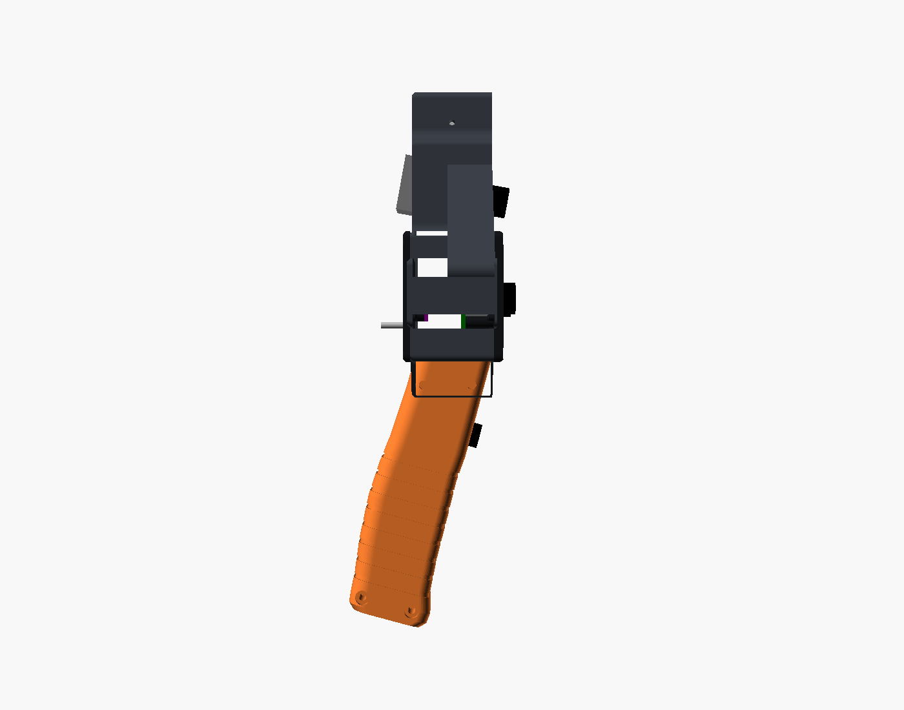
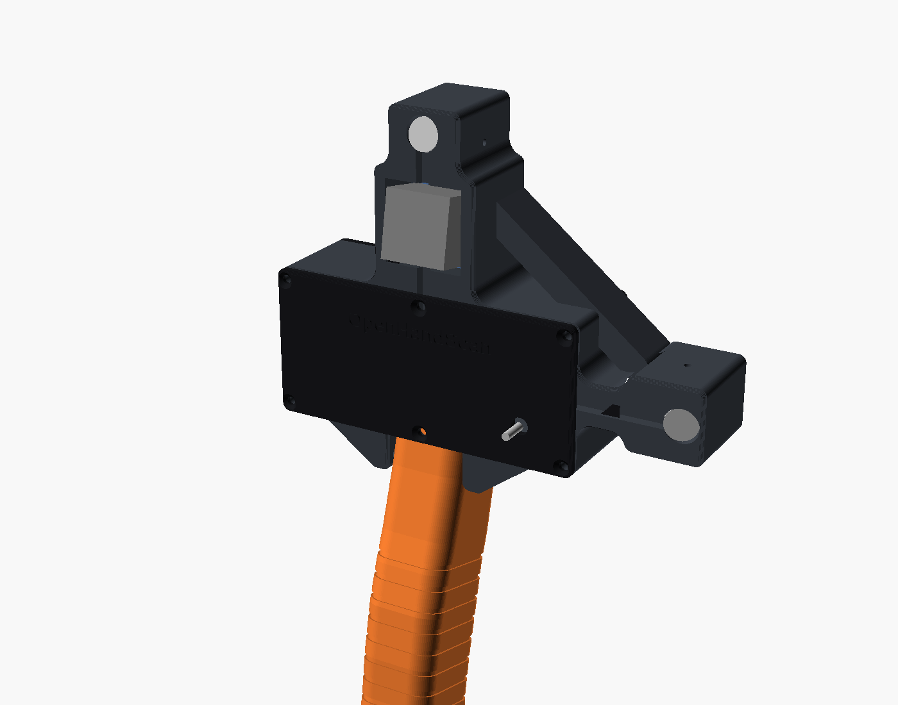
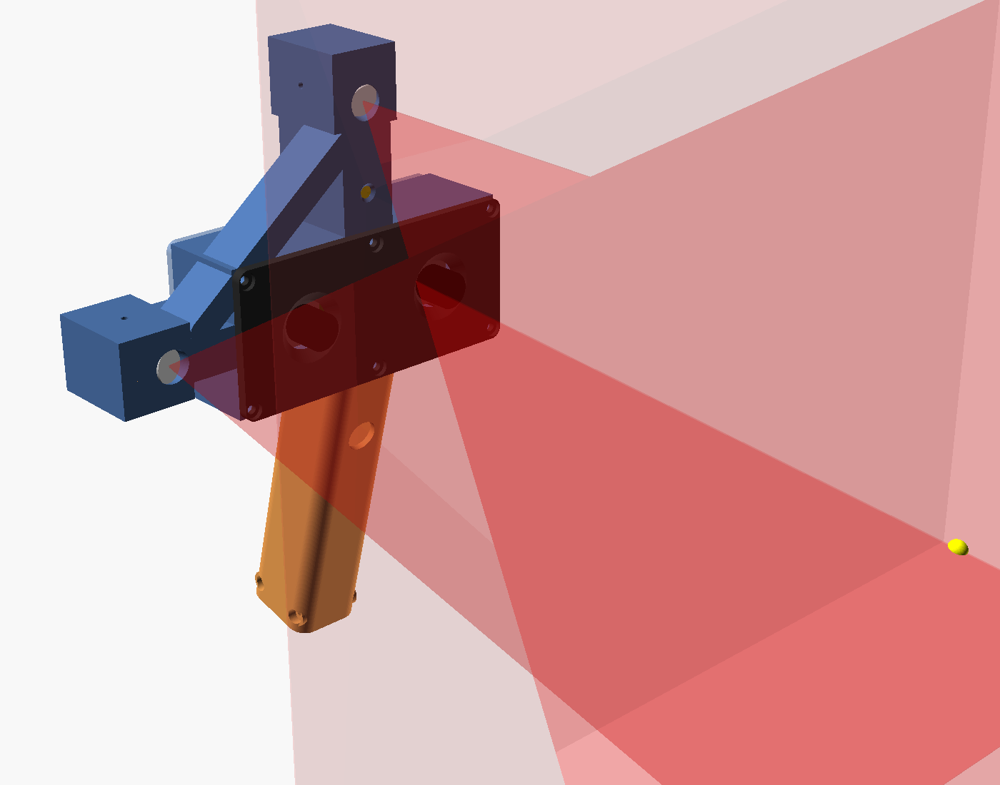

# OpenHandScan build guide

Step-by-step instructions for building the scanner, from the printed parts to the first power-up.

**What this guide builds:** the standard scanner with **two line lasers**, the **LED pattern
projector** (option B) with the Arducam lens holder, and a **Raspberry Pi Pico**. Other choices are
covered in [Variants](#variants) at the end.

**Status, read this first.** All the parts were **printed in ASA and dry-fitted** on 2026-11-16:
they fit as designed, with no value changed. No scanner has been assembled and wired from these
files yet, so the steps from the wiring onward are written from the CAD model, the wiring drawing
and the firmware, not from a finished build. Printers differ: dry-fit your own parts before you
solder.

| Where to look | For |
|---|---|
| [PARTS.md](../PARTS.md) | What to order, with links |
| [docs/wiring.html](wiring.html) | The wiring drawn out, with pinouts and a checklist to tick off (open it in a browser) |
| [firmware/README.md](../firmware/README.md) | Flashing and testing the board |
| [software/README.md](../software/README.md) | Installing the software, calibrating, scanning |

**Time:** roughly a day of printing, then an afternoon for the build.

## Safety

- The line lasers are **Class 3R**. Never look into them, and never point them at anyone. While
  testing, aim the scanner at a wall or a sheet of paper.
- The **toggle on the back cover is the kill switch** for the lasers and the LED. Keep it off
  whenever you are working on the scanner.
- Unplug both USB cables before soldering.
- Heat-set inserts and ASA printing both mean hot plastic: ventilate the room.

---

## 1. What you need

### Parts

Everything in [PARTS.md](../PARTS.md): rows 1 to 16, plus the "Option B: LED + printed mask" table.
Rows 17 to 21 (filament, spray, label paper, picture frame, calipers) are for printing and for
calibration later.

### Tools

- Soldering iron (it also presses in the inserts; an insert tip helps)
- Hex keys or drivers: 2 mm and 2.5 mm for M3, 1.5 mm for M2, 2 mm for M2.5
- Small screwdriver, flush cutters, wire strippers, tweezers
- Heat gun or lighter for heat-shrink
- 3 mm and 4 mm drill bits, turned by hand, to ease a tight pin hole
- A laser printer (1200 dpi) for the projector mask, or a film mask from a photoplot service
- Sharp scissors or a knife, masking tape and a pen for labelling wires

### Screws, and where each one goes

| Screw | Count | Where |
|---|---|---|
| M3 × 5.7 heat-set insert | 22 | Head 12, grip ledges 8, left grip half 2 |
| M3 × 8 flat-head | 12 | Faceplate 6, back cover 6 |
| M3 × 10 socket-head | 8 | Grip to head: 4 from above, 4 through the yoke |
| M3 × 12 socket-head | 2 | One per line laser (pinch screw, cuts its own thread) |
| M3 × 16 socket-head | 2 | Joins the grip halves at the bottom |
| M2 × 5 | 4 | Pico to its standoffs |
| M2 × 6 | 6 | Camera board to the faceplate posts 4, lens holder to the cartridge 2 |
| M2 × 8 | 4 | LED cartridge into the head |
| M2.5 × 5 | 4 | IMU to the back cover |

The M2 and M2.5 screws cut their own thread in the plastic. Turn them in gently and stop when they
seat. Check that your M2 kit includes the 8 mm length.

---

## 2. Print the parts

All files are in `stl/`, already turned the right way up. **No supports.**

| File | Lies on the bed | Notes |
|---|---|---|
| `head_led.stl` | front face down | The biggest part, about 166 × 138 mm and 36 mm tall. 5 walls, 40 % gyroid infill, brim on |
| `led_cartridge.stl` | front face down | Holds the mask, the lens holder and the LED |
| `faceplate.stl` | front face down | Four camera posts and two pins point up |
| `back_cover.stl` | outside face down | IMU standoffs and two pins point up; the name is sunk into the first layers |
| `grip_left.stl`, `grip_right.stl` | outer face down | The right half carries two pins |

**Material: ASA.** A closed car reaches 70 to 80 °C; PLA warps there and PETG is marginal.
Settings: 0.2 mm layers, enclosure closed, part-cooling fan off (or 20 % at most).

**After printing, dry-fit before anything else:**

1. Faceplate onto the head's front: its two pins should drop into the head. One hole is a short
   slot, so a slightly shrunk print still fits.
2. Back cover onto the head's back, the same way.
3. The two grip halves together: the right half's pins go into the left half.
4. The closed grip up between the head's two cheeks (the yoke). It should slide in with a light
   push. The designed gap is 0.2 mm a side.
5. A laser module into each bore from the back. It should slide and turn by hand.
6. The cartridge into the projector bay from the back.

If a pin is tight, turn a 3 mm (head) or 4 mm (grip) drill bit in the hole by hand. If the grip
will not enter the yoke, sand the grip's top flanks, not the cheeks.

---

## 3. Press in the inserts

22 inserts. Set the iron to about 240 °C for ASA, push each insert straight until it sits flush or
a hair below the surface, and let it cool before loading it.

| Part | Inserts | Where |
|---|---|---|
| Head | 6 + 6 | Front face (for the faceplate) and back face (for the back cover) |
| Each grip half | 2 + 2 | Two in the top surface (screws come down from the head), two in the outer side near the top (screws come through the yoke) |
| Left grip half | 2 | The two bosses at the bottom, from the split face |

Press each one against something flat while it is still warm, so none stands proud. A proud insert
on the head's faces keeps the faceplate or cover from seating.

---

## 4. Get the board running first

Do this on the bare board, before anything is soldered to it. A board that fails here is easy to
swap now.

1. Install the software on the PC: [software/README.md](../software/README.md), section 1.
2. Flash MicroPython and copy the two firmware files: [firmware/README.md](../firmware/README.md),
   sections 1 and 2.
3. Open a serial terminal as in section 3 there and type `HELLO`. Expect
   `OK HELLO ohs-fw <version> imu=NONE`. `imu=NONE` is right for now: the IMU is not wired yet.
4. Unplug the board.

---

## 5. Print the projector mask

The LED projector shines through a small printed pattern of random dots.

1. Run `ohs printables print/` (software guide, section 5). It writes the mask sheet, the calibration
   board and the AprilTag stickers.
2. Print the mask sheet on **transparency film** with a laser printer at **100 % scale**, 1200 dpi.
   One sheet holds 48 copies.
3. Look at them against a light and cut out the cleanest one: solid black, sharp dots, no streaks.
4. Cut a 10 × 10 mm piece of the white diffusion film.

Handle both by the edges. A fingerprint on the mask shows up in the projected dots.

---

## 6. Build the projector cartridge

1. Lay the diffusion film in the recess on the cartridge's **front**, then the mask on top of it.
2. Put the M12 lens holder over both and screw it on from the cartridge's **back** with 2× M2 × 6.
   This clamps the films. If the holder's holes are not threaded, add nuts on the holder side.
3. Thread the 3.6 mm lens into the holder a few turns.
4. Solder two wires, about 20 cm, to the LED star. Its solder pads are on the **front** face, the
   side with the LED, one pad on each of the six lobes. Use one pad marked **+** and one marked
   **−** on two lobes **next to each other**. Lay each wire flat on its pad, pointing away from
   the LED, and keep the solder low: the joint has 2.5 mm of room. Mark the + wire.
5. Leave the LED and the heatsink out for now. They go in after the cartridge is in the head
   (step 10).

The cartridge has a recess for these two joints, in the ledge the star lies on, beside the notch
in the cartridge's edge. A cartridge printed before 2026-11-16 does not have it: print
`led_cartridge.stl` again (it is a small part).

---

## 7. Build the driver board and the wiring harness

Open [docs/wiring.html](wiring.html) in a browser and keep it beside you. It shows the schematic,
each part's pinout and a checklist you can tick. What follows is the order to do it in.

**How the wiring is laid out.** The Pico and a small perfboard live in the grip. Everything else
(lasers, LED, IMU, toggle) is in the head. So you build the grip side with **long loose wires
("tails") coming out of its top**, and join those tails to the parts in the head later.

### The driver board (a perfboard scrap, about 20 × 30 mm)

| Circuit | Parts | Connections |
|---|---|---|
| V-line laser switch | PN2222 (Q1), 1 kΩ | Base through 1 kΩ to **GP2 (pin 4)**; emitter to GND; collector to the laser's black wire |
| H-line laser switch | PN2222 (Q2), 1 kΩ | Base through 1 kΩ to **GP3 (pin 5)**; emitter to GND; collector to the laser's black wire |
| 4-laser variant only: second V-line and H-line laser switches | PN2222 (Q4, Q5), 1 kΩ each | Q4's base through 1 kΩ to **GP0 (pin 1)**, Q5's to **GP1 (pin 2)**; emitters to GND; collectors to those lasers' black wires (firmware 1.2.0 or later) |
| LED switch | IRLB8721 (Q3), 8.2 Ω 3 W, 10 kΩ | Gate straight to **GP6 (pin 9)**, with 10 kΩ from gate to GND; source to GND; drain through the 8.2 Ω resistor to the LED's − wire |

- PN2222 legs are **E-B-C** with the flat face toward you and the legs down. Check the datasheet
  of the part you received: some "2N2222" parts are C-B-E.
- The 8.2 Ω resistor gives off about 1 W. Stand it a few millimetres off the board and keep it
  away from the plastic.

### Tails from the grip to the head

Cut each about **25 cm** long; you trim them in step 12. With three wire colours you cannot give
each its own, so put a tape flag with its name on every free end.

| Tail | From | Goes to (in the head) |
|---|---|---|
| +5 V | Pico **VBUS (pin 40)** | Toggle |
| V return | Q1 collector | V-line laser, black |
| H return | Q2 collector | H-line laser, black |
| LED return | 8.2 Ω resistor | LED − |
| IMU 3.3 V | Pico **3V3 (pin 36)** | IMU VIN |
| IMU ground | Pico **GND (pin 8)** | IMU GND |
| IMU SDA | Pico **GP4 (pin 6)** | IMU SDA |
| IMU SCL | Pico **GP5 (pin 7)** | IMU SCL |

Also solder, staying inside the grip:
- the driver board's ground to a Pico **GND** pin;
- two wires, about 8 cm, for the trigger button: **GP15 (pin 20)** and **GND (pin 18)**.

### Test it on the bench

1. Plug the board in, open the serial terminal and check that `HELLO` answers. Touch the two
   trigger wires together: the terminal shows `B <time> 1`, then `B <time> 0` when you part them.
2. Optional but worth it: hold a laser's red wire on the +5 V tail and its black wire on the V
   return tail, point it at the wall, and type `EMIT 20 0 0`. The line lights and goes out 1.5 s
   later. `EMIT 0 20 0` tests the H return the same way.
3. Unplug.

---

## 8. Assemble the grip

1. Screw the Pico onto the four standoffs in the **right** half with 4× M2 × 5, its USB socket
   pointing **down**, toward the opening in the bottom of the grip.
2. Tuck the driver board in above the Pico. Wrap it in a turn of Kapton tape or a piece of
   heat-shrink so nothing shorts against the Pico.
3. Push the trigger button through the split hole at the front and solder its two wires. Spin its
   nut down until about **2.5 mm** is left under the bezel: that gap is the grip's wall.
4. Lead all eight tails up and out through the slot in the top of the grip.
5. Feed the **camera's USB cable** through the grip, in at the bottom opening and out at the top
   slot, whichever end fits through. Leave about 15 cm above the grip.
6. Plug the Pico's USB cable in from below.
7. Close the left half onto the right one; the pins find their holes. Check that no wire is
   pinched in the seam and that the button's bezel sits in both halves.
8. Join the halves at the bottom with 2× M3 × 16, from the right side into the left half's inserts.

---

## 9. Fix the grip to the head

The head's camera opening must still be **empty** for this step: the first four screws go in
through it.

1. Pass the tails and the camera cable up through the slot in the head's underside, into the
   camera opening.
2. Slide the top of the grip up between the head's two cheeks until it stops against the head.
3. From inside the camera opening, drop 4× M3 × 10 through the floor into the grip's top inserts.
   Tighten them evenly.
4. Put 4× M3 × 10 through the cheeks from the sides, two a side. **These are the screws that stop
   the head rocking on the grip**, so do not leave them out.

---

## 10. Fit the lasers and the projector

1. Slide a line laser into the **right** bore from the back, lens forward, and another into the
   **top** bore. Start an M3 × 12 pinch screw in each block, only until the module stops falling
   out. It must still turn.
2. Slide the projector cartridge into the bay from the back, lens first, and fix it with
   4× M2 × 8.
3. Drop the LED star into the pocket at the cartridge's back, **LED side first**, so the LED looks
   through the mask and the bare metal back faces you. Turn it until the two soldered lobes lie
   over the recess and two of its edge cut-outs sit over the lens holder's screw heads. Lead both
   wires out through the channel and the notch, then back along the side of the heatsink. The
   star must lie flat, level with the cartridge's back. Stick the heatsink onto it with its
   thermal tape.
4. Press the lasers' wires into the channels on the head's back face. They lead to the camera
   opening. Bring the LED's wires there too.

---

## 11. Mount the camera

1. Screw the stereo board to the four posts on the faceplate's back with 4× M2 × 6, lenses
   through the two holes. The lenses stand about 2 mm proud of the front, so you can turn them to
   focus later. The board must sit flat on all four posts. Each post is notched at its top, on
   the side of the lens, to clear the square base of the lens holder. A faceplate printed before
   2026-11-16 has round posts that hit those bases: print `faceplate.stl` again, or cut the
   notch by hand (the top 3 mm of each post, on the lens side, back to the edge of the screw
   hole).
2. Plug the camera's cable into the board.
3. Seat the faceplate on its two pins and fix it with 6× M3 × 8 flat-head. They should sit flush.

---

## 12. Back cover and final wiring

1. Screw the IMU to the four standoffs inside the back cover with 4× M2.5 × 5.
2. Mount the toggle in the cover's hole with its nut.
3. Now join the tails, working at the open back of the head. Trim each to length, leaving enough
   slack that the cover can swing open like a door. Slip heat-shrink on **before** each joint.

   | Join | To |
   |---|---|
   | +5 V tail | Toggle, **middle** lug |
   | Toggle, one **outer** lug | The two lasers' red wires and the LED's + wire, all together |
   | V return | Right laser, black |
   | H return | Top laser, black |
   | LED return | LED − |
   | IMU 3.3 V, ground, SDA, SCL | IMU VIN, GND, SDA, SCL |

4. Tick the connections off in the checklist of [wiring.html](wiring.html).
5. **Leave the cover open** for the next two steps.

---

## 13. First power-up

1. Toggle **off**. Plug in the Pico's cable and the camera's cable.
2. In the serial terminal, `HELLO` now answers `... imu=LSM6DSOX`. If it says `imu=NONE`, check
   the four IMU wires (firmware guide, "Troubleshooting").
3. `IMU 104` starts a stream of lines beginning with `I`; `IMU 0` stops it.
4. Press the trigger: `B <time> 1`, then `B <time> 0`.
5. Aim at a wall. Toggle **on**. Type `EMIT 20 0 0` (vertical line), `EMIT 0 20 0` (horizontal
   line), `EMIT 0 0 20` (dots). Each lights and goes out by itself after 1.5 s.
6. Flip the toggle off while one is lit: it must go dark at once.
7. Close the terminal and run `ohs selftest`. It checks the camera, the IMU, the clock, the
   emitters and the trigger in about a minute.

Nothing lights? Toggle off, unplug, and check the toggle's lugs first (the middle one must carry
the +5 V tail), then the transistor's leg order.

---

## 14. Focus and aim

Stand the scanner **25 cm** from a flat wall. That is where the two laser sheets are designed to
cross.

1. **Camera lenses:** run `ohs preview` and turn each lens from the front until fine detail is
   sharpest. Lock each with a small dab of nail polish on the thread.
2. **Projector:** turn the M12 lens until the dots are sharp on the wall.
3. **Line lasers:** turn each module's focus ring until its line is thinnest. Then rotate the
   whole module in its bore: the right laser until its line is exactly **vertical**, the top one
   until its line is exactly **horizontal**. A door frame or a level line on the wall helps. The
   two lines should form a "+".
4. Snug the two M3 × 12 pinch screws. Do not over-tighten: the screw only has to stop the module
   turning, and too much force dents it.

---

## 15. Close it and calibrate

1. Toggle off, unplug. Fold the wires into the head so none lies over the IMU or under the
   cover's edge.
2. Seat the back cover on its two pins and fix it with 6× M3 × 8 flat-head.
3. Calibrate: [software/README.md](../software/README.md), sections 5 and 6, or the **Setup**
   wizard in the desktop app. In short: print the calibration board, glue it flat to the glass of
   the picture frame, then calibrate the cameras, the lasers and the IMU, in that order. About ten
   minutes.
4. Scan: section 7 of the same guide.

Redo the laser calibration whenever you loosen a pinch screw or turn a laser. Redo the short
calibration check after the scanner has been through a hot day in the car.

---

## Variants

| You have | What changes | Where it is described |
|---|---|---|
| **Four line lasers** | A different head file, two more transistors and resistors, two more tails, a long 2.5 mm hex driver for the right yoke screws | [README.md](../README.md#4-laser-variant-optional), "4-laser variant" |
| **Dot laser + DOE** instead of the LED (option A) | Print `head.stl`, no cartridge. A third PN2222 replaces the MOSFET circuit. Drop the DOE disc into the top-arm bore from the back with tweezers, slide the dot laser in behind it and pinch it with a third M3 × 12 | [README.md](../README.md#assembly), step 5 |
| **Commonlands CLA020** lens holder | Print `head_led_cla020.stl` and `led_cartridge_cla020.stl`; the holder takes M1.6 × 6 screws | [PARTS.md](../PARTS.md) |
| **Waveshare ESP32-S3-Pico** instead of the Pico | Same wiring on the same pin numbers, USB-C cable, different flashing steps. Not yet tried on a real board | [firmware/README.md](../firmware/README.md), "ESP32 instead of a Pico" |
| A stereo board with other dimensions | Edit the `st_` values in `hardware/scanner.scad` and re-export only the faceplate | [README.md](../README.md#stereo-board-measurements) |

## If something does not fit

Every dimension is a named value at the top of `hardware/scanner.scad`. The ones most likely to
need a change after a first print:

| Problem | Value | Now |
|---|---|---|
| Faceplate or cover pins too tight or too loose | `pin_fit` | 0.3 mm |
| Grip too tight or too loose in the yoke | `yoke_fit` | 0.2 mm a side |
| Laser module too tight or too loose in its bore | `laser_clear` | 0.35 mm |
| Lens holder of another height | `holder_h` | 10 mm |

Change the value, re-export that part (the commands are at the top of the file), and print it
again.
