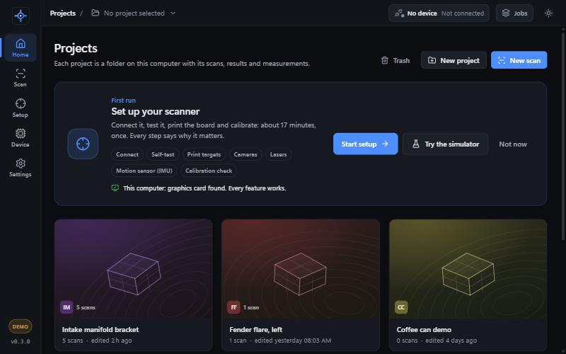

# OpenHandScan Studio user guide

This guide explains how to use OpenHandScan Studio, the desktop app of the OpenHandScan handheld 3D scanner: setting the scanner up, scanning a part, making and cleaning its mesh, measuring it, and putting several scans together. Use the contents below to read it through, or the "I want to..." table to look one thing up.

*The Studio window with the demo's projects.*

**Where things stand.** So far the software has been tested on simulated scans. Every picture in this guide comes from the app's built-in demo, and every measured number comes from the simulator. Results on the real scanner are not measured yet, and the guide says so wherever it gives a number.

On this page:

- [From part to mesh in five steps](#from-part-to-mesh-in-five-steps)
- [Contents](#contents)
- [I want to...](#i-want-to)
- [Other documents](#other-documents)

## From part to mesh in five steps

1. **Start the app** and, the first time, run the Setup wizard. See [Getting started](getting-started.md) and [Set up and calibrate the scanner](setup.md).
2. **Scan the part** on the Scan page. See [Scanning](scanning.md).
3. **Make the mesh.** It starts by itself when a scan stops, or you press **Make mesh**. See [From a recording to a mesh](make-mesh.md).
4. **Look at it and measure it** in the viewer. See [The result viewer](viewer.md) and [Measuring on the scan](measuring.md).
5. **Download it** as STL or PLY, or as features for CAD. See [Download the scan](viewer.md#download-the-scan) and [Export features for CAD](measuring.md#export-features-for-cad).

You can try all five without a scanner: see [Try the simulator](getting-started.md#try-the-simulator).

## Contents

| Page | What it covers |
|---|---|
| [Getting started](getting-started.md) | Installing and starting the app, the window, the simulator, what your computer can do |
| [Set up and calibrate the scanner](setup.md) | The Setup wizard step by step, reading a calibration result, the Device page |
| [Scanning](scanning.md) | Starting and stopping, the live view, tracking, rewind, hotkeys, second passes, tags, laser safety |
| [From a recording to a mesh](make-mesh.md) | Make mesh, quality, stages, presets and mesh detail, thin walls, the notes afterwards |
| [Cleaning a mesh](editing.md) | Loose bits, the table, holes, smoothing, selecting by hand, the history, recipes |
| [The result viewer](viewer.md) | Moving the view, colour modes, the Scan check, the report, downloads |
| [Measuring on the scan](measuring.md) | Distances, planes, cylinders and holes, the part's axes, sections, flush, files for CAD |
| [Comparing a scan with a reference](compare.md) | Comparing with a CAD model or a scan of a good part |
| [Aligning and merging scans](align-merge.md) | Two or more scans of one part, the verdict, the "share little" caution, merging |
| [Projects and scans](projects.md) | Projects, the trash, disk space, the files in a scan's folder, the Jobs panel |
| [Settings](settings.md) | Every setting, what it does and its default, where files are kept |
| [Troubleshooting](troubleshooting.md) | What to do when something goes wrong, by what you see |
| [Glossary](glossary.md) | The words the app and this guide use |

Each page ends with a table "Messages on this page": the warnings and messages you can meet there, what each means and what to do.

## I want to...

| I want to... | Go to |
|---|---|
| try the app without a scanner | [Try the simulator](getting-started.md#try-the-simulator) |
| connect the scanner | [Step 1: Connect](setup.md#step-1-connect) |
| calibrate the cameras | [Step 4: Cameras](setup.md#step-4-cameras) |
| know whether my calibration is still good | [The calibration status after connecting](setup.md#the-calibration-status-after-connecting) |
| start, pause or stop a scan | [Start a scan](scanning.md#start-a-scan), [Pause, rewind and stop](scanning.md#pause-rewind-and-stop) |
| know what to do when tracking is lost | [If tracking is lost](scanning.md#if-tracking-is-lost) |
| scan a large plain panel | [Tags for large plain parts](scanning.md#tags-for-large-plain-parts) |
| scan the areas the first scan missed | [A second pass](scanning.md#a-second-pass) |
| see the keys I can use | [Hotkeys and the trigger](scanning.md#hotkeys-and-the-trigger), [Tools and keys](measuring.md#tools-and-keys) |
| make the mesh again with other settings | [Make the mesh again](make-mesh.md#make-the-mesh-again) |
| choose between Preview, Standard and Best | [Choose the quality](make-mesh.md#choose-the-quality) |
| scan thin sheet metal | [Presets and mesh detail](make-mesh.md#presets-and-mesh-detail), [If thin walls are found](make-mesh.md#if-thin-walls-are-found) |
| know how long making a mesh takes | [How long it takes](make-mesh.md#how-long-it-takes) |
| remove the table from the mesh | [Remove the table](editing.md#remove-the-table) |
| fill holes | [Fill holes](editing.md#fill-holes) |
| undo an edit | [Undo and the history](editing.md#undo-and-the-history) |
| apply the same clean-up to every scan | [Recipes](editing.md#recipes) |
| know how far I can trust a scan | [Is it good? The Scan check](viewer.md#is-it-good-the-scan-check) |
| measure a distance | [Measure a distance](measuring.md#measure-a-distance) |
| measure a hole or a boss | [Fit a plane, a cylinder or a hole](measuring.md#fit-a-plane-a-cylinder-or-a-hole) |
| know what the ± after a value means | [What the ± means](measuring.md#what-the--means) |
| cut a cross-section | [Cut a section](measuring.md#cut-a-section) |
| measure flush between two panels | [Measure the flush along a seam](measuring.md#measure-the-flush-along-a-seam) |
| get measured features into CAD | [Export features for CAD](measuring.md#export-features-for-cad) |
| compare a scan with a CAD model | [Comparing a scan with a reference](compare.md) |
| scan both sides of a part | [Aligning and merging scans](align-merge.md) |
| understand "The scans share little" | [The scans share little](align-merge.md#the-scans-share-little) |
| download an STL | [Download a mesh](projects.md#download-a-mesh), [Download the scan](viewer.md#download-the-scan) |
| get a deleted scan back | [Restore from the trash, or empty it](projects.md#restore-from-the-trash-or-empty-it) |
| free disk space | [Free space](projects.md#free-space) |
| find my files on disk | [Where a project lives on disk](projects.md#where-a-project-lives-on-disk), [Where files are kept](settings.md#where-files-are-kept) |
| change the number of line lasers | [Line lasers](settings.md#line-lasers) |
| report a bug | [Report a problem](troubleshooting.md#report-a-problem) |

## Other documents

| Document | What it is |
|---|---|
| [The main README](../../README.md) | The scanner itself: how it works, the parts to order, the printed parts, the wiring |
| [BUILD.md](../BUILD.md) | Building the scanner step by step |
| [wiring.html](../wiring.html) | The wiring drawn out, with a checklist |
| [software/README.md](../../software/README.md) | Installing the software, the `ohs` command line, printing the targets, laser safety |
| [software/VALIDATION.md](../../software/VALIDATION.md) | What has been measured, and how (long and technical) |
