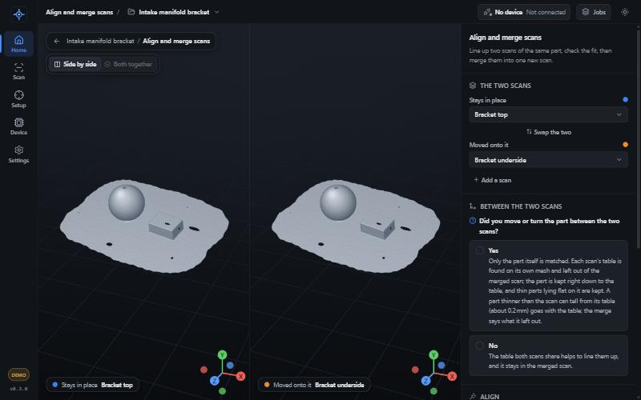
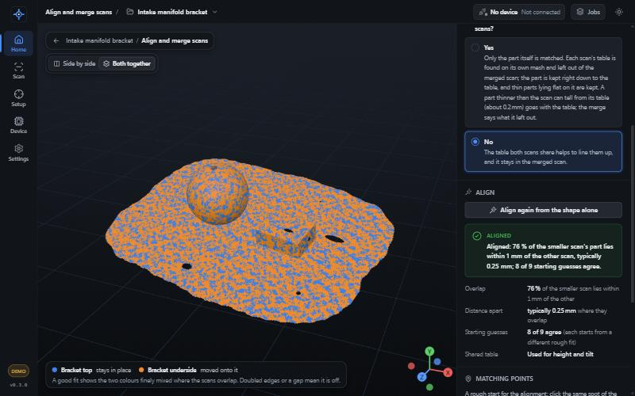
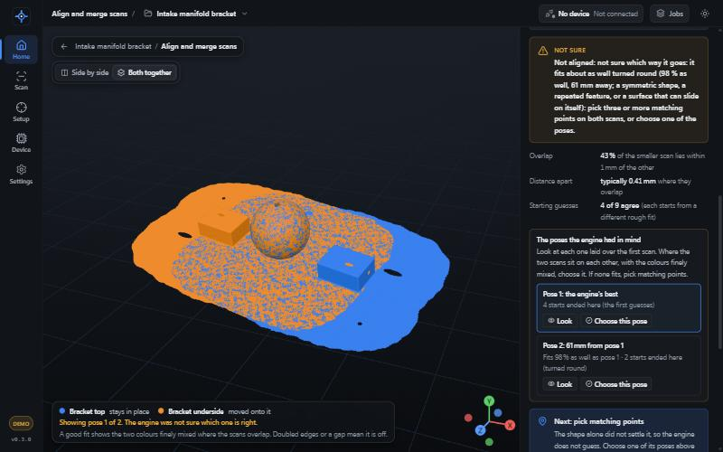
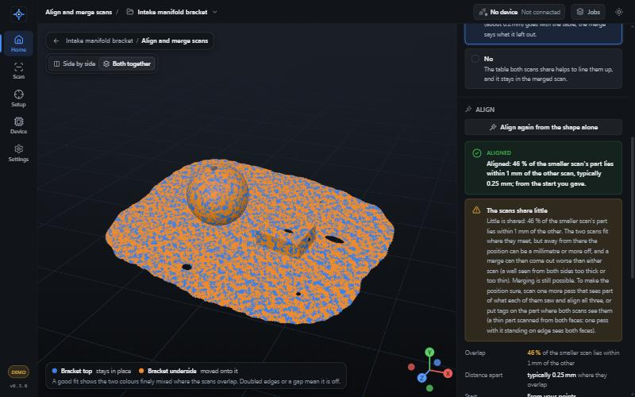
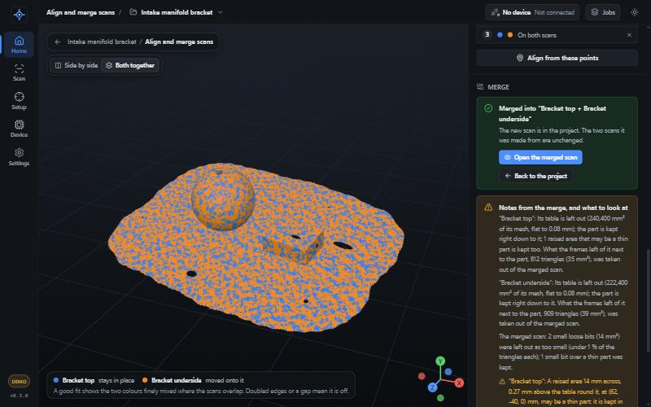
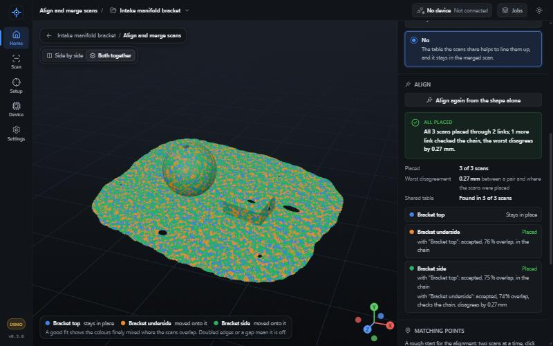

# Aligning and merging scans

This page explains how to put two or more scans of one part together: aligning them on the **Align and merge scans** page, reading the verdict, the caution when the scans share little, and merging them into one new scan. It also says what a merge does and does not improve.

On this page:

- [Why scan a part more than once](#why-scan-a-part-more-than-once)
- [Open the Align page](#open-the-align-page)
- [Was the part moved between the scans?](#was-the-part-moved-between-the-scans)
- [Align two scans from their shape](#align-two-scans-from-their-shape)
- [Read the verdict and the figures](#read-the-verdict-and-the-figures)
- [If the engine is not sure](#if-the-engine-is-not-sure)
- [Align from picked points](#align-from-picked-points)
- [Align from tags](#align-from-tags)
- [The scans share little](#the-scans-share-little)
- [Merge into a new scan](#merge-into-a-new-scan)
- [Several scans at once](#several-scans-at-once)
- [What a merge does and does not improve](#what-a-merge-does-and-does-not-improve)
- [Messages on this page](#messages-on-this-page)

## Why scan a part more than once

One scan rarely sees all of a part. A part lying on a table has an underside the scanner cannot see, and deep corners may be in shadow. Scan it again from the other side (or turned over) and you have two scans that each see part of it. **Aligning** finds how one scan must be moved to sit on the other. **Merging** then builds one new scan from both recordings, with more of the part in it.

The **overlap** is the share of the part that both scans saw. Alignment needs enough of it: plan your second scan so that it sees part of what the first one saw.

## Open the Align page

1. Make the mesh of each scan (see [Making the mesh](make-mesh.md)). Only scans with a mesh can be aligned.
2. On the project page, click **Align and merge scans** (see [Projects and scans](projects.md)).

The page needs two scans with a mesh; otherwise it says **Two scans with a mesh are needed**.

*Two scans side by side before aligning, each named under its view with its colour.*

- **The two scans**: **Stays in place** is the first scan; **Moved onto it** is the second. Choose them from the lists. **Swap the two** changes which stays; the picked points are kept.
- The 3D view shows them **Side by side** (each in its own view, to pick points) or **Both together** (after aligning, the second moved onto the first).
- A scan marked **(merged)**, **(result only)** or **(no recording)** in the lists can be aligned to but not merged (see [Merge into a new scan](#merge-into-a-new-scan)).

## Was the part moved between the scans?

Under **Between the two scans** the page asks: **Did you move or turn the part between the two scans?** No answer is chosen for you, and aligning waits until you answer.

| Answer | What it means | What the alignment and the merge do |
|---|---|---|
| **Yes** | You turned the part over or moved it on the table. Each scan has its own table. | Only the part itself is matched. Each scan's table is found on its own mesh and left out of the merged scan; the part is kept right down to the table, and thin parts lying flat on it are kept. A part thinner than the scan can tell from its table (about 0.2 mm) goes with the table; the merge says what it left out. |
| **No** | The part stayed where it was on the table; you only moved the scanner. | The table both scans share helps to line them up, and it stays in the merged scan. |

Answer **No** only if the part really did not move: the shared table is then used for height and tilt. If the two tables do not line up after all, the figures say **Not used: the two scans' tables did not line up**.

## Align two scans from their shape

1. Answer the question above.
2. Click **Align the two scans**. It "Works from the shape of the two scans and takes a few seconds. Nothing is changed yet."
3. Read the verdict (next section).
4. The view switches to **Both together** by itself. Look: "A good fit shows the two colours finely mixed where the scans overlap. Doubled edges or a gap mean it is off."

*Aligned: the two colours finely mixed where the scans overlap.*

Aligning writes nothing: the scans are not changed until you merge, and even then they stay as they are.

## Read the verdict and the figures

The verdict is one sentence from the engine, under a label:

| Label | What it means |
|---|---|
| **Aligned** | The engine is sure of the pose. You can merge. |
| **Not sure** | The engine had poses in mind but the evidence does not settle which is right. See [If the engine is not sure](#if-the-engine-is-not-sure). |
| **Not sure: check your points** | Your picked points and the shapes disagree. |
| **Not aligned** | No usable pose: too little of the part, no starting guess, too little shared, or a loose fit. Pick matching points. |

An accepted verdict reads, for example: "Aligned: 76 % of the smaller scan's part lies within 1 mm of the other scan, typically 0.25 mm; 8 of 9 starting guesses agree."

Under it, the figures:

| Figure | What it says |
|---|---|
| **Overlap** | The share "of the smaller scan" that "lies within 1 mm of the other". Shown in the warning colour when the scans share little. |
| **Distance apart** | "typically … mm" "where they overlap": how far the two surfaces typically lie from each other where they meet. |
| **Starting guesses** | "… of … agree": the engine starts from several rough fits; the more end at the same pose, the surer it is. Or **Start**: **From your points**, or **From the tags**. |
| **Your points** | "agree to … mm": how well your picked points agree with each other. Shown in the warning colour above 5 mm. |
| **Shared table** | **Used for height and tilt**, or **Not used: the two scans' tables did not line up** (only when you answered **No**). |

**Align again from the shape alone** runs it again. Changing the answer to the question drops the result: click **Align the two scans** again.

## If the engine is not sure

The engine accepts a pose only when enough of the part is shared, the fit is tight, the pose beats every other by a clear margin and at least two different starts reached it. It also tries the pose turned round, because a wrong pose that scores well is most often the right one turned round. When that evidence is not there, it does not guess.

*Not sure: the poses the engine had in mind, to look at and choose from.*

The verdict says why, for example "not sure which way it goes: it fits about as well turned round (98 % as well, 61 mm away; a symmetric shape, a repeated feature, or a surface that can slide on itself)". Under **The poses the engine had in mind**:

1. Pose 1 is shown at first. Click **Look** on another pose to see it instead. A pose is shown laid over the first scan ("Showing pose 1 of 2").
2. "Where the two scans sit on each other, with the colours finely mixed, choose it." Click **Choose this pose**. It is marked **Your choice**; **Undo the choice** takes it back.
3. If none fits, pick matching points (next section).

No merge is offered on a pose the engine was not sure of unless you chose it or picked the points.

## Align from picked points

Picked points give the alignment a rough start. Use them when the shape alone does not settle it.

1. Choose **Side by side** at the top (or click **Pick points** in the hint).
2. Click a spot you can find on both scans (a corner, a hole, an edge), first on one scan, then the same spot on the other. The **Matching points** panel numbers each pair.
3. Do this three times or more, with the points far apart over the part. "A millimetre or two off is fine": the alignment refines it.
4. Click **Align from these points**.

Each row in **Matching points** says **On both scans**, or **Not yet on “…”** when it still needs its second click. The cross removes a point; **Clear all** removes them all.

With points, no second guess has to confirm the pose, so check **Your points**. When they disagree by more than about 5 mm, the page says **Two of your points probably do not match**: compare the numbers on the two scans, remove the one that is off, and align again. When the shapes do not confirm your points, the verdict is **Not sure: check your points**, and merging asks you to confirm first.

## Align from tags

**Tags** are small printed square markers (AprilTags). If both scans saw the same tags, the alignment starts from them by itself; you do nothing more. The figure **Start** then reads **From the tags**, with which tags were used, for example "tags 2, 4 and 5 seen by both scans; tag 3 left out (moved?)".

- Tags are looked for only when you have not picked points.
- Tags keep the pose along directions the shape pins only weakly: a sphere, a cylinder or a plate is then turned as the tags say.
- Tags on the table help only when the part was not moved on it (answer **No**). For a part that was moved, only tags on the part help.
- A merged scan has no recording, so no tags of its own.
- If the start from the tags is not accepted, the engine tries the shape's own guesses instead.

For scanning with markers, see [Scanning](scanning.md).

## The scans share little

When an accepted alignment has an overlap under 70 %, the page shows a caution under the verdict: **The scans share little**.

*An alignment from picked points, accepted with 46 % shared, and the caution.*

What it means, in the app's words: "The two scans fit where they meet, but away from there the position can be a millimetre or more off, and a merge can then come out worse than either scan (a wall seen from both sides too thick or too thin). Merging is still possible."

It is a caution, not an error: **Merge into a new scan** stays available without a further question. Why 70 %: on simulated scans, merges at poses with an overlap of 0.40 to 0.69 came out far worse than the better single scan; those from 0.72 up were sound. The margin is thin and was measured on simulated scans only.

What helps, as the caution says:

- Scan one more pass that sees part of what each of the two saw, and align all three (see [Several scans at once](#several-scans-at-once)).
- Put tags on the part where both scans see them.
- For a thin part scanned from both faces: one pass with it standing on edge sees both faces.

The merge checks the same share itself at the pose it is given (**Checking how much the scans share**, a few seconds). When a pair shares little, the merged scan's notes say so ("… share little where they were merged …"), and its **Processing report** in the viewer lists it under **Notes from the merge**. Compare the merged scan with the scans it was made from.

## Merge into a new scan

Once the scans are aligned:

1. Under **Merge**, check **Name of the new scan**. It starts as the scans' names joined by " + ". If another scan already has that name, the page says so and offers a free one (**Use “…”**).
2. Click **Merge into a new scan**. "Both recordings are rebuilt together into one new scan, which takes about as long as making both meshes. The two scans stay as they are." The progress bar shows the merge; its cancel button stops it and adds nothing.
3. When it is done: **Merged into “…”**. Click **Open the merged scan**, or **Back to the project**.

*The merge done: the new scan is in the project, with the notes from the merge.*

**Notes from the merge** lists what it left out and kept:

- with the part moved, for each scan what was left out of its table, and any raised area kept because it may be a thin part;
- what the cleaning took: small loose bits left out as too small;
- warnings to look at, each naming its scan, such as a pair that shares little.

What a merged scan is:

- A new scan in the project, made from the raw frames of all its scans at the alignment's pose, with the first scan's quality and the first scan's preset values for meshing (mesh detail and thin walls). If another scan was made with other values, a note says so.
- It can be viewed, edited, measured, compared and exported, and another scan can be aligned to it.
- **It has no recording of its own.** It cannot be made again from frames or merged again. To merge again, merge the original scans.
- The scans it was made from are unchanged.

A merge is not offered on a scan without its recording: one already merged, one whose recording was removed to free space (**(result only)**), or one whose recording is missing. The page says why and what you can still do.

## Several scans at once

Up to eight scans can be aligned and merged together.

1. Click **Add a scan** under the list. Each added scan is moved onto the first one. Remove one with its cross; two always stay.
2. Answer **Did you move or turn the part between the scans?**
3. Click **Align the scans**. Every pair of scans is aligned, a few seconds each (3 pairs for three scans, 28 for eight).

*Three scans placed through their best-shared pairs.*

Each scan is placed through the chain of best pairs that reaches it, so two scans that share too little with each other (opposite sides) can both be placed through a third. The verdict is **All placed** or **Not all placed**, with:

- **Placed**: how many scans were placed.
- **Worst disagreement**: how far a pair that checks the chain disagrees with where the scans were placed. Above 2 mm: "That is a lot: look at the scans together before merging."
- **Left out**: pairs that did not fit the others.
- **Shared table**: in how many scans it was found.
- Each scan: **Stays in place**, **Placed** or **Not placed**, with a line for each of its pairs ("with “…”: accepted, 76 % overlap, in the chain").

When a scan is not placed, pick matching points between it and a placed scan: choose the pair under **Pick on**, pick three or more points, then **Align from these points**. Or remove the scan from the list. Merging is not possible while a scan is not placed. When a pair disagrees by more than 2 mm, merging asks you to confirm (**Merge although a pair disagrees?**).

The caution **The scans share little** works as for two scans, but only for the pairs that hold the scans together.

## What a merge does and does not improve

A merge gives you **more of the part** in one scan. On today's engine it does **not** make the part more accurate than the better of the scans it was made from. This was measured on simulated scans (VALIDATION.md, "The merge on today's engine"):

- A merge averages. Where only one scan saw a place well, the merged surface is pulled towards the other scan's poorer view, by 0.5 to 1 mm in the study. Nothing thin went missing.
- The pose decides a pair that shares little. Opposite sides of a bracket, sharing 46 %, were aligned about 1 mm off, and the merge was ruined (a wall 0.8 mm too thick). That is why the caution above exists.
- Thin walls: only a merge sees both faces of a wall, but a thin wall can come out too thick or too thin in it.
- Scans of different calibrations merge too; each scan's frames are processed with its own calibration.

So: merge to fill in what one scan could not see. To measure a feature, use the scan that saw it best, or check the merged scan against it. For the most reliable merge, plan scans that share well over 70 % of the part.

## Messages on this page

| Message | What it means | What to do |
|---|---|---|
| **Two scans with a mesh are needed** | The project has fewer than two scans with a mesh. | Scan the part again, or make the mesh of another scan, on the project page. |
| "Answer the question above first: did you move or turn the part?" | Aligning waits for the answer. | Click **Answer it**, then **Yes** or **No**. |
| **Not sure** | The shape alone did not settle the pose. | **Look** at the poses and **Choose this pose**, or pick matching points. |
| **Not aligned** | No usable pose. | Pick three or more matching points; scan with more overlap. |
| **Next: pick matching points** | The shape alone did not settle it. | Click three or more matching spots on both scans, then **Align from these points**. |
| **Check your points, or add more** | Your points did not give an accepted pose. | Remove a point that is off, add points further apart, align again. |
| **Two of your points probably do not match** | The picked points disagree by more than about 5 mm. | Remove the point that is off, align again. |
| **The scans share little** | Accepted, but under 70 % shared: the position can be off away from where they meet. | Add a pass that sees part of both, or tags; or merge and compare. |
| "The engine is not sure where the second scan goes, so there is nothing to merge at yet. …" | No merge on a pose the engine was not sure of. | Choose a pose, or align from points. |
| "The shapes did not confirm your points, so the second scan may be in the wrong place. Merging asks you to confirm." | Your points and the shapes disagree. | Look at both together; **Merge anyway** only if they sit on each other. |
| **Merge at your points although the shapes did not confirm them?** | The confirmation for the above. | **Merge anyway**, or check your points (two may be swapped) and align again. |
| **Merge although a pair disagrees?** | Several scans: not all placed, or a pair disagrees by more than 2 mm. | Look at the scans together first; pick points and align again if one does not sit. |
| "… is not placed, so the scans cannot be merged yet." | A scan of the list has no pose. | Pick points between it and a placed scan, or remove it. |
| **“…” cannot be merged again** | It is a merged scan and has no recording of its own. | Align to it; merge the scans that were recorded instead. |
| **“…” cannot be merged** | Its recording was removed to free space, or is not on disk. | Choose scans that still have their recordings. |
| "Another scan of this project is already called “…”." | The merged scan's name is taken. | Click **Use “…”** or type another name. |
| **Merging was cancelled** | You stopped the merge. Nothing was added; the scans are unchanged. | Merge again when you are ready. |
| **Couldn't open the mesh of “…”** | A scan's mesh could not be loaded. | **Try again**. See [Troubleshooting](troubleshooting.md). |
| **Notes from the merge, and what to look at** | The merge has warnings: a table not found, a pair that shares little, a preset that differs. | Open the merged scan and compare it with its scans. |
