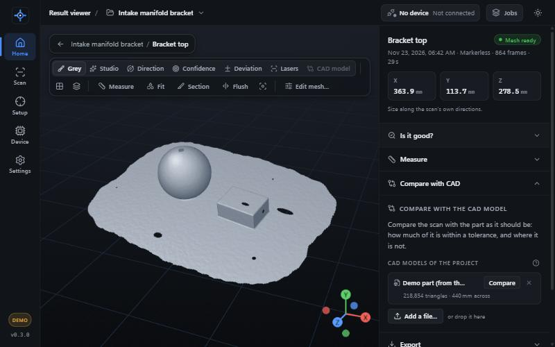
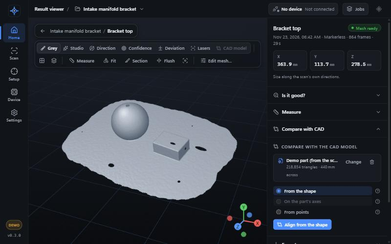
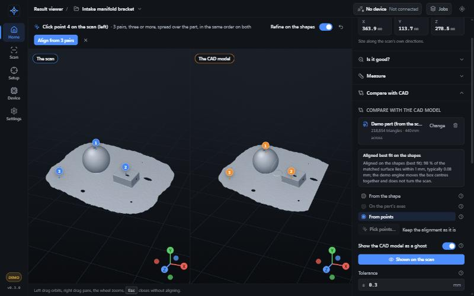
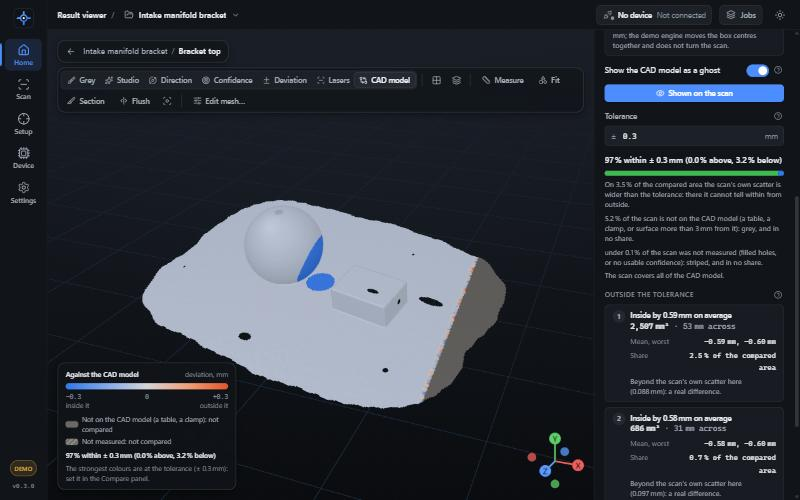

# Comparing a scan with a reference

This page explains how to compare a scan with the part as it should be: a CAD model, or a scan of a good part. You add the reference, align the scan with it, and the app colours the scan by how far it is from the reference and lists the areas outside your tolerance.

On this page:

- [What a comparison tells you](#what-a-comparison-tells-you)
- [Add a reference](#add-a-reference)
- [If the app asks about units](#if-the-app-asks-about-units)
- [Align the scan with the reference](#align-the-scan-with-the-reference)
- [Align from picked points](#align-from-picked-points)
- [Read the comparison](#read-the-comparison)
- [The deviation colours](#the-deviation-colours)
- [The areas outside the tolerance](#the-areas-outside-the-tolerance)
- [Limits](#limits)
- [Messages on this page](#messages-on-this-page)

## What a comparison tells you

A **reference** is the part as it should be. A **deviation** is how far a point of the scan lies from the reference, measured square to its surface: **+** where the scan lies outside the reference (material where there should be none), **−** where it lies inside (material missing). The comparison answers "how much of the part is within the tolerance, and where is the rest", for example "87 % within ± 0.3 mm (8.2 % above, 5.2 % below)".

The comparison is in the viewer, in the side panel's **Compare with CAD** group, panel **Compare with the CAD model**. Open the scan first (see [The result viewer](viewer.md)).

## Add a reference

A reference belongs to the project: once added, every scan of the project can be compared with it. A scan keeps one comparison at a time.

*The CAD models of the project, ready to compare.*

1. Open **Compare with CAD**.
2. Under **CAD models of the project**, click **Add a file…** and choose the file, or drop the file on the panel.
3. Wait while the app reads and checks it: "a few seconds for a large one".
4. Click **Compare** beside the model. The panel then shows the model you chose, with **Change** and a bin icon, and the ways to align (next sections).

What the file must be:

- An **STL**, **OBJ** or **PLY** mesh, in mm, up to 100 MB. A STEP file must be exported as STL first, from your CAD program.
- To compare with another scan of a good part, download that scan's **STL** from its viewer (see [The result viewer](viewer.md#download-the-scan)) and add it here.

Each model in the list shows its triangles and size. Rename it with the pencil; remove it from the project with its cross, which also removes the comparisons that use it. **Change** picks another model; the bin icon removes this scan's comparison (the model stays with the project).

In demo mode, each project with a processed scan already has a model, "Demo part (from the scan).stl": the scan's own surface with one end left out and a round patch moved 0.6 mm out, so you can try the panel without a file.

## If the app asks about units

CAD files carry no units. When the model and the scan are very different in size, the app asks, for example **Is the CAD model in inches?**, and shows both sizes:

- **It is in inches: scale it by 25.4** (or centimetres, metres, micrometres), with the size it then has;
- **Keep it as it is (mm)**, with the size as read.

The line under them gives the scan's own size for comparison. Nothing is aligned until you answer. Changing the units later drops the alignment.

## Align the scan with the reference

The scan and the model are in different positions. **Aligning** finds how to move the scan onto the model. Choose one of three ways:

*Choosing how to align the scan with the CAD model.*

| Way | What it does | Use it when |
|---|---|---|
| **From the shape** | A best fit: the scan is moved until its surface matches the CAD model as closely as it can overall. Takes a few seconds. | Most parts. But an overall error of the part (a little too long, bent, shifted) is spread over the whole part, so it shows as small deviations everywhere instead of where it is. |
| **On the part's axes** | No fit at all: the part's axes (set from three saved fitted shapes) are put onto the CAD model's own axes. | The CAD model is modelled in the part's axes, and you want an overall error to show where it is: a part 0.5 mm too long reads 0.5 mm at the far end. Needs the part's axes, set and up to date (see [Measuring on the scan](measuring.md#set-the-parts-axes)). |
| **From points** | You click three or more matching points on the scan and on the CAD model. The points are then refined on the shapes (a best fit), unless you turn that off. | The shape alone does not find where the scan goes: a symmetric part, or a scan of only a small part of it. |

1. Choose the way.
2. Click **Align from the shape** or **Align on the part's axes** (or **Pick points…**, below).
3. Read the result: **Aligned …** with the engine's verdict and notes. For a best fit made while the part's axes are set, a note says how far it lies from the pose on the part's axes.

**Again** shows the ways to align once more; **Keep the alignment as it is** goes back without changing it. An alignment the engine does not accept is shown as **Not aligned (…)** and not kept: "The alignment kept before stays."

## Align from picked points

*Picking matching points: the scan on the left, the CAD model on the right.*

1. Choose **From points**, then click **Pick points…**. The scan and the CAD model open side by side.
2. Click a spot on the scan (left), then the same spot on the CAD model (right). The top line says what to click next.
3. Repeat, three times or more, spread over the part, in the same order on both. Corners, hole edges and sharp edges are easy to find again.
4. Leave **Refine on the shapes** on to finish with a best fit from there (a few seconds); turn it off to use the points as they are.
5. Click **Align from … pairs**.

**Take the last point back** (the undo arrow) removes the last point. **Esc** or the cross closes without aligning. In both views, left drag orbits, right drag pans, the wheel zooms.

## Read the comparison

Once aligned, the panel shows:

- **Show the CAD model as a ghost** (on at first): draws the model faintly over the scan where the alignment puts it, to judge it by eye.
- **Show it on the scan**: turns on the **CAD model** colour mode (key **7**). The button then reads **Shown on the scan**.
- **Tolerance**: how far the surface may be from the CAD model (± mm, 0.3 to start). The answer follows each number you type; the arrow keys change it by 0.05.
- The answer, for example "87 % within ± 0.3 mm (8.2 % above, 5.2 % below)", and a bar: green within, then above, then below.
- A line when the scan's own scatter is wider than the tolerance somewhere: "there it cannot tell within from outside."
- What was not compared and why:
  - "… of the scan is not on the CAD model (a table, a clamp, or surface more than 3 mm from it): grey, and in no share."
  - "… of the scan was not measured (filled holes, or no usable confidence): striped, and in no share."
  - "… of the CAD model's surface was not scanned: nothing is said about it." or "The scan covers all of the CAD model."

The shares are of the compared area only.

## The deviation colours

*Against the CAD model: blue inside it, red outside it, grey where not compared.*

The legend **Against the CAD model** (bottom left):

| Colour | Meaning |
|---|---|
| Blue | Inside the CAD model (material missing), up to the tolerance |
| Light grey | On it |
| Orange-red | Outside the CAD model (extra material), up to the tolerance |
| Dark grey | **Not on the CAD model (a table, a clamp): not compared** |
| Striped | **Not measured: not compared** |

The strongest colours are at the tolerance (± the value in the panel). Under the mouse pointer the viewer shows the deviation there, for example "+0.12 mm (outside)", "−0.30 mm (inside)", "not on the CAD model" or "not measured".

## The areas outside the tolerance

Under **Outside the tolerance**, the areas are listed largest first (six, then **Show all … areas**). Each shows:

- **Outside by … on average** or **Inside by … on average**, its size in mm² and how far it reaches;
- **Mean, worst**: its mean and worst deviation;
- **Share**: how much of the compared area it is;
- whether it is beyond the scan's own scatter there.

Click an area to light it on the mesh and turn the view to it.

That last line matters. **The scan's own scatter** is its ± (see [Measuring on the scan](measuring.md#what-the--means)); the app compares each area's deviation with twice the scan's typical ± there:

| Line | What it means |
|---|---|
| "Beyond the scan's own scatter here (…): a real difference." | The deviation is larger than the scan's own scatter. |
| "Within the scan's own scatter here (…): this alone is no evidence of a real difference. Scan it again more closely to tell." | It could be the scan's error as much as the part's. |
| "The scan carries no confidence here, so it cannot tell a real difference from its own error." | The mesh has no ± there. |

Smaller areas count in the shares but are not listed. "No area outside the tolerance is large enough to list." means just that.

## Limits

- **The scatter is not the accuracy.** "Beyond the scan's own scatter" rules out the scan's scatter, not a calibration or scale error, nor an error a whole region shares. The software has been tested on simulated scans only.
- **Known errors of the scan show up as deviations.** Thin walls read too thick, bosses read small and small holes are filled in (see [Known biases](measuring.md#known-biases)); the comparison shows these like any other difference.
- **From the shape spreads overall errors.** A best fit hides a part that is too long or bent by spreading the error. Use **On the part's axes** to see it where it is.
- **What was not scanned is not judged.** The app says how much of the model the scan did not cover.
- **When the mesh changes** (an edit, or the mesh made again), the alignment is kept, because the scan's axes stay the same, and the deviation is worked out again: "The mesh has changed since the scan was aligned with the CAD model."
- **Files:** STL, OBJ or PLY only, up to 100 MB. Large models are shown with fewer triangles ("shown with …") but compared in full.

The report (see [Measuring on the scan](measuring.md#the-report)) includes the comparison: the reference, its units, the alignment, and the answer at the panel's tolerance.

## Messages on this page

| Message | What it means | What to do |
|---|---|---|
| "a reference must be an STL, OBJ or PLY mesh; … (export a STEP or other CAD file as STL first)" | The file is not a mesh. | Export the model as STL from your CAD program. |
| **Is the CAD model in …?** / **The CAD model and the scan are very different in size** | The sizes do not match as mm. | Choose the scale, or **Keep it as it is (mm)**. |
| **Not aligned (…)** | The engine did not accept the alignment. "The alignment kept before stays." | Try **From points**, with points spread over the part. |
| **The alignment failed** | The alignment could not run. | Read the reason; try again. |
| "Set the part's axes first (the panel “The part's axes”)." | **On the part's axes** needs them. | Set the part's axes, see [Measuring on the scan](measuring.md#set-the-parts-axes). |
| "The part's axes are out of date: set them again first." | A fit they were set from changed. | **Set again** in the part's axes panel. |
| **The CAD model is gone** | The model this comparison used was removed from the project. | **Change** to another model. |
| "The mesh has changed since the scan was aligned with the CAD model. …" | The mesh was edited or made again. The alignment is kept and the deviation worked out again. | Nothing; align again if the part's position changed. |
| "Couldn't read the CAD model's mesh: …" | The model's display copy could not be loaded; the ghost and **From points** need it. | Reload the page; add the file again if it persists. |
| "Nothing of the scan could be compared with the CAD model." | No compared surface: misaligned, or not the same part. | Check the alignment with the ghost. |
| "Compare the scan with a CAD model first (the Compare panel)" | The **CAD model** colour mode is greyed out. | Add a model and align. |
| "Align the scan with a CAD model in the Compare panel first." | The legend has nothing to show yet. | Align first. |
