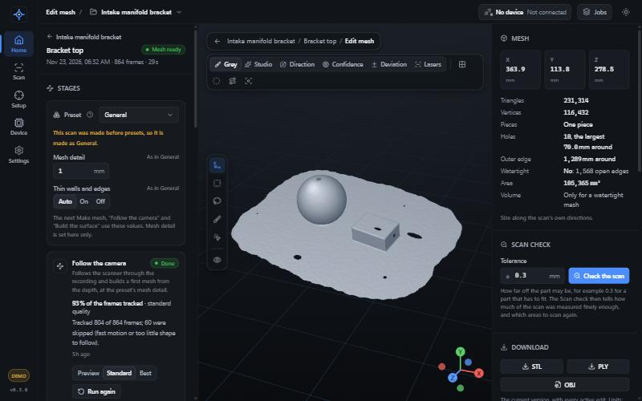
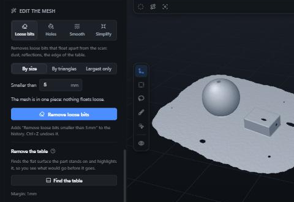
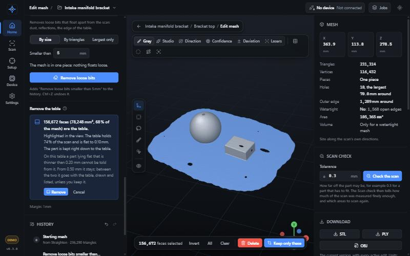
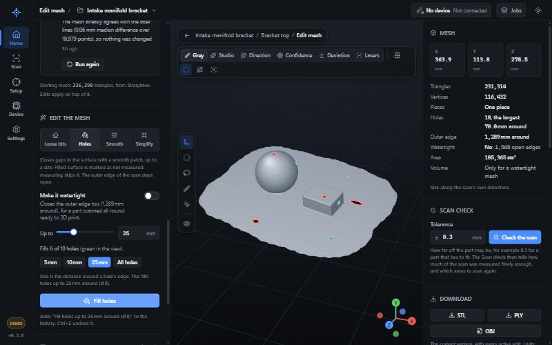
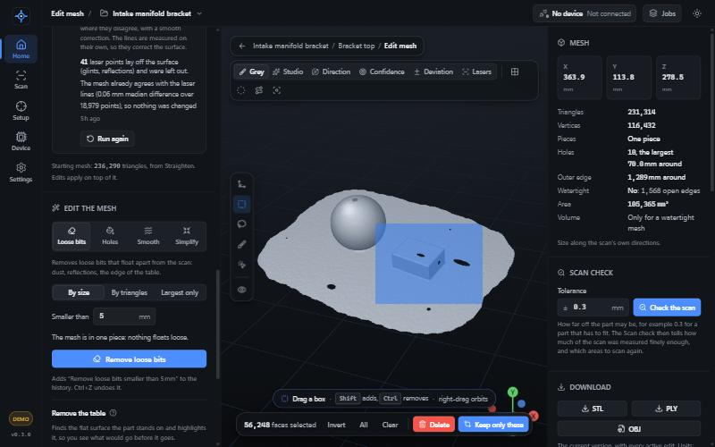
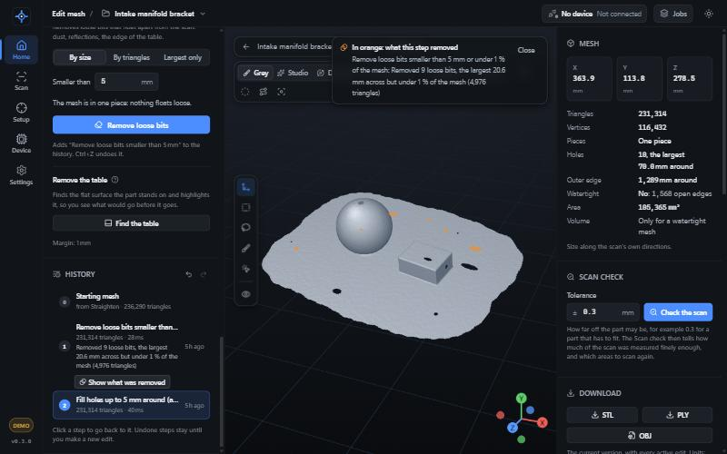
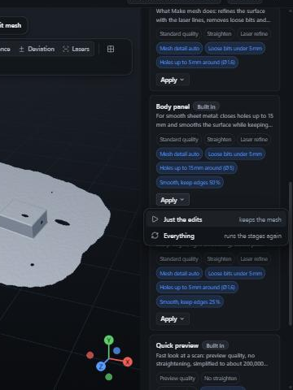

# Cleaning a mesh

This page explains how to clean up a mesh on the Edit mesh page: removing loose bits and the table, filling holes, smoothing, simplifying, selecting faces by hand, undo and the history, recipes, and what each edit does to your measurements.

On this page:

- [The Edit mesh page](#the-edit-mesh-page)
- [How edits work](#how-edits-work)
- [Remove loose bits](#remove-loose-bits)
- [Remove the table](#remove-the-table)
- [Fill holes](#fill-holes)
- [Smooth](#smooth)
- [Simplify](#simplify)
- [Select faces by hand](#select-faces-by-hand)
- [Undo and the history](#undo-and-the-history)
- [See what was removed](#see-what-was-removed)
- [Thin parts are never removed without a word](#thin-parts-are-never-removed-without-a-word)
- [Recipes](#recipes)
- [Save your own recipe](#save-your-own-recipe)
- [What edits do to measurements](#what-edits-do-to-measurements)
- [How long edits take](#how-long-edits-take)
- [Messages on this page](#messages-on-this-page)

## The Edit mesh page

To open it, click **Edit mesh…** on a scan's row on the project page (see [projects.md](projects.md)), or in the viewer. The page has three parts:

- **On the left**: the **Stages** that make the mesh (see [make-mesh.md](make-mesh.md#run-the-stages-one-at-a-time)), the **Edit the mesh** panel with its four tabs, and the **History**.
- **In the middle**: the 3D view. At the top are the view options; on the left edge, the selection tools.
- **On the right** (in a window at least 1280 pixels wide; under the history otherwise): the **Mesh** numbers, the **Scan check**, **Download** and **Recipes**.

*The Edit mesh page: stages, edits and history on the left, the view in the middle, numbers, downloads and recipes on the right.*

The view options:

| Option | Key | What it shows |
|---|---|---|
| Shading: **Grey**, **Studio**, **Direction** | 1, 2, 3 | Plain grey, studio lighting, or colour by the direction the surface faces. |
| Shading: **Confidence** | 4 | How well each point was measured. Only for meshes made with a graphics card. |
| Shading: **Deviation** | 5 | How far your edits moved the surface from the mesh as measured. Only once there are edits. |
| Shading: **Lasers** | 6 | Where the laser lines and the mesh agree, and where they differ. |
| **Wireframe** | W | The triangles' edges. |
| **Hole outlines** | O | The edges of the holes, with their count. |
| **Camera path** | T | The scanner's path, as tracked and straightened. |
| **Frame the model** | F | Fits the whole mesh in the view. |
| Compare: **Now**, **Before**, **Both** | K | After a change: the current mesh, the mesh before the last change, or the previous mesh as an orange ghost over the current one. |

To move the view: orbit with a left drag (a right drag while selecting), pan with a right drag (the middle button while selecting), zoom with the wheel. Press **?** for the list of keyboard shortcuts.

## How edits work

The mesh the stages made is the **starting mesh**. Each edit you apply goes on top of it, in order, and is listed in the history. Every edit can be undone. The current mesh, the starting mesh with your edits, is what the viewer shows and what you download.

To apply an edit:

1. In **Edit the mesh**, pick a tab: **Loose bits**, **Holes**, **Smooth** or **Simplify**.
2. Set its values. The line under the button says what will be added to the history.
3. Click the button (**Remove loose bits**, **Fill holes**, **Smooth**, **Simplify**).

A running edit shows its progress at the top right of the view. Only one job runs on a scan at a time: wait for it before you start the next edit.

Running a stage again, or making the mesh again, gives a new starting mesh and clears your edits. Save them as a recipe first if you want them back (see [Save your own recipe](#save-your-own-recipe)).

## Remove loose bits

Removes loose bits that float apart from the scan: dust, reflections, the edge of the table. A **piece** is a set of triangles joined through shared edges.

*The Loose bits tab: choose which pieces go, then Remove loose bits.*

| Choice | What goes |
|---|---|
| **By size** | Pieces smaller than the size you give, in mm across (default 5 mm). |
| **By triangles** | Pieces with fewer triangles than you give (default 500). |
| **Largest only** | Everything but the biggest piece, the scan itself. |

The tab says how many pieces the mesh is in now. The largest piece is never removed.

After the edit, its line in the history says how many bits went and how large the largest was, and which rule took it. A piece under 1 % of the mesh can be large: the Default recipe removes pieces "smaller than 5 mm or under 1 % of the mesh". If the largest is larger than you expected, click **Show what was removed** (see [See what was removed](#see-what-was-removed)).

## Remove the table

A single scan often keeps part of the table the part stood on. **Remove the table**, at the foot of the **Loose bits** tab, finds that flat surface and shows you what would go before anything goes.

1. Click **Find the table**. Nothing changes yet.
2. The table's faces are highlighted in the view, as a selection: the selection bar at the bottom of the view says how many faces. The box says how many faces and how much of the mesh they are, how flat the table is, and whether the part is kept right down to the table.
3. Look at the raised areas the box lists (see below).
4. Click **Remove** to remove the table as an edit, or **Cancel** to let it go.

*Remove the table: what would go is highlighted first; Remove makes it an edit you can undo.*

What it keeps: every face turned more than 45° from the table, at any height, so the part's walls stay right down to the table. Where the part meets the table, the lower half of the rounded edge goes with the table.

**Thin parts lying flat** (a shim, a gasket, a sheet) get special care. Raised areas on the table are drawn and listed:

| Colour and words | What it means | What you can do |
|---|---|---|
| Green, **A thin part, kept:** | A thin part lying flat that the engine is sure of. It stays. | **Look** turns the view to it. |
| Amber, **Goes with the table, may be a thin part:** | A raised area the engine is not sure of. It goes with the table unless you keep it. | **Look**, then **Keep this** to keep it. |
| **Kept, as you chose:** | An area you kept. | **Let it go** to remove it with the table after all. |

The box also says this scan's own limit: how thin a part it can tell from the table, which depends on how flat the table is.

**Margin** (1 mm by default, 0 to 20 mm): how far above the table a face that faces the table's way still counts as the table. Click **Margin: 1 mm** to change it. 1 mm kept the most of the part on the simulated scans.

If the scan has no table, or the largest flat surface is the part's own face, the app says **No table to remove** and why, and removes nothing. Select the table by hand then (see [Select faces by hand](#select-faces-by-hand)).

## Fill holes

Closes gaps in the surface with a smooth patch, up to a size. A hole's size is the length around its edge: "15 mm around (Ø 5)" is a round hole about 5 mm across.

*The Holes tab: the holes that the size you set would fill are green in the view.*

1. Open the **Holes** tab. The hole edges are drawn on the mesh.
2. Set **Up to** with the slider, the number field, or the buttons **5 mm**, **10 mm**, **25 mm** and **All holes**. The tab says how many holes this fills, and they turn green in the view.
3. Click **Fill holes**.

The outer edge of the scan stays open. To close it too, turn on **Make it watertight**: for a part scanned all round, ready to 3D print. The button then reads **Make watertight**.

Filled surface is marked as not measured: it is drawn striped grey, and measuring skips it. The **Mesh** panel shows its area as **Filled ... not measured**.

## Smooth

Evens out scan noise. Choose the method, the strength and where to smooth.

| Setting | Choices |
|---|---|
| **Taubin** | Even smoothing that keeps the size: good for body panels and curved surfaces. With **Protect sharp edges** (on by default) it leaves corners and creases alone. |
| **Keep edges** | Smooths the flat and gently curved areas but keeps sharp edges crisp: brackets, flanges, machined parts. |
| **Strength** | From **Light** to **Strong** (50 % for Taubin, 30 % for Keep edges, when you pick the method). |
| **Where to smooth** | **Everywhere**, **Off edges** or **Flat only** (see below). |
| **Stay within each point's scatter** | Off by default. No point moves further from where it was measured than the scan's own scatter there. Needs a mesh with confidence data (made with a graphics card). It does not protect edges. |

**Where to smooth**, as measured on simulated scans:

| Choice | What it does |
|---|---|
| **Everywhere** | Evens out the noise on the whole part. It also rounds sharp edges: 17 to 46 % of the edge points moved by more than 0.05 mm. |
| **Off edges** | Leaves 1.5 mm on each side of a sharp edge as scanned and smooths everything else, round features too. 1 to 8 % of the edge points moved. |
| **Flat only** | Smooths only where the surface is flat. Edges, corners and small round features stay as scanned: 0 to 4 % of the edge points moved. |

Measuring edges or holes? **Flat only** keeps them truest.

## Simplify

Fewer triangles for a lighter file. Flat areas give up triangles first; edges and curves keep theirs.

| Choice | What you set |
|---|---|
| **Accuracy** (the default) | A tolerance: **0.01 mm**, **0.02 mm**, **0.05 mm**, **0.1 mm** or your own. As few triangles as the surface allows while it stays within about this distance of the scan. The outer edge keeps every point. |
| **Percent** | The share of the triangles to keep, 5 to 95 %. |
| **Triangle count** | A target number of triangles. |

The history entry says how far the surface actually moved.

## Select faces by hand

For anything the edits do not catch, select faces in the view and delete them, or keep only them.

*Selecting by hand: the selected faces are highlighted, and the bar at the bottom says how many.*

The tools are on the left edge of the view:

| Tool | Key | How to use it |
|---|---|---|
| **Orbit the view** | V | No selecting. Esc also brings you back here. |
| **Box select** | B | Drag a box. |
| **Lasso select** | L | Draw around the faces. |
| **Brush select** | P | Paint over the faces. [ and ] change the brush size. |
| **Select a connected piece** | C | Click a piece. |

With any tool, hold **Shift** to add to the selection and **Ctrl** to remove from it. By default only visible faces are selected; the eye button below the tools switches to selecting through the model, hidden faces too.

The selection bar at the bottom of the view:

| Button | Key | What it does |
|---|---|---|
| **Invert** | Ctrl+I | Selects what is not selected. |
| **All** | Ctrl+A | Selects everything. |
| **Clear** | Ctrl+Shift+A | Clears the selection. |
| **Delete** | Delete or Backspace | Deletes the selected faces, as an edit. |
| **Keep only these** | | Crops the mesh to the selected faces, as an edit. |

Any change of the mesh (an edit, undo or redo) clears the selection, and the app says so.

## Undo and the history

The **History** panel lists the **Starting mesh** (step 0, with the stage that made it) and every edit after it, with its triangles, how long it took and when.

| To | Do this |
|---|---|
| Undo the last edit | The undo arrow in the History panel, or Ctrl+Z. |
| Redo it | The redo arrow, or Ctrl+Y (Ctrl+Shift+Z too). |
| Go back to any step | Click that step. Click the **Starting mesh** to undo every edit. |
| Go forward again | Click a greyed step. |

Undone steps are greyed and crossed out, and stay until you make a new edit: a new edit drops them. The last 10 steps are instant; an older one takes as long as replaying its edits.

The **Before** and **Both** views (K) compare the current mesh with the one before the last change.

If you freed space on the scan (see [projects.md](projects.md#free-space)), the old undo steps are gone: undo stops at the mesh the scan had then. New edits can be undone as usual.

## See what was removed

Each **Remove loose bits** entry in the history that removed something has **Show what was removed**. It shows the mesh before that step as an orange ghost beside the mesh after it: what was removed shows in orange. A box at the top right names the step and what it took. Click **Close**, or the button again, to hide it. It works at any time, also for an older or undone step.

*Show what was removed: the mesh before the step, in orange, beside the mesh after it.*

Right after the edit the same view comes from the Compare control's **Both**. For very large meshes the app does not load the extra meshes, and says so: this computer would run short of memory.

## Thin parts are never removed without a word

A part can be a fraction of a millimetre thick, so the edits that remove things tell you what they took:

- **Remove loose bits** says how many pieces went and how large the largest was, and offers **Show what was removed**. A large piece can be part of the real part.
- **Remove the table** lists every raised area it is not sure of, draws it in amber and offers **Keep this**. Thin parts lying flat that it is sure of are kept and drawn green.
- **Smooth** tells you, per choice of **Where to smooth**, how much it moves edges.

Look before you rely on a thin part, and use undo if something went that should have stayed. See also [If thin walls are found](make-mesh.md#if-thin-walls-are-found).

## Recipes

A **recipe** is a named set of stage settings (quality, Straighten, Refine with lasers, mesh detail) and edits, to apply in one click. Make mesh runs the **Default** recipe. The **Recipes** panel lists the built-in recipes first, then yours. The chips under each recipe show its settings and its edits.

*The Recipes panel: each recipe with its settings and edits; Apply runs just the edits or everything.*

The built-in recipes:

| Recipe | What it does |
|---|---|
| **Default** | What Make mesh does: refines the surface with the laser lines, removes loose bits and closes pin holes up to 5 mm. No smoothing and no simplification, so measurements stay true to the scan. |
| **Body panel** | For smooth sheet metal: closes holes up to 15 mm and smooths the surface while keeping creases and edges. |
| **Bracket / mechanical** | For brackets and machined parts: keeps sharp edges, light smoothing, closes pin holes up to 5 mm. |
| **Quick preview** | Fast look at a scan: preview quality, no straightening, simplified to about 200,000 triangles. Not for measuring. |

To apply a recipe, click **Apply** under it and choose:

| Choice | What it does |
|---|---|
| **Just the edits** ("keeps the mesh") | Keeps the starting mesh and replaces your edits with the recipe's. Each of the recipe's edits becomes a step of the history. |
| **Everything** ("runs the stages again") | Runs Follow the camera, Straighten and Refine with lasers again with the recipe's settings, then its edits. The new mesh is built beside the one you have (see [make-mesh.md](make-mesh.md#make-the-mesh-again)). |

If the scan has edits, the app asks first, because both replace them.

A preset can name a recipe (**Recipe after meshing**): Make mesh then runs that recipe instead of Default (see [make-mesh.md](make-mesh.md#presets-and-mesh-detail)).

## Save your own recipe

1. Make the edits you want on one scan.
2. In the **Recipes** panel, click **Save as recipe…**.
3. Give it a **Name** and, if you like, a **Description**. The dialog shows **What it keeps**: the stage settings and the edits.
4. Click **Save recipe**.

It is in the recipe list for every scan. Deleting and keeping a selection are left out, because they only fit this scan. To delete one of your recipes, click its bin button and **Delete recipe**. Scans you already processed with it keep their meshes and history. Built-in recipes cannot be deleted.

**Repeatable edits.** Where two choices are equally good (which piece is the largest of two equal ones, how to close a hole), an edit can come out slightly differently when the mesh lists its points in another order, as a mesh made on the graphics card does on every run. The engine's settings file has an option, `repeatable_edits` under `[process]`, off by default, that makes such edits give the same result every time. It is not in the app's Settings page.

## What edits do to measurements

| Edit | Effect on the surface | Effect on measurements |
|---|---|---|
| Remove loose bits, Remove the table, Delete, Keep only these | Removes faces. The rest does not move. | Measurements on the part stay the same, unless what you removed was part of it. |
| Fill holes | Adds a patch where nothing was measured. | Filled surface is marked as not measured; measuring skips it. |
| Smooth | Moves the surface. | Sizes can change, most at edges. The **Deviation** shading shows how far the edits moved the surface. Use **Flat only** to keep edges and holes truest. |
| Simplify | Removes triangles within a tolerance. | With **Accuracy**, the surface stays within about the tolerance; the history says how far it moved. |

Fitted shapes and measurements you saved in the viewer stay after an edit, an undo or a redo, but they are marked as made on an earlier mesh, and their numbers are that mesh's. **Fit again** in the viewer measures the current mesh. See [measuring.md](measuring.md).

## How long edits take

Measured on a mesh of 1.3 million triangles, on the processor of the development PC (an AMD Ryzen 7 7735U), from software/docs/APP_API.md:

| Edit | Time |
|---|---|
| Remove loose bits | about 1.1 s (on 1.7 million triangles) |
| Fill holes up to 5 mm / 80 mm | 1.5 s / 3.4 s |
| Smooth, Taubin 50 % | 1.8 s (3.7 s with sharp edges protected) |
| Smooth, Keep edges 50 % / 100 % | 5.0 s / 9.1 s |
| Simplify to 200,000 triangles | 9.2 s |
| Delete or keep a selection | 0.05 s |
| Undo or redo | 0.3 s |

Each edit adds about 2 s at this size for the mesh's numbers and its files.

## Messages on this page

| Message | What it means | What to do |
|---|---|---|
| **Edits need a mesh: run "Follow the camera" first.** | The scan has no mesh yet. | Make the mesh (see [make-mesh.md](make-mesh.md)). |
| **Waiting for the running job to finish.** | Another job runs on the scan. | Wait, or cancel it. |
| **No holes to fill** / **No hole is that small** | Nothing matches the size you set. | Raise **Up to**, or leave it. |
| **The mesh is already watertight** / **No opening is that small** | Make watertight has nothing to close at this size. | Raise **Up to**, or leave it. |
| **Choose a strength above 0** | Smooth at 0 % does nothing. | Raise the strength. |
| **The mesh already has ... triangles** | The triangle target is not below the current count. | Choose a smaller target. |
| **Selection cleared** | The mesh changed, so the selection no longer fits it. | Select again. |
| **The mesh changed** | The selection was made on an older version. | Select again. |
| **That's the whole mesh** | You tried to delete every face. | Select less, or use **Keep only these**. |
| **Nothing to crop** | Every face is selected. | Select only the faces to keep. |
| **No table to remove** | No table was found, or the largest flat surface is the part's own face. | Select the table by hand and press **Delete**. |
| **Couldn't find the table** | The search failed. | Try again. |
| **Find the table again on the current mesh.** | The mesh changed after the table was found. | Click **Find the table** again. |
| **Not shown: these meshes are too big** | Showing what was removed would need too much memory. | The history still says what was removed. |
| **Run "..." again?** | Running a stage again clears your edits. | Click **Run it again**, or save a recipe first. |
| **Replace the edits with "..."?** | Applying **Just the edits** replaces yours. | Click **Replace the edits**, or cancel. |
| **Run everything again with "..."?** | Applying **Everything** clears your edits and runs the stages. | Click **Run everything again**, or cancel. |
| **Give the recipe a name.** | The recipe has no name. | Type a name. |
| **Saved "..."** | Your recipe is saved for every scan. | |
| **Couldn't load the recipes** | The engine could not read the recipes. | Click **Try again**. |
| **There is nothing to undo: the earlier steps were removed to free space.** | You freed space on this scan. | New edits can be undone as usual. |
| **Couldn't load the holes** / **Couldn't load the trajectory** | An overlay could not be read. | Try again. |
| **Couldn't load the new version: ...** | The changed mesh could not be loaded. | Click **Retry**. |
