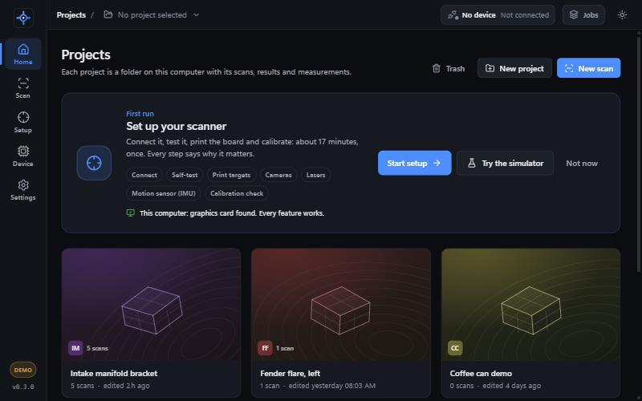
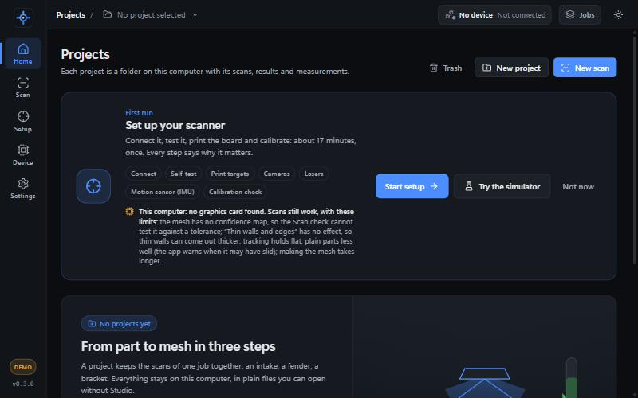

# Getting started

This page covers installing OpenHandScan Studio, starting it, and finding your way around its window. It also explains the simulator, which lets you try every part of the app without a scanner.

On this page:

- [What Studio is](#what-studio-is)
- [Install the app](#install-the-app)
- [The Windows program (ohs.exe)](#the-windows-program-ohsexe)
- [Update the app](#update-the-app)
- [Start the app](#start-the-app)
- [Use a phone or tablet](#use-a-phone-or-tablet)
- [If the app cannot reach the engine](#if-the-app-cannot-reach-the-engine)
- [The window](#the-window)
- [The Home page](#the-home-page)
- [Set up your scanner](#set-up-your-scanner)
- [Try the simulator](#try-the-simulator)
- [What this computer can do](#what-this-computer-can-do)
- [Disk space and memory](#disk-space-and-memory)
- [Messages on this page](#messages-on-this-page)

## What Studio is

OpenHandScan Studio is the desktop app for the OpenHandScan handheld scanner. With it you set up and calibrate the scanner, scan a part with a live 3D view, make a mesh, and measure it.

Studio runs entirely on your computer. It has two parts:

- the **engine** (`ohs`), a local program that talks to the scanner and does the heavy processing;
- the **window**, which shows the app and talks to the engine.

Your projects stay on this computer as plain folders you can open without Studio.

So far the software has been tested on simulated scans. Results on the real scanner are not measured yet.

## Install the app

The full command-line instructions are in the software guide, [software/README.md](../../software/README.md), section 1 ("Install"). In short:

1. Install Python 3.10 or newer (3.11 or newer is recommended).
2. Install [Node.js](https://nodejs.org) 20 or newer. You need it once, to build the app's pages.
3. Create a Python virtual environment. On Windows keep it at a short path such as `C:\venvs\ohs`, not inside a deep folder or OneDrive: Windows limits paths to 260 characters, and a long path makes the install fail with confusing "file not found" errors.
4. In the repository's `software` folder, install the engine with the app extras: `pip install -e .[fusion,app]`.
5. Build the app's pages once: in `software/ui` run `npm install`, then `npm run build`.
6. On Linux, add yourself to the `dialout` group so the app can reach the control board's serial port, then log out and in again.

Before the first scan with real hardware you also need to:

- flash the control board's firmware: see section 2 of [software/README.md](../../software/README.md) and [firmware/README.md](../../firmware/README.md);
- plug in the stereo camera and the control board, and check the laser kill toggle on the back cover (section 3 of the software guide).

## The Windows program (ohs.exe)

There is also a trial Windows build: a folder with `ohs.exe` and everything it needs, so the computer that runs it needs no Python. It has no installer yet, and it is not signed.

To build it (on a Windows computer with the source install above):

1. Build the app's pages first: `npm run build` in `software/ui`.
2. Install PyInstaller in the engine's environment: `pip install pyinstaller`.
3. In `software`, run `python packaging/build_exe.py`. Add `--out DIR` to choose where it goes.
4. The program is `packaging/out/ohs/ohs.exe` (or `DIR/ohs/ohs.exe`). Copy the whole `ohs` folder, not the exe alone.

The folder is about 525 MB (526 MB in the build of 2026-11-22, [software/VALIDATION.md](../../software/VALIDATION.md), "A trial exe").

`ohs.exe` works as the `ohs` command does: `ohs.exe app` starts Studio, and `ohs.exe process`, `ohs.exe bench` and the other commands work too. It uses the same settings file and the same folders as a source install (see [settings.md](settings.md#where-files-are-kept)), because they are in your home folder, not in the program's folder.

## Update the app

There is no update button in the app. When a message asks you to update the engine (for example **This engine has no setup wizard yet**), update both parts, the engine and the app's pages, together.

From a source install:

1. Close Studio.
2. Get the new version of the repository, for example with `git pull` in the repository folder.
3. Activate the virtual environment, and in `software` run `pip install -e .[fusion,app]` again. This installs any library the new version needs.
4. In `software/ui` run `npm install`, then `npm run build`. This rebuilds the app's pages; the window shows the old pages until you do.
5. Start the app again with `ohs app`.

With the Windows program:

1. Close Studio.
2. Build a new `ohs` folder as described in [The Windows program](#the-windows-program-ohsexe), from the new version of the repository.
3. Replace the old `ohs` folder with the new one.

Your projects, settings and calibration are not in the program's folder, so an update keeps them.

To see which version you have, look at the bottom of the sidebar (the engine's version), or at **About** on the [Settings](settings.md#about) page. `ohs --version` (or `ohs.exe --version`) prints it in a terminal.

## Start the app

1. Activate the virtual environment.
2. Run `ohs app` (or `ohs.exe app`). Studio opens in its own window, titled **OpenHandScan Studio**. The terminal says where it runs, for example `OpenHandScan Studio is running at http://127.0.0.1:8765/`.
3. To stop the app, close its window. The terminal then says `OpenHandScan Studio stopped.`

If the window cannot open (for example when the window part is not installed), the app opens in your web browser instead and says so in the terminal. It then runs until you press Ctrl-C in the terminal.

Useful options (all in [software/README.md](../../software/README.md), section 1, "Desktop app"):

| Option | What it does |
|---|---|
| `ohs app --no-window --open-browser` | Uses your web browser instead of the app's window. |
| `--port`, `--host` | Change where the engine listens. The default is `127.0.0.1:8765`. |
| `--host 0.0.0.0` | Also serves phones and tablets on your network. See [Use a phone or tablet](#use-a-phone-or-tablet). |

Only one copy of the app can use a port. If another copy already runs, the new one stops with a message that the port is already in use, and asks whether Studio is already running. Open the running one, or start with `--port` and another number.

## Use a phone or tablet

The app's pages also work in a web browser, so a phone or tablet on your network can show them, for example as a display beside you while you scan.

1. Start the app with `ohs app --host 0.0.0.0`. The terminal warns that the app can be reached from your network with no password.
2. Find this computer's address on your network (its IP address, for example in your router or the computer's network settings).
3. On the phone or tablet, open `http://` followed by that address and `:8765/`, for example `http://192.168.1.20:8765/` (use your own address and port). Use the number, not the computer's name: the engine accepts only `localhost` or an IP address.

There is no password. Anyone on the same network can open the app and use it, so do this only on a network you trust. A file you download on the phone or tablet is saved by that device's browser.

The app's design plan names this use (a phone or tablet as the scan display), but no document says how well each page works on a small screen.

## If the app cannot reach the engine

If the window opens but the engine is not answering, the page says **Can't reach the OpenHandScan engine**. It lists what to try:

1. Start the engine: `ohs app` opens Studio in its own window and serves the page.
2. If it is already running, check that nothing else uses port 8765, then press **Retry**. The page also retries on its own.
3. With no engine or hardware at hand, press **Open the demo**. The demo runs a simulated scanner inside the window.

If the engine was reachable and then stops answering, a bar at the top says **Lost the live connection to the engine.** It retries by itself, and you can press **Retry now**. A scan that is recording keeps running on the engine.

## The window

*The Studio window with the sidebar, the top bar and the Home page.*

### The sidebar

The sidebar on the left has five places:

| Item | What it is for |
|---|---|
| **Home** | Your projects, and the setup card on first run. See [projects.md](projects.md). |
| **Scan** | The live scan page. See [scanning.md](scanning.md). |
| **Setup** | The setup and calibration wizard. See [setup.md](setup.md). |
| **Device** | Choose where frames come from: the scanner, a recording, or the simulator. See [setup.md](setup.md#the-device-page). |
| **Settings** | How the app works on this computer. See [settings.md](settings.md). |

A small dot on an item tells you something without opening it:

- on **Scan**: a red dot while a scan records, an amber dot while it is paused;
- on **Setup**: an amber dot when there is no calibration yet or the calibration needs attention, and a dot in the app's accent colour while a calibration is open in Setup. Hover over **Setup** to read why, for example **Setup: no calibration yet**;
- on **Device**: a dot in the accent colour while the device is busy, for example while the simulator is being prepared.

At the bottom of the sidebar is the engine's version number.

### The top bar

From left to right the top bar shows:

- **The page title and the project picker.** The picker shows the current project, or **No project selected**. Click it to switch to one of your recent projects, or choose **New project…** or **All projects**.
- **The device status.** It shows the source (**Camera**, **Replay**, **Simulator** or **No device**), whether it is connected, and the state of the calibration, for example **Calibration valid**, **Check recommended**, **Recalibrate**, **No calibration** or **Demo calibration**. Hover over it for details. Click it to open the Device page. When the calibration needs attention, a button next to it opens the right Setup step, for example **Check the calibration**.
- **Jobs.** Long tasks, such as making a mesh, run as jobs. The button shows how many are running, and opens a list of them with their progress.
- **The theme switch.** It changes between the dark and the light theme. You can also set this on the [Settings](settings.md) page.

*The device status with the simulator connected, and its details on hover.*

### The Demo badge

When the app runs in demo mode, a **Demo** badge appears at the bottom of the sidebar. Demo mode is a simulated engine that runs inside the window, with no engine program and no hardware. You get it from **Open the demo** on the "Can't reach the engine" page, or, for developers, with `npm run dev:mock` in `software/ui`. In demo mode the data lives only in the window, and no folder opens.

The pictures in this guide are taken in demo mode, so they show the **Demo** badge.

Demo mode is not the same as the simulator. The simulator is part of the real engine: it makes real recordings you can process. See [Try the simulator](#try-the-simulator).

### Where downloaded files go

Every **Download** button in the app (meshes, reports, section drawings, the calibration report, the log) saves the file as an ordinary download. In a web browser, the browser's own download setting decides where it goes, as for any other download. The app's own window is set up to allow downloads, but neither the code nor the documents say whether it asks where to save or which folder it uses; look for the file in your usual download folder, and if it is not there, use the app in a web browser (`ohs app --no-window --open-browser`) for downloads.

## The Home page

The Home page, titled **Projects**, lists your projects. A project is a folder on this computer that keeps the scans of one job together, with their results and measurements.

At the top right are **Trash**, **New project** and **New scan**. **New scan** opens the Scan page and asks **Choose the project for this scan**.

When you have no projects yet, Home shows **From part to mesh in three steps**:

1. Set up the scanner (connect it, test it and calibrate it), or try the simulator.
2. **Scan the part**: sweep slowly 200 to 350 mm from the surface.
3. **Make the mesh and measure**.

Working with projects, the trash and scans is described in [projects.md](projects.md).

## Set up your scanner

On first run, Home shows a card called **Set up your scanner**. It stays until the camera calibration is done.

*Home on first run: the setup card above the three steps.*

The card shows:

- how much time setup takes (the steps add up to about 19 minutes when none is done), or how many steps are done and which one is next;
- the seven steps as small labels: **Connect**, **Self-test**, **Print targets**, **Cameras**, **Lasers**, **Motion sensor (IMU)** and **Calibration check**. A done step has a tick. Click a label to open that step;
- one line about what this computer can do (see [below](#what-this-computer-can-do)).

Its buttons:

| Button | What it does |
|---|---|
| **Start setup** or **Continue setup** | Opens the setup wizard at the first step still to do. See [setup.md](setup.md). |
| **Try the simulator** | Opens the Device page and connects the simulator. |
| **Not now** | Hides the card. You can turn it back on in Setup, under **Reminder**, with **Show the setup card on Home**. |

## Try the simulator

The simulator is a virtual scanner inside the engine. It renders camera pictures, laser lines, dots and motion sensor data of a sphere on a plane, and it knows its own true calibration. With it you can try the whole app with no hardware: scan, make a mesh, measure, and even practise the setup wizard.

To start it:

1. Press **Try the simulator** on Home, or open the **Device** page, choose **Simulator** and press **Start simulator**.
2. The first time, the engine builds the simulator's demo recording. This takes about a minute, once. The page shows **Preparing the simulator…** with a progress bar.
3. When it is ready, a message says **The simulator is ready**, and the device status shows **Simulator** with **Demo calibration**.
4. Press **Go to scan** to start scanning.

*The Device page with the simulator connected.*

Good to know:

- Scans made with the simulator are real recordings: you can process, view and measure them like any other.
- The simulator's demo scans with its own true calibration, called **Demo calibration**. When you run the setup wizard with the simulator connected, the wizard calibrates the virtual scanner into a file of its own. Your real scanner's calibration is never touched.
- The simulator has no lasers or dots to adjust, no control board and no trigger.

The same demo is available from the command line (`ohs sim demo`). See section 9 of [software/README.md](../../software/README.md).

## What this computer can do

The app looks for a graphics card and uses it for the heavy work. Any make works (NVIDIA, AMD or Intel, separate or built in), as long as its driver offers OpenCL. Without one, everything runs on the processor.

The setup card on Home and the **About** box on the [Settings](settings.md#about) page say what the app found:

- **This computer: graphics card found. Every feature works.**
- or, without a graphics card, why (for example **no graphics card found**, or **the graphics card is turned off in the app's settings**), followed by **Scans still work, with these limits:**
  - The mesh has no confidence map, so the Scan check cannot test it against a tolerance.
  - "Thin walls and edges" has no effect, so thin walls can come out thicker.
  - Tracking holds flat, plain parts less well (the app warns when it may have slid).
  - Making the mesh takes longer.

What those words mean:

- The **confidence map** says, for each point of the mesh, how sure the scan is of it. The viewer can colour the mesh by it. See [viewer.md](viewer.md#confidence).
- The **Scan check** tests a finished mesh against a tolerance you choose and shows the areas that miss it. See [viewer.md](viewer.md#is-it-good-the-scan-check).
- **Thin walls and edges** is a setting that keeps sheet metal, ribs and edges from coming out too thick. See [settings.md](settings.md#making-the-mesh).

*The setup card on a computer without a graphics card.*

On simulated scans, the camera path without a graphics card is clearly weaker, most of all on flat, thin and plain parts, and making the mesh is slow. Use a computer with a graphics card if you can. How to turn the graphics card off on purpose is in [settings.md](settings.md#settings-on-other-pages).

## Disk space and memory

**Disk.** Scanning writes every camera frame to disk, so recordings are large. Measured on simulated recordings with 1280 × 800 pictures per camera at 30 frames a second ([software/VALIDATION.md](../../software/VALIDATION.md), "What a scan takes on disk"):

- a recording takes about **36 MB for each second** of scanning, about 2.1 GB a minute;
- the recording is about **80 %** of a scan's folder; the mesh, the stages and the undo history make up the rest.

So 30 seconds of scanning make a recording of about 1.1 GB and a scan folder of about 1.3 GB. Recordings at another picture size or frame rate were not measured. The project page shows how much space each project takes, and how to free some: see [projects.md](projects.md).

If the disk cannot keep up during a scan, the Scan page says **Saving is behind** (see [scanning.md](scanning.md#messages-on-this-page)).

**Memory.** No minimum is stated. The one figure the app gives is in its thin-parts hint: scans made at a mesh detail of 0.5 mm, with 3.34 to 6.4 million triangles, took 7 to 11.9 GB of memory and 2.2 to 3 GB of the graphics card's shared memory. That was measured on simulated scans, on a mini PC with built-in graphics and 20 GB of memory. The memory a scan at the standard mesh detail (1 mm) needs is not stated. Making only the thin walls finer needs no more memory than the scan's mesh took, but about 7.8 MB of free disk for each frame while the mesh is made. See [make-mesh.md](make-mesh.md).

## Messages on this page

| Message | What it means | What to do |
|---|---|---|
| **Can't reach the OpenHandScan engine** | The window cannot talk to the engine at `127.0.0.1:8765`. | Start `ohs app`. If it runs, check that nothing else uses port 8765 and press **Retry**. Or press **Open the demo**. |
| **Lost the live connection to the engine.** | The engine stopped answering after it had been reachable. | Wait while it retries, or press **Retry now**. A running recording carries on in the engine. |
| **Couldn't load the projects** | The engine did not return the project list. | Press **Try again**. The message under the title says why. |
| **Preparing the simulator…** | The engine is building the simulator's demo recording. | Wait about a minute. It happens only the first time. |
| **The simulator is ready** | The simulator is connected. | Open the Scan page and start a scan. |
| **Couldn't prepare the simulator** | Building the demo recording failed. | Check the engine log (see [settings.md](settings.md#about)), then try again. |
| **Couldn't start the simulator** | The simulator could not connect. | Read the reason in the message and try again from the Device page. |
| **This computer: … Scans still work, with these limits:** | No graphics card is in use. | See [What this computer can do](#what-this-computer-can-do). |
| **Setup: no calibration yet** (on the Setup item) | A device is connected but has no calibration. | Run the setup wizard. See [setup.md](setup.md). |
| `port 8765 on 127.0.0.1 is already in use: is OpenHandScan Studio already running?` (terminal) | Another program, often another copy of Studio, uses the port. | Use the running copy at the address shown, or start with `--port` and another number. |
| `the app window could not open (…): opening the app in your browser instead` (terminal) | The app's window could not start. | Use the app in the browser; press Ctrl-C in the terminal to stop it. |
| **The backend is running, but the user interface has not been built yet.** (in the window) | The app's pages were never built. | In `software/ui` run `npm install` and `npm run build`, then reload the page. |
| `warning: the app is reachable from your network (no password)` (terminal) | You started with `--host 0.0.0.0`. | Only do this on a network you trust. See [Use a phone or tablet](#use-a-phone-or-tablet). |
| **This engine has no setup wizard yet** and other messages asking you to update | The engine is older than the app's pages. | See [Update the app](#update-the-app). |

Next: [set up and calibrate the scanner](setup.md), or [start scanning](scanning.md) with the simulator. Words you do not know are in the [glossary](glossary.md).
