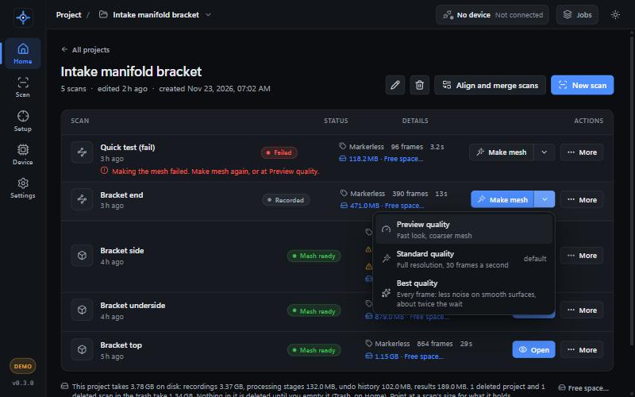
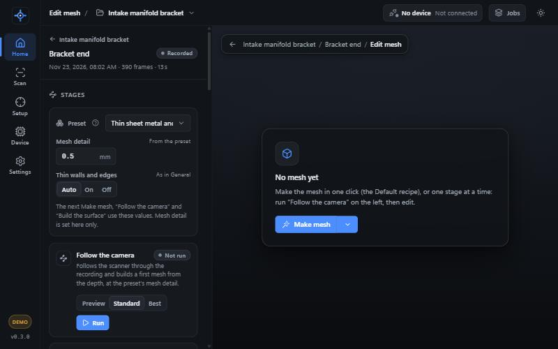
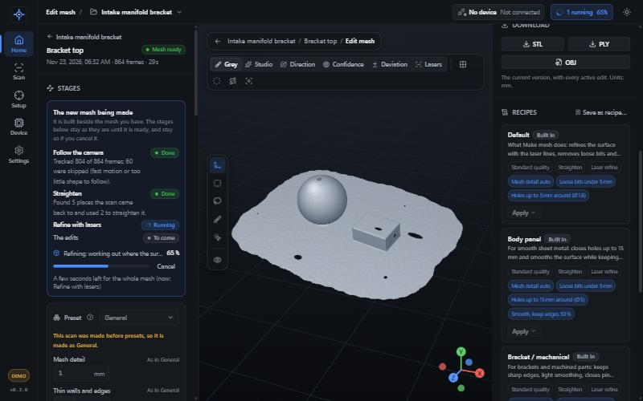
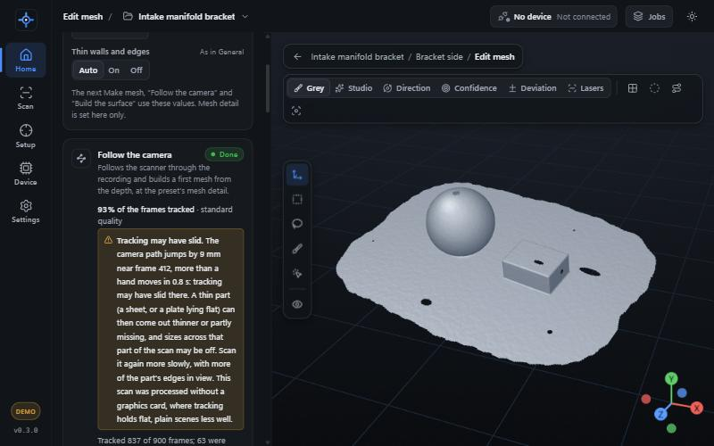
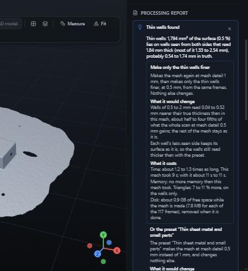
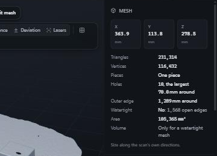

# From a recording to a mesh

This page explains how Studio turns a scan's recording into a mesh: the **Make mesh** button, the quality levels, the stages on the Edit mesh page, presets and mesh detail, the thin-walls hint, the mesh's numbers, the warnings you may see afterwards, and what changes on a computer without a graphics card.

On this page:

- [Words used on this page](#words-used-on-this-page)
- [Make a mesh](#make-a-mesh)
- [Choose the quality](#choose-the-quality)
- [What Make mesh does](#what-make-mesh-does)
- [Make the mesh again](#make-the-mesh-again)
- [How long it takes](#how-long-it-takes)
- [Run the stages one at a time](#run-the-stages-one-at-a-time)
- [Presets and mesh detail](#presets-and-mesh-detail)
- [If thin walls are found](#if-thin-walls-are-found)
- [The mesh in numbers](#the-mesh-in-numbers)
- [If tracking may have slid](#if-tracking-may-have-slid)
- [Other notes after Make mesh](#other-notes-after-make-mesh)
- [Without a graphics card](#without-a-graphics-card)
- [If making the mesh fails or you cancel it](#if-making-the-mesh-fails-or-you-cancel-it)
- [Known limits](#known-limits)
- [Messages on this page](#messages-on-this-page)

## Words used on this page

| Word | Meaning |
|---|---|
| **Recording** | The raw camera frames and motion sensor readings of a scan, kept as the scanner sent them. |
| **Mesh** | The 3D surface of the part, made of small triangles. |
| **Camera path** | Where the scanner was at each frame, worked out from the recording. |
| **Stage** | One step of making the mesh, such as **Follow the camera** or **Straighten**. |
| **Mesh detail** | The size of the smallest cell the surface is built from, in millimetres (the engine's "voxel size"). Smaller is finer. The default is 1 mm. |
| **Quality** | How many of the recorded frames are used: **Preview**, **Standard** or **Best**. |
| **Preset** | A named set of values for a kind of part, such as **Thin sheet metal and small parts**. |
| **Recipe** | A saved set of stage settings and edits. Make mesh runs the **Default** recipe. See [editing.md](editing.md#recipes). |
| **Confidence** | How sure the scan is of each point of the mesh, as a ± in millimetres. |

## Make a mesh

After a scan is recorded its status is **Recorded**. To make its mesh:

1. Open the project (see [projects.md](projects.md)).
2. On the scan's row, click **Make mesh**.

The plain button makes the mesh at **Standard quality**. To choose another quality, click the small arrow beside it (**Choose the mesh quality**) and pick one.

*The quality menu beside Make mesh: Preview, Standard (the default) and Best.*

The scan's status changes to **Making the mesh** and its row shows a progress bar, the time left and **Cancel**. You can leave the page: the job keeps running and the **Jobs** panel in the top bar follows it (see [projects.md](projects.md#the-jobs-panel)). When it is done, a notice says **Mesh ready for "..."** with **Open result**, and the status becomes **Mesh ready**.

You can also make the mesh from the Edit mesh page. A scan without a mesh shows **No mesh yet** there, with a **Make mesh** button.

*Edit mesh before there is a mesh: make it in one click, or run the stages one at a time on the left.*

## Choose the quality

| Quality | What the app says | What it does |
|---|---|---|
| **Preview quality** | "Fast look, coarser mesh" | A quick, coarse mesh to check the scan. |
| **Standard quality** (the default) | "Full resolution, 30 frames a second" | Uses 30 frames for each second of scanning: every second frame of a 60 frames a second recording, every frame of a 30 frames a second one. |
| **Best quality** | "Every frame: less noise on smooth surfaces, about twice the wait" | Uses every recorded frame. |

On a recording made at 30 frames a second, Standard and Best use the same frames, since Standard already uses every frame of it.

## What Make mesh does

Make mesh runs the **Default** recipe at the quality you chose. In order:

1. **Follow the camera**: follows the scanner through the recording and builds a first mesh from the depth, at the preset's mesh detail.
2. **Straighten**: finds where the scan came back to a place it had seen and closes those loops, then lines the scan up where the laser lines of different frames cross.
3. **Refine with lasers**: pulls the surface onto the laser lines where they disagree with it.
4. The Default recipe's edits: it removes loose bits smaller than 5 mm or under 1 % of the mesh, and closes pin holes up to 5 mm around. There is no smoothing and no simplification, so measurements stay true to the scan.

When the scan carries a preset that names another recipe (**Recipe after meshing**), Make mesh runs that recipe instead of Default.

## Make the mesh again

Every scan keeps its recording, so you can make its mesh again, for example at another quality or with another preset. Use **Make mesh again** on the scan's row on the project page or in the viewer's **Make mesh again** panel (both with the quality menu; in a window narrower than about 1500 pixels the project page has it in the row's **More** menu, at Standard quality), or a recipe's **Everything** on the Edit mesh page (see [editing.md](editing.md#recipes)). Saved measurements and fitted shapes stay; they are marked when the new mesh differs (see [measuring.md](measuring.md)).

The new mesh is built beside the one the scan has. The scan keeps its mesh, its stages, its edits and its undo history until the new mesh is ready, and keeps them if you cancel or the run fails. Meanwhile you can still open the scan in the viewer (**Open**: "The mesh it has now, until the new one is ready").

While it runs, the Edit mesh page shows **The new mesh being made** at the top of the Stages panel: each part of the run with **Done**, **Running**, **To come**, **Skipped** or **Failed**, the progress, the time left and **Cancel**.

*Make mesh again: the new mesh is built beside the one you have, which stays until it is ready.*

Making the mesh again starts the edits over: the new mesh replaces the edits you made by hand with the recipe's. Save your steps as a recipe first if you want to repeat them (see [editing.md](editing.md#save-your-own-recipe)).

While a mesh is being built the scan holds two results on disk, the one it has and the one being built.

## How long it takes

While the mesh is made, the app says the time left in plain words: **Working out the time left…** at first, then for example **About 4 min left for the whole mesh (now: Straighten)**. The estimate is for every stage and edit still to come, at the pace so far. When one stage runs on its own it names that stage, for example **About 2 min left for Follow the camera**. After the last frame of a pass there is no count; the progress line says what is happening.

Measured times, all on simulated scans, not on the real scanner:

- On the development PC (a mini PC with an AMD Ryzen 7 7735U and its built-in Radeon 680M graphics), Standard quality needs about 4.8 times the scan's duration; on a laptop with an RTX 3070 Ti about 1.5 times. Best quality takes about twice as long as Standard. These figures are worked out from the processing speed, not timed on a real scan (software/VALIDATION.md, "Standard and Best quality").
- Without a graphics card a frame at full resolution took 0.60 to 0.73 s on the same PC's processor, so making the mesh is slow (software/VALIDATION.md, "Known limitations of the pipeline").
- Of a Make mesh's time, Follow the camera took about 47 %, Straighten 37 %, Refine with lasers 3 % and the edits 13 % (three simulated scans of 180 to 240 frames).

After the mesh is made, the viewer's processing report says **Making the mesh took** and the time for the whole Make mesh (see [viewer.md](viewer.md)).

## Run the stages one at a time

Open a scan with **Edit mesh…** to see its **Stages** panel on the left. Each stage is a card with its state, what it does, the engine's summary of its last run, when it ran, and a button to run it. You can run the stages yourself instead of Make mesh, or run one again with other settings.

*The Stages panel: under the Preset box, one card per stage with its state and summary. Here Follow the camera carries the note "Tracking may have slid." Scroll the panel for the other stages.*

| Stage | What it does | Button | Needs |
|---|---|---|---|
| **Follow the camera** | Follows the scanner through the recording and builds a first mesh from the depth, at the preset's mesh detail. Has its own **Quality** choice (Preview, Standard, Best). Its summary says how many frames were tracked. | **Run**, then **Run again** | The recording. |
| **Straighten** | Closes the loops where the scan came back to a place it had seen, then lines the scan up where the laser lines of different frames cross. Says how many loops it closed and how far it moved the scan. | **Straighten**, then **Run again** | Follow the camera. |
| **Build the surface** | Builds the mesh again from the camera path: after Straighten, or to change the mesh detail. Optional, since Follow the camera already made a mesh. Uses the mesh detail of the Preset box. | **Build**, then **Run again** | Follow the camera. |
| **Refine from the images** (marked **Trial**) | Measures the surface again against every frame. A trial build: it needs a graphics card to be quick. Run it before Refine with lasers, which starts over after it. Make mesh does not run it. | **Refine**, then **Run again** | Follow the camera. |
| **Refine with lasers** | Pulls the surface onto the laser lines where they disagree, with a smooth correction. Says how many laser points lay off the surface (glints, reflections) and were left out. | **Refine**, then **Run again** | Follow the camera. Not the recording: it works on a merged scan too. |

A stage's badge reads **Not run**, **Running**, **Done**, **Failed** or **Skipped**; Build the surface reads **Optional** before it runs. Under the cards, **Starting mesh** says how many triangles the mesh the edits start from has, and which stage made it.

Running a stage again gives a new starting mesh, and that clears your edits: the faces of a new mesh don't match them. If the scan has edits, the app asks first (**Run "..." again?**). The recording is kept.

A stage can be **Skipped** on purpose. The summary then says why, for example that the scan never came back to a place it had already seen, or that the mesh already agrees with the laser lines.

To see the camera path over the mesh, click **Camera path** in the view options (or press T). It shows the path as tracked, the straightened path and the loop closures.

## Presets and mesh detail

A preset sets values for a kind of part. You choose it on the Scan page ("What are you scanning?", see [scanning.md](scanning.md)), and you can change it afterwards in the **Preset** box at the top of the Stages panel. The next Make mesh, Follow the camera and Build the surface use these values.

The built-in presets:

| Preset | What it changes | What it costs |
|---|---|---|
| **General** (the default) | Nothing: 1 mm mesh detail, the Default recipe, every setting as it is. | Nothing. |
| **Thin sheet metal and small parts** | Finer mesh detail (0.5 mm instead of 1 mm), so thin walls come out closer to their real thickness. Nothing else changes. | "Takes about twice as long to make the mesh. No gain on large panels." |

Point at the **?** beside the preset's name for its card, with the measured numbers behind it.

The values in the Preset box:

| Value | What it does |
|---|---|
| **Mesh detail** | 0.25 to 10 mm, in steps of 0.25 mm. Finer mesh detail keeps smaller features; each halving makes about 4 times the triangles. This is the only place to set it. |
| **Thin walls and edges** | **Auto** (on for scans without markers, as the app's setting does), **On** (keeps thin walls and edges from swelling) or **Off** (thin walls and edges can come out thicker). |
| **Quality**, **Recipe after meshing**, **Tolerance** | Shown when the preset names them or you changed them. Tolerance is what the Scan check starts with (see [measuring.md](measuring.md)). |

Each value says where it comes from: **From the preset**, **As in General**, or **Changed by hand from ...**. **Preset's value** puts a changed value back.
## If thin walls are found

After Make mesh the engine looks at the finished mesh for thin walls seen from both sides. When it finds them, the viewer's **Processing report** panel (in the **Is it good?** group) shows a hint titled **Thin walls found**. It says where the walls are, how thick they read and how thick they probably are, what a finer mesh would change, and what it would cost in time, triangles and memory, all as measured on simulated scans.

*The top of the thin-walls hint: two ways to make the walls finer, each with what it changes and what it costs. The buttons are at the foot of the hint.*

The hint offers up to two choices:

| Choice | What it does | When it is offered |
|---|---|---|
| **Make only the thin walls finer** | Makes the mesh again at mesh detail 1 mm, then makes only the thin walls finer, at 0.5 mm, from the same frames. Nothing else changes. The hint states the time it would take, the extra triangles and the free disk space it needs while the mesh is made. | With a graphics card, at mesh detail 1 mm, and not at Preview quality. |
| **Make the mesh again with this preset** | Sets the scan's preset to **Thin sheet metal and small parts** (mesh detail 0.5 mm for the whole scan) and makes the mesh again. | Always, when the hint shows. |

Both make the mesh again at the quality it was made at, and the mesh you have stays until the new one is ready. Nothing changes unless you press one. **Not for this scan** (or the **X**) puts the hint away for good on this scan.

**Make only the thin walls finer** stays on for the scan's later Make mesh runs. After such a run a short note takes the hint's place: what was made finer (or why it did not run), and **Make the mesh again without this** to turn it off.

The hint only suggests the preset for thin walls, where a gain was measured. A thin plate lying flat or small holes alone give no hint.

## The mesh in numbers

On the Edit mesh page the **Mesh** panel (on the right in a wide window, under the history in a narrow one) describes the current mesh.

*The Mesh panel: the size, the triangles and whether the surface is closed.*

| Row | What it means |
|---|---|
| **x**, **y**, **z** | The size of the mesh along the scan's own directions, in mm. |
| **Triangles**, **Vertices** | How many triangles and corner points the mesh has. |
| **Pieces** | **One piece**, or how many separate pieces. Extra pieces are often loose bits (see [editing.md](editing.md#remove-loose-bits)). |
| **Holes** | **None**, or how many and how large the largest is, measured around its edge. |
| **Outer edge** | The length of the open edge round the scan, or **None: the surface is closed**. |
| **Watertight** | **Yes: fully closed**, or **No** with the number of open edges. |
| **Tangled edges** | Edges shared by three or more triangles, when there are any. |
| **Area** | The surface area in mm². |
| **Filled** | Area made by hole filling: not measured, so measuring skips it. |
| **Confidence** | The share of the surface known to within 0.1 mm, and the median ±. Only for meshes made with a graphics card. |
| **Volume** | Only for a watertight mesh. |

The **History** panel under the edits lists the starting mesh and every edit since; see [editing.md](editing.md#undo-and-the-history).

## If tracking may have slid

After Follow the camera, the engine checks the camera path for a jump no hand makes. When it finds one, the scan shows **Tracking may have slid**: on its row on the project page (point at it for the sentence), on the Follow the camera card on the Edit mesh page, and in the viewer's report. The sentence says where the path jumped and by how much, and that a thin part (a sheet, or a plate lying flat) can then come out thinner or partly missing, and sizes across that part of the scan may be off.

It only warns: the mesh is the same with or without it. What to do: scan the part again more slowly, with more of the part's edges in view (see [scanning.md](scanning.md)). Check thin parts another way before you rely on them.

The check catches sudden jumps. It can miss a slow, steady drift, so a scan without the warning is not proof that tracking held.

## Other notes after Make mesh

The stage summaries and the report can say more. The most common:

| What you see | What it means |
|---|---|
| A Straighten summary that ends with a sentence about thin walls seen from both sides | Straighten moved the camera path to make the laser lines meet where they cross. On thin walls this can make a wall read thinner or thicker than it is, so check the thickness of thin walls another way. |
| **Skipped** on Straighten, with "No loops found: ..." | The scan never came back to a place it had seen, so there was nothing to correct. To let Studio straighten a scan, pass over an earlier part again. |
| **Skipped** on Straighten after closing loops | The loops showed the passes already line up, so the scan was left as it is. |
| **Skipped** on Refine with lasers | The scan has no laser points (the lasers were off or not calibrated), or the mesh already agrees with the laser lines. The mesh was left as it is. |
| **Notes on making the mesh** on the project page | Other sentences of the report. Point at it to read them. |
| **Scanned with a calibration that needed a check** (or **...recalibrating**) | What this scan saw of the calibration. See [setup.md](setup.md). |

## Without a graphics card

Studio uses any graphics card it finds (NVIDIA, AMD or Intel). Without one, or with it turned off in the settings, scans still work, with these limits (the app lists the same in Settings and on Home):

- The mesh has no confidence map, so the Scan check cannot test it against a tolerance, and the **Confidence** shading is greyed out.
- **Thin walls and edges** has no effect, so thin walls can come out thicker. The Preset box says so under the value.
- Tracking holds flat, plain parts less well (the app warns when it may have slid).
- Making the mesh takes longer.

Also: **Make only the thin walls finer** is not offered, **Refine from the images** runs much more slowly, and smoothing's **Stay within each point's scatter** cannot be used (see [editing.md](editing.md#smooth)). Making the mesh again on the same computer does not add confidence; make it on a computer with a graphics card.

## If making the mesh fails or you cancel it

If you cancel Make mesh, or it fails, nothing is lost:

- A scan that had a mesh keeps it, with its edits: **The mesh stays as it was, and so does the recording.**
- A scan without a mesh keeps its recording: **The recording is kept: you can make the mesh any time.**

A failed scan shows **Failed** and the reason under its row. Read the reason, then try **Make mesh** again, or at Preview quality. If tracking failed on most frames, scan the part again with more overlap between passes, or with markers (see [scanning.md](scanning.md) and [troubleshooting.md](troubleshooting.md)).

A failed or cancelled single stage shows a box at the top of the Edit mesh page's left column, with **Dismiss**.

## Known limits

The software has so far been tested on simulated scans. Measured there (software/VALIDATION.md, "Known limitations of the pipeline"):

- Thin walls read too thick with tracking, more so the thinner the wall. A thin plate lying flat reads close to its thickness.
- Small holes are partly filled in by the depth, so they read small.
- Without a graphics card the camera path is weaker, and thin plates can slide and come out thinned.

## Messages on this page

| Message | What it means | What to do |
|---|---|---|
| **Mesh ready for "..."** | The mesh is made. | Click **Open result** to see it. |
| **Making the mesh was cancelled** | You cancelled it. | Nothing is lost. Make the mesh again when you like. |
| **Making the mesh failed** | The run stopped. The reason follows. | Read the reason; try again, or at Preview quality. |
| **Failed: ... Make mesh again, or at Preview quality.** | The reason under a failed scan's row. | As it says. |
| **Couldn't start meshing** | The engine refused to start, with the reason. | Read the reason. If the scan is busy, wait. |
| **This scan's mesh is already being made.** | A second Make mesh on the same scan. | Wait for the first one, or cancel it. |
| **This scan is busy: ...** | Another job is working on the scan. | Wait for it to finish, or press **Cancel**. |
| **Run "..." again?** | Running the stage again clears your edits. | Click **Run it again**, or save the steps as a recipe first. |
| **Run "Follow the camera" first** | The stage needs Follow the camera. | Run Follow the camera, or Make mesh. |
| **"Follow the camera" failed** | Tracking failed. The summary says why. | Try again, or try Preview quality. The raw recording is kept. |
| **Tracking may have slid** | The camera path jumped where no hand moves. | Scan again more slowly with the part's edges in view. Check thin parts another way. |
| **Thin walls found** | The engine found thin walls a finer mesh would help. | Choose one of its buttons, or **Not for this scan**. |
| **"Thin walls and edges" has no effect on this computer: it needs a graphics card.** | No graphics card is in use. | Use a computer with a graphics card for thin parts. |
| **This mesh has no confidence data: ...** | The mesh was made without a graphics card or by an earlier version. | Make the mesh again on a computer with a graphics card. |
| **This scan's recording was removed to free space (it keeps its result only). Only a new scan of the part can make the mesh again.** | You chose **Keep the result only** for this scan. | Scan the part again. |
| **The stage files this needs were removed to free space. Make mesh, or Follow the camera, builds them again from the recording.** | You freed space on this scan. | Click **Make mesh**, or run Follow the camera. |
| **This scan was merged from other scans and has no recording of its own. Merge those scans again to make it again.** | A merged scan cannot be made from frames. | Merge the scans again (see [align-merge.md](align-merge.md)). |
| **The new mesh could not take the place of the earlier one, because a file of this scan is open in another program. The earlier mesh is kept as it was.** | Another program holds a file of the scan. | Close that program, then press **Make mesh** again. |
| **The Edit mesh page needs OpenHandScan engine 0.3 or newer.** | The engine is too old for this page. | Update the engine. Make mesh and the viewer still work. |
