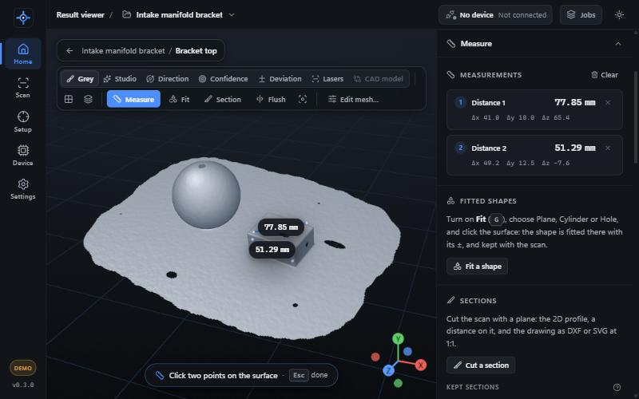
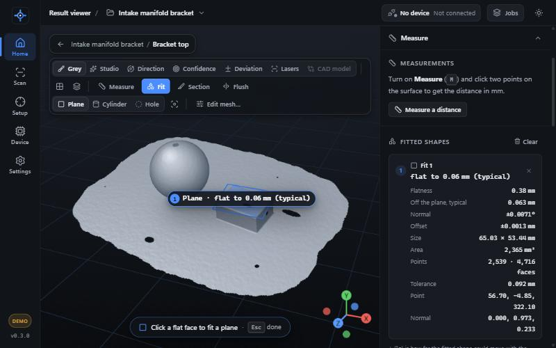
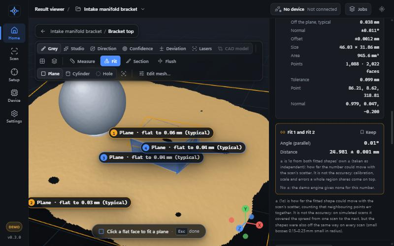
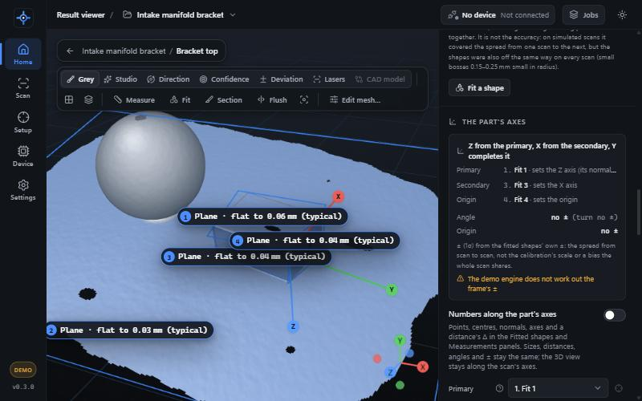
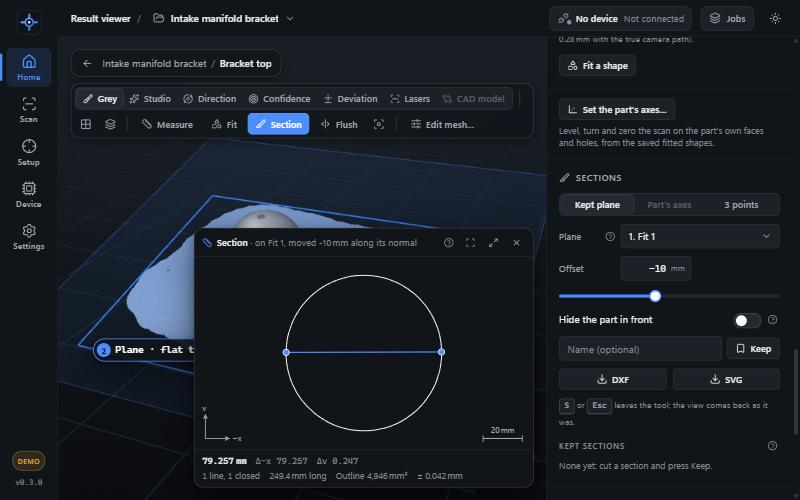
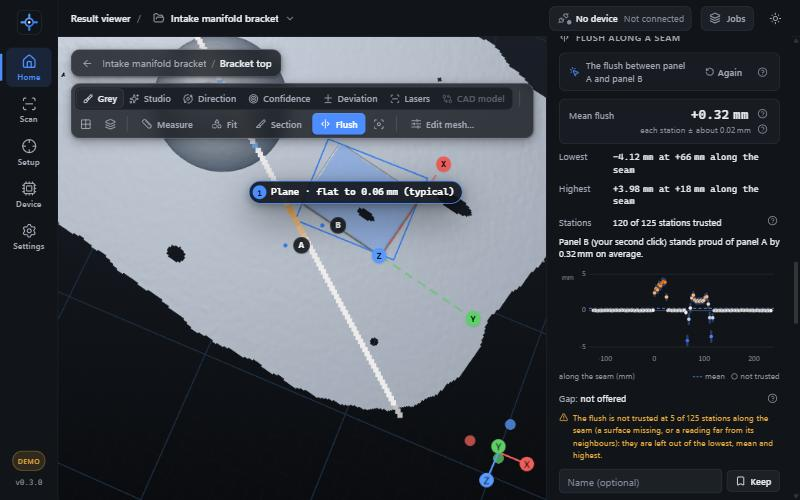

# Measuring on the scan

This page explains how to measure a finished scan in the viewer: distances, fitted shapes (planes, cylinders, holes) and how they relate, the part's own axes, nominal values, sections, the flush between two panels, the files for CAD and the report. It also says what the ± after a value means and which known biases the app states.

On this page:

- [Before you start](#before-you-start)
- [Tools and keys](#tools-and-keys)
- [Measure a distance](#measure-a-distance)
- [Fit a plane, a cylinder or a hole](#fit-a-plane-a-cylinder-or-a-hole)
- [What the ± means](#what-the--means)
- [Known biases](#known-biases)
- [How two shapes relate](#how-two-shapes-relate)
- [Set the part's axes](#set-the-parts-axes)
- [Nominal values](#nominal-values)
- [Cut a section](#cut-a-section)
- [Measure the flush along a seam](#measure-the-flush-along-a-seam)
- [Export features for CAD](#export-features-for-cad)
- [The report](#the-report)
- [When the mesh changes](#when-the-mesh-changes)
- [Messages on this page](#messages-on-this-page)

## Before you start

Open the scan in the viewer (see [The result viewer](viewer.md)). The measuring panels are in the side panel's **Measure** group. Everything you measure here (measurements, fitted shapes, relations, the part's axes, sections and seams) is kept with the scan: it is there again the next time you open it.

All lengths are in millimetres. The software has so far been tested on simulated scans only; the accuracy of the real scanner is still to be measured.

## Tools and keys

One tool is on at a time. Turn a tool on with its toolbar button or key; press the key again, or **Esc**, to turn it off.

| Key | Tool | What it does |
|---|---|---|
| **M** | **Measure** | The distance between two points you click. |
| **G** | **Fit** | Fits a shape where you click. |
| **P** | **Fit**, **Plane** | A flat face. |
| **C** | **Fit**, **Cylinder** | A shaft, a boss or the wall of a bore. |
| **H** | **Fit**, **Hole** | A hole's round edge. |
| **S** | **Section** | Cuts the scan with a plane: its 2D profile, a distance on it, DXF and SVG. |
| **U** | **Flush** | The flush between two panels along their seam. |
| **Esc** | | Drops a half-made measurement, then turns the tool off. |

## Measure a distance

*Two distances measured on the block, listed with their Δx, Δy and Δz.*

1. Click **Measure** in the toolbar, or press **M**. The hint at the bottom says "Click two points on the surface".
2. Click the first point on the surface. A dashed line follows the pointer with the distance so far.
3. Click the second point. The distance is drawn on the model and added to **Measurements**.
4. Measure more, or press **Esc** to stop.

Each measurement shows its distance to two decimals, and **Δx**, **Δy**, **Δz**: how far apart the points are along the scan's axes. Once the part's axes are set and **Numbers along the part's axes** is on, they read **ΔX**, **ΔY**, **ΔZ** along the part's axes. Hover over a measurement to see both points.

Where the surface was made up by hole filling, the pointer turns grey and says "Filled, not measured: pick a scanned spot". A point there is not a measured point.

To remove one measurement, click its cross; **Clear** removes them all.

## Fit a plane, a cylinder or a hole

A **fit** is a simple shape (a plane, a cylinder or a circle) that the engine lays as closely as it can on the points of the surface around your click. A fit gives sizes that a single click cannot: a face's flatness, a bore's diameter, a hole's centre.

*A plane fitted on the block's top face.*

1. Click **Fit** in the toolbar, or press **G**.
2. Choose **Plane**, **Cylinder** or **Hole** next to it (or press **P**, **C** or **H**).
3. Click the surface:
   - **Plane**: "Click a flat face to fit a plane".
   - **Cylinder**: "Click a round wall (a shaft, a boss or a bore) to fit a cylinder".
   - **Hole**: "Click next to a hole's edge to fit its circle".
4. The engine finds the region that belongs to the shape, lights it on the mesh, and adds the fit to **Fitted shapes** with a number and a name ("Fit 1", "Fit 2"…).

A hole is always fitted as a circle on its edge. If you click on the wall inside a bore, the app tells you to use **Cylinder** instead.

### What each fit shows

The main number is beside the name: "flat to 0.04 mm (typical)" for a plane, "Ø 14.02 ± 0.03 mm" for a cylinder or a hole. Below it:

| Shape | Rows |
|---|---|
| Plane | **Flatness**, **Off the plane, typical**, **Normal** (± of its direction), **Offset** (± of its position), **Size** and **Area** of the region |
| Cylinder | **Form** (**Boss**, **Bore** or **Not known**), **Diameter**, **Radius**, **Off the cylinder, typical**, **Axis** (± of its direction), **Axis position**, **Length** and **Arc** of the region |
| Hole | **Diameter**, **Off the circle, typical**, **Centre** (± of its position) |
| All | **Points** used and faces lit, **Independent** (see below), **Points' mean ±**, **Tolerance** (how far from the shape a face could lie and still join the region), the position and the direction |

Hover over a row's name for what it means. Some notes worth knowing:

- **Flatness** is the largest minus the smallest distance of the region's points from the plane. The region only takes points within its tolerance, so a face that is really out of flat reads flatter here than it is.
- **Boss** means the surface faces away from the axis (a shaft, a pin); **Bore** means it faces the axis (the wall of a hole). Bosses and bores read off in size differently on scans.
- **Independent**: neighbouring points err together, in patches, so a fit knows about as much as this many independent points would tell. Its ± are counted that way.
- Which way a normal or an axis points is not measured: either sign is the same face.

Warnings appear in orange under a fit, for example a small region, scattered points or an incomplete hole edge. A fit with a warning that makes its size unreliable gets no nominal offer (see [Nominal values](#nominal-values)).

To remove a fit, click its cross; **Clear** removes them all.

## What the ± means

The ± after a value is **1σ** (one sigma): how far the number could move with the scan's own scatter. If you scanned the same part again, the value would typically land within that distance. **It is not the accuracy.** The app says so beside each kind of value:

- **Planes and cylinders:** "how far the fitted shape could move with the scan's scatter, counting that neighbouring points err together. It is not the accuracy: on simulated scans it covered the spread from one scan to the next, but the shapes were also off the same way on every scan (Ø 14 bosses 0.15–0.19 mm small in radius as tracked, 0.23–0.28 mm with the true camera path)."
- **Holes:** "how well the edge points agree with the circle (1σ). It is not the accuracy: on simulated scans a hole's edge read about 1 mm small in diameter, several times its ±."
- **Relations of two fits:** "1σ from both fitted shapes' own ± (taken as independent) … calibration, scale and errors a whole region shares come on top." An angle with a hole's axis has no ±, because a hole's circle is fitted in a plane taken as given.
- **The part's axes, flush, sections and the report:** the same idea, the spread from scan to scan, not the calibration's scale or a bias the whole scan shares.

Errors of the calibration and of the scale come on top of every ±. No accuracy figure is claimed until the scanner has been measured against reference parts.

## Known biases

A **bias** is an error that is the same on every scan, so the ± does not show it. The app knows a few, measured on the simulator only. It uses them for nominal offers (only when you ask, see [Nominal values](#nominal-values)), and each offer that relies on one names it. The real scanner's biases are still to be measured.

| Feature | Known bias on simulated scans |
|---|---|
| Ø 14 bosses | read 0.23–0.28 mm small in radius at true poses; 0.15–0.19 mm small with tracking |
| Ø 16 shaft | reads 0.13 mm small in radius at true poses; 0.02 mm large with tracking |
| Ø 25 hole over a far background (open edge) | reads 1.0–1.7 mm small in diameter at true poses; 0.9–3 mm small with tracking |
| Ø 25 and Ø 10 holes with a wall, read 0.5 mm below the face | read 0.57–0.70 mm (Ø 25) and 0.28–0.60 mm (Ø 10) large at true poses; −0.3 to +0.51 mm and −0.34 to +0.5 mm off with tracking |
| Thin walls (1, 2 and 3 mm) | read too thick: a 1 mm rib 1.24–1.28 mm at true poses and 1.66–2.20 mm with tracking; a 2 mm flange 2.10–2.18 and 2.26–2.61 mm; a 3 mm rib 3.04–3.06 and 3.17–3.71 mm |

"At true poses" means with the simulator's exact camera path; "with tracking" is what a real scan gets. These numbers are for the graphics card's path, scans without markers, Standard quality. Where there is no number for a case (a bore, a boss of another size, any angle), no bias is used and the offer says so. See also [Troubleshooting](troubleshooting.md) for what reads small or thick and why.

## How two shapes relate

*Two planes picked: the angle between them and, as they are parallel, the distance.*

1. In **Fitted shapes**, click the number of one fit, then of another. Their number badges change colour ("Pick it for a relation (two at most)").
2. A card under the list shows how they relate, worked out by the engine, with ±:
   - two planes: the angle and, when parallel, the distance between them;
   - a plane and a cylinder or hole: the angle of the axis to the plane, and the distance where there is one (**Hole centre to plane**, **Axis to plane**);
   - two cylinders or holes: the angle of the axes and the distance between them; for two holes also **Centre to centre**.
3. Click **Keep** to keep the relation with the scan. Kept relations are listed under the fits; click one to show it again.

If the two fits were made on different versions of the mesh, the card says so.

## Set the part's axes

A scan's numbers are along the scan's own axes, which depend on how you held the scanner. The **part's axes** are a coordinate system on the part itself, set from three fitted shapes by the 3-2-1 rule that measuring machines use: level, turn, origin.

*The part's axes set from three planes of the block.*

1. Fit the shapes you need (see above). **Set the part's axes…** appears in **Measure** once a plane is saved.
2. Click **Set the part's axes…**.
3. Fill the three slots, from the lists or by clicking a fit in **Fitted shapes** and then the crosshair button beside a slot:
   - **Primary**: a flat face, the one the part sits on or its main face. Its normal is the first axis (Z by default) and the face is Z = 0.
   - **Secondary**: a side face, a cylinder or a hole. It sets the turn about Z. Plane, hole, hole is the usual way to line up a part with two dowel holes.
   - **Origin**: a hole, a cylinder or a face. A hole's centre is X = 0 and Y = 0; a third face makes the origin the corner where the three faces meet.
4. If needed, change **Axes** (which letters the primary and secondary give), **Flip** an axis, or turn on **Strict 3-2-1**. Hover over each **?** for what it does.
5. Click **Set the part's axes**.

The panel then shows which axis each fit set, the **Angle** and **Origin** ± ("from the fitted shapes' own ±: the spread from scan to scan"), and any warnings. The axes are drawn in the 3D view; the 3D view itself stays along the scan's axes.

- **Numbers along the part's axes**: turn it on to show points, centres, normals, axes and a distance's Δ in **Fitted shapes** and **Measurements** along the part's axes. Sizes, distances, angles and ± stay the same.
- Once set, **Export** offers **STL along the part's axes** and **PLY along the part's axes**, the CAD files use the part's axes, and **Section** can cut at X, Y or Z = a value.
- When a fit the axes were set from is deleted, fitted again or changed, the panel says **Out of date** with the reason. Nothing is set again by itself: click **Set again**. **Remove** forgets the axes; the fitted shapes stay.

## Nominal values

A **nominal value** is the round size the part was probably drawn with: a measured Ø 14.02 ± 0.03 mm was probably drawn as Ø 14. The app can offer one beside a cylinder's or hole's diameter, and beside each value of a kept relation. **The measured value never changes.** An approved value is kept beside it and used in the CAD files.

- **An offer** is a small dashed chip such as "Ø 14?" or "parallel?". Hover over it for why it is offered. Click it for **Accept …**, **Other value…** or **Ignore** ("Until it is measured again").
- **An approved value** reads "nominal Ø 14" next to the measured one, with a cross to remove it. When the shape is measured again and the new value no longer allows it, it is marked **check again**.
- **No offer**: hover over the card and click the small pencil to enter a value yourself (**Other value…**, then **Approve**).

A value is offered only where the measurement's ± alone allows it (inside ±2σ). The switch **Offers a known bias allows** (off by default, under the fitted shapes) also offers values that only a [known bias](#known-biases) allows, in the warning colour, each saying which bias. As the app puts it: off, "a Ø 14.3 boss stays Ø 14.3". Ignored offers are remembered in this browser only.

For a kept relation with an approved value, **In the CAD file** chooses what happens in the CAD files:

- **Listed only** (the default): the approved values are named in the files' notes; no shape moves.
- **Move** one of the two fits: the CAD file gets a copy of that fitted shape turned and slid, the smallest change that makes the approved values hold. The measured fitted shapes and the part's axes never change.

## Cut a section

A **section** is the line where a plane cuts the scan, drawn flat as a 2D profile.

*A section through the part, its profile at the bottom right with a distance on it.*

1. Click **Section** in the toolbar, press **S**, or click **Cut a section** in **Sections**.
2. Choose how the plane is set:
   - **Kept plane**: a fitted plane moved along its own normal by **Offset** (type it, or drag the slider).
   - **Part's axes**: X, Y or Z = a value, in mm from the part's origin. Needs the part's axes.
   - **3 points**: click three points on the surface; the plane goes through them.
3. The profile opens at the bottom right. Solid lines are measured surface; dashed red is surface that hole filling made up.
4. To measure on the profile, click two of its points (a click snaps to the nearest point). It shows the distance and its Δ along the drawing's axes.
5. To keep the section, type a name (optional) and click **Keep**.
6. Click **DXF** or **SVG** to save the section at 1:1 in mm. The DXF has measured and not-measured stretches on two layers; the SVG has a scale bar.

**Hide the part in front** hides the side of the model the profile is seen from, in the view only. In the profile, the wheel zooms, a drag pans, and a double click (or the **Fit the profile** button) fits it again. Under the profile: the number of lines and closed loops, the total length, each outline's and hole's area, and the mean ± of the longest line.

A kept section keeps its plane as numbers. Opening it (the folder button) cuts the current mesh again.

## Measure the flush along a seam

**Flush** is the step between two panels across their seam: how far one stands above or below the other. The gap (the width of the seam) is not offered.

*The flush along a seam, with the chart of each station.*

1. Click **Flush** in the toolbar, press **U**, or click **Measure flush**.
2. Click panel A a few millimetres from the seam ("Click panel A, near the seam").
3. Click panel B across the seam ("Now click panel B, across the seam").
4. The engine follows the seam both ways and reads a section across it every 3 mm. Each reading is a **station**.

The panel shows:

- **Mean flush**: "the number to trust". + means panel B stands above panel A (square to panel A), − below. Under it, the typical ± of each station.
- **Lowest** and **Highest**, and where along the seam.
- **Stations**: how many are trusted. A station is not trusted when a panel has no surface there or its reading is far from its neighbours'; those are left out.
- A sentence such as "Panel B (your second click) stands proud of panel A by … mm on average", or that the panels are level (within 0.05 mm).
- A chart along the seam, and **Gap: not offered** with the engine's reason on hover.

**Keep** keeps the seam (its two clicks) under a name; opening it measures the current mesh again. **Stations (CSV)** saves every station: its place, the flush and its ±, and whether it is trusted.

## Export features for CAD

> For the whole way from fitted shapes to a STEP file open in CAD, with the mesh beside it, see [From the mesh to STL and STEP](to-cad.md). This section is the short reference.

The fitted shapes can go to CAD as real geometry, so you can model against them. Open **Export** and find **For CAD** under the download buttons.

| Button | File | What is in it |
|---|---|---|
| **STEP** | `<project>-<scan>-fits.step` | A STEP file (AP214, mm). Each plane a flat face, each cylinder a cylindrical face over its length and arc, each hole a circle; an axis line for every cylinder and hole; with the part's axes set, the part's X, Y and Z axes and its origin. Every shape is named after its fit. |
| **FreeCAD macro** | `<project>-<scan>-fits.FCMacro` | A short FreeCAD macro that builds the same shapes as named objects in a new document, in the groups "Planes", "Cylinders", "Holes", "Axes", "Points" and "Part frame". Unlike FreeCAD's STEP import it shows the part's origin as a point. |

A line under the buttons says what will be exported and along which axes, for example "4 fitted shapes (2 planes, 1 cylinder and 1 hole), along the part's axes."

- **Planes with their real outline**: off, each plane is its measured rectangle; on, each plane follows its real outline and the real holes in it, simplified to about 0.5 mm. Small holes are left out as pits of the scan. Hover over **?** for the cost in file size.
- **Measured values only** (shown once a nominal value is approved): off, the approved sizes are written in place of the measured ones and approved relations are applied as chosen; on, the files hold the measured values only.
- Warnings (fits made on an earlier mesh, axes out of date) and the writer's **Notes** are shown under it; the notes are in the files too.

To use them: import the STEP file in your CAD program as you would any STEP file. In FreeCAD, run the macro; it was checked with FreeCAD 1.1.4. Both files are made from the same kept fits and give the same shapes.

The buttons are disabled until you keep a fit: "Keep a fit first: click a plane, cylinder or hole with the fit tool (G)."

## The report

The **Report** part of **Export** makes one page with everything saved with the scan: how it was made, the calibration, the Scan check, the fitted shapes with their ±, relations, sections, the comparison with the CAD model, the flush along a seam, and every warning that was not resolved.

1. Set **Tolerance for the report's Scan check, ± mm** (it follows the **Scan check**'s tolerance until you type here), or turn it off to leave the Check out.
2. With the part's axes set, choose **Numbers along the part's axes** if you want them.
3. With several kept seams, choose which **Seam**'s flush the report shows.
4. Add pictures with **Add this view to the report** (see [The result viewer](viewer.md#save-a-picture-of-the-view)).
5. Click **Report (HTML)**.

The page fetches nothing and holds its pictures. Open it in any browser and print it; "Save as PDF" gives a PDF. "Every ± in it is the spread from scan to scan, not the accuracy."

**Features (CSV)** gives the saved fitted shapes and relations, one row each, values and ± in separate columns, for a spreadsheet. **Features (JSON)** gives the kept features with what the report worked out beside them.

## When the mesh changes

When you edit the mesh or make it again, what you measured stays, marked:

- A fit made on an earlier mesh shows **Fitted on an earlier mesh (v…)** and is not drawn. **Fit again** fits it again on the current mesh, from the clicks it was made with.
- A kept section or seam shows **The mesh has changed since it was kept**. Opening it measures the current mesh; **Mark as current** keeps it as measured on the current mesh.
- The part's axes become **Out of date** when a fit they were set from changes.

## Messages on this page

| Message | What it means | What to do |
|---|---|---|
| **Couldn't fit a plane here** (or a cylinder, a hole), with the engine's reason | No such shape was found where you clicked. | Follow the hint; for a bore wall, use **Cylinder**. |
| **The mesh changed since it was loaded** | The mesh changed between loading and your click. | The viewer reloads it. Click again once it shows. |
| **The mesh changed since the viewer opened it** | The engine fitted a newer mesh than the one shown. The fit is kept. | Wait for the mesh to reload. |
| **The fit's region doesn't match the mesh on screen** | The region could not be drawn on this mesh. | Click **Reload the mesh**. |
| **Fitted on an earlier mesh (v…)** | The mesh was changed after this fit. Its numbers are for that version. | Click **Fit again**. |
| "… fitted shapes were saved before their size was measured." | Older fits without their size and outline. | Click **Fit again**: the shapes stay the same. |
| **Couldn't fit them again** | Fit again failed for some fits. They stay marked. | Remove them, or fit them afresh. |
| **check again** (beside a nominal value) | Measured again, the new value no longer allows the approved one. | Look at the value; approve another or remove it. |
| **Out of date** (the part's axes) | A fit they were set from was deleted, fitted again or changed. | Click **Set again**, or pick another fit. |
| "A fitted shape they were set from is gone: pick another below." | A slot's fit was removed. | Choose another fit for that slot, then **Set**. |
| **The plane misses the scan** | The section plane does not cross the mesh. | Change the offset or the value. |
| **The mesh has changed since it was kept** | A kept section or seam was made on another mesh version. | Open it, then **Mark as current** if it looks right. |
| **Gap: not offered** | The scan closes a narrow gap, so the panels' edges are not measured. | Use the flush; measure the gap another way. |
| "Keep a fit first: click a plane, cylinder or hole with the fit tool (G)." | The CAD files need at least one kept fit. | Fit a shape. |
| **Couldn't keep the measurement**, **Couldn't keep the section**, **Couldn't keep the seam**, **Couldn't rename it**, **Couldn't remove it** | The engine refused or could not be reached. | Try again. See [Troubleshooting](troubleshooting.md). |
