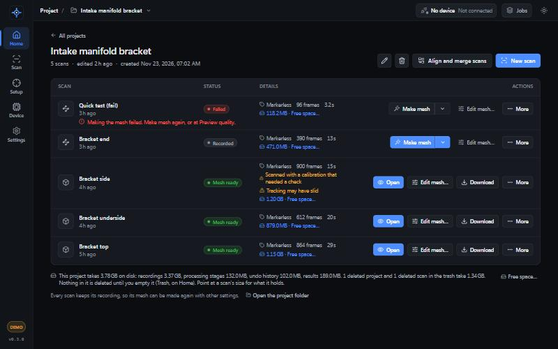
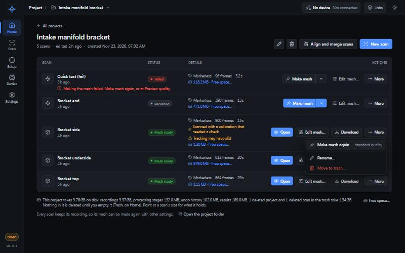
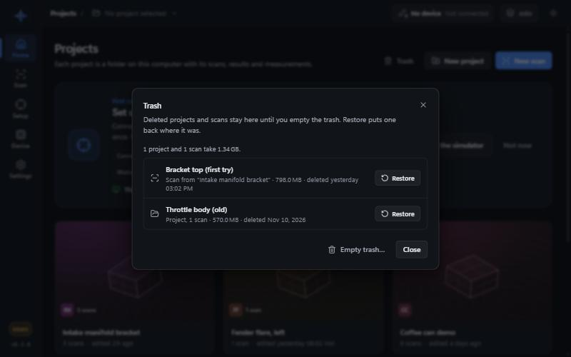
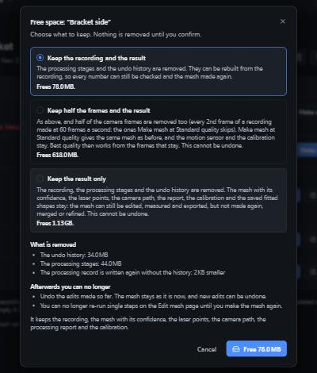
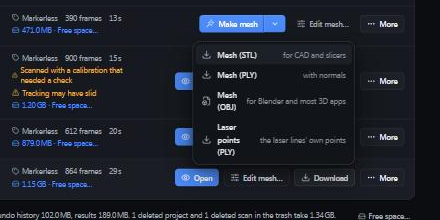
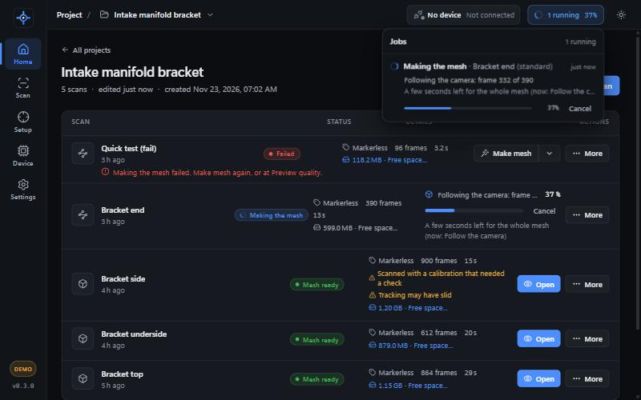

# Projects and scans

This page explains how OpenHandScan Studio keeps your work: projects, the scans in them, the trash, the space they take on disk, the files in a scan's folder, downloads and the Jobs panel.

On this page:

- [What a project and a scan are](#what-a-project-and-a-scan-are)
- [Create, rename and open a project](#create-rename-and-open-a-project)
- [The project page](#the-project-page)
- [What a scan's status means](#what-a-scans-status-means)
- [Rename a scan](#rename-a-scan)
- [Move a project or a scan to the trash](#move-a-project-or-a-scan-to-the-trash)
- [Restore from the trash, or empty it](#restore-from-the-trash-or-empty-it)
- [See how much space a project takes](#see-how-much-space-a-project-takes)
- [Free space](#free-space)
- [Download a mesh](#download-a-mesh)
- [Where a project lives on disk](#where-a-project-lives-on-disk)
- [The Jobs panel](#the-jobs-panel)
- [Messages on this page](#messages-on-this-page)

## What a project and a scan are

A **project** is a folder on your computer that keeps the scans, results and measurements of one part (or one job) together. The Home page lists your projects as cards.

A **scan** is one pass of the scanner over the part. Every scan keeps its **recording**: the raw camera frames and the motion sensor's readings, exactly as the scanner sent them. From the recording the app makes the **mesh**, the 3D surface of the part made of small triangles. Because the recording is kept, you can make the mesh again later with other settings (see [make-mesh.md](make-mesh.md)).

A **merged scan** is made by merging two or more scans of the same part (see [align-merge.md](align-merge.md)). It has a mesh but no recording of its own.

## Create, rename and open a project

To create a project:

1. On Home, click **New project**.
2. Type a name under **Project name** and click **Create project**.

The new project becomes the current one: scans you start now go into it. You can also start a scan straight away with **New scan** on Home or on the project page (see [scanning.md](scanning.md)).

To open a project, click its card on Home. When you point at a card, a **Scan** button and a menu appear. The menu holds **Open**, **New scan here**, **Rename…** and **Move to trash…**.

To rename the project you have open, click the pencil button (**Rename project**) at the top of the project page, type the new name and click **Rename**.

With more than four projects, Home shows a **Search projects** box.

## The project page

The project page lists the project's scans, newest first, in a table with four columns: **Scan**, **Status**, **Details** and **Actions**. Above the table are the project's name, how many scans it has, when it was last edited and when it was created.

*The project page: each row is one scan, with its status, its details and its actions.*

The buttons at the top:

| Button | What it does |
|---|---|
| **Rename project** (pencil) | Renames the project. |
| **Move project to trash** (bin) | Moves the whole project to the trash, after asking. |
| **Align and merge scans** | Lines up two to eight scans of the same part and merges them. Shown when at least two scans have a mesh. See [align-merge.md](align-merge.md). |
| **New scan** | Opens the Scan page for this project. While a scan of this project is running it reads **Back to live scan**. |

The **Details** column of a scan can show:

| Detail | What it means |
|---|---|
| **Markers** or **Markerless** | The tracking mode the scan was made with (see [scanning.md](scanning.md)). |
| Frames and duration | How many camera frames the recording holds and how long the scan lasted. |
| **Merged** | The scan was made by merging other scans and has no recording of its own. |
| **Scanned with a calibration that needed a check**, or **...that needed recalibrating** | The scan's own calibration status was not Valid. Point at it for the reason. See [setup.md](setup.md). |
| **Tracking may have slid** | The camera path has a jump no hand makes. Point at it for the full sentence. See [make-mesh.md](make-mesh.md#if-tracking-may-have-slid). |
| **Notes on making the mesh** (or **Notes from the merge**) | Other notes from the processing report. Point at it to read them. |
| **Keeps the recording and the result**, **Keeps half the frames and the result** or **Keeps the result only** | You freed space on this scan (see [Free space](#free-space)). Point at it for what was removed and when. |
| Size and **Free space…** | What the scan takes on disk. Point at it for the parts; click it to free space. |

The **Actions** column changes with the scan's status:

| The scan | Actions shown |
|---|---|
| Has a mesh | **Open** (the viewer, see [viewer.md](viewer.md)), **Edit mesh…** (see [editing.md](editing.md)), **Download**, **Make mesh again** (in the **More** menu unless the window is very wide) |
| Has a recording but no mesh | **Make mesh** (with a quality menu), **Edit mesh…** |
| Is being made | The progress bar with **Cancel**, and **Open** when it already had a mesh |
| Is recording | **Go to live scan** |

Every row also has a **More** menu with **Rename…** and **Move to trash…**. In a window narrower than about 1500 pixels, **Make mesh again** is in this menu (at Standard quality) instead of on the row. In a window narrower than about 1100 pixels the row's other actions, such as **Edit mesh…** and **Download**, move into this menu too, so look there if a button seems to be missing.

*The More menu of a scan with a mesh: Make mesh again, Rename… and Move to trash….*

## What a scan's status means

| Status | What it means | What you can do |
|---|---|---|
| **Recording** | The scan is running now. | **Go to live scan**. Stop the scan before you edit it or move it to the trash. |
| **Recorded** | The recording is saved but has no mesh yet. | **Make mesh**. |
| **Making the mesh** | A Make mesh job is running on the scan. | Wait, or **Cancel**. If the scan had a mesh, it stays until the new one is ready. |
| **Mesh ready** | The scan has a mesh. | **Open**, **Edit mesh…**, **Download**, **Make mesh again** (in the **More** menu unless the window is very wide). |
| **Failed** | Making the mesh failed. The reason is on its own line under the row. | Read the reason, then **Make mesh** again, or at Preview quality. The recording is kept. |

## Rename a scan

1. Open the scan's **More** menu and choose **Rename…**.
2. Type the new name under **Scan name** (at most 120 characters) and click **Rename**.

Two scans of one project cannot share a name. The app refuses a name another scan already has and suggests a free one, for example "Bracket (2)".

## Move a project or a scan to the trash

Nothing is deleted when you move something to the trash. Its folder moves to the trash folder, and you can restore it from **Trash** on Home.

To move a scan to the trash:

1. Open the scan's **More** menu and choose **Move to trash…**.
2. Read the question and click **Move to trash**.

The scan's folder (its recording, mesh and measurements) moves to the trash. If other scans depend on this one (a second pass of it, or a scan merged from it), the question names them. They keep their own meshes, but cannot be made again from this scan while it is in the trash.

You cannot move a scan to the trash while it is recording, or while its mesh is being made, aligned or merged. **Move to trash…** is then greyed out and says why.

To move a whole project to the trash, click **Move project to trash** at the top of the project page, or choose **Move to trash…** from the project card's menu on Home. The project folder and all its scans move together.

## Restore from the trash, or empty it

The trash holds deleted projects and scans until you empty it.

*The Trash: each item says what it is, where it was, its size and when it was deleted.*

To restore something:

1. On Home, click **Trash**.
2. Click **Restore** beside the item.

It goes back where it was. If its name is taken by now, it gets " (restored)" added and the app tells you the new name. A scan whose project is also in the trash says **Restore its project first.**: restore the project, then the scan.

To delete everything in the trash for good:

1. On Home, click **Trash**, then **Empty trash…**.
2. The dialog asks again, names what goes and how much space it frees. Click **Delete for good**.

This cannot be undone: the recordings, meshes and measurements in those items are gone. Only the items the dialog listed are deleted.

## See how much space a project takes

Under the scan table the project page says what the project takes on disk, for example "This project takes 1.2 GB on disk: recordings ..., processing stages ..., undo history ..., results ...". If the trash holds anything, the same line says how much the trash takes. The trash is not part of the project, and nothing in it is deleted until you empty it.

Point at a scan's size in its row to see what it holds:

| Part | What it is |
|---|---|
| **Recording** | The camera frames and the motion sensor's readings. Usually the largest part. |
| **Processing stages** | The files of each stage of making the mesh (Follow the camera, Straighten and so on). They can be rebuilt from the recording. |
| **Undo history** | The saved steps that let you undo edits. |
| **Result** | The mesh files, laser points, camera path and report. |
| **Other files** | Everything else: the processing record, the thumbnail, saved measurements and so on. |

## Free space

Free space removes parts of a scan you may no longer need. You choose what to keep; the app shows what each choice frees and what you can no longer do afterwards. Nothing is removed until you confirm, and nothing is ever removed on its own. New scans keep everything.

To free space:

1. Click a scan's size (**... · Free space…**) in its row, or **Free space…** under the table for every scan of the project.
2. Choose what to keep. Each choice says how much it frees.
3. Read **What is removed** and **Afterwards you can no longer**.
4. Click **Free** with the amount.
5. For the second and third choices the app asks once more, because they cannot be undone. Click **Delete the recording** or **Delete half the frames**.

*Free space: choose what to keep; each choice says what it frees and what you lose.*

| Choice | What goes | What you can still do | Can it be undone? |
|---|---|---|---|
| **Keep the recording and the result** | The processing stages and the undo history. | Everything: Make mesh rebuilds the stages from the recording. You can no longer undo the edits made so far, and you cannot re-run single stages on the Edit mesh page until you make the mesh again. | The stages come back when you make the mesh again. The old undo steps do not. |
| **Keep half the frames and the result** | As above, plus the camera frames Make mesh at Standard quality skips (every second frame of a recording made at 60 frames a second). | Make mesh at Standard quality gives the same mesh as before. Best quality then works from the frames that stay and gives the Standard mesh. | No. |
| **Keep the result only** | The recording, the processing stages and the undo history. | The mesh can still be edited, measured and exported. It cannot be made again, merged or refined. | No. |

A choice that does not apply to a scan (for example, half the frames of a recording made at 30 frames a second) says why and frees nothing. A merged scan has no recording, so only **Keep the result only** applies to it.

## Download a mesh

On the project page, click **Download** on a scan's row (in a narrow window it is in the **More** menu). The viewer and the Edit mesh page offer the same files as buttons, in the same order (the Edit mesh page without the laser points).

*The Download menu of a scan with a mesh.*

| Item | File name | What it is for |
|---|---|---|
| **Mesh (STL)** | `<project>-<scan>.stl` | CAD and slicers. |
| **Mesh (PLY)** | `<project>-<scan>.ply` | The mesh with its normals. |
| **Mesh (OBJ)** | `<project>-<scan>.obj` | Blender and most 3D apps. Only there when OBJ export is turned on in the engine's settings. |
| **Laser points (PLY)** | `<project>-<scan>-laser.ply` | The laser lines' own points. Only for scans that have them. |

You always get the current mesh, with every edit you applied. **All units are millimetres**: set the import units to mm in your CAD or mesh program.

## Where a project lives on disk

Projects live in the folder that Home names at the bottom of the page (by default `~/OpenHandScan/projects`). To open a project's folder in your file manager, click **Open the project folder** under the scan table. (In the demo no folder opens.)

You do not need to touch these files: the app manages them. This table is for looking things up.

| Path inside the project folder | What it holds |
|---|---|
| `project.json` | The project's name, dates and list of scans. |
| `references/` | CAD models you compared the scans with (see [compare.md](compare.md)). |
| `scans/<scan id>/recording/` | The recording: the camera frames (`frames/`, listed in `frames.csv`), the motion sensor (`imu.csv`), events such as pauses (`events.csv`), the calibration the scan was made with (`calibration.json`) and notes on the recording (`meta.json`). |
| `scans/<scan id>/process/` | The processing stages (one folder each), the processing record (`state.json`) and the undo history (`cache/`, `selections/`). |
| `scans/<scan id>/result/` | The current result, described below. |
| `scans/<scan id>/features.json` and `features/` | Fitted shapes and measurements you saved (see [measuring.md](measuring.md)). |

The files in a scan's `result/` folder:

| File | What it is |
|---|---|
| `mesh.ply` | The current mesh, with normals and, when the mesh has it, each point's confidence. |
| `mesh.stl` | The same mesh as STL. |
| `mesh.obj` | The same mesh as OBJ, only when OBJ export is turned on. |
| `laser_points.ply` | The points measured on the laser lines, the most accurate data of a scan. |
| `trajectory.csv` | The camera path: the scanner's position for every frame. |
| `report.json` | The processing report: frame counts, tracking, timings, mesh statistics and warnings. |
| `marker_map.json` | The map of the markers, for scans made in markers mode. |

Deleted projects and scans go to a hidden `.trash` folder inside the projects folder.

## The Jobs panel

A **job** is a long task the app runs in the background: making a mesh, a stage of the Edit mesh page, an edit, a recipe, aligning or merging scans, a calibration and so on. Jobs keep running when you switch pages.

The **Jobs** button sits in the top bar. While jobs run, it says how many (for example **1 running**) and the progress of the newest. Click it to open the panel.

*The Jobs panel: the newest jobs, with progress, time left and Cancel.*

Each row shows what the job is, the scan, the quality, when it started and what it is doing now. A running job shows a progress bar, the time left and **Cancel**. A finished job offers a way to its result: **Open result**, **Open the merged scan** or **Open in Edit mesh**. The panel shows the eight newest jobs.

To cancel a job, click **Cancel** on its row (or on the scan's row on the project page). Cancelling Make mesh leaves the scan as it was: an earlier mesh stays, and so does the recording.

## Messages on this page

| Message | What it means | What to do |
|---|---|---|
| **No scans in this project yet** | The project is empty. | Connect the scanner (or the simulator) and click **Start a scan**. |
| **This project doesn't exist any more** | The project was moved to the trash, or renamed outside Studio. | Go back to **All projects**, or restore it from the trash. |
| **Couldn't load the project** | The engine could not read the project. | Click **Try again**. If it repeats, see [troubleshooting.md](troubleshooting.md). |
| **This scan is recording. Stop it first.** | You tried to move a recording scan to the trash. | Stop the scan, then try again. |
| **This scan is busy: its mesh is being made, or it is being aligned or merged. Wait for it to finish, or cancel it.** | A job is using the scan. | Wait, or cancel the job in the Jobs panel. |
| **Moved "..." to the trash** | The project or scan is in the trash. | Restore it from **Trash** on Home if you need it back. |
| **Restore its project first.** | The scan's project is in the trash too, or gone. | Restore the project, then the scan. |
| **Restored "..."** (**Its name was taken, so it is now "..."**) | The item is back. Its name was already in use, so it got a new one. | Rename it if you like. |
| **Some items could not be deleted** | A program has a file of them open. | Close that program, then empty the trash again. |
| **Delete ... for good?** | The second question before emptying the trash. | Click **Delete for good** only if you are sure. It cannot be undone. |
| **Delete the recording for good?** | The second question before **Keep the result only**. | Click **Delete the recording** only if you will never need to make the mesh again. |
| **Delete half the frames?** | The second question before **Keep half the frames and the result**. | Click **Delete half the frames** to go on. |
| **Couldn't free all of the space** | A file was held open, or the engine refused. | Read the reason. Close other programs and try **Free space…** again. |
| **There is nothing to free: ...** | Nothing of that choice is on disk for this scan. | Choose another option, or leave the scan as it is. |
| **No OBJ for this scan** | OBJ export is off, so the engine wrote no OBJ file. | Download STL or PLY, or turn on OBJ export in the engine's settings and make the mesh again. |
| **Failed: ...** (under a scan row), or **Making the mesh failed.** when no reason was saved | Making the mesh failed; the reason follows. | **Make mesh again, or at Preview quality.** See [make-mesh.md](make-mesh.md). |
| **Making the mesh was cancelled** | You cancelled Make mesh. | Nothing is lost. Make the mesh again when you like. |
| **In the demo, no folder opens** | You clicked **Open the project folder** in the demo. | With the app on your computer, the folder opens in your file manager. |
