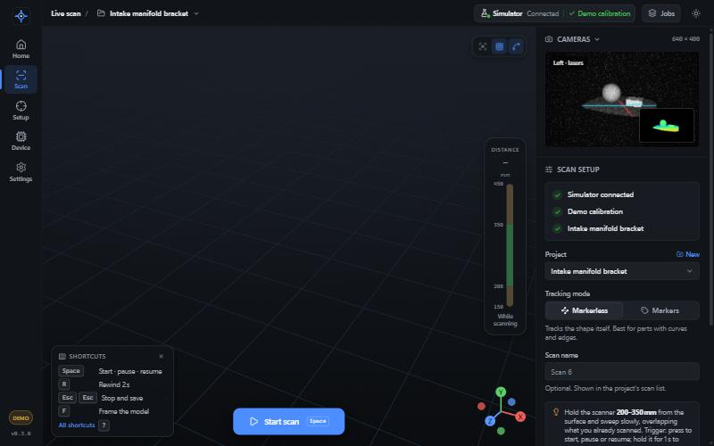
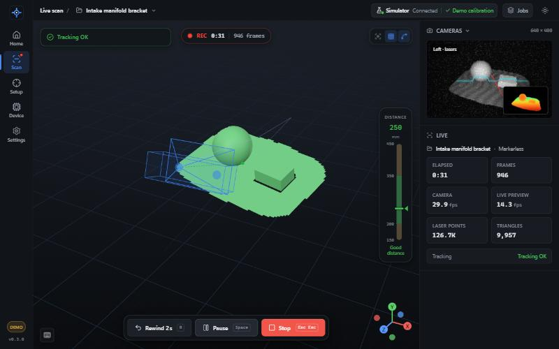
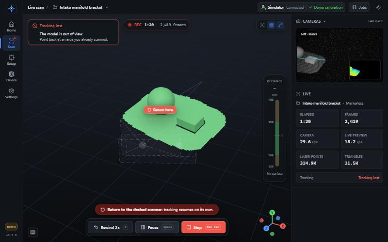
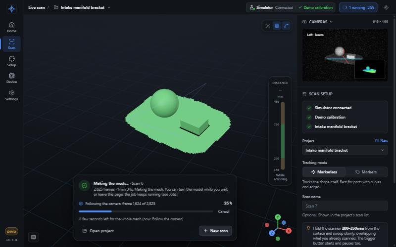
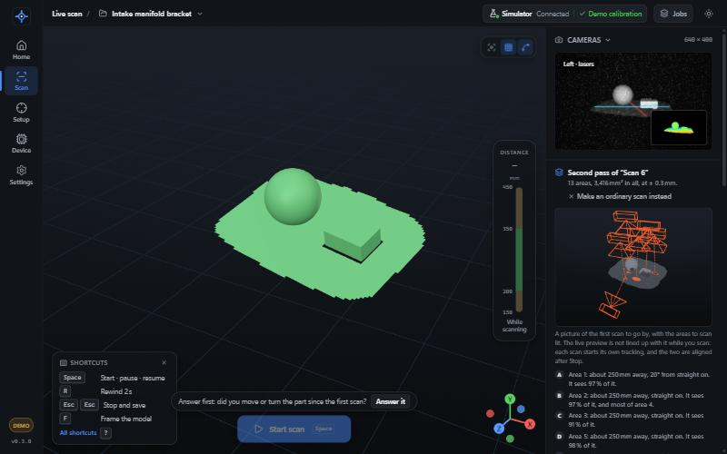

# Scanning

This page covers the Scan page: getting ready, starting and stopping a scan, reading the live view, what to do when tracking is weak or lost, second passes, tags for large plain parts, and laser safety.

On this page:

- [Before you start](#before-you-start)
- [The Scan page](#the-scan-page)
- [Start a scan](#start-a-scan)
- [Pause, rewind and stop](#pause-rewind-and-stop)
- [The live 3D view](#the-live-3d-view)
- [The camera and depth pictures](#the-camera-and-depth-pictures)
- [The distance gauge](#the-distance-gauge)
- [Tracking](#tracking)
- [If tracking is weak](#if-tracking-is-weak)
- [If tracking is lost](#if-tracking-is-lost)
- [After you stop](#after-you-stop)
- [Hotkeys and the trigger](#hotkeys-and-the-trigger)
- [The lasers and dots](#the-lasers-and-dots)
- [A second pass](#a-second-pass) and [if the pass stops part-way](#if-the-pass-stops-part-way)
- [Tags for large plain parts](#tags-for-large-plain-parts)
- [Laser safety](#laser-safety)
- [Messages on this page](#messages-on-this-page)

## Before you start

The scanner needs:

- **A connected device**: the scanner, a replay or the simulator. See [setup.md](setup.md#the-device-page).
- **A calibration**: at least the **Cameras** step of the Setup wizard. See [setup.md](setup.md).
- **A project** to save the scan in. See [projects.md](projects.md).

How to hold it:

- Keep the scanner **200 to 350 mm** from the surface. The laser lines cross at about 250 mm, the sweet spot. The live view works from 150 to 450 mm.
- Move **slowly**, in overlapping sweeps, like spray painting. Keep part of the area you already scanned in view.

The surface:

- Glossy paint, dark plastic, chrome and glass reflect or swallow the dots and the laser lines. Spray them with a matte scanning spray, for example AESUB Blue, which evaporates within hours.
- Avoid glare on the part.
- If the camera pictures stay too bright or too dark, the camera's exposure and gain can be set in the settings file (`[camera] exposure` and `gain`; by default the camera sets them itself). The app shows them under **Advanced** on the Settings page but does not change them; see [settings.md](settings.md#advanced-what-the-settings-file-says) and section 10 of [software/README.md](../../software/README.md) for the units.

The disk: a recording takes about 36 MB for each second of scanning (measured at 30 frames a second). Check you have room before a long scan: see [getting-started.md](getting-started.md#disk-space-and-memory).

For a large, smooth area with little shape (a door, a hood, a roof), use tags. See [Tags for large plain parts](#tags-for-large-plain-parts).

## The Scan page

**Scan** in the sidebar opens the page, titled **Live scan**. The big area is the live 3D view. The panel on the right shows the camera pictures and, before a scan, the scan's setup.

*The Scan page ready to start, with the simulator connected.*

Before a scan, the right panel has:

- **Cameras**: the camera and depth pictures (see [below](#the-camera-and-depth-pictures)).
- **Scan setup**: three checks (the device, the calibration, the project), then:
  - **Project**: the project the scan goes into. **New** creates one.
  - **Tracking mode**: **Markerless** tracks the shape itself, best for parts with curves and edges. **Markers** uses AprilTag stickers to keep big flat panels from drifting.
  - **Scan name**: optional, shown in the project's scan list.
- **What are you scanning?**: a preset, a named set of settings for the kind of part. **General** keeps every setting as it is. **Thin sheet metal and small parts** makes the mesh detail finer (0.5 mm instead of 1 mm; the **mesh detail** is the size of the smallest cell the surface is built from; smaller is finer; see [make-mesh.md](make-mesh.md#words-used-on-this-page)) so thin walls come out closer to their real thickness; making the mesh takes about twice as long. Hover over a preset to read what it changes. Presets are described in [make-mesh.md](make-mesh.md).
- **Lasers and dots** (scanner only): see [The lasers and dots](#the-lasers-and-dots).

When the calibration status is not valid, a line above the view says so with a button to the Setup step. It warns; it does not block the scan. See [setup.md](setup.md#the-calibration-status-after-connecting).

## Start a scan

1. Connect the device and choose the project.
2. Point the scanner at the part, about 250 mm away.
3. Press the trigger, press **Start scan**, or press Space.
4. Sweep slowly over the part, keeping the distance gauge green.

If **Start scan** is greyed out, the line above it says why, for example **Connect a device to start** or **Choose a project to start**.

When you open the Scan page from **New scan** on Home, the project picker asks **Choose the project for this scan**.

After **Scan your first object** in the Setup wizard, a short guide called **Your first scan** appears. Press **Got it** to close it.

## Pause, rewind and stop

While scanning, the control bar at the bottom has three buttons:

| Button | Key | What it does |
|---|---|---|
| **Rewind 2 s** | R | Cuts the last 2 seconds from the live model. Use it after a bad moment, for example a jump. The raw recording keeps those frames, marked as cut, and the mesh is made without them. |
| **Pause** / **Resume** | Space | Pauses the scan. While paused, frames are not recorded and the lasers and dots are off. |
| **Stop** | Esc twice | Stops and saves the recording. |

### More about rewind

- Each press cuts the 2 seconds before the newest recorded frame. Pressing again straight away, with no new frames since, cuts the same span again: it does not go back further. Pressing again after scanning on cuts the last 2 seconds of the new frames.
- While paused, no frames are recorded, so a rewind cuts the 2 seconds before you paused. Time spent paused within those 2 seconds counts towards them.
- While the live model is rebuilt, the badge says **Not tracking** for a moment. The rebuilt model is coarser until new frames fill it in.
- Tracking then starts again from the last kept position, so move back near it. If tracking is lost, the dashed scanner shows where.
- In marker mode the map of the tags is not rewound.
- A message says **Rewound 2 s**. The cut frames stay in the recording, marked as cut; making the mesh skips them.

### Stop with Esc

Esc also closes things, so one press only shows **Press Esc again to stop**. A second press within a second stops. The **Stop** button stops at once.

At the top of the view, a chip shows **REC** with the time and the number of frames, **PAUSED** while paused, and **SAVING** while the recording is being saved.

## The live 3D view

*A scan in progress with the simulator.*

The view shows the model as it grows. It is a rough live preview at half resolution, only for feedback. The final mesh is made later from the full recording.

- **Colours**: the model is yellow where few frames have seen it, and green where many have. Sweep over yellow areas again.
- **The scanner**: drawn where it is now, with a line to the surface. The line and its dot are coloured by distance: green is good, amber is a little close or far, red is too close or too far.
- **The scanner path**: the trail behind the scanner.

The toolbar at the top right:

| Button | What it does |
|---|---|
| **Frame the model (F)** | Turns and zooms the view to show the whole model. |
| **Grid** | Shows or hides the floor grid. |
| **Scanner path** | Shows or hides the trail. |

You can turn the view with the mouse while you scan.

The **Live** panel on the right shows **Elapsed**, **Frames**, the **Camera** and **Live preview** frame rates, **Laser points** and **Triangles**, and the tracking state. On the scanner it also shows the levels of the vertical and horizontal lasers and the dots.

If the computer cannot keep up, the panel says **The live preview is slow on this computer. Move more slowly; the recording still keeps every frame.**

## The camera and depth pictures

The **Cameras** section at the top of the right panel shows:

- the left camera picture with the laser lines drawn on it (**Left · lasers**);
- a small depth picture in the corner: the distance of each point, in colour.

Click the small picture to swap the two. Click the section's title to fold it away.

The depth picture is empty where the scanner cannot measure: too close, too far, a shiny or dark surface, or no dots on it.

## The distance gauge

The gauge on the right of the view shows the distance to the surface while you record. The bar runs from 150 mm (bottom) to 450 mm (top); the green band is 200 to 350 mm.

| Text | Distance | What to do |
|---|---|---|
| **Too close** | under 150 mm | Move back. |
| **Move back a little** | 150 to 200 mm | Move back a little. |
| **Good distance** | 200 to 350 mm | Keep going. |
| **Move closer** | 350 to 450 mm | Move closer. |
| **Too far** | over 450 mm | Move closer. |
| **No surface** | none | Point the scanner at the part. |

Before a scan and while paused, the gauge says **While scanning**.

## Tracking

**Tracking** is how the app works out where the scanner is for each frame, by matching what it sees with the model built so far (or with the tags, in marker mode). Good tracking puts every frame in the right place. The motion sensor helps when it is calibrated.

The badge at the top left of the view shows the state:

| State | Meaning |
|---|---|
| **Tracking OK** | The frame matched. |
| **Tracking weak** | The frame matched, but not well. The scanner on the view turns amber. |
| **Tracking lost** | The frame did not match. The app is not adding to the model. |

To see how well each frame matched, turn on **Show the tracking numbers** in [Settings](settings.md#while-scanning). The badge then shows two numbers: how well the frame matched the model, and how far apart the surfaces were.

## If tracking is weak

The badge says what is wrong and what to do. The common reasons:

| Reason shown | What to do |
|---|---|
| **No depth on the surface** | Hold the scanner 200 to 350 mm from the part. |
| **Unreliable depth** | Avoid glare and turn the dots up. |
| **The model is out of view** | Point back at an area you already scanned. |
| **Tracking jumped** | Move slower and keep overlap with the scanned area. |
| **Too little shape to follow** | Add tags or move closer. |
| **Little overlap with the model** | Slow down and keep the scanned area in view. |
| **Surface doesn't match the live preview** | Hold steady; check the part has not moved. |
| **Moved too fast** | Slow down and return to the last good spot. |
| **Waiting for tags** (markers) | Show at least 2 AprilTags to start the map. |
| **No tags in view** (markers) | Point at an area with AprilTag stickers. |
| **Too few tags** (markers) | Keep 2 or more tags in view, or add stickers. |
| **Tags don't agree** (markers) | A tag may have moved; hold steady. |
| **Tag positions are inconsistent** (markers) | Move closer or reduce motion blur. |

Flat, smooth, plain areas can let the scanner "slide": the shape does not pin down where it is. Use tags for those.

## If tracking is lost

*Tracking lost. The dashed scanner marks the last good position.*

When tracking is lost:

1. Look for the **dashed scanner** in the view, labelled **Return here**. It marks the last place where tracking was good.
2. Move the scanner slowly back to that spot, pointing at an area you already scanned.
3. Hold it there. Tracking resumes on its own, and the badge returns to **Tracking OK**.

The banner at the bottom says **Return to the dashed scanner: tracking resumes on its own.**

If the last seconds went wrong before tracking was lost, press **Rewind 2 s** (R) once tracking is back.

## After you stop

After **Stop** the recording is saved, and a card appears at the bottom of the view.

*After Stop: the mesh is being made from the recording.*

- If **Make the mesh as soon as a scan stops** is on in [Settings](settings.md#after-a-scan) (the default), the mesh is made right away at Standard quality. The card shows **Making the mesh…** with its progress. You can turn the model or leave the page: the job keeps running (see **Jobs** in the top bar).
- If it is off, the card says **Scan saved**. Press **Make mesh** to make it.

When the mesh is ready the card says **Mesh ready**, and the finished mesh takes the live model's place. Then:

| Button | What it does |
|---|---|
| **Open result** | Opens the mesh in the viewer. See [viewer.md](viewer.md). |
| **Edit mesh…** | Opens the mesh editor. See [editing.md](editing.md). |
| **Open project** | Opens the project with all its scans. |
| **New scan** | Clears the view for the next scan. |

Making the mesh is described in [make-mesh.md](make-mesh.md).

## Hotkeys and the trigger

| Key | What it does |
|---|---|
| Space | Start the scan, pause, resume. |
| R | Rewind 2 s: cut the last two seconds from the live preview. |
| Esc Esc | Stop and save: press Esc twice within a second. |
| F | Frame the model. |
| ? | Show all keyboard shortcuts. |

The keyboard card at the bottom left lists the main keys; the keyboard button shows it again if you hid it. Keys do not work while you type in a text field. Every key and mouse action of the app is listed in [keys.md](keys.md).

The scanner's trigger:

| Press | When | What it does |
|---|---|---|
| Short press | No scan running | Starts a scan in the last-used project. |
| Short press | Scanning | Pauses or resumes. |
| Long press (1 s or more) | Scanning | Stops the scan. |

## The lasers and dots

The scanner has two light sources besides its cameras:

- the **line lasers** draw thin lines on the part. Their points are the most precise data the scanner takes;
- the **dots** project a pattern that gives the cameras texture on plain surfaces, so they can measure depth.

The standard build has two line lasers, one vertical and one horizontal. The 4-laser build adds a second of each. You choose this in [Settings](settings.md#line-lasers).

On the scanner, open **Lasers and dots** in the right panel to set the **Vertical laser**, the **Horizontal laser** and the **Dots** in percent, or press **Scan**, **Lines only**, **Dots only** or **All off**. Changes during a scan are kept for the rest of it. With four lasers, each laser's brightness within its pair is set in [Settings](settings.md#line-lasers).

The lasers and dots switch on when a scan starts, off while it is paused, and off when it stops. On the Device page you can also turn them on by hand. The simulator and replays carry their own levels, so these controls appear only with the scanner.

## A second pass

A **pass** is one scan of the part. A **second pass** is a scan made to fill in areas the first scan did not measure well enough. The app then joins the two.

You start a second pass from the first scan's **Scan check** in the viewer: press **Check the scan**, then **Scan these areas again…** (see [viewer.md](viewer.md)). The Scan page then opens set up for the pass.

*A second pass: the first scan with the areas to scan lit, and the places to scan from.*

The right panel shows **Second pass of "…"**, how many areas there are to scan again, and **Make an ordinary scan instead**, which drops the pass. Below that it has:

- a small picture of the first scan, with the areas to scan lit and the scanner drawn at each place to scan from. The live view is not lined up with this picture while you scan: each scan starts its own tracking, and the two are aligned after Stop;
- the places to scan from, in words, for example how far away and at what angle;
- the preset, the first scan's unless you change it;
- the question **Did you move or turn the part since the first scan?** Answer **Yes** or **No** before you start: until you do, **Start scan** is greyed out and the line above it says **Answer first: did you move or turn the part since the first scan?** with **Answer it**. With **No**, the table both scans share helps to align them and stays in the merge. With **Yes**, the table is not used to align them, and each scan's table is left out of the merge.

Start the pass as any scan. The scanner's trigger never starts a pass: it starts an ordinary scan, and the pass keeps waiting.

After **Stop** the app runs three steps on its own: **Make the pass's mesh**, **Align it to the first scan**, and **Merge the two into a new scan**. The first scan itself is not changed. When it is merged, the card shows **Before and after**: the share of the surface that meets the tolerance, before and after. Press **Open the merged scan** to see it.

A merge adds coverage: it fills in surface the first scan did not measure well enough. It does not make the surface the first scan already saw well more accurate: where both scans saw a place, the two are averaged.

### If the pass stops part-way

The card's title says where the pass is. Each step is an ordinary job, shown under **Jobs** too, and can be cancelled from the card's progress bar: that stops the pass's steps there, and the pass is kept as its own scan. Whatever happens, the first scan is not changed, and the pass stays in the project as a scan of its own.

| Title on the card | What it means | What to do |
|---|---|---|
| **Second pass: waiting for Stop** | You are still scanning the pass. | Press **Stop** when it is done. |
| **Second pass: making its mesh…** / **aligning it to the first scan…** / **merging the two…** | A step is running. | Wait, or cancel it. |
| **Second pass merged** | Done: a new merged scan is in the project. | **Open the merged scan**. |
| **Second pass not merged: the alignment was not accepted** | The pass could not be lined up with the first scan well enough. Nothing was merged. | **Open the Align page** to align by hand with matching points (see [align-merge.md](align-merge.md)), or **Try aligning again** (it aligns again from the shape, by the same rule). |
| **Second pass aligned, not merged** | The pass was aligned, but the merge cannot be made, for example because the first scan's recording was removed to free space, a scan it was merged from is gone, or more than 8 scans would be merged. The card's line gives the reason. | **Continue** to try the merge again once the cause is gone, or **Open the Align page**. |
| **Second pass stopped: a step failed** | A step failed. The card's line gives the engine's reason. | **Continue** runs the pass on from where it stopped. |
| **Second pass stopped: cancelled** | You cancelled a step. | **Continue** runs the pass on from where it stopped: the mesh if the pass has none yet, else the alignment. |

On a stopped card, **Open the pass** opens the pass's own scan in the viewer, and **New scan** clears the page for an ordinary scan. To scan the areas once more, start a new pass from the first scan's Scan check.

## Tags for large plain parts

On large, smooth, featureless areas (a whole door, a hood, a roof) markerless tracking can slide. Use **Markers** mode with AprilTag stickers instead.

1. Make and print the tag sheet in Setup, step **Print targets** (see [setup.md](setup.md#step-3-print-targets)). Print it at 100 % on matte removable label paper and cut the tags along the dashed lines.
2. Stick the 20 mm tags 5 to 10 cm apart, so that at least 2 or 3 are always in view.
3. On the Scan page choose **Markers** under **Tracking mode**.
4. Scan as usual. Do not move the tags during the scan.

In marker mode the dots run dimmed while you scan, so the tags can be read. The final processing at full resolution reads tags better than the live view does.

### Tags that hold a markerless scan (a setting, off)

Tags can also hold a scan made in **Markerless** mode. The Straighten stage then ties every pass to the tags it saw, so the passes no longer sit shifted along a plain part. On a simulated plain panel 1.3 m long, scanned in three passes with tags on the table, the mesh's length was 0.2 to 0.6 mm off with the setting on and 0.7 to 2.6 mm off without it; the passes sat up to 1.1 mm apart along the panel (RMS) instead of up to 11 mm.

It is off by default, for two reasons. It holds the length (where the tags acted, on eight of nine simulated long scans, the length came out within 0.05 %), but the passes still sit 0.6 to 1.4 mm apart along the part, more than the project allows. And in a test on a short scan of thin standing walls it made a 0.5 mm wall disappear from the mesh, with no warning, while the thicker walls got better.

**Do not switch it on for a part with walls thinner than about 1 mm that you scan from both sides.** It has not been tried with tags on the part itself. To use it:

1. Lay tags on the table along at least one long side of the part and across both ends. Two tags must often be in view at once along the part: that is what holds the length. In the test they were 300 mm apart; closer is better.
2. Do not move the tags during the scan. A tag that moves by about a millimetre can bend the scan.
3. Set `straighten_tags = true` under `[process]` in the settings file and start the app again (see [Change the settings file](settings.md#change-the-settings-file)).
4. Scan and make the mesh as usual. Make mesh takes longer (about 76 seconds more in the test), because the surface is built again at the corrected positions.

Afterwards the Straighten stage says what the tags did, for example **17 tags held the scan: the end of the scan moved 7.9 mm into place.**, names any tag it left out and why, or says why the tags changed nothing. The printed size of the tags does not need to be known. A scan with no tag in view comes out exactly as before.

## Laser safety

The line lasers, and the dot laser of the laser projector option, are **Class 3R**. In short:

- Never look into a beam, and never point the scanner at anyone's eyes, pets' included. Beware of reflections from chrome, glass and mirrors.
- Use the kill toggle on the back cover whenever you are not scanning.
- The software switches the lasers on only while scanning, during the laser calibration and check, and briefly in the self-test; the firmware switches them off if the computer stops talking to it.

The full rules are in [software/README.md](../../software/README.md), section 11, "Laser safety".

## Messages on this page

| Message | What it means | What to do |
|---|---|---|
| **Connect a device to start** | No device is connected. | Press **Use the simulator** or **Device page**, or connect the scanner. |
| **Connect a device to scan** | Shown in the middle of the view with no device. | Press **Start the simulator** or **Device page**. |
| **No calibration yet: calibrate the scanner in Setup** | The device has no calibration. | Press **Calibrate in Setup**. See [setup.md](setup.md). |
| **Choose a project to start** | No project is chosen. | Pick one under **Project**, or press **New**. |
| **A calibration is in progress in Setup.** / **A calibration result is still open in Setup.** | A scan and a calibration never run together. | Press **Review it** or **Close it**. |
| **Answer first: did you move or turn the part since the first scan?** | A second pass waits for your answer. | Press **Answer it** and choose **Yes** or **No**. |
| **Nothing to scan again yet** | The page was opened for a pass, but there is none. | Start a pass from the first scan's Scan check, or press **Start scan** for an ordinary scan. |
| **An ordinary scan was started, not the second pass of "…"** | The trigger started an ordinary scan. | Stop it; **Start scan** then begins the pass. |
| **Press Esc again to stop** | You pressed Esc once while scanning. | Press Esc again within a second to stop, or carry on. |
| **Tracking weak** / **Tracking lost** | See [Tracking](#tracking). | See [If tracking is weak](#if-tracking-is-weak) and [If tracking is lost](#if-tracking-is-lost). |
| **Return to the dashed scanner: tracking resumes on its own.** | Tracking is lost. | Go back slowly to the dashed scanner. |
| **Rewound 2 s** | The last 2 seconds are cut from the model. | Carry on scanning. |
| **Saving is behind: N frames waiting** | The disk or the processor is not keeping up. Frames wait in memory; nothing is lost so far. | Pause to let it catch up. |
| **Graphics card stopped: running slower** | The graphics card stopped working for part of the processing. It carries on with the processor, which is slower. | Carry on; move more slowly. |
| **The live preview is slow on this computer.** | The live view runs at a low frame rate. | Move more slowly. Every frame is still recorded. |
| **No new frames** | The camera picture has not changed for a few seconds. | Check the camera cable and the device. |
| **Waiting for camera frames…** | The device is connected but no picture has arrived. | Wait, or reconnect on the Device page. |
| **Making the mesh failed** | The mesh job failed. The raw recording is kept. | Press **Try again**. |
| **Making the mesh was cancelled** | The mesh job was cancelled. The raw recording is kept. | Press **Make mesh** any time. |
| **Couldn't start the scan** / **Couldn't stop the scan** | The engine refused the request. | Read the reason in the message and try again. |
| **This recording has no calibration, so it cannot be scanned from.** | You started a scan during a replay of a recording without a calibration. | Replay a recording made with a calibration, or connect the scanner or the simulator. |
| **Couldn't rewind** | The rewind failed, for example **The live preview is not running, so there is nothing to rewind.** | Stop the scan: the recording is complete, and its mesh can be made. |
| **Second pass stopped: …** / **Second pass aligned, not merged** / **Second pass not merged: …** | The pass's steps stopped part-way. | See [If the pass stops part-way](#if-the-pass-stops-part-way). |
| **Couldn't continue the pass** | **Continue** or **Try aligning again** was refused. | Read the reason in the message. |
| **Couldn't compare before and after** | The merged scan was made, but the comparison could not be read. | Open the merged scan; the merge itself is done. |

Next: [make the mesh](make-mesh.md), then [view and measure it](viewer.md). For problems not listed here, see [troubleshooting.md](troubleshooting.md).
