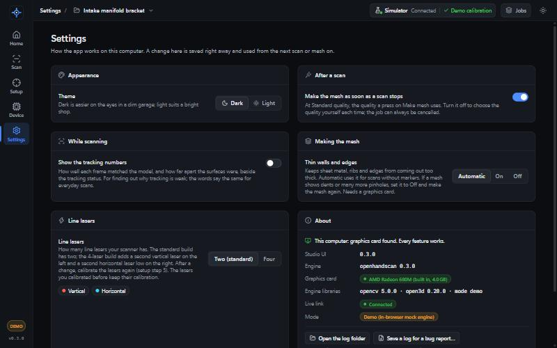
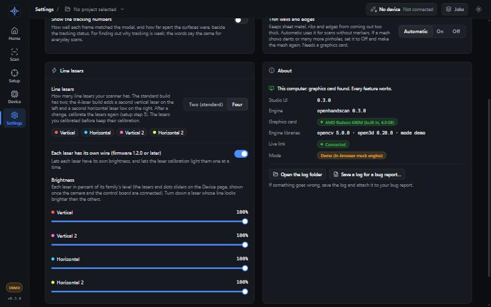
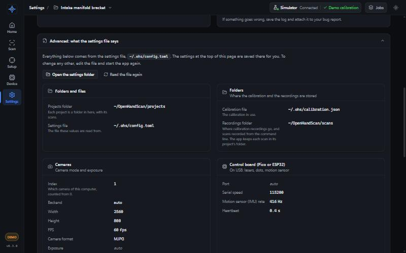

# Settings

This page lists every setting you can change in OpenHandScan Studio, what it does and its default, and where the app keeps its files. Most settings are on the Settings page; a few live on other pages.

On this page:

- [The Settings page](#the-settings-page)
- [Appearance](#appearance)
- [After a scan](#after-a-scan)
- [While scanning](#while-scanning)
- [Making the mesh](#making-the-mesh)
- [Line lasers](#line-lasers)
- [About](#about)
- [Advanced: what the settings file says](#advanced-what-the-settings-file-says)
- [All settings at a glance](#all-settings-at-a-glance)
- [Settings on other pages](#settings-on-other-pages)
- [Where files are kept](#where-files-are-kept)
- [Messages on this page](#messages-on-this-page)

## The Settings page

**Settings** in the sidebar opens the page. A change is saved right away and used from the next scan or mesh on.

The settings you change come first, in boxes: **Appearance**, **After a scan**, **While scanning**, **Making the mesh**, **Line lasers** and **About**. At the bottom, a closed box called **Advanced: what the settings file says** shows everything in the settings file, read only.

*The Settings page.*

Some settings are kept by the app window on this computer (theme, after a scan, while scanning). The others are saved in the **settings file**, `~/.ohs/config.toml` by default, which the command-line tool `ohs` reads too.

## Appearance

**Theme**: **Dark** or **Light**. Dark is easier on the eyes in a dim garage; light suits a bright shop. The default is Dark. The sun or moon button in the top bar changes it too.

## After a scan

**Make the mesh as soon as a scan stops**: when on, the app makes the mesh at Standard quality as soon as you press Stop, as the **Make mesh** button does. Turn it off to choose the quality yourself each time. The job can always be cancelled. The default is on. See [scanning.md](scanning.md#after-you-stop) and [make-mesh.md](make-mesh.md).

## While scanning

**Show the tracking numbers**: when on, the tracking badge and the Live panel on the Scan page show two numbers: how well each frame matched the model, and how far apart the surfaces were. It is for finding out why tracking is weak; the words say the same for everyday scans. The default is off. See [scanning.md](scanning.md#tracking).

## Making the mesh

**Thin walls and edges**: **Automatic**, **On** or **Off**. It keeps sheet metal, ribs and edges from coming out too thick. **Automatic** uses it for scans without markers. If a mesh shows dents or many more pinholes, set it to **Off** and make the mesh again. The default is **Automatic**.

It needs a graphics card. Without one it has no effect, and thin walls can come out thicker (see [getting-started.md](getting-started.md#what-this-computer-can-do)).

It is saved in the settings file as `[process] thin_walls`.

## Line lasers

**Line lasers**: how many line lasers your scanner has.

- **Two (standard)**: one vertical and one horizontal laser. This is the default.
- **Four**: the 4-laser build adds a second vertical laser on the left and a second horizontal laser low on the right.
- **Custom** (greyed out): shown when the settings file lists its own lasers. Pick **Two** or **Four** to replace that list; otherwise it stays as it is.

Below the choice, the configured lasers are listed with their colour in the camera picture (with four: **Vertical**, **Horizontal**, **Vertical 2** and **Horizontal 2**).

After a change, calibrate the lasers again (Setup, step 5: see [setup.md](setup.md#step-5-lasers)). The lasers you calibrated before keep their calibration.

It is saved in the settings file as `[lasers] lines`.

*Line lasers set to Four, with the brightness of each laser.*

With two lasers in a family (the 4-laser build), two more settings appear:

- **Each laser has its own wire (firmware 1.2.0 or later)**: lets each laser have its own brightness, and lets the laser calibration light them one at a time. The default is on. Turn it off if each pair of lasers shares one wire. Saved as `[lasers] own_channels`.
- **Brightness**: one slider per laser (**Vertical**, **Vertical 2**, **Horizontal**, **Horizontal 2**), in percent of its family's level. The family's level is the lasers and dots slider on the Device page, shown once the camera and the control board are connected. Turn down a laser whose line looks brighter than the others. The default is 100 %. When each pair shares one wire, there is one slider per pair (**Vertical lasers**, **Horizontal lasers**). Saved as `[lasers] brightness`.

## About

The **About** box tells you what this computer and this copy of the app are:

- one line on what this computer can do: with a graphics card, **This computer: graphics card found. Every feature works.**; without one, why and what is not available (see [getting-started.md](getting-started.md#what-this-computer-can-do));
- **Studio UI**: the version of the app's pages;
- **Engine**: the engine's name and version;
- **Graphics card**: the card in use, whether it is a separate card or built in, and its memory; or **None in use**;
- **Engine libraries**: the versions of the main libraries;
- **Live link**: **Connected**, **Connecting** or **Offline**;
- **Mode**: **Demo (in-browser mock engine)**, only in demo mode.

Two buttons help when something goes wrong:

- **Open the log folder** opens the folder with the app's log in your file manager.
- **Save a log for a bug report…** saves the log as a text file. Attach it to your bug report.

## Advanced: what the settings file says

Open this box to see everything in the settings file, read only, with plain labels (for example **Camera format** instead of `fourcc`). The settings at the top of the page are saved there for you. To change any other, edit the file and start the app again.

*The settings file's values under Advanced.*

| Button | What it does |
|---|---|
| **Open the settings folder** | Opens the folder of the settings file. |
| **Read the file again** | Reads the file again after you edited it. |

The sections and their main values, with the defaults:

| Section in the app | In the file | Main values (default) |
|---|---|---|
| **Folders and files** | `[paths]`, and where the file is | **Projects folder** (`~/OpenHandScan/projects`), **Settings file** (`~/.ohs/config.toml`): the file these values are read from |
| **Folders** | `[paths]` | **Calibration file** (`~/.ohs/calibration.json`), **Recordings folder** (`~/OpenHandScan/scans`): where calibration recordings and command-line scans go |
| **Cameras** | `[camera]` | which camera (counted from 0), width and height (2560 × 800), **Camera format** (MJPG), exposure and gain (the camera's own), **Swap left and right** (off) |
| **Control board (Pico or ESP32)** | `[pico]` | serial port (automatic), **Motion sensor (IMU) rate** (416 Hz) |
| **Lasers and dots** | `[emitters]` | **Dots in markers mode** (25 %), and the levels of the vertical laser, horizontal laser and dots for each use |
| **Live preview** | `[live]` | scale (0.5), **Nearest depth** (150 mm), **Farthest depth** (450 mm), **Preview mesh detail** (automatic: 2 mm) |
| **Making the mesh** | `[process]` | **Mesh detail** (automatic: 1 mm), **Thin walls and edges** (auto), **Watertight surface (Poisson)** (off), **Files written** (ply, stl) |
| **Calibration board** | `[board]` | **Squares across** (11), **Squares down** (8), **Square size** (20 mm), **Marker size** (15 mm), paper (letter) |
| **Markers** | `[markers]` | **Tag size** (20 mm): the side of the black square of the printed AprilTags |
| **Line lasers** | `[lasers]` | **Line lasers** (vertical, horizontal), **Each laser has its own wire** (on), brightness |

The full list of settings, with what each one does, is in [software/README.md](../../software/README.md), section 4, "Settings". `ohs config --init` writes a settings file with every setting in it, commented.

## All settings at a glance

| Setting | Where | What it does | Default |
|---|---|---|---|
| **Theme** | Settings, Appearance | Dark or light colours. | Dark |
| **Make the mesh as soon as a scan stops** | Settings, After a scan | Makes the mesh at Standard quality after Stop. | On |
| **Show the tracking numbers** | Settings, While scanning | Shows the match numbers beside the tracking state. | Off |
| **Thin walls and edges** | Settings, Making the mesh | Keeps thin walls, ribs and edges from coming out too thick. Needs a graphics card. | Automatic |
| **Line lasers** | Settings, Line lasers | Two or four line lasers. | Two (standard) |
| **Each laser has its own wire** | Settings, Line lasers (4 lasers) | Each laser gets its own brightness; the laser calibration lights them one at a time. | On |
| **Brightness** | Settings, Line lasers (4 lasers) | Each laser's level within its family. | 100 % |
| **Show the setup card on Home** | Setup overview, Reminder | Shows the **Set up your scanner** card on Home until the camera calibration is done. | On |
| **Use this camera** | Setup, Connect | Which camera of the computer is the scanner. | Camera 0 |
| **Swap left and right** | Setup, Connect | Swaps the left and right pictures. Use it only if the calibration says they are swapped. | Off |
| **Paper size** | Setup, Print targets | Letter or A4 for the printables and the laser calibration. | Letter |
| **Use my measurement** | Setup, Print targets | Scales the board for calibration to your measured print. | Not used |
| **Auto-capture** | Setup, calibration capture | Takes a view by itself when the board is steady at a new spot. | |
| **Capture click** | Setup, calibration capture | Plays a click on each capture. | On |
| **Tracking mode** | Scan page, Scan setup | **Markerless** or **Markers**. The page remembers your last choice. | Markerless |
| **What are you scanning?** | Scan page | The preset for the scan. | General |
| **Lasers and dots** | Device page, Scan page | The levels of the vertical laser, horizontal laser and dots, on the scanner only. | |

Some of these are described on their own pages: [setup.md](setup.md), [scanning.md](scanning.md).

## Settings on other pages

- **Graphics card on or off.** The app uses a graphics card when it finds one. To turn it off, set `device = "cpu"` in the `[compute]` section of the settings file; part of a card's name (for example `"RTX"`) picks one of several. The `OHS_COMPUTE` environment variable overrides it for one run. The **About** box then says why no graphics card is in use. See [software/README.md](../../software/README.md), sections 4 and 8.
- **Where the engine listens.** `[app]` `host` and `port` (default `127.0.0.1` and `8765`), or `ohs app --host` and `--port`. See [getting-started.md](getting-started.md#start-the-app).
- **Folders.** `[paths]` `projects_dir`, `data_dir`, `printables_dir`, `scans_dir` and `calibration`. See the next section.

## Where files are kept

| What | Default place | Setting |
|---|---|---|
| Projects: one folder per project, with its scans and results | `~/OpenHandScan/projects` | `paths.projects_dir` |
| Deleted projects and scans (the trash) | `.trash` in the projects folder | |
| The settings file | `~/.ohs/config.toml` | `--config` or the `OHS_CONFIG` environment variable |
| The calibration of the scanner | `~/.ohs/calibration.json`, the previous version as `calibration.json.bak` | `paths.calibration` |
| The app's own data: the wizard's state, the simulator's calibration sandbox, presets | `~/.ohs/studio` | `paths.data_dir` |
| The app's log | `logs/studio.log` in the app's data folder | |
| The printables (board, tags, mask) | `~/OpenHandScan/printables` | `paths.printables_dir` |
| Calibration recordings, and scans made with the command line | `~/OpenHandScan/scans` (calibration captures in its `calibration` folder) | `paths.scans_dir` |

`~` is your home folder, for example `C:\Users\you` on Windows. All lengths in the files are in millimetres.

## Messages on this page

| Message | What it means | What to do |
|---|---|---|
| **Couldn't load the settings** | The engine did not send its settings. | Press **Try again**. The line under it says why. |
| **Couldn't save the setting:** … | The engine refused or could not save the change. | Read the reason that follows, then try again. |
| **Couldn't open the folder** | The file manager could not be opened. | Open the folder by hand; the places are in [Where files are kept](#where-files-are-kept). |
| **In the demo, no folder opens** | You are in demo mode. | With the app on your computer, the folder opens in your file manager. |
| **This computer: … Scans still work, with these limits:** | No graphics card is in use. | See [getting-started.md](getting-started.md#what-this-computer-can-do). |
| **Custom** (greyed out) under Line lasers | The settings file lists its own lasers. | Pick **Two (standard)** or **Four** to replace the list, or leave it. |
| **Live link: Offline** | The window has lost its live connection to the engine. | See [getting-started.md](getting-started.md#if-the-app-cannot-reach-the-engine). |

For problems not listed here, see [troubleshooting.md](troubleshooting.md).
