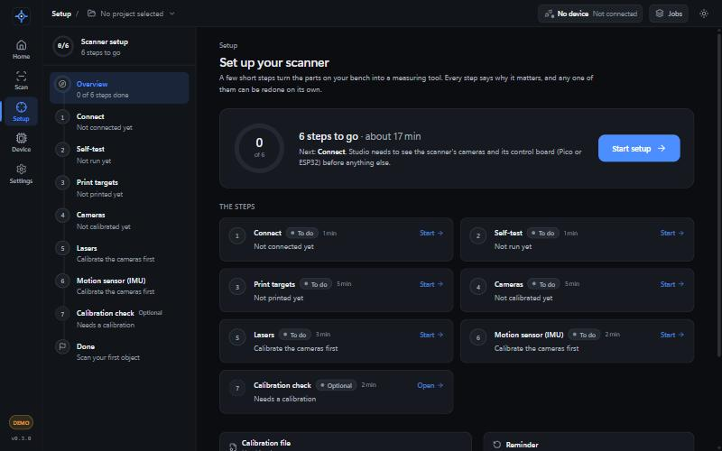
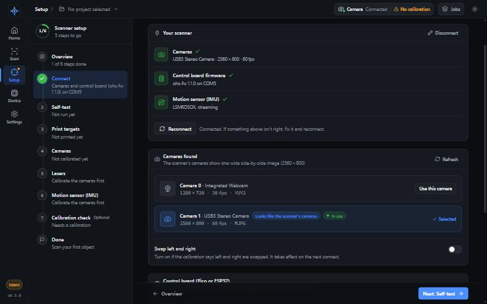
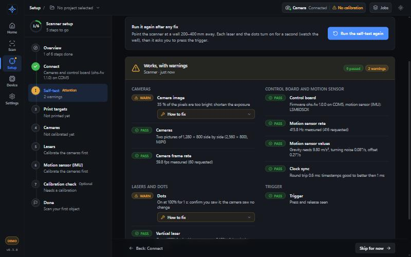
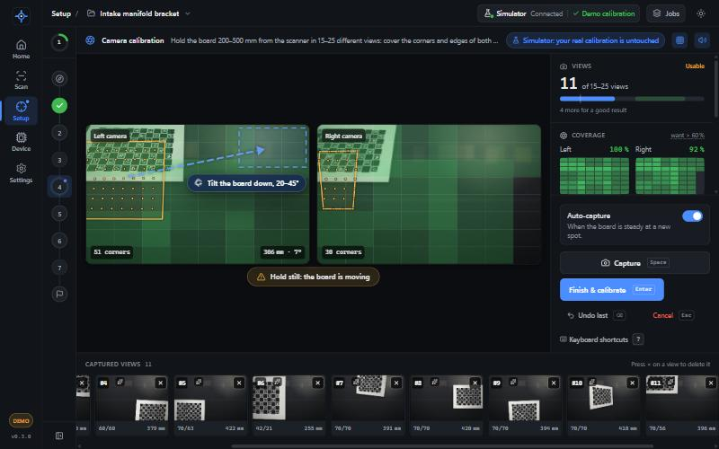
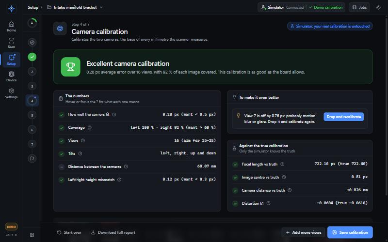
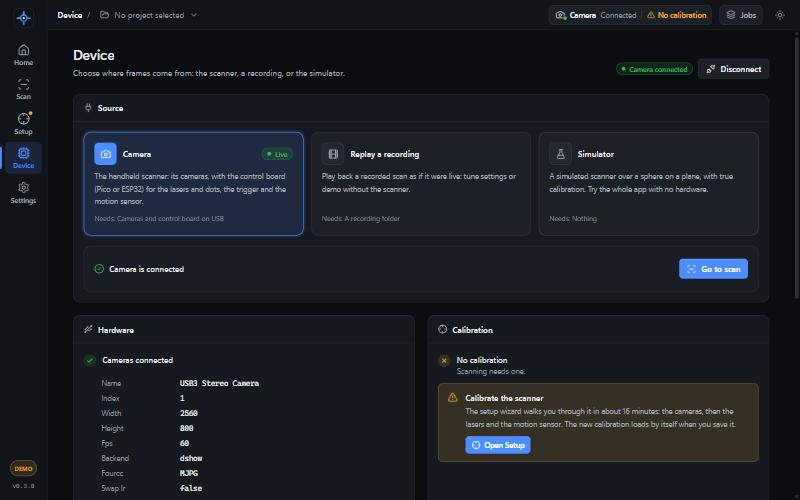

# Set up and calibrate the scanner

This page walks through the Setup wizard step by step: connecting the scanner, testing it, printing the targets and calibrating it. It also covers the calibration status the app shows after each connect, and the Device page.

On this page:

- [What setup and calibration are](#what-setup-and-calibration-are)
- [The Setup overview](#the-setup-overview)
- [Step 1: Connect](#step-1-connect)
- [Step 2: Self-test](#step-2-self-test)
- [Step 3: Print targets](#step-3-print-targets)
- [How the calibration steps work](#how-the-calibration-steps-work)
- [Step 4: Cameras](#step-4-cameras)
- [Step 5: Lasers](#step-5-lasers)
- [Step 6: Motion sensor (IMU)](#step-6-motion-sensor-imu)
- [Step 7: Calibration check](#step-7-calibration-check)
- [Read a calibration result](#read-a-calibration-result)
- [Done: scan your first object](#done-scan-your-first-object)
- [The calibration status after connecting](#the-calibration-status-after-connecting)
- [The Device page](#the-device-page)
- [Messages on this page](#messages-on-this-page)

## What setup and calibration are

**Calibration** measures your scanner's own geometry: exactly how its two cameras sit and how their lenses bend the picture, where each laser line lies, and how the motion sensor is mounted. The app needs it to turn pictures into millimetres. You calibrate once after building the scanner, and again when something moved (a knock, a lens refocused, a laser re-aimed).

The wizard has seven steps. Open it with **Setup** in the sidebar.

| Step | What it is for | About |
|---|---|---|
| **Connect** | Studio needs to see the scanner's cameras and its control board (Pico or ESP32) before anything else. | 1 min |
| **Self-test** | A one-minute hardware check catches wiring and camera problems before they spoil a calibration. | 1 min |
| **Print targets** | Calibration measures against the printed board, so the print must be exactly the right size. | 5 min |
| **Cameras** | Calibrates the two cameras: the base of every millimetre the scanner measures. | 5 min |
| **Lasers** | The laser lines give precise extra points, even on black and glossy paint. | 3 min |
| **Motion sensor (IMU)** | The motion sensor keeps tracking steady on fast sweeps and plain surfaces. | 2 min |
| **Calibration check** | A two-minute check that the saved calibration is still valid after a knock or a hot day in the car. | 2 min |

You can scan once the **Cameras** step is done. The other steps make scans better. Every step can be redone on its own.

You can run the whole wizard with the simulator first (see [getting-started.md](getting-started.md#try-the-simulator)). While the simulator is connected, the wizard shows a **Simulator** chip: it calibrates the virtual scanner into a file of its own, and your real scanner's calibration is never touched.

## The Setup overview

**Setup** in the sidebar opens the overview, titled **Set up your scanner**.

*The Setup overview before any step is done. The demo counts the calibration check as optional until there is a calibration, so it shows 6 steps and about 17 minutes; the engine counts all 7.*

On the left, a list of the steps stays in view on every Setup page, with the state of each step; click one to open it. The overview itself shows:

- a ring with how many steps are done, how many are left and about how long they take, and the next step with why it matters;
- **Start setup** or **Continue setup**, which opens the first step still to do. When every step is done it shows **Scan your first object** and **Run the check** instead;
- the calibration status strip (see [The calibration status after connecting](#the-calibration-status-after-connecting));
- **The steps**: one card per step with its state and a button (**Start**, **Continue**, **Redo**, **Fix** or **Open**);
- **Calibration file**: where the calibration is saved, when, the previous version, which parts are calibrated, the image size, the distance between the cameras, and the board;
- **Reminder**: the switch **Show the setup card on Home**;
- **Advanced: the same steps from the command line**: the `ohs` command for each step, with a copy button.

A step's state is one of:

| State | Meaning |
|---|---|
| **Done** | The step is complete. |
| **To do** | Not done yet. |
| **Needs attention** | Done, but with a problem: for example a self-test with warnings, or a calibration check that failed. |
| **Optional** | Not needed here. **Print targets** is optional with the simulator, whose board is virtual. |

Each step page has a footer with a back button named after the step before it (for example **Back: Connect**; on the first step, **Overview**), and a next button named after the step after it (for example **Next: Self-test**), or **Skip for now** while the step is not done. You can come back to a skipped step any time.

## Step 1: Connect

This step finds the scanner and connects it.

*The Connect step with the cameras found and the control board connected.*

1. Plug the scanner's camera cable into a USB 3 port, and the control board into any USB port.
2. Press **Connect the scanner** (or **Switch to the scanner** if the simulator or a replay is connected).
3. Check the three rows under **Your scanner**:
   - **Cameras**: the camera name, its size and frame rate;
   - **Control board firmware**: the firmware version and its serial port;
   - **Motion sensor (IMU)**: **Streaming** when it works.
4. If something is wrong, fix it and press **Reconnect**.

Under **Cameras found** the app lists every camera of the computer. The scanner's stereo camera shows one wide side-by-side picture (2560 × 800) and is marked **Looks like the scanner's cameras**. If the wrong camera is in use, press **Use this camera** on the right one; the chosen camera shows **Selected**. Press **Refresh** to look again.

**Swap left and right**: turn this on only if the camera calibration says left and right are swapped. It takes effect on the next connect.

Studio saves the camera you pick and the swap setting to the settings file (`~/.ohs/config.toml` by default). After a change, a box says **Reconnect to use the new camera settings**.

Under **Control board (Pico or ESP32)** you see the serial port and the firmware. If the board is missing or answers with the wrong firmware, open **Flash or update the firmware**. It explains how to install MicroPython, copy the two firmware files with `mpremote`, and connect again. The full guide is [firmware/README.md](../../firmware/README.md).

**No hardware yet? Try the simulator.** The card at the bottom connects the simulator with **Use the simulator**.

## Step 2: Self-test

The self-test checks the cameras, the control board and motion sensor, the lasers and dots, and the trigger.

> **Laser safety.** The test turns each laser on. Point the scanner at a wall 200 to 400 mm away and never look into the beams. See [scanning.md](scanning.md#laser-safety).

1. Connect the scanner (or the simulator) first.
2. Point the scanner at a wall 200 to 400 mm away.
3. Press **Run self-test**. It takes about a minute with the scanner, a few seconds with the simulator.
4. Watch the wall: each laser and the dots turn on for a second.
5. When the panel says **Your turn**, do what it asks, for example press and release the trigger.

The simulator has no lasers, control board or trigger, so the test skips them there.

*Self-test results, grouped by part: here the demo's run, with two warnings.*

The result's heading is one of:

| Heading | Meaning |
|---|---|
| **Everything works** | Every check passed. |
| **Works, with warnings** | At least one check has a warning. |
| **Something needs fixing** | At least one check failed. |

Each check has a status: **PASS**, **WARN**, **FAIL**, **SKIP** (not tested here) or **INFO**. The checks are grouped under **Cameras**, **Control board and motion sensor**, **Lasers and dots** and **Trigger**. A check with a problem has **How to fix**; it opens by itself for a failed check. After a fix, press **Run the self-test again**.

## Step 3: Print targets

The calibration measures your scanner against a printed board, so the print must be exactly the right size.

1. Choose the paper size: **Letter** or **A4**.
2. Press **Make the printables**. The app makes, as PDFs at their true size:
   - the calibration board (a ChArUco board with a 100 mm scale bar);
   - the AprilTag stickers, for scanning in marker mode (see [scanning.md](scanning.md#tags-for-large-plain-parts));
   - the LED projector mask, only for option B, the dots made by an LED and a printed mask;
   - the same mask as a Gerber file (**Projector mask film**), for a photoplot service that makes a sharper film mask.
3. Press **Download** on each file, or **Open folder**. **Make again** makes the files anew.
4. Print following the rules under **Before you print**:
   - **Print at 100 %, "actual size"**. Never "fit to page" or "shrink to fit".
   - **Matte paper**. Use matte label paper for the tags.
   - **Glue the board flat** to glass (a picture-frame glass) or a flat tile, with no bubbles.
5. Measure the 100 mm bar under the board with calipers, between its end marks.
6. Type the reading under **Your calipers read** and press **Check**.

Within ±0.3 % (99.7 to 100.3 mm) the print is fine: the box says **The print is the right size**. If it is off, the box shows how far (for example **+1.2 % off**) and offers:

- **Reprint at 100 %**: the cleaner fix;
- **Use my measurement** (only for a small error): the app scales the board for calibration only; printing stays as it is.

Making the files for another paper size also sets the board's paper size for the laser calibration. With the simulator this step is optional.

## How the calibration steps work

Steps 4 to 7 all work the same way.

1. The step page shows **How it works** and **You need:**. Read them, then press the start button.
2. A capture screen opens with the live camera picture (both cameras' pictures for the camera calibration), a side panel and a strip of the views taken so far.
3. You show the printed board to the scanner. A **view** is one captured picture of the board.
4. When you have enough views, press **Finish & calibrate** (or **Finish & check**). The app works out the calibration.
5. The result shows a grade and plain advice. You save it, add views, or start over.

*Capturing views for the camera calibration with the simulator.*

### The capture screen

The live picture shows the corners the app finds on the board. A coloured **coverage map** shows which parts of the picture already have board corners from earlier views; you can hide it with the grid button at the top. For the camera calibration a blue box shows where to put the board next.

Below the picture a line tells you what to do:

| Line | Meaning |
|---|---|
| **Show the board to the camera** | No board is found. |
| **Move the board to a new spot** | The board is found, but this spot is already covered. |
| **Good spot: hold still to capture** | Hold the board still; with auto-capture on, the view is taken by itself. |
| **Hold still… the view is taken when the ring is full** | Auto-capture is counting down. |
| **Good spot: press Space to capture** | Auto-capture is off: press **Capture**, Space or the trigger. |
| **Plenty of views: press Enter to calibrate, or keep adding** | You have the recommended number of views. |

When the app knows why the board cannot be captured where it is, the line gives that reason instead, for example **Hold still**, **Too close to view 3: move or tilt the board** or **View 4 captured: move the board to a new place**. (The demo's wording differs a little, for example **Hold still: the board is moving**.)

The side panel shows:

- **Views**: how many you have against the recommended range. **Finish unlocks at** the minimum. The label changes from **Usable** to **Enough** to **Plenty**.
- **Laser lines** (lasers and check only): for each laser line, how many points lie on the white paper and whether it is **on margin** or **missing**. Each line needs 15 or more points on the white paper around the squares.
- **Coverage**: the share of each picture that had board corners in at least one view. Aim for more than 60 %. The lens edges distort most, so they need views too.
- **Variety**: how many views you have per tilt (**Flat**, **Left**, **Right**, **Up**, **Down**) and per distance (**Near**, **Mid**, **Far**). A dashed amber chip is still missing.
- **Board**: the board's distance in mm, its tilt, and how many corners both cameras see. The bar shows the distance to aim for.

The controls:

| Control | Key | What it does |
|---|---|---|
| **Auto-capture** | | When on, a view is taken when the board is steady at a new spot. When off, you press **Capture** per view. |
| **Capture** | Space, or a short press of the trigger | Takes a view now, if it can be used. |
| **Finish & calibrate** / **Finish & check** | Enter, or a long press of the trigger | Works out the calibration from the views. |
| **Undo last** | Backspace | Deletes the last view. |
| **Cancel** | Esc | Ends the session, after asking. Captured views stay on disk. Your saved calibration does not change. |
| **Keyboard shortcuts** | ? | Shows the keys. |

To delete any other view, press × on it in the strip at the bottom. A speaker button at the top turns the click on each capture on or off.

If a view is refused, a note says **Not captured:** and why.

## Step 4: Cameras

The camera calibration (also called stereo calibration) measures the two cameras. Every other step builds on it.

You need the printed board, glued flat to glass. The lasers and dots stay off.

1. Press **Start camera calibration**.
2. Hold the board 200 to 500 mm in front of the scanner, facing it.
3. Follow the blue box: it shows where to put the board next. Tilt it when asked.
4. Hold still: the ring fills and the view is taken by itself (or press Space).
5. Cover every corner and edge of the picture, tilted left, right, up and down, near and far.
6. At 15 to 25 views, press Enter (**Finish & calibrate**).

> Saving a new camera calibration resets the lasers and the motion sensor. They are measured from the cameras, so they are dropped when you save a new one. Redo those two steps afterwards (about 4 minutes).

## Step 5: Lasers

The laser calibration finds where each laser line lies, so its points can be measured in millimetres. It needs the camera calibration.

> The line lasers switch on during this step. They are Class 3R: never look into the beams, and keep them pointed at the board.

1. Press **Start laser calibration**.
2. Hold the board so every laser line crosses the white paper around the squares (the margin). Lines on the black and white squares are not used.
3. Change the distance (150 to 450 mm) and the tilt between views.
4. At 6 to 10 views, press Enter.

With the 4-laser build (see [settings.md](settings.md#line-lasers)) every view needs all four lines on the margin. Two lasers draw lines in the same direction: the app counts them during capture and tells them apart after this calibration. The side panel may say that two lines run into each other at a certain distance; if one goes missing there, hold the board a little nearer or farther.

## Step 6: Motion sensor (IMU)

The motion sensor (IMU, on the control board) measures how the scanner turns. Calibrating it lets the app use it to keep tracking steady. It needs the camera calibration and the control board. Tracking works without it, so you can skip this step.

1. Put the board where the camera sees it: propped on a table is fine.
2. Press **Get ready**. The screen says **Put the board in view, then press Start**.
3. Press **Start** (or Space, or the trigger) and hold the scanner still. A countdown says **Hold still** for 2 seconds.
4. When it says **Rotate slowly about all three axes, ±20–40°**, turn the scanner slowly about all three axes, keeping the board in view.
5. **Stop** unlocks after the minimum time shown on the ring. Press **Stop**, or wait: it stops by itself at the end of the ring.
6. Press **Calibrate** (or Enter), or **Record again**.

While you record, the side shows:

- **Board seen**: the share of frames with the board in view. Keep it above 80 %; the app compares the motion sensor with it.
- **Turn rate**: **Still**, **Moving: hold still**, **Rotate a bit more**, **Good pace** or **A little slower**.

## Step 7: Calibration check

The check compares the saved calibration with what the scanner sees now. It never changes the calibration; it only reports. Run it before an important scan, or after a knock or a hot day in the car.

> The line lasers switch on during this step.

1. Press **Start calibration check**.
2. Show the board at 3 to 5 different distances, with every laser line on its white margin.
3. Press Enter (**Finish & check**).

The result is **Calibration valid** or **The calibration needs attention**, with advice such as which step to redo. Press **Done** to close it, or **Run the calibration check again**. A check result cannot be saved, because nothing changes.

## Read a calibration result

*A camera calibration result with the simulator.*

The top card gives a grade, a headline and a verdict in plain words. The grade says how well the board was measured; it does not promise how accurate a scan will be.

| Grade | Meaning |
|---|---|
| **Excellent** | As good as the board allows. Save it. |
| **Good** | No step needs redoing. Save it. |
| **Usable** | It works, but scans will be less accurate than they could be. Follow the advice if you have a few minutes. |
| **Poor** | Scans would be inaccurate. Follow the advice before you save. |
| **Not yet** | The calibration could not be worked out from these views. Your views are kept: follow the advice. |

Below the card:

- **The numbers**: each measured value with a mark for good or not. Hover over or focus the **?** for what each one means.
- **To make it even better** or **What to do**: advice, each with a button such as **Add more views**, **Drop and recalibrate**, **Start over**, **Redo the cameras**, **Go to Print targets** or **Check the board**.
- **Against the true calibration** (simulator only): how close the result is to the virtual scanner's true calibration.
- The strip of views.

The buttons at the bottom:

| Button | What it does |
|---|---|
| **Save calibration** | Saves the result. The previous file is kept as a backup. |
| **Add more views** | Goes back to capturing, keeping the views you have. |
| **Start over** | Starts the step again. |
| **Download full report** | Saves the full result as a JSON file. |

If you save a result graded below the bar, the app asks **Save a calibration below the quality bar?** You can press **Save anyway**; you can redo the step any time.

After saving, the page says where the file went (`~/.ohs/calibration.json` by default for the real scanner) and offers **Next step:** and **Calibrate again**. A new calibration loads by itself when you save it.

## Done: scan your first object

The last page says **Your scanner is ready**, or **Almost there** with **Some steps are still open**. It lists what is set up.

**Scan your first object** creates a project called "My first scan" and opens the Scan page with a short guide. A mug or a coffee can is a good first object: point the scanner at it from about 250 mm, press the trigger (or Start), and move slowly all the way around. Continue in [scanning.md](scanning.md).

## The calibration status after connecting

Each time a device connects, the app quietly compares the left and right camera pictures with the calibration (the **start-up check**). It only speaks up when the cameras seem to have moved. The app also judges the calibration as a whole from the calibration check and from scans made with it.

The status is one of three states:

| State | Meaning | Button |
|---|---|---|
| **Calibration valid** | Nothing to do. | |
| **Check recommended** | Something may have changed. | Usually **Check the calibration** |
| **Recalibration required** | A part needs calibrating again. | **Redo the cameras**, **Redo the lasers** or **Redo the motion sensor** |

The status may name the part (for example **Check recommended for the lasers**) and gives one sentence of reason. It appears:

- in the device status in the top bar, with the button next to it;
- on the Setup overview, as a strip under the progress ring;
- on the Scan and Device pages, as a line with the button.

The status warns; it never blocks a scan. Parts that could not be judged yet are named as **Not judged yet:**. The app also notes that the limits are provisional until the real scanner has been measured.

If the start-up check finds drift, you see **The calibration may have drifted.** with **Run the calibration check** or **Check the calibration**. Run [the calibration check](#step-7-calibration-check): it tells you whether to recalibrate.

## The Device page

**Device** in the sidebar chooses where frames come from: the scanner, a recording, or the simulator.

*The Device page with the scanner connected and no calibration yet. The Lasers and dots box is further down.*

Under **Source**, pick one card:

| Source | What it is | Button |
|---|---|---|
| **Camera** | The handheld scanner: its cameras, with the control board for the lasers and dots, the trigger and the motion sensor. | **Connect camera** |
| **Replay a recording** | Plays back a recorded scan as if it were live, to tune settings or demo without the scanner. Type the **Recording folder** and choose **Loop** to start over at the end. | **Start replay** |
| **Simulator** | A simulated scanner over a sphere on a plane, with true calibration. | **Start simulator** |

When another source is connected, the button says **Switch to …**; the current device disconnects first. Once connected, **Go to scan** opens the Scan page, and **Disconnect** at the top disconnects and switches the lasers and dots off. You cannot change the device while a scan records.

The other boxes:

- **Hardware**: whether the cameras and the control board are connected, the camera's details, the firmware version, and the motion sensor's temperature when there is one.
- **Calibration**: the calibration in use (**Calibration loaded**, **Demo calibration**, or **No calibration**), its file, image size, the distance between the cameras, which laser lines are calibrated, and whether the motion sensor is calibrated. Without a calibration, **Open Setup** starts the wizard.
- **Lasers and dots** (camera only): a slider for the **Vertical line laser**, the **Horizontal line laser** and the **Dots**, in percent, and the buttons **Scan**, **Lines only**, **Dots only** and **All off**. The lasers and dots stay off until a scan starts or you turn them on here. Never look into the lasers.

## Messages on this page

| Message | What it means | What to do |
|---|---|---|
| **No camera found** | No camera is visible to the computer. | Plug the camera cable into a USB 3 port (blue inside), close other apps that use a camera, then **Refresh**. |
| **Control board not answering** | No reply on any serial port. | Flash the firmware, or try a data USB cable. Open **Flash or update the firmware**. |
| **Unexpected firmware** | Something answers, but not the OpenHandScan firmware. | Flash the OpenHandScan firmware. |
| **No control board found** | No serial port looks like the control board. | Check the cable; flash the firmware. |
| **The firmware finds no motion sensor: check the wiring** | The control board answers, but finds no IMU. | Check the IMU wiring (on a Pico: SDA GP4, SCL GP5, 3V3, GND). |
| **The motion sensor (IMU) didn't start: tracking runs without it.** | The IMU stream did not start. | Reconnect; check the wiring. You can still scan. |
| **Reconnect to use the new camera settings** | You changed the camera or the swap setting. | Press **Reconnect**. |
| **Connect the scanner first** | The step needs a device. | Press **Go to Connect**. |
| **A replay is connected** | Self-test and calibration need the scanner or the simulator. | Connect the scanner or the simulator. |
| **Calibrate the cameras first** | Lasers, motion sensor and check build on the camera calibration. | Press **Go to Cameras**. |
| **A scan is running** | A scan and a calibration never run together. | Stop the scan first. |
| **The motion sensor step needs the control board** | The IMU is on the control board. | Connect it, or skip this step. |
| **The … calibration is in progress** / **Your … result isn't saved yet** | Another calibration session is open. One runs at a time. | Press **Review it** or **Continue …**, or discard it and start this one. |
| **Not captured:** … | The view could not be used. | Follow the reason, for example move or hold the board still. |
| **Not yet: here's why** | The calibration could not be worked out from the views. | Follow the advice and add views. |
| **Left and right cameras are swapped** | The right camera's picture arrives as the left one. | Turn on **Swap left and right** on the Connect step, reconnect, and start the camera calibration over. |
| **Save a calibration below the quality bar?** | The result is graded below the bar. | Follow the advice, or **Save anyway**. |
| **Saving a new camera calibration resets the lasers and the motion sensor** | A new camera calibration drops the laser and IMU calibration. | Redo **Lasers** and **Motion sensor (IMU)** after saving. |
| **The calibration session was closed** | The device disconnected, or the session was cancelled elsewhere. | Start the step again. The captured views are kept on disk. |
| **The calibration didn't finish** | Working out the calibration failed. | Try again; your views are kept. |
| **Class 3R lasers** | The step turns the lasers on. | Point the scanner at a wall or the board. Never look into the beams. |
| **The calibration may have drifted.** | The start-up check found the cameras may have moved. | Run the calibration check. |
| **Check recommended** / **Recalibration required** | The calibration status is not valid. | Press the button next to it. |
| **Calibrate the scanner** (Device page) | No calibration is loaded. | Press **Open Setup**. |
| **Control board not found** (Device page) | The lasers and dots, the trigger and the motion sensor are unavailable. | Check the cable, or flash the firmware: press **Show the firmware steps**. |

Next: [start scanning](scanning.md). For problems not listed here, see [troubleshooting.md](troubleshooting.md).
