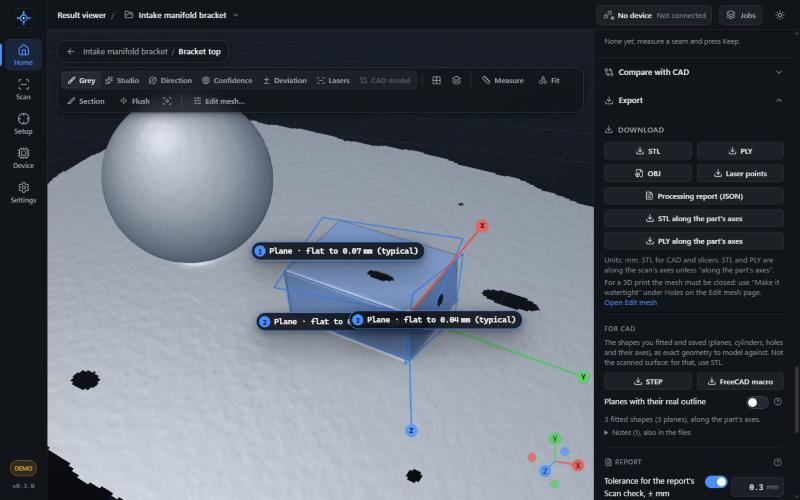
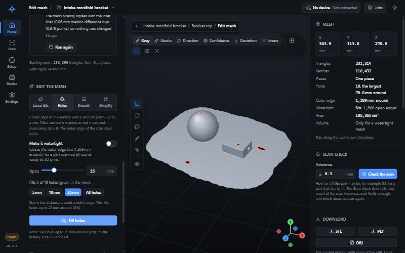
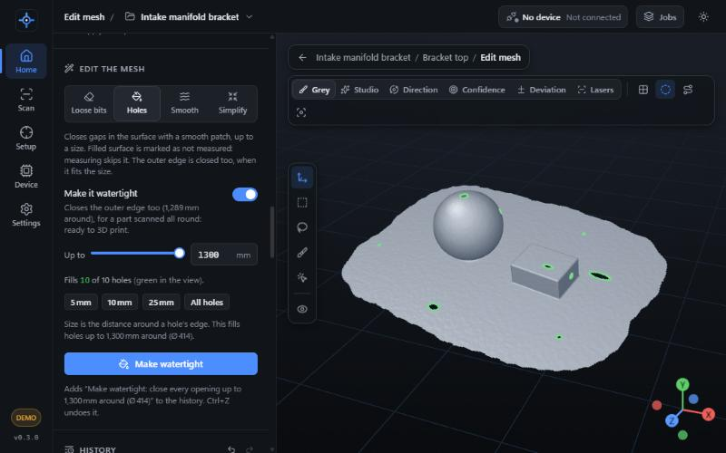
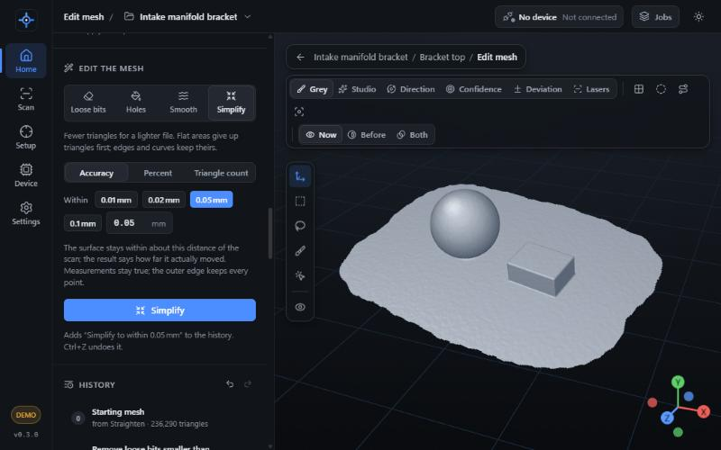
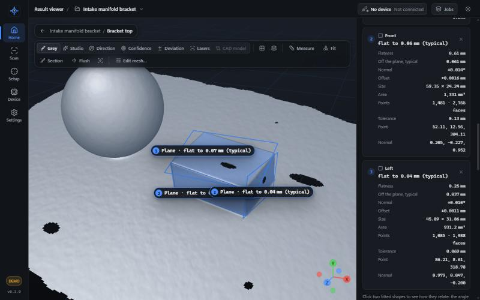
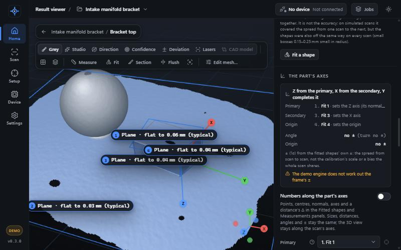
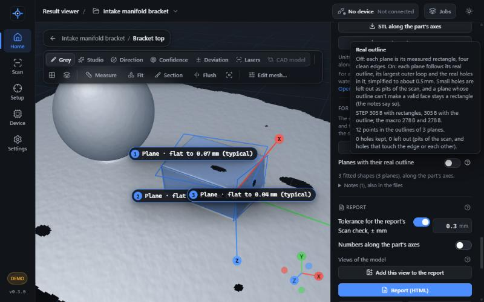
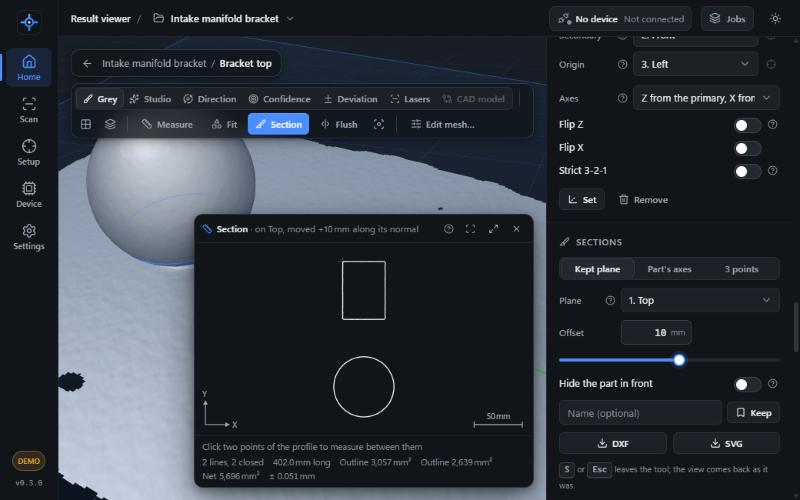

# From the mesh to STL and STEP

This page takes you from a finished scan to a file open in your other program: an STL for a 3D printer or slicer, a mesh and a STEP file to model against in CAD, a 2D section for a sketch, or the numbers for a spreadsheet. Follow it from the top, or jump to the file you need.

On this page:

- [Which file do I need?](#which-file-do-i-need)
- [What the app does and does not do](#what-the-app-does-and-does-not-do)
- [Make a good STL](#make-a-good-stl)
- [Make a STEP file of the fitted shapes](#make-a-step-file-of-the-fitted-shapes)
- [Open the STEP file and use it with the STL](#open-the-step-file-and-use-it-with-the-stl)
- [Sections for sketches: DXF and SVG](#sections-for-sketches-dxf-and-svg)
- [The numbers behind the files](#the-numbers-behind-the-files)
- [What to keep in mind](#what-to-keep-in-mind)
- [Worked example: the demo block to STEP](#worked-example-the-demo-block-to-step)
- [Messages on this page](#messages-on-this-page)

## Which file do I need?

All the buttons are in the viewer, in the side panel's **Export** group (see [The result viewer](viewer.md)), unless the table says otherwise. All files are in millimetres.

| Your goal | The file | Its button | Read |
|---|---|---|---|
| Print the part, or open it in a slicer | STL of the mesh | **Download**: **STL** (or **STL along the part's axes**) | [Make a good STL](#make-a-good-stl) |
| A mesh to model against in CAD | STL (or PLY) of the mesh, best along the part's axes | **Download**: **STL along the part's axes** | [Make a good STL](#make-a-good-stl) |
| Exact faces, axes and holes for CAD | STEP file of the fitted shapes, or a FreeCAD macro | **For CAD**: **STEP**, **FreeCAD macro** | [Make a STEP file](#make-a-step-file-of-the-fitted-shapes) |
| A 2D outline or profile for a sketch or a drawing | DXF or SVG of a section | **Measure** group, **Sections**: **DXF**, **SVG** | [Sections for sketches](#sections-for-sketches-dxf-and-svg) |
| Numbers for a spreadsheet, a program or a report | CSV, JSON, an HTML report | **Report** part of **Export**, under **For CAD**: **Features (CSV)**, **Features (JSON)**, **Report (HTML)** | [The numbers behind the files](#the-numbers-behind-the-files) |

The plain mesh files can also be saved from the scan's row on the project page (**More**: **Mesh (STL)**, **Mesh (PLY)**, **Mesh (OBJ)**, **Laser points (PLY)**) and from the **Download** panel of the Edit mesh page (**STL**, **PLY**, **OBJ**).

## What the app does and does not do

**The app does not turn the scanned surface into a STEP solid.** The STEP file holds only the shapes you fitted and kept on the scan: flat faces, cylindrical faces, hole circles, their axes, and the part's axes and origin when you set them. Its writer says so: "no solids, no free-form surfaces". A surface you did not fit (a casting's curves, a fillet, the ball in the demo) is not in it.

What you get instead is two files that fit together:

- **The STL** (or PLY) is the scanned surface, all of it, as triangles. Use it as the reference you trace and check against.
- **The STEP file** is the exact geometry of the features you measured: the mounting faces as true planes, a bore as a true cylinder, a hole as a true circle with its axis. Use it as the faces and axes you build on.

Both come out in the same coordinates: the scan's own axes, or the part's axes once you set them (choose **STL along the part's axes** then). So in your CAD program the fitted faces lie on the mesh, and you model the new part on the exact faces with the mesh beside them for everything else.

*Export: the mesh along the part's axes above, the fitted shapes for CAD below.*

## Make a good STL

The **STL** button saves the mesh as it is now, with every edit you made. These steps make it clean, the right size and the right way up first.

### 1. Clean the mesh

Open the Edit mesh page: **Edit mesh…** in the viewer's toolbar. See [Cleaning a mesh](editing.md) for every tool.

1. **Remove the table** (at the foot of the **Loose bits** tab): click **Find the table**, look at what is highlighted and at any raised areas it lists, then **Remove**. See [Remove the table](editing.md#remove-the-table).
2. **Remove loose bits**: dust, reflections, bits of table edge. See [Remove loose bits](editing.md#remove-loose-bits).
3. Anything left: select it by hand and **Delete**. See [Select faces by hand](editing.md#select-faces-by-hand).

Every edit can be undone. Make mesh already ran the **Default** recipe, which removes loose bits and closes pin holes up to 5 mm.

### 2. Holes, and closing the mesh for a printer

*The Holes tab: the holes up to the size you set are green.*

A scan has holes where the scanner saw nothing, and an open outer edge where it stopped (the underside of a part that stood on a table, for example). A slicer needs a closed surface to know what is inside.

1. Open the **Holes** tab. Set **Up to** and click **Fill holes** to close the small gaps.
2. For a print, turn on **Make it watertight** ("Closes the outer edge too (… mm around), for a part scanned all round: ready to 3D print."). The button then reads **Make watertight**: it closes every opening up to the size you set. **Up to** is the distance around an opening's edge, so the outer edge is closed only when **Up to** is at least the length the switch names; type it in the box. **All holes** sets **Up to** to the largest hole inside the outer edge, not to the outer edge.
3. Check the **Mesh** panel, under **History** in the left column: **Watertight** should read **Yes: fully closed** (an open mesh reads, for example, **No: 1,288 open edges**). Only then does it show a **Volume**.

*Make it watertight, with **Up to** above the outer edge's 1,289 mm: closes the outer edge too, for a print.*

For CAD, a closed mesh is not needed: leave the outer edge open and fill only what helps you see.

**What filling means for the truth of the surface.** A filled hole is a smooth patch the app made up; nothing was measured there. The app marks it: it is striped grey in the viewer, measuring skips it, and the **Mesh** panel shows its area as **Filled**. In the STL it is just triangles like any others, so remember which areas were filled. A large closed underside is a guess at the shape, not the part.

### 3. Smoothing: only if you need it

**Smooth** evens out scan noise but moves the surface, most at sharp edges (17 to 46 % of the edge points moved by more than 0.05 mm with **Everywhere**, on simulated scans). For a print, light smoothing can look better. For a mesh you will measure or model against, leave it, or use **Flat only**, which keeps edges and holes truest. See [Smooth](editing.md#smooth). The viewer's **Deviation** colour mode shows how far your edits moved the surface.

### 4. Simplify for a smaller file

*Simplify: as few triangles as the surface allows within the tolerance.*

A mesh has hundreds of thousands of triangles: simulated scans named in the app's documents have about 715,000 (a bracket) and 804,000 (a ball on a table). Each halving of the mesh detail makes about 4 times as many. A binary STL takes 50 bytes per triangle, so 715,000 triangles is about 36 MB, and two million about 100 MB.

To make it lighter:

1. Open the **Simplify** tab.
2. Keep **Accuracy** and choose a tolerance beside **Within** (**0.01 mm**, **0.02 mm**, **0.05 mm** or **0.1 mm**, or type one): as few triangles as the surface allows while it stays within about that distance of the scan. Flat areas give up triangles first; edges and curves keep theirs.
3. Click **Simplify**. The history says how far the surface actually moved.

For a quick look only, the **Quick preview** recipe simplifies to about 200,000 triangles; it is not for measuring.

### 5. Set the part's axes, so it comes in upright

The mesh is in the scan's own axes, which start wherever the scanner started. In another program it can come in tilted and far from the origin. Set the part's axes to fix that:

1. In the viewer, fit a plane on the face the part sits on, and two more shapes (a side face and a hole, or two more faces). See [Set the part's axes](measuring.md#set-the-parts-axes).
2. Click **Set the part's axes…**, fill **Primary**, **Secondary** and **Origin**, and click **Set the part's axes**.
3. In **Export**, **Download**, click **STL along the part's axes** (or **PLY along the part's axes**).

That file has the primary face at Z = 0, the part turned square to its own faces and the origin where you put it. Z points from the primary face into the part, so with the face the part sits on as **Primary** the part stands upright on Z = 0; with its top face as **Primary** it comes in upside down. The plain **STL** stays along the scan's axes: "STL and PLY are along the scan's axes unless “along the part's axes”."

### 6. Choose the format and save

| Button | File name | What it is | Use it for |
|---|---|---|---|
| **STL** | `<project>-<scan>.stl` | Binary STL, mm | "for CAD and slicers". The usual choice. |
| **STL along the part's axes** | `<project>-<scan>-part-frame.stl` | The same, moved into the part's axes | Printing upright; modelling at the part's origin. |
| **PLY** | `<project>-<scan>.ply` | Binary PLY "with normals"; also each point's ± and which faces were filled | Programs that read PLY; keeping the confidence data. |
| **PLY along the part's axes** | `<project>-<scan>-part-frame.ply` | The same, in the part's axes | As above. |
| **OBJ** | `<project>-<scan>.obj` | ASCII OBJ | "for Blender and most 3D apps". Only when OBJ export is turned on in the settings file. |

The name is made from the project's and the scan's names, with each space turned into an underscore: `Intake_manifold_bracket-Bracket_top.stl`, for example. The file goes where your browser or the app's window saves downloads. Saving does not change the scan.

### 7. Open it in the other program

- **Units:** STL carries no unit. The app's STL says "units: mm" in its header, but a program may not read that. When it asks, answer **millimetres**. A part that comes in 25.4 times too large or too small was read as inches.
- **Check the size:** measure one length you know, and compare it with the size the viewer shows (**x**, **y**, **z** under the scan's name) or a distance you measured in the app.
- **Check it is closed** if you will print it: most slicers report open edges.

## Make a STEP file of the fitted shapes

The STEP file holds the shapes you fitted and kept. So first decide which features matter, fit them, and set the part's axes.

### 1. Fit the shapes that matter

In the viewer, use **Fit** (**G**) with **Plane**, **Cylinder** or **Hole** (see [Fit a plane, a cylinder or a hole](measuring.md#fit-a-plane-a-cylinder-or-a-hole)). Every fit is kept with the scan, and every kept fit goes into the STEP file. On a typical bracket:

| Feature | Fit | Why |
|---|---|---|
| The mounting face, the face it bolts to | **Plane** | The face your new part must sit on; also the primary of the part's axes. |
| Other mounting faces and side faces | **Plane** | Their angle and distance to the first. |
| A bore or a shaft | **Cylinder** | Its axis and diameter. Click the round wall. |
| Each bolt hole of the hole pattern | **Hole** | Its centre, axis and diameter. Click next to the hole's edge. |

Rename each fit after what it is (the pencil beside its name): the names go into the STEP file. Remove fits you do not want in the file.

*Three planes kept on the block: its top and two sides.*

### 2. Keep the relations worth checking

Click two fits' numbers in **Fitted shapes** to see how they relate, and **Keep** the ones that matter: the angle between two mounting faces, the distance between parallel faces, the centre-to-centre distance of two holes. See [How two shapes relate](measuring.md#how-two-shapes-relate). A kept relation is not a shape in the STEP file, but its approved value can be (next step but one).

### 3. Set the part's axes

*The part's axes: the STEP file is then in the part's own coordinates.*

Set them as in [Set the part's axes](measuring.md#set-the-parts-axes): for a bracket, **Primary** the mounting face, **Secondary** a side face or a hole, **Origin** a hole (plane, hole, hole is the usual way to line up a part with two dowel holes). With axes set, the STEP file is in the part's axes and also holds the part's **X axis**, **Y axis**, **Z axis** and **Part origin**. Without them, the shapes stay in the scan's own axes, "which is wherever the scanner started", and a note in the file says so.

### 4. Nominal values: the round size the part was drawn with

A measured Ø 14.02 ± 0.03 mm bore was probably drawn as Ø 14. Beside a cylinder's or hole's diameter the app can offer "Ø 14?"; click it and **Accept** it, or enter **Other value…**. See [Nominal values](measuring.md#nominal-values).

- **What approving does to the file:** the approved size is written in place of the measured one, in the STEP file and the macro alike, and the file's notes list each one with its measured value. The measured fit in the app never changes.
- **An approved relation** is **Listed only** in the notes by default. In the relation's card, under **In the CAD file**, you can choose to **Move** one of its two shapes instead: the file then gets a copy of that shape turned and slid so the approved value holds.
- **Measured values only**: this switch appears once something is approved. On, the files hold the measured values only, "as if nothing were approved: no shape moves".

### 5. Choose rectangles or real outlines

**Planes with their real outline** decides how each flat face is bounded:

| Setting | Each plane in the file |
|---|---|
| Off (the default) | Its measured rectangle: "four clean edges". |
| On | Its real outline, its largest outer loop and the real holes in it, simplified to about 0.5 mm. Small holes are left out as pits of the scan; a plane whose outline cannot make a valid face stays a rectangle, and the notes say so. |

Hover over its **?** to see what the outline costs: both files' sizes with rectangles and with outlines, the points the outlines hold, and how many holes are kept and left out.

*Real outline: what it changes and what it costs, before you choose it.*

### 6. Read the line, the warnings and the notes

Under the buttons the app says what will be exported, for example "4 fitted shapes (2 planes, 1 cylinder and 1 hole), along the part's axes." Then, when they apply:

- what the approved values do ("1 approved size is used in place of the measured one"…), and how far each moved shape was turned and slid;
- warnings in orange: a fit made on an earlier mesh (it is exported as it was kept, so it may no longer lie exactly on the current mesh), the part's axes out of date (used as they are);
- **Notes (…), also in the files**: the writer's notes, for example a fit kept with no size.

Mend what the warnings name before you export: **Fit again** for old fits, **Set again** for the axes (see [When the mesh changes](measuring.md#when-the-mesh-changes)).

### 7. Download

| Button | File | What it is |
|---|---|---|
| **STEP** | `<project>-<scan>-fits.step` | A STEP file (AP214), in mm, plain text. |
| **FreeCAD macro** | `<project>-<scan>-fits.FCMacro` | A short FreeCAD macro that builds the same shapes as named objects in a new document. |

The buttons stay disabled until there is a kept fit: "Keep a fit first: click a plane, cylinder or hole with the fit tool (G)."

## Open the STEP file and use it with the STL

### What is in it

| Kept item | In the file |
|---|---|
| A plane | A flat face, bounded by its rectangle or its outline |
| A cylinder | A cylindrical face over its measured length and arc, and its axis line, "<name> axis" |
| A hole | A circle on its plane, its centre and diameter, and its axis line, "<name> axis" |
| The part's axes | "X axis", "Y axis", "Z axis" lines and "Part origin" |

Every shape is named after its fit. A name used twice gets " (2)". The file as a whole is named after the project. The notes are in the file's description (in the macro, as comments at the top).

### In FreeCAD

FreeCAD 1.1.4 was used to check both files.

- **The STEP file** (File, Import): each shape is one object labelled with its name, the faces as faces and the lines as edges. FreeCAD's import does not show points, so the origin is where the three axes meet.
- **The macro** (Macro, Macros…, or open it and execute it): it makes a new document named after the part, with the objects in the groups "Planes", "Cylinders", "Holes", "Axes", "Points" and "Part frame". It shows the part's origin as a point. Its shapes are the STEP file's, number for number.

### In other CAD programs

Import the STEP file as you would any STEP file. The app's documents make no further claims about other programs.

### Rebuild the part with both files

1. Import the **STL along the part's axes** (or the plain **STL** if you did not set axes) and the **STEP** file into one document. Both are in the same axes, so the fitted faces lie on the mesh.
2. Build your part on the STEP file's faces, axes and circles: they are exact planes, cylinders and circles, at the sizes you approved.
3. Use the mesh for everything you did not fit: curves, outlines, clearances. Cut sections of it (below) where a 2D profile helps.
4. Check the sizes that matter against the part itself (see [What to keep in mind](#what-to-keep-in-mind)).

## Sections for sketches: DXF and SVG

A **section** is the line where a plane cuts the scan, drawn flat: the profile of a rib, the outline of a flange, a shape no fit describes.

*A section ready to save as DXF or SVG at 1:1.*

1. In the viewer, click **Section** or press **S** (see [Cut a section](measuring.md#cut-a-section)).
2. Choose the plane: **Kept plane** with an **Offset**, **Part's axes** (X, Y or Z = a value), or **3 points** clicked on the surface.
3. Look at the profile. Solid lines are measured; dashed red lines cross surface that hole filling made up.
4. Click **DXF** or **SVG**. To use the same plane later, **Keep** it first.

| File | What is in it |
|---|---|
| DXF | DXF R12, plain text, at 1:1 in mm, in the plane's own 2D axes. Two layers: **MEASURED** (continuous) and **NOT_MEASURED** (dashed, red), for the stretches over filled surface. The header declares millimetres. |
| SVG | At 1:1 in mm, so it prints true at 100 %. Measured lines solid black, not-measured ones dashed red; under the drawing, the plane's description and a scale bar. |

The drawing is the cut seen from the side the plane's normal points to, never mirrored, in the part's axes when they are set. Both files hold every line of the cut, at full precision. The files are named after the scan and the section, for example `Bracket_top-section-Top-offset-10mm.dxf` for the plane "Top" moved 10 mm, or with "Z12mm" in the name for a plane of the part's axes.

**When a section is better than a fit:** for anything that is not a plane, a cylinder or a circle: a curved outline, a fillet, a rib's profile. A fit gives one exact shape with a ±; a section gives the scanned line as it is, noise and all, to trace in a sketch.

## The numbers behind the files

| File | What is in it | Read |
|---|---|---|
| **Features (CSV)** | The saved fitted shapes and relations, one row each, values and ± in separate columns. For a spreadsheet. | [The report](measuring.md#the-report) |
| **Features (JSON)** | The kept features as JSON, with what the report worked out beside them. For a program. | [The report](measuring.md#the-report) |
| **Report (HTML)** | One page with everything saved with the scan, prints to PDF from any browser. | [The report](measuring.md#the-report) |
| **Stations (CSV)** | Every station of a flush along a seam. | [Measure the flush along a seam](measuring.md#measure-the-flush-along-a-seam) |

The first three are in the **Report** part of **Export**, under **For CAD**. They are named after the scan alone, for example `Bracket_top-features.csv`, `Bracket_top-features.json` and `Bracket_top-report.html`.

## What to keep in mind

- **The ± is not the accuracy.** It is the spread from scan to scan. Calibration and scale errors come on top. See [What the ± means](measuring.md#what-the--means).
- **Known biases are not corrected.** On simulated scans, holes and bosses read small and thin walls read too thick, the same way on every scan. See [Known biases](measuring.md#known-biases). The STEP file holds the measured values unless you approve nominal ones.
- **Filled holes and smoothing are not measurements.** A filled patch is made up; smoothing moves the surface.
- **Simulated scans only, so far.** The software has been tested on simulated scans; the real scanner's accuracy is still to be measured.
- **Check a size that matters with calipers** before you rely on it.

## Worked example: the demo block to STEP

In demo mode (see [Getting started](getting-started.md)) the scans show a ball and a block on a table. This takes the block to a STEP file with its top, two sides and the part's axes.

1. Open the project "Intake manifold bracket" and click **Open** on "Bracket top".
2. Press **G**; **Plane** is already chosen. Click the top of the block. "Fit 1" appears in **Fitted shapes**.
3. Click one side of the block: "Fit 2". Click a side next to it: "Fit 3". Press **Esc**.
4. Rename them, for example "Top", "Front", "Left": hover over each name and click the pencil.
5. In **Measure**, click **Set the part's axes…**. Choose **Primary** "Top", **Secondary** "Front", **Origin** "Left". Click **Set the part's axes**. The axes are drawn on the block; the origin is the corner where the three faces meet, and Z points down into the block, from the top. So the STL along the part's axes has the block upside down, its top at Z = 0: fine for modelling, but for a print choose the face the part sits on as **Primary**.
6. Open **Export**. Under **Download**, click **STL along the part's axes** for the mesh.
7. Under **For CAD**, read the line: "3 fitted shapes (3 planes), along the part's axes."
8. Click **STEP**.

In demo mode the STEP file and the macro are small fixed texts that say they come from the demo; the real engine writes the shapes. The ball cannot be fitted (a cylinder fit refuses it) and the demo has no clean round holes, so cylinders and holes are not part of this example. The demo's **Make watertight** closes the holes but never the outer edge, so a demo mesh stays open (**Watertight**: **No**) and the Export line about closing the mesh for a 3D print stays.

## Messages on this page

| Message | What it means | What to do |
|---|---|---|
| "Make the mesh first, then fit and keep planes, cylinders or holes." | The scan has no mesh, so there is nothing for CAD. | Make the mesh (see [Making the mesh](make-mesh.md)). |
| "Keep a fit first: click a plane, cylinder or hole with the fit tool (G)." | The STEP and macro buttons need at least one kept fit. | Fit a shape. |
| "This scan has no fitted shapes to export yet." | The same, from the engine. | Fit shapes in the viewer first. |
| A warning naming a fit "made on an earlier mesh" | The fit is exported as it was kept, for an earlier version of the mesh. | Click **Fit again** in **Fitted shapes**. |
| A warning that the part's axes are out of date | The files use the axes as they are. | Click **Set again** in the part's axes panel. |
| "No plane has an outline kept: each stays its rectangle. Fit a plane again to measure its outline." | Older planes have no outline to export. | **Fit again**, then turn **Planes with their real outline** on. |
| "Measured values only: the approved nominal values are left out." | **Measured values only** is on. | Turn it off to use the approved values. |
| **No OBJ for this scan** | OBJ export is off. | Add `"obj"` to `export` under `[process]` in the settings file (`export = ["ply", "stl", "obj"]`), then make the mesh again. STL and PLY are always there. |
| **The mesh is already watertight** / **No opening is that small** | Make watertight has nothing to close at this size. | Raise **Up to**, or leave it. |
| **The mesh already has ... triangles** | The triangle target is not below the current count. | Choose a smaller target. |
| **The plane misses the scan** | The section plane does not cross the mesh. | Change the offset or the value. |
| "Couldn't download …" | The file could not be fetched. | Try again. See [Troubleshooting](troubleshooting.md). |
