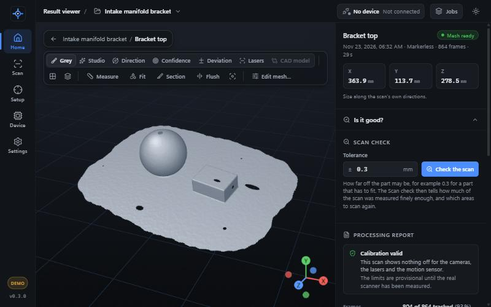
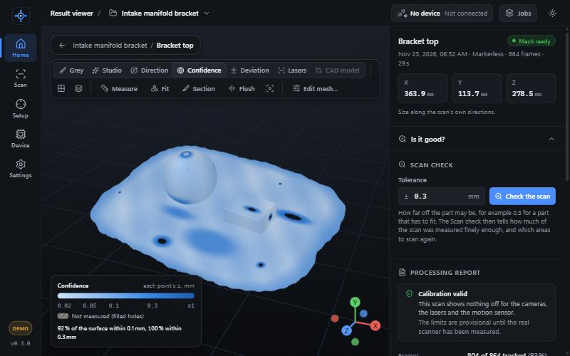
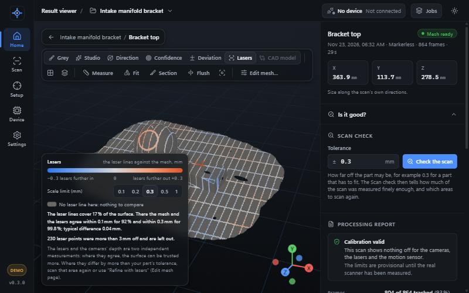
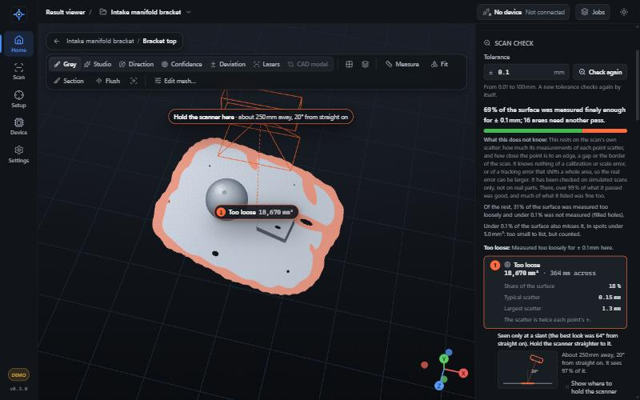
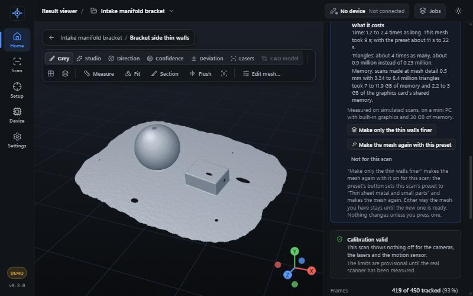
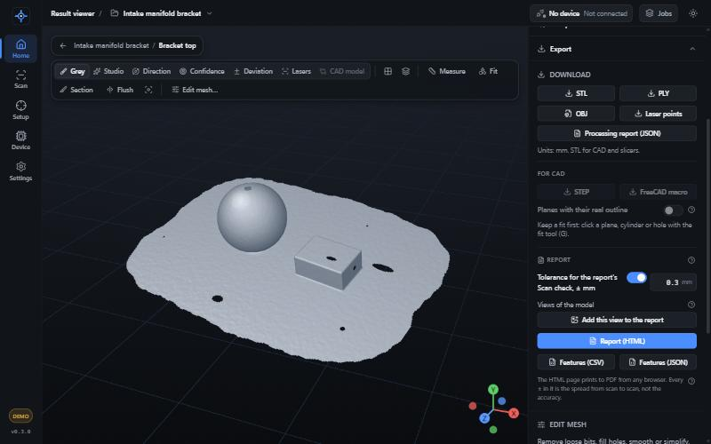

# The result viewer

This page explains how to look at a finished scan in the result viewer: moving the view, the colour modes, the size, the **Scan check**, the processing report, the thin-parts hint, pictures of the view and the downloads. Measuring is on its own page, [Measuring on the scan](measuring.md).

On this page:

- [Open a scan in the viewer](#open-a-scan-in-the-viewer)
- [What is on the screen](#what-is-on-the-screen)
- [Move the view](#move-the-view)
- [Colour modes](#colour-modes)
- [The size of the part](#the-size-of-the-part)
- [Is it good? The Scan check](#is-it-good-the-scan-check)
- [The processing report](#the-processing-report)
- [The thin-parts hint](#the-thin-parts-hint)
- [Save a picture of the view](#save-a-picture-of-the-view)
- [Download the scan](#download-the-scan)
- [Rename things](#rename-things)
- [Messages on this page](#messages-on-this-page)

## Open a scan in the viewer

1. Open the project on the home page (see [Projects and scans](projects.md)).
2. In the scan's row, click **Open**, or click the scan's name.

A scan opens in the viewer once it has a mesh. A **mesh** is the scan's surface made of small triangles; the app builds it from the raw recording with **Make mesh** (see [Making the mesh](make-mesh.md)). A scan without one shows **This scan has no mesh yet** and a **Make mesh** button instead.

While a mesh is being made again, the viewer keeps showing the current one with a progress bar: "The mesh you see, its downloads and its report stay as they are until the new mesh is ready."

## What is on the screen

*The viewer: the 3D view with its toolbar on the left, the side panel on the right.*

- **Top left:** the project and scan names (click the arrow or the project name to go back to the project), and under it the toolbar: the colour modes, **Wireframe (W)**, the laser point cloud, the tools **Measure**, **Fit**, **Section** and **Flush**, **Frame the model (F)** and **Edit mesh…**.
- **Right:** the side panel. At the top: the scan's name, its date, **Markers** or **Markerless**, the number of frames, the scan's length, and its size. Below that, four groups that fold open and shut with a click on their heading:

| Group | What is in it |
|---|---|
| **Is it good?** | **Scan check** and **Processing report**. Open when the viewer opens. |
| **Measure** | **Measurements**, **Fitted shapes**, the part's axes, **Sections**, **Flush along a seam** (see [Measuring on the scan](measuring.md)). |
| **Compare with CAD** | **Compare with the CAD model** (see [Comparing with a reference](compare.md)). |
| **Export** | **Download**, **For CAD**, the report, **Edit mesh**, **Make mesh again**. |

A folded group shows what is saved inside it, for example "2 measurements · 1 fitted shape". Turning on a tool opens the group its panel is in.

## Move the view

| To do this | Use |
|---|---|
| Turn the part (orbit) | Drag with the left mouse button |
| Slide the view (pan) | Drag with the right mouse button |
| Zoom | Mouse wheel; it zooms towards the cursor |
| Fit the whole part in the view | **F**, or the **Frame the model (F)** button |
| Show the triangles' edges | **W** (**Wireframe**) |
| Show the laser points | **L** (the laser point cloud; only when the scan has laser points) |
| Change the colour mode | **1** to **7** (see the next section) |
| Show all keyboard shortcuts | **?**, or **Keyboard shortcuts** at the bottom of the side panel |

The tool keys are listed in [Measuring on the scan](measuring.md#tools-and-keys). **Esc** first drops a half-made measurement, then turns the tool off.

## Colour modes

The toolbar's first buttons choose how the surface is coloured. Some modes are greyed out until the scan has what they show; hover over a greyed-out button to see why. When a mode has nothing to show, the viewer shows the plain grey surface and its legend says why.

| Key | Button | What the colours show |
|---|---|---|
| 1 | **Grey** | Plain grey. The best view to judge the shape. |
| 2 | **Studio** | Studio lighting. |
| 3 | **Direction** | Colour by the direction each part of the surface faces. |
| 4 | **Confidence** | How well each point was measured: each point's ±. |
| 5 | **Deviation** | How far the edits moved the surface from the mesh as measured. |
| 6 | **Lasers** | Where the laser lines and the mesh agree, and where they differ. |
| 7 | **CAD model** | How far the scan is from the CAD model, against a tolerance. See [Comparing with a reference](compare.md). |

In the **Confidence**, **Deviation**, **Lasers** and **CAD model** modes a legend appears at the bottom left, and the value under the mouse pointer is shown next to it on the surface.

### Confidence

*Confidence: light blue where each point is measured finely, dark blue where it is loose.*

**±** (sigma) is the app's figure for how much a measurement scatters: a point with ±0.05 mm would typically land within about 0.05 mm of the same place if it were scanned again. It is the scatter, not the accuracy (see [The Scan check](#is-it-good-the-scan-check) for what it does not know).

The legend **Confidence**, "each point's ±, mm", runs on a scale from 0.02 to 1 mm or more. It also shows:

- **Not measured (filled holes)**: striped grey. Hole filling made this surface up; nothing was measured there.
- How much of the surface is within 0.1 mm and within 0.3 mm, and how much was not measured.

Under the pointer: the ± of that spot, or **Not measured**.

This mode needs the mesh to carry each point's ±. A mesh made without a graphics card, or by an earlier version, has none: the button is greyed out and says "This mesh has no confidence data: it was made without a graphics card or by an earlier version."
### Deviation

**Deviation** compares the mesh as it is now with the mesh as measured, before your edits (smoothing, filling holes and so on, see [Editing the mesh](editing.md)). It stays greyed out with "No edits yet: the mesh is as measured" until you have made an edit.

- Blue: moved inward. Grey: unchanged. Orange-red: moved outward.
- **Scale limit (mm)**: 0.05, 0.1, 0.2, 0.5 or 1. The strongest colour is at plus and minus this value. It starts at 0.05.
- **New surface (filled holes): nothing to compare**: striped.
- The legend gives the share within the limit, the **Largest move**, the distance within which 95 % of the surface lies, and how much of the surface is new.

Under the pointer: for example "+0.034 mm (outward)", or "new surface".

This is not the comparison with a CAD model; that is mode 7.

### Lasers

*Lasers: the laser lines against the mesh, with the numbers in sentences.*

The scanner measures the surface in two independent ways: the cameras' depth, which makes the mesh, and the laser lines. The **Lasers** mode colours the surface where a laser line crossed it:

- Blue: the lasers see the surface further in than the mesh. Light grey: they agree. Orange-red: the lasers see it further out.
- Darker grey: **No laser line here: nothing to compare**. Most of the surface is this colour, because the lasers draw lines.
- **Scale limit (mm)**: 0.1, 0.2, 0.3, 0.5 or 1; it starts at 0.3.

The legend says in sentences how much of the surface the laser lines cover, how much of that agrees within 0.1 mm and 0.3 mm, and the typical difference. Its last line says what it is good for: "where they agree, the surface can be trusted more. Where they differ by more than your part's tolerance, scan that area again or use “Refine with lasers” (Edit mesh page)."

A scan made with the lasers off or not calibrated says "This scan has no laser points: the lasers were off, or they were not calibrated when it was made." with a link **Calibrate the lasers** (see [Setting up the scanner](setup.md)).

## The size of the part

Under the scan's name, three boxes give the size along **X**, **Y** and **Z** in mm: "Size along the scan's own directions." These are the sides of the box round the whole mesh in the scan's own axes, so a part lying at an angle reads larger than it is, and anything else in the scan (a bit of table) is counted too. For sizes along the part's own faces, set the part's axes (see [Measuring on the scan](measuring.md#set-the-parts-axes)) and measure.

The **Processing report** adds the **Diagonal** of that box, the number of **Triangles** and **Vertices**, and the **PLY size**.

## Is it good? The Scan check

The **Scan check** tells you how much of the surface was measured finely enough for the tolerance your part needs, and which areas to scan again. A **tolerance** here is how far off the part may be, for example ±0.3 mm for a part that has to fit.

*The Scan check: the answer, the bar, and the areas that need another pass.*

### Check a scan

1. In **Is it good?**, type the tolerance in **Tolerance** (± mm). The field takes 0.01 to 100 mm; the arrow keys change it by 0.05.
2. Click **Check the scan**.
3. Read the sentence, for example "92 % of the surface was measured finely enough for ± 0.3 mm; 3 areas need another pass."
4. Click an area in the list to light it on the mesh and turn the view to it. Where the app found a place to scan it from, the scanner is drawn there too ("Hold the scanner here"). Click the area again to turn it off.

After the first check, a new tolerance checks again by itself; the button becomes **Check again**.

### What the answer says

- The bar: green for the share measured finely enough, orange for **Too loose**, striped for **Not measured**.
- **Too loose**: "Measured too loosely for ± 0.3 mm here." A spot is too loose when twice its ± is more than the tolerance.
- **Not measured**: "Hole filling made this surface up: nothing was measured here."
- Each area shows its size in mm², how far it reaches, its **Share of the surface**, its **Typical scatter** and **Largest scatter**. The scatter shown is twice each point's ±, the same figure the check compares with the tolerance.
- The six largest areas are listed first; **Show all … areas** lists the rest. Spots too small to list are still counted, and a line under the answer says how much they add.
- When the mesh has open holes, a line **Not scanned:** says so: they are not in the list. **See them on the Edit mesh page** opens them.

### Why an area is marked weak

A few seconds after the answer, each area gets a reason and a place to scan it from:

| Reason | What it means and what to do |
|---|---|
| **Not seen** | Nothing measured this surface (a hole or a shadow that hole filling made up), or it lies next to surface the scan never saw. Scan it from where it can be seen. |
| **Seen only at a slant** | The best look was at a steep angle. Hold the scanner straighter to it. |
| **Seen from too far** | The nearest look was too far away. Hold the scanner at the distance shown. |
| **Seen too few times** | Too few separate looks. Go over it again, more slowly. |
| **On an edge or a tight curve** | The scan's own scatter is above the tolerance there, and another pass alone does not lower it. |
| **No reason found** | The scan's data do not tell why this area is weak. |

Where the app found a place to scan from, a small side view shows the scanner's angle and distance, and **Show where to hold the scanner** draws the scanner beside the area in the 3D view. Under the list, a short plan names a few places that between them see the largest areas: "A pass from each, at the distance shown, then Check again."

**Scan these areas again…** starts a second pass that joins this scan. After you stop, the pass is aligned and merged with this scan into a new scan; this scan is not changed. See [Scanning](scanning.md).

### How far the Check can be trusted

The panel says it under the answer, in **What this does not know:**

- It rests on the scan's own scatter: how much the measurements of each point scatter, and how close the point is to an edge, a gap or the border of the scan.
- It knows nothing of a calibration or scale error, or of a tracking error that shifts a whole area, so the real error can be larger.
- It has been checked on simulated scans only, not on real parts. There, over 99 % of what it passed was good, and much of what it listed was fine too.

So a passed check means the scan measured finely enough; it does not prove the part is within the tolerance. To check the part against its design, compare it with a CAD model ([Comparing with a reference](compare.md)).

The Check needs each point's ±. On a mesh without it the panel says **Scan check can't be used on this mesh**, with **Make the mesh again** where that would help.

## The processing report

**Processing report**, in **Is it good?**, says how the mesh was made:

- **Frames**: how many were tracked out of how many processed.
- **Mode**, **Mesh detail**, **Confidence** (the median ± and the share within 0.1 mm), **Laser points**, **The last stage took**, **Source**.
- **Frames not tracked**, with the reason for each.
- The calibration the scan was made with and its state.
- **Tracking may have slid**: when the camera path jumps in a way no hand makes. A thin part can then come out thinner or partly missing.
- **Notes on making the mesh**, or for a merged scan **Notes from the merge** (see [Aligning and merging scans](align-merge.md)).

For a scan of the simulator, **Accuracy vs ground truth (simulator)** compares the camera path with the true one.

## The thin-parts hint

After **Make mesh**, the engine looks for thin walls. When it finds them, a hint **Thin walls found** appears at the top of the **Processing report**, with what it found, what a finer mesh would change and what it costs (time, triangles, memory, disk), all as measured on simulated scans.

*The end of the thin-parts hint, with its choices.*

Its buttons:

| Button | What it does |
|---|---|
| **Make only the thin walls finer** | Makes the mesh again at mesh detail 1 mm, then makes only the thin walls finer, at 0.5 mm. Offered only where the engine can run it (with a graphics card, at mesh detail 1 mm). |
| **Make the mesh again with this preset** | Sets this scan's preset to "Thin sheet metal and small parts" and makes the mesh again. |
| **Not for this scan** | Puts the hint away for good. |

Nothing happens unless you press one, and the mesh you have stays until the new one is ready. After a mesh made with **Make only the thin walls finer**, a line in the hint's place says what it did, with **Make the mesh again without this**. See also [Making the mesh](make-mesh.md) and [Settings](settings.md).

## Save a picture of the view

The viewer saves pictures of the 3D view into the scan's report, not as separate files.

1. Turn and zoom the mesh to the view you want. Choose the colour mode you want to show.
2. Open **Export**. In its **Report** part, under **Views of the model**, click **Add this view to the report**.
3. The picture appears as a small image ("View 1", "View 2"…). Click its cross to remove it.
4. Click **Report (HTML)** to save the report with the pictures in it.

The fitted shapes' numbers and names are drawn on the picture. A report takes up to 6 views, each at most 3 MB (made at most 1600 pixels across). The views are kept only while the page is open.

## Download the scan

*Export: the mesh files, the files for CAD and the report.*

Open **Export**. The mesh files are under **Download**, then come **For CAD** and **Report**. Units are always mm.

| Button | File | Use it for |
|---|---|---|
| **STL** | Mesh (STL) | CAD and slicers. The usual choice. |
| **PLY** | Mesh (PLY) | The mesh with normals; it also carries each point's ± when the mesh has it. |
| **OBJ** | Mesh (OBJ) | Blender and most 3D apps. Only when OBJ export is turned on: add `"obj"` to `export` under `[process]` in the settings file (see [Settings](settings.md)). |
| **Laser points** | Laser points (PLY) | The laser lines' own points. Only when the scan has them. |
| **Processing report (JSON)** | the processing report | How the engine made the mesh (frames, tracking, timings). Not the scan's report below. |
| **STL along the part's axes**, **PLY along the part's axes** | the mesh, moved | Shown once the part's axes are set: the mesh in the part's own axes. |
| **STEP**, **FreeCAD macro** (in **For CAD**) | the fitted shapes | Planes, cylinders and holes for CAD. See [Measuring on the scan](measuring.md#export-features-for-cad). |
| **Report (HTML)** | one page | Everything saved with the scan. It prints to PDF from any browser. See [Measuring on the scan](measuring.md#the-report). |
| **Features (CSV)**, **Features (JSON)** | tables | The saved fitted shapes and relations, for a spreadsheet or a program. |

The files are named after the project and the scan. The mesh files are the scan's own and do not change when you download them.

## Rename things

- **The scan:** on the project page, open the scan row's menu and choose **Rename…** (see [Projects and scans](projects.md)). The viewer shows the name but does not change it.
- **Measurements, fitted shapes, relations, sections, seams and CAD models:** hover over the name in its panel and click the pencil, or double-click the name. Press Enter to save or Esc to cancel. A name can be up to 80 characters.

## Messages on this page

| Message | What it means | What to do |
|---|---|---|
| **This scan has no mesh yet** | The scan has a recording but no mesh. | Click **Make mesh**. See [Making the mesh](make-mesh.md). |
| **Making the mesh failed** | The last Make mesh stopped with an error. | Try again, or use preview quality. The raw recording is kept. |
| **Couldn't open the mesh** | The mesh file could not be loaded or read. | **Try again**; if it keeps failing, **Make mesh again**. See [Troubleshooting](troubleshooting.md). |
| **Scan check can't be used on this mesh** | The mesh has no confidence data (made without a graphics card or by an earlier version). | **Make the mesh again** on a computer with a graphics card. |
| **The mesh changed since it was opened** | The mesh was changed while the viewer had it open, so the Check's areas would not line up. | Click **Reload the mesh**; it is checked again by itself. |
| **Couldn't check the surface** | The engine could not answer the Check. | **Try again**. |
| "Why each area is weak, and where to scan it from, could not be worked out this time." | The reasons could not be found; the areas are still right. | Check again later. |
| "Whether an area was seen too steeply or from too far can't be told here: …" | The scan's camera path is not available, so some reasons are unknown. | Nothing; the other reasons still hold. |
| "This scan has no laser points: …" | The lasers were off or not calibrated when it was scanned. | Scan again with the lasers on and calibrated. |
| "This version of the engine can't compare the mesh with the lasers yet." | The engine is older than the app. | Update OpenHandScan and start it again. |
| **Tracking may have slid** | The camera path jumped somewhere. A thin part can come out thinner or partly missing. | Look at the scan closely; scan again if it matters. |
| **No OBJ for this scan** | The engine writes OBJ only when OBJ export is on. | Add `"obj"` to `export` under `[process]` in the settings file (`export = ["ply", "stl", "obj"]`), then make the mesh again. STL and PLY are always there. |
| **No view to add** | There is no 3D view to take a picture of. | Open the mesh first. |
| **Couldn't add the view** | The report is full (6 views) or the picture is too large. | Remove a view first. |
| **Couldn't make the report** / **Couldn't make the features file** | The engine could not build the file. | Try again. See [Troubleshooting](troubleshooting.md). |
| **Couldn't put the hint away** | **Not for this scan** failed. | Try again. |
