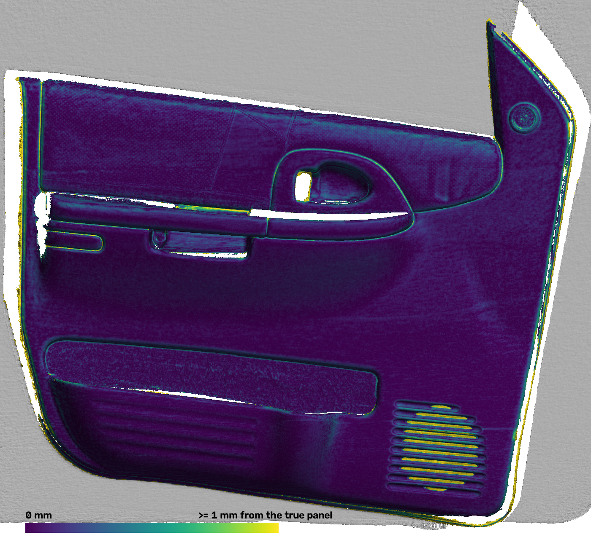
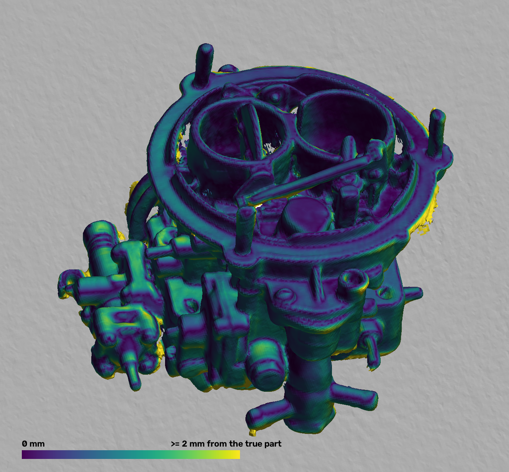

# OpenHandScan: end-to-end validation on simulated data

This document reports how accurately the whole processing chain works on data from the simulator
(`ohs.sim`). It covers calibration from recordings, the per-frame pipeline, offline processing and
export, compared against the simulator's ground truth. **Everything here is simulation.** The
numbers are an upper bound on what the real scanner will do; see
[Simulation limitations](#simulation-limitations).

Environment: Windows 11, Python 3.13, numpy 2.5.4, opencv-contrib 5.0.0, open3d 0.20.0 (CPU),
16 logical CPUs. Data: 1280x800 per camera, realistic lens model (distortion, 0.3 deg camera
rotation; rectification is not trivial), dot projector and both laser lines on. Each scan is 36
frames at 30 fps (1.2 s of hand-held motion: 63 mm and 28 deg of camera travel on the sphere scan)
with IMU at 416 Hz.

## How to reproduce

```
# fast checks (about 2 min for the three files)
C:\Users\Garage\.venvs\ohs\Scripts\python.exe -m pytest software\tests\test_app_pipeline.py software\tests\test_e2e_calibration.py software\tests\test_e2e_scan.py -q
# the full runs behind the table below (about 7 min); -s prints one "METRICS {...}" line per run
C:\Users\Garage\.venvs\ohs\Scripts\python.exe -m pytest software\tests\test_e2e_calibration.py software\tests\test_e2e_scan.py -m slow -s -q
```

## Results (full runs)

| Item | Metric | Result | Expectation |
|---|---|---|---|
| **(a) Stereo calibration**, 20 board views | fx error, left / right | -0.05 / -0.01 px | |
| | cx / cy error (left) | -0.01 / -0.14 px | |
| | baseline error | +0.005 mm | |
| | relative rotation error | 0.011 deg | |
| | row error after rectification, median / p95 | 0.006 / 0.025 px | < 0.3 px |
| | depth scale error (triangulation at 200-450 mm) | 0.001 % | |
| | reprojection rms | 0.075 px | < 0.5 px |
| **(b) Laser planes**, 8 views, true stereo, **margin** (default) | normal angle, vertical / horizontal | 0.0056 / 0.0054 deg | |
| | d error, vertical / horizontal | -0.016 / -0.018 mm | |
| | laser-point error, median / max (vertical; horizontal) | 0.011 / 0.13 mm; 0.028 / 0.24 mm | |
| (b) same views, **board** region | normal angle, V / H | 0.078 / 0.037 deg | |
| | d error, V / H | +0.26 / -0.13 mm | |
| | laser-point error, median / max (V; H) | 0.16 / 1.7 mm; 0.20 / 1.7 mm | |
| (b) same views, board + margin (`both`) | laser-point error, median (V; H) | 0.058; 0.048 mm | |
| (b) **estimated** stereo, margin | normal angle, V / H | 0.0077 / 0.013 deg | |
| | d error, V / H | -0.028 / -0.007 mm | |
| | laser-point error, median / max (V; H) | 0.019 / 0.17 mm; 0.14 / 0.75 mm | |
| (b) estimated stereo, board | laser-point error, median (V; H) | 0.16; 0.23 mm | |
| **(c) IMU calibration**, 7 s (1.2 s still, then rotation), 210 frames | R_ci error (estimated stereo / true stereo) | 0.025 / 0.031 deg | |
| | time-offset error | 0.019 / 0.014 ms | |
| | gyro-bias error | 0.087 mrad/s (0.005 deg/s) | |
| | rotation residual rms | 0.035 deg | |
| **(d) Markerless scan**, sphere on plane, true calibration | frames tracked | 36 / 36 (100 %) | > 90 % |
| | trajectory error, median / max | 0.19 mm, 0.035 deg / 0.29 mm, 0.077 deg | < 3 mm / 1 deg |
| | mesh distance, median / p95 | 0.20 / 0.67 mm (sphere 0.12, table 0.20) | median < 0.3 mm |
| | laser points, median / p95 | 0.068 / 0.28 mm (sphere 0.084) | median < 0.2 mm |
| **(e) Marker mode**, same recording | frames tracked | 36 / 36 | |
| | trajectory error, median / max | 0.94 mm, 0.22 deg / 3.8 mm, 0.93 deg | |
| | mesh, median / p95 | 0.71 / 2.0 mm (sphere 0.11, table 0.72) | |
| | laser points, median / p95 | 0.18 / 0.60 mm | |
| | tag map: tags, `refine_map` rms | 5 tags, 0.28 mm | |
| **(f) Markerless scan, car panel** (nearly featureless) | frames tracked | 36 / 36 | |
| | trajectory error, median / max | 0.63 mm, 0.039 deg / 0.97 mm, 0.065 deg | |
| | mesh, median / p95 | 0.29 / 1.17 mm (panel 0.11, floor 0.35) | |
| | laser points, median / p95 | 0.067 / 0.23 mm | |
| (f) same, tracking on raw depth (`track_filter_px=0`, the original design) | trajectory error, max | 13.3 mm, 2.4 deg | |
| **(g) Full chain**: (d) with the calibration estimated in (a)-(c) | frames tracked | 36 / 36 | > 90 % |
| | trajectory error, median / max | 0.23 mm, 0.035 deg / 0.34 mm, 0.079 deg | < 3 mm / 1 deg |
| | mesh, median / p95 | 0.27 / 0.77 mm | median < 0.3 mm |
| | laser points, median / p95 | 0.078 / 0.29 mm | median < 0.2 mm |

SGBM and Open3D are multi-threaded, so repeated runs can differ in the third significant digit.

Half resolution (640x400, the live preview), sphere scene, 24 frames (fast test): trajectory
error max 0.49 mm / 0.085 deg, mesh median 0.20 mm (2 mm voxels), laser median 0.15 mm.
The same recording without the IMU drifts 30 mm / 12 deg: the scene is symmetric about the
sphere axis, and the tracker flags it (`info["degenerate"]`).

## Timings

These are medians per frame on the CPU described above, from the full runs. Offline processing runs
at full resolution (1280x800); the live preview runs at half resolution (640x400, measured in the
fast tests).

| Stage (ms) | Offline 1280x800, markerless | Offline 1280x800, markers | Live 640x400, markerless |
|---|---|---|---|
| rectify (both images) | 2 | 2 | 1 |
| depth (SGBM + sub-pixel refinement) | 121-125 | 125 | 20-24 |
| laser lines (extract L+R, triangulate) | 24-26 | 26 | 9-12 |
| tracking-depth filter | 36-39 | - | 5 |
| ICP: ray cast / Gauss-Newton | 100-116 / 15-25 | - | 29 / 7-8 |
| TSDF integration: tracking model / reconstruction | 5 / 16-18 | - / 18 | 4 / 5 |
| marker detection + pose | - | ~44 | - |
| **total** | **348-361** | **217** | **86-100** |

Mesh extraction takes about 0.9 s per scan (0.8 M faces at 1 mm voxels); cleaning and export add
about 1 s. A 36-frame scan processes in about 15 s offline (`report.json` `wall_time_s` 14.8). The
simulator renders about 1 s per full-resolution stereo frame.

## GPU processing (M3, 2026-11-09)

The heavy steps now run on any OpenCL GPU (`ohs.compute`), and the CPU path above is the fallback.
- **Depth:** census semi-global matching on the GPU (`ohs/vision/depth_gpu.py`).
- **Tracking model:** a 2 mm TSDF on the GPU, with trilinear ray casting (`ohs/track/volume_gpu.py`).

"GPU mode" below means GPU depth and the GPU tracking model, the defaults when a GPU exists. "CPU mode" is `OHS_COMPUTE=cpu`.

**Depth against the true depth**, 1280x800, 8 frames of the sphere and car-panel scenes:

| | GPU | CPU (SGBM) |
|---|---|---|
| median abs. error | 0.316 mm | 0.369 mm |
| 95th percentile | 1.41 mm | 2.14 mm |
| off by > 2 mm | 1.8 % | 5.6 % |
| disparity off by > 1 px | 0.9 % | 4.1 % |
| bias | -0.002 mm | +0.117 mm |
| valid | 89.8 % (98.2 % where dots land) | 93.6 % (97.6 %) |

- **Where the GPU keeps no depth:** pixels with no dots near them, i.e. outside the projector's field. SGBM's depth there is mostly wrong (54 % of it is off by more than 2 mm).
- **640x400:** the GPU is also ahead there: off by > 2 mm 5.3 % vs 8.8 %, disparity off by > 1 px 1.1 % vs 2.8 %.

**Trajectory error, full runs** (median / max):

| Scan | VALIDATION (CPU, above) | GPU mode |
|---|---|---|
| sphere, 1280x800, 36 frames | 0.19 mm, 0.035 deg / 0.29 mm, 0.077 deg | 0.108 mm, 0.023 deg / 0.168 mm, 0.039 deg |
| car panel, 1280x800 | 0.63 mm, 0.039 deg / 0.97 mm, 0.065 deg | 0.110 mm, 0.025 deg / 0.261 mm, 0.034 deg |
| sphere, 640x400 (fast test) | max 0.49 mm / 0.085 deg | max 0.211 mm / 0.035 deg |

- **Mesh accuracy:** in GPU mode the mesh median is 0.065 mm (sphere) and 0.088 mm (car panel), against 0.20 mm and 0.29 mm above.

**Robustness over 15 scans** (3 scenes with extra seeds, at 1280x800 and 640x400; max trajectory error per scan):
- The GPU tracking model is better than Open3D's on 12 of 15 scans with SGBM depth, and on 11 of 15 with GPU depth.
- **This set exposed a weakness of the CPU path that the single validation seed hid.** On 3 of the 15 recordings (the sphere scene with extra seeds) the Open3D tracking model slides 13-42 mm with either depth. The GPU model stays below 0.4 mm on the same recordings.
  - The cause: Open3D's nearest-voxel ray cast drops most surface hits near the borders of the observed area. Those borders are exactly where stereo depth carries camera-fixed bias.
  - The GPU ray cast keeps a hit only when it is 8 mm inside the observed surface and its voxel has been fused at least 8 times (`FusionParams.gpu_border_mm`, `gpu_weight_threshold`).
- **GPU depth against SGBM:** on 26 of the 30 (scan, model) pairs, GPU depth tracks at or below SGBM's error. Three remaining pairs differ by a few thousandths of a degree or 0.05 mm, which is tracking noise. On the fourth, Open3D's model fails with either depth.
- **Depth fix that this set forced:** on the car panel, the area below the projector's field has no dots. Early GPU depth carried smooth but wrong depth into it from the neighbouring dots, and tracking slid 1.8 mm. Depth is now kept only where at least 20 % of a 15 x 15 window holds census texture.

**Speed (`ohs bench`, 90 frames, Radeon 680M integrated GPU in the Ryzen 7 7735U):** ms per frame, mean.

| Stage | CPU | GPU |
|---|---|---|
| depth | 123.9 | 68.7 |
| ray cast (tracking model) | 116 | 7.2 |
| whole frame, full quality | 338 (2.96 fps) | 187 (5.34 fps), **1.81x** |
| whole frame, preview quality | 83 (12.0 fps) | 58.5 (17.1 fps), 1.42x |

- **Shared power:** on this integrated GPU, the CPU stages that remain (laser lines, ICP) run slightly slower while the GPU works, because both share power and memory bandwidth.

**Speed on the owner's laptop** (i9-12900H, RTX 3070 Ti Laptop 8 GB, on AC power, same bench). All 50 GPU tests pass on NVIDIA's OpenCL compiler.

| Stage (ms, mean) | CPU | GPU |
|---|---|---|
| depth | 116.4 | 36.6 |
| ray cast (tracking model) | 111.9 | 5.9 |
| whole frame, full quality | 308 (3.24 fps) | 119 (8.38 fps), **2.58x** |
| whole frame, preview quality | 66.2 (15.1 fps) | 41.2 (24.2 fps), 1.60x |

- **Accuracy matches the 680M runs:** trajectory max 0.25 mm / 0.053 deg (GPU) against 0.68 mm / 0.174 deg (CPU).
- **Where the RTX still waits:**
  - The census-SGM kernels give it too little parallel work: depth takes 37 ms at full resolution, and at 640x400 it is no faster than the CPU.
  - ICP is slower in GPU mode, because the denser depth gives more source points.
  - Laser extraction, the tracking filter and the 1 mm reconstruction integration still run on the CPU.
  - These are the next tuning targets.
- **In the app:** a 15 s simulated scan (449 frames) meshed at full quality in about 1 min 50 s on the GPU.
- **Results files:** in `~/.ohs/bench/results/`; `ohs bench` reproduces them on any machine.

## GPU tuning (M3, 2026-11-10)

The first tuning round, from `ohs bench` per-stage tables on both machines. The tuning targets above turned out to be ordering and sampling more than kernels.

**What changed:**
- **The laser lines run in the background.** Two CPU threads extract them while the depth runs (on the GPU, or in SGBM's threads). On the laptop the frame now never waits for them. On the Radeon it still waits a little, because there the depth step's own CPU work competes with them. One thread was slower than two.
- **ICP samples every 8th pixel at its finest level** at full resolution (no level closer than 8 px at 1280 px width, scaled with the width; a 640 px preview keeps its strides of 16, 8 and 4).
  - First the strides themselves scaled with the width. At 320x200 that meant every 2nd pixel, and the CPU path's live-scan test then crashed in Open3D's ray cast in 2 of 3 runs. The minimum spacing leaves everything below full resolution as it was.
  - On five simulated scans the trajectory RMS went 0.13 / 0.24 / 0.08 / 1.06 / 0.74 → 0.14 / 0.19 / 0.08 / 0.69 / 0.68 mm.
  - It is 3–4 times faster.
  - Neighbouring pixels share the camera-fixed dot error, so the denser sampling added bias, not information.
- **The confidence TSDF weighs its pixels on the GPU.** Several full-image numpy passes on the CPU are gone, and one image fewer is uploaded. Its brick search now samples the same share of a brick at every voxel size: at preview every 4th pixel instead of every 2nd, and the mesh keeps its area within 0.06 %.
- **Stereo-matching work-groups (not changed):** a sweep of `GpuTuning.lines_v`, `lines_h` and `dpt` found the defaults fastest on both GPUs (22.5 ms per frame on the RTX, 72.8 ms on the 680M), and every setting gives the same disparities. Larger work-groups don't fit: the vertical SGM kernel is limited to 256 work-items on both GPUs.

**Speed, GPU mode** (ms per frame, mean; same bench, same accuracy):

| Machine | Quality | Before (a024ec4) | After (279d709) |
|---|---|---|---|
| RTX 3070 Ti laptop | full | 124.4 (8.0 fps) | **67.2 (14.9 fps)** |
| | preview | 53.1 (18.8 fps) | **28.4 (35.2 fps)** |
| Radeon 680M | full | 217.4 (4.6 fps) | **172.0 (5.8 fps)** |
| | preview | 73.0 (13.7 fps) | **67.0 (14.9 fps)** |

- The intermediate commit 880aa6b benched 72.6 / 33.0 ms on the laptop and 170.1 / 66.3 ms on the Radeon. The final version's minimum ICP spacing did not slow the preview down. The laptop's 5–14 % gain since then is probably mostly noise and temperature: its run was an hour later.
- The CPU path got faster too. On the laptop at full quality it went from 332 ms (3.0 fps) to 264 ms (3.8 fps), and its trajectory error fell from 0.33 mm / 0.075° to 0.24 mm / 0.028°. The GPU path is now 3.9 times faster than the CPU path at full quality and 2.3 times at preview.
- Trajectory error on the bench in GPU mode: 0.13 mm / 0.017° median at full quality (it was 0.15 mm / 0.035°), and 0.21 mm / 0.025° at preview (unchanged).
- **Per-stage times can mislead.** The tracking model's GPU integration is queued and returns at once, so the next frame's depth step waits for it: on the laptop the matcher alone takes 22.5 ms, while "depth" shows 27.2 ms. The whole-frame time is the number to trust.
**Round 2: the last two CPU steps on the GPU** (2b1eae0):
- **The tracking filter** (`ohs/track/filter_gpu.py`) gives `tracking_depth`'s map in four kernels:
  - edge test and block average;
  - a row and a column Gaussian pass;
  - an erosion with the offsets that `cv2.distanceTransform` itself rates within the radius;
  - the bilinear upsampling.

  On the bench recording 12 of 15.4 M pixels differ in validity, and the values agree within 0.014 mm.
- **The confidence TSDF's brick search** puts the frame's rays into a GPU hash set, and only the frame's brick list comes back. It gives the same bricks in the same order, and the same volume bit for bit. Beyond 512 bricks from the first camera (4 m at 1 mm voxels) it falls back to the CPU search.
- **A CPU filter bug found on the way:** the full-resolution path blurred `depth * valid`, and NaN × 0 is NaN, so a pixel without depth emptied the blur radius around it. It now blurs only the valid depth, as the half-resolution path always did. The pipeline uses the half-resolution path, so its scans were not affected.

| Machine | Quality | Round 1 (279d709) | Round 2 (2b1eae0) |
|---|---|---|---|
| RTX 3070 Ti laptop | full | 67.2 (14.9 fps) | **49.1 (20.4 fps)** |
| | preview | 28.4 (35.2 fps) | **25.5 (39.2 fps)** |
| Radeon 680M | full | 172.0 (5.8 fps) | **156.3 (6.4 fps)** |
| | preview | 67.0 (14.9 fps) | **63.0 (15.9 fps)** |

- On the laptop the filter went from 11.5 to 1.6 ms and the integration from 7.4 to 2.4 ms. "depth" went from 27.2 to 23.8 ms because it waits less on the queued GPU work: the matcher alone takes 22.5 ms. On the Radeon the filter went from 17 to 6.7 ms, mostly upload and download through the iGPU's driver, and the integration from about 15 to 9.7 ms.
- Since this morning (a024ec4) the GPU path is 2.5 times faster at full quality on the laptop (8.0 → 20.4 fps) and 2.1 times at preview. Trajectory errors are unchanged from round 1.
- **What limits it now:**
  - On the laptop the stereo matcher is 23.8 of 49 ms.
  - The two laser threads take about 16 ms each, so once the depth step gets below about 16 ms they become what the frame waits for.
  - At preview, ICP (5.3 ms, on the CPU) is the biggest tracking stage.
  - Every frame still crosses PCIe several times: the depth and sigma are downloaded, then uploaded again for the filter and the reconstruction, and the filtered depth goes up for the tracking model. Keeping them on the GPU would be the next step.

## Large and detailed parts (simulator, 2026-11-10)

Two real parts' 3D scans, rendered by the simulator's new `TriangleMesh` object (Open3D's Embree ray caster) with the usual dots, lasers and noise. Both were painted with low-contrast paint noise and set on a dark floor. They were processed as the Studio does (Make mesh, then Straighten with its laser crossings) and compared with the true mesh.
- **Door trim panel**, 946 × 868 × 135 mm, 0.49 M triangles: the Thunk3D ArcherS car door scan on Sketchfab (CC BY).
  - 1,410 frames (47 s): five overlapping passes along the panel, 150 mm apart.
- **Carburetor**, 186 × 186 × 196 mm, 0.5 M triangles: "Carburetor – Artec 3D Scanner" by Artec Group (CC BY 3.0).
  - 1,080 frames: two orbits looking down 30–65°.
- The models stay out of the repository; `ohs.sim.scene.mesh_on_floor` loads any OBJ, PLY, STL or glTF file.

**The door works.**

| | Door trim panel |
|---|---|
| Frames tracked | 1,410 of 1,410 |
| Trajectory error vs truth | median 0.34 mm, max 0.82 mm, 0.04° |
| Mesh vertices vs the true panel | median 0.07 mm, 92 % within 0.5 mm, p95 0.79 mm |
| Seen surface reconstructed | 99.5 % within 1 mm |
| Straighten | 25 loops, already within 0.12 mm: unchanged |
| Laser crossings | 1,661, within the lasers' scatter: unchanged |
| Time on the Radeon PC | track and fuse 280 s, Straighten 12 s, crossings 26 s |



The larger errors are where structured light always struggles:
- the speaker grille's slots, which the matcher bridges;
- thin skirts where the panel's edge meets the floor.

A metre of panel, scanned in five passes, did not drift.

**The carburetor exposed a tracking weakness: the tracking filter erases detailed parts.** It is now fixed (below).
- Only 596 of 1,080 frames tracked, and the trajectory slid away by up to 1.7 m, while the gyro kept the rotation right (0.09°).
- The tracking filter keeps only 3–9 % of the carburetor's depth pixels, against 52–78 % in the raw depth. It erodes 12 px around every depth step, and on a part like this every pixel is near one.
- What is left is the floor, a plane, which cannot hold the scanner's sideways motion.

The machined bracket preset suffered too, only less visibly. The trial below used 90 frames, median / max trajectory error in mm:

| Tracking input | Carburetor (300 frames) | Bracket | Car panel | Sphere | Door (400 frames) |
|---|---|---|---|---|---|
| Filtered (before) | lost: 1,190 mm by frame 336 | 1.01 / 6.90 | **0.10 / 0.31** | **0.13 / 0.22** | **0.18 / 0.34** |
| Raw depth, single model | 1.75 / 2.32 | | | | |
| Filtered, raw where the filter dropped it, whole scan | **1.48 / 1.86** | **0.36 / 0.95** | 0.16 / 0.52 | 0.24 / 0.44 | 0.16 / 0.51 |
| Raw only in frames that keep < 50 % | 2.01 / 3.75 | 0.27 / 2.31 | | 0.13 / 0.22 | 0.18 / 0.34 |
| **Shipped: decided at the start of the scan** | **1.48 / 1.86** | **0.36 / 0.95** | **0.10 / 0.31** | **0.13 / 0.22** | **0.18 / 0.34** |

**The fix: decide at the start of the scan whether the filtered depth can hold the pose.**
- **What decides it.** Each ICP now measures how well its input holds the weakest translation while the gyro holds the rotation: the translation block's smallest eigenvalue over the problem's largest (`info["trans_strength"]`).
  - With a filtered-only model, smooth parts hold 1e-3 to 1e-2: sphere p10 1.2e-3, car panel 2.6e-3, door 4.8e-3.
  - The bracket holds 1.1e-5 to 1.9e-5 and the carburetor 2.5e-5 to 3.8e-5.
- **The probe.** For the first 10 frames of a scan a second tracker runs on the filtered depth plus the raw depth wherever the filter dropped a pixel.
  - If the filtered tracker holds less than 5e-4 in any of those frames, the second tracker takes over for the whole scan, consistent from frame 0 (`detail_mode`). The report gives `detailed_part_from_frame`.
  - The threshold is above the 2e-4 a grown model needs, because a one-frame model flatters the filtered depth: the carburetor read 3.0e-4, 2.1e-4, then 1.3e-4 and falling, while smooth parts never dropped below 1.1e-3.
  - The carburetor and the bracket switch at frame 1. The sphere, car panel and door never switch, so their results are bit-identical to before.
- **What did not work**, in the order tried:
  - **Switching frame by frame** whenever the tracker's own "slide" flag or the strength said so: the carburetor still slid 0.7 m, and the bracket's median doubled. Once the raw frames put the part into the model, the filter's leftover fragments of it look well held, but they are biased.
  - **Switching for good after 2 weak frames in 5:** this deadlocked (5 of 300 frames tracked). The model didn't contain the part yet, so frames with the part failed the fitness gate and were never fused. Fusing them at the filtered pose freed it, but the slid frames left the model smeared (carburetor 49 mm).
  - **Raw depth only far (> 16–24 px) from the filter's surviving pixels:** a total failure, with 1 of 300 carburetor frames tracked.
  - **The filter's kept share, or the strength computed from the input's own normals:** neither separates the scenes. The floor inflates the share, and the dots' noise inflates self-normal constraints.
- **What is left of the per-frame idea:** a frame that fails a gate tries the raw-filled depth before it is lost. Weak frames are not retried: on the door that fired on 4.6 % of the frames (views mostly of floor) and made the worst frame worse (0.82 → 1.21 mm).
- **Not covered:**
  - A scan that starts on a smooth part and only later reaches a detailed one stays on the filtered depth. Start such scans on the detailed part.
  - On the CPU path, with no GPU (SGBM depth, Open3D tracking model), the probe misses the carburetor. Open3D's young model has noisy normals, which flatter the filtered depth (2e-3 to 9e-3 over the first 11 frames). The bracket is still caught at frame 3, and smooth parts stay above 2e-3. Detailed parts need a GPU for now.

**The full carburetor scan with the fix** (1,080 frames, processed as above):

| | Carburetor |
|---|---|
| Frames tracked | 1,080 of 1,080 (was 596) |
| Trajectory error vs truth | median 1.72 mm, max 3.22 mm; rotation median 0.33°, max 0.61° |
| Mesh vertices vs the true part | median 0.80 mm, p95 2.7 mm, p99 4.4 mm |
| Seen surface reconstructed | 72 % within 1 mm, 97 % within 2 mm |
| Straighten | 40 loops, already within 0.17 mm: unchanged |
| Laser crossings | 604, within the lasers' scatter: unchanged |



- The carburetor is still the hardest case. Its trajectory error is 5× the door's, its rotation error 18×, and its edges carry stereo skirts (yellow). The raw depth's camera-fixed dot error is what the filter was there to remove, and here it can't be.
- **Speed:** the probe costs a second tracker for 10 frames, +5–6 ms on the 90-frame bench's mean on the Radeon. Medians are unchanged within noise (probe on / off in the same run: full 155.6 / 153.5 ms, preview 66.4 / 63.9 ms). Over a real scan it amortises to under 1 %.

## The waits a user feels (2026-11-10)

Maintenance plan task F1. The Radeon 680M column is `ohs bench --frames 90 --quality both --device gpu`, three runs on the idle PC at 6e1c102; a range is the three runs. The RTX 3070 Ti column comes from the round 2 bench above (2b1eae0); the tail and the engine start have not been measured there yet. The targets were agreed with the owner on 2026-11-10.

| What the user feels | Radeon 680M | RTX 3070 Ti | Target |
|---|---|---|---|
| Live scanning (preview quality) | 15.1–15.3 fps | 39.2 fps | at least 15 fps on integrated graphics, 30 fps on a gaming GPU |
| Processing after the scan, full quality | 6.2–6.3 fps (158–162 ms a frame) | 20.4 fps (49.1 ms) | |
| → wait per minute of scanning, full quality | 9.5–9.7 min | about 2.9 min | at most 3 min on integrated graphics, 1 min on a gaming GPU |
| → the same at preview quality | 3.9–4.0 min | about 1.5 min | |
| Tail after the last frame, full quality (3 s scan, 1.09 M faces) | 1.8–1.9 s | not measured | |
| → the same at preview quality (0.25 M faces) | 0.33–0.37 s | not measured | |
| Engine start, new process to first status message | 1.9–2.0 s | not measured | |

- **Where it stands:** live scanning meets its target on both machines, on the Radeon only just. The wait after a scan misses its target by a factor of about 3 on both.
- **The wait per minute** is the bench's mean frame time × 3,600 frames (60 fps, every frame processed). It leaves out reading and decoding the frames. In the frame-step runs of the next section, `process_recording` as a whole took 199 s for the carburetor scan (1,080 frames) and 256 s for the door (1,410 frames), against 177 s and 222 s of frame time. That is about 19 ms more per frame and 3–6 s at the end, so the real wait is about 13 % above the bench's figure: about 11 min per minute of scanning on the Radeon.
- **The tail** at full quality: mesh extraction 0.56–0.59 s, cleaning 0.72–0.76 s, PLY 0.05–0.07 s, STL 0.46–0.47 s, laser points file 0.01 s. It grows with the scan. Not covered: the app's own step after processing, which reads the mesh back into the project and shows it.
- **The engine start:** the port accepts a connection after 1.1–1.2 s, and the app's "hello" message follows at once. The first status message comes about 0.8 s later. That time is in the engine, not in the connection (the WebSocket handshake takes 0.00–0.02 s). The 0.8 s start figure in the maintenance plan was taken differently and did not include Python's own start.

## Processing fewer frames after a scan: measurement (2026-11-10)

Maintenance plan task F2, step 1: measure only, no code change. Full quality on the Radeon 680M GPU path, through `process_recording` with the app's settings, every run twice.

- **What `frame_step` does:** with step s, every s-th recorded frame is processed. Skipped frames are never decoded, and every per-frame stage (rectify, laser extraction, depth, tracking, fusion) runs only on the processed frames. The laser profiles of skipped frames are dropped with them. All IMU samples are kept.
- **Real step:** the device records 60 frames a second, the simulated scans in this document 30. At the same hand speed, a 30 fps recording at step s shows the tracker the same motion per frame as a 60 fps recording at step 2s. Checked by simulating the sphere and the panel scan a second time at 60 fps with the same hand motion: 30 fps step 1 against 60 fps step 2 gives a mesh median of 0.0654 against 0.0665 mm (sphere) and 0.0886 against 0.0871 mm (panel). "Real step" below is the step on the 60 fps device.

Recordings at 60 fps (72 frames; the bracket 180):

| Scan | Real step | Wait per minute of scanning | Trajectory median / max, mm | Mesh median / p95, mm | Floor noise, mm |
|---|---|---|---|---|---|
| Sphere | 1 | 9.7–9.8 min | 0.111 / 0.185 | 0.0565 / 0.287 | 0.074 |
| | 2 | 5.1 min | 0.096 / 0.144 | 0.0665 / 0.309 | 0.091 |
| | 3 | 3.5 min | 0.090 / 0.158 | 0.0752 / 0.322 | 0.107 |
| | 4 | 2.7–2.9 min | 0.093 / 0.124 | 0.0832 / 0.338 | 0.122 |
| Car panel | 1 | 9.6–9.8 min | 0.087 / 0.324 | 0.0716 / 0.425 | 0.116 |
| | 2 | 5.0–5.1 min | 0.084 / 0.332 | 0.0871 / 0.456 | 0.156 |
| | 3 | 3.5 min | 0.113 / 0.266 | 0.1004 / 0.488 | 0.189 |
| | 4 | 2.7–2.9 min | 0.106 / 0.271 | 0.1094 / 0.509 | 0.211 |
| Bracket | 1 | 10.0–10.2 min | 0.479 / 0.889 | 0.0944 / 0.420 | 0.080 |
| | 2 | 5.1 min | 0.203 / 0.581 | 0.0902 / 0.384 | 0.088 |
| | 3 | 3.5 min | 0.304 / 0.446 | 0.0918 / 0.400 | 0.100 |
| | 4 | 2.6 min | 0.531 / 0.823 | 0.0916 / 0.412 | 0.108 |

The two long scans (30 fps recordings, so steps 1–4 are real steps 2–8):

| Scan | Real step | Wait per minute, frames only / whole run | Trajectory median / max, mm | Part median / p95, mm | Complete within 1 mm | Floor noise, mm |
|---|---|---|---|---|---|---|
| Carburetor (1,080 frames) | 2 | 4.9 / 5.5 min | 1.720 / 3.216 | 0.802 / 2.722 | 71.6 % | 0.070 |
| | 4 | 2.5 / 2.8 min | 1.576 / 2.766 | 0.746 / 2.490 | 75.1 % | 0.088 |
| | 6 | 1.7 / 1.9 min | 1.603 / 2.606 | 0.739 / 2.386 | 75.0 % | 0.099 |
| | 8 | 1.3 / 1.5 min | 1.566 / 2.395 | 0.717 / 2.280 | 75.2 % | 0.111 |
| Door (1,410 frames) | 2 | 4.7 / 5.4 min | 0.336 / 0.816 | 0.070 / 0.785 | 99.5 % | 0.081 |
| | 4 | 2.4 / 2.8 min | 0.263 / 0.720 | 0.075 / 0.683 | 99.4 % | 0.100 |
| | 6 | 1.6 / 1.9 min | 0.223 / 0.957 | 0.066 / 0.632 | 99.4 % | 0.111 |
| | 8 | 1.2 / 1.5 min | 0.213 / 0.859 | 0.069 / 0.579 | 99.3 % | 0.124 |

- **Time:** the wait falls almost exactly as 1 / step. The time per processed frame rises by 1–4 % at step 4 on the long scans (carburetor 163.5 → 167.8 ms, door 157.4 → 164.0 ms) and by 12–25 % on the scans of 36–72 frames, where a few frames carry the fixed costs of the start.
- **Trajectory:** holds up to real step 8. On the long scans it improves, because drift adds up over fewer steps (carburetor: median 1.72 → 1.57 mm, rotation 0.33 → 0.19°).
- **Large parts:** the error against the part does not get worse (carburetor median 0.80 → 0.72 mm; door median unchanged, p95 0.79 → 0.58 mm).
- **Smooth surfaces get noisier.** On the sphere and the panel the mesh median rises by 18–22 % at real step 2 and by 47–53 % at real step 4; the floor noise rises by 23–34 % at real step 2. Fewer frames average less noise away. The noise grows more slowly than 1 / √frames would give (× 1.23 at half the frames, not × 1.41).
- **Spread:** the GPU path repeats exactly: the trajectories of the two runs are byte-identical, and the mesh files differ only in the order of the vertices. The same hand motion recorded twice (30 fps and 60 fps, same real step) agrees within 2 % on the sphere and the panel. The rise in noise is far beyond that. The bracket is the exception: its trajectory error jumps between steps without a trend (0.48 / 0.20 / 0.30 / 0.53 mm), and its two recordings are 30–60 % apart, so it speaks neither for nor against.
- **Result under the plan's stop rule:** the mesh error and the noise rise beyond the spread, so the default stays at 1 on this evidence.
- **What this says about the figures above:** the accuracy validated in this document comes from 30 fps recordings, which is real step 2. Processing every frame of a 60 fps scan is 15–18 % better than that on smooth surfaces (mesh median 0.0565 against 0.0665 mm on the sphere, 0.0716 against 0.0871 mm on the panel). Real step 2 would give the accuracy validated here and halve the wait, from about 9.8 to about 5 min per minute of scanning on the Radeon. Which of the two becomes the default is the owner's decision (F2 step 3).
- **Floor noise** is this section's own measure: floor vertices at least 10 mm from the object, in 5 mm cells that all four steps of a recording cover, a plane fit per cell, 1.4826 × the median absolute deviation. It compares steps of one recording, not recordings with each other.
- **Motion per recorded frame** in the 30 fps scans: 1.7–3.4 mm and 0.17–0.82° median (carburetor at most 4.96 mm and 1.08°). That is a hand speed of about 50–100 mm/s and 5–25°/s: a calm hand.
- **Not measured:** fast or jerky hand motion and motion blur; Straighten and the laser-curve adjustment with fewer laser crossings (the laser points fall as 1 / step: carburetor 210 k → 55 k at real step 8); marker mode; the CPU path; the RTX laptop; a real IMU, whose gyro prior of 0.02° per processed frame is not widened for a longer gap between frames.

## Picking frames by motion against a fixed step: measurement (2026-11-10)

Maintenance plan task F2, step 2. The setting `process.frame_motion_deg` lets the gyro choose the frames: a frame is processed when the hand has turned by that angle since the last processed frame, or when `process.frame_max_gap` recorded frames have passed. It is off by default. Measured at code b890475, full quality on the Radeon 680M GPU path, through `process_recording` with the app's settings, one run each (the GPU path repeats exactly: six reruns of rows from the section above gave byte-identical trajectories). Scoring and floor noise as in the section above; the floor noise compares rows of one recording only.

**Steady hand (the 60 fps recordings above, cap 4).** The hand turns at a near-constant rate, so an angle picks the very frames of a fixed step: sphere 0.5° and bracket 0.5° pick the frames of step 2, sphere 0.9° and bracket 1.0° those of step 3, panel 0.4° those of step 2. Same frames, same result. Only the panel at a third of the frames differs:

| Scan | Setting | Frames | Trajectory median / max, mm | Mesh median / p95, mm | Floor noise, mm |
|---|---|---|---|---|---|
| Car panel | step 3 | 24 | 0.113 / 0.266 | 0.1004 / 0.488 | 0.1885 |
| | 0.7°, cap 4 | 24 | 0.117 / 0.351 | 0.1001 / 0.495 | 0.1890 |

**The two long scans (30 fps recordings; a gap of n frames is 2n on the 60 fps device):**

| Scan | Setting | Frames (by angle / by cap) | Trajectory median / max, mm | Mesh median / p95, mm | Part median / p95, mm | Complete within 1 mm | Floor noise, mm |
|---|---|---|---|---|---|---|---|
| Carburetor | step 2 | 540 | 1.576 / 2.766 | 0.284 / 1.193 | 0.746 / 2.490 | 75.1 % | 0.0896 |
| | 1.0°, cap 4 | 540 (539 / 0) | 1.562 / 2.777 | 0.297 / 1.196 | 0.737 / 2.484 | 75.5 % | 0.0898 |
| | 1.0°, cap 2 | 559 (508 / 50) | 1.606 / 2.953 | 0.293 / 1.198 | 0.747 / 2.496 | 74.8 % | 0.0885 |
| Door | step 2 | 705 | 0.263 / 0.720 | 0.109 / 0.551 | 0.075 / 0.683 | 99.43 % | 0.1007 |
| | 0.27°, cap 4 | 708 (677 / 30) | 0.259 / 0.787 | 0.094 / 0.512 | 0.072 / 0.661 | 99.44 % | 0.1035 |
| | 0.35°, cap 2 | 723 (348 / 374) | 0.271 / 0.711 | 0.112 / 0.550 | 0.077 / 0.682 | 99.43 % | 0.0993 |

**A hand that changes speed.** Two new 60 fps recordings of 270 frames (sphere and car panel) with the usual hand path on a warped clock: slow for 1 s, fast for 0.9 s (frames 78–131), slow again, a hover of 0.4 s, slow. Median speed and turn rate of the camera: slow 40–65 mm/s and 10–30°/s; fast 241 mm/s and 77°/s on the sphere (peak 356 mm/s, 94°/s), 154 mm/s and 28°/s on the panel (peak 294 mm/s, 39°/s); hover 2 mm/s. The angles were chosen to land on the frame counts of steps 2, 3 and 4; the count of step 4 needs cap 8.

| Scan | Setting | Frames | In the fast part | Trajectory median / max, mm | Drift across the fast part, mm | Mesh median / p95, mm | Floor noise, mm |
|---|---|---|---|---|---|---|---|
| Sphere | every frame | 270 | 54 | 0.240 / 0.394 | 0.327 | 0.0538 / 0.317 | 0.0642 |
| | step 2 | 135 | 27 | 0.201 / 0.353 | 0.122 | 0.0606 / 0.333 | 0.0783 |
| | step 2, one frame later | 135 | 27 | 0.154 / 0.354 | 0.345 | 0.0612 / 0.321 | 0.0779 |
| | 1.0°, cap 4 | 138 | 54 | 0.182 / 0.398 | 0.322 | 0.0593 / 0.333 | 0.0718 |
| | step 3 | 90 | 18 | 0.222 / 0.419 | 0.423 | 0.0664 / 0.335 | 0.0909 |
| | 1.6°, cap 4 | 87 | 27 | 0.206 / 0.410 | 0.345 | 0.0678 / 0.347 | 0.0901 |
| | step 4 | 68 | 13 | 0.217 / 0.367 | 0.328 | 0.0712 / 0.341 | 0.1011 |
| | 2.0°, cap 8 | 72 | 27 | 0.179 / 0.351 | 0.115 | 0.0705 / 0.358 | 0.0947 |
| Car panel | every frame | 270 | 54 | 0.138 / 0.448 | 0.273 | 0.0651 / 0.396 | 0.0963 |
| | step 2 | 135 | 27 | 0.164 / 0.419 | 0.190 | 0.0791 / 0.414 | 0.1231 |
| | step 2, one frame later | 135 | 27 | 0.169 / 0.429 | 0.158 | 0.0924 / 0.429 | 0.1217 |
| | 0.4°, cap 4 | 135 | 46 | 0.129 / 0.397 | 0.165 | 0.0743 / 0.404 | 0.1198 |
| | step 3 | 90 | 18 | 0.267 / 0.440 | 0.159 | 0.0883 / 0.421 | 0.1425 |
| | 0.7°, cap 4 | 88 | 26 | 0.119 / 0.291 | 0.351 | 0.0863 / 0.426 | 0.1433 |
| | step 4 | 68 | 13 | 0.172 / 0.476 | 0.281 | 0.0978 / 0.436 | 0.1585 |
| | 0.8°, cap 8 | 72 | 24 | 0.102 / 0.324 | 0.047 | 0.0917 / 0.437 | 0.1549 |

- **Tracking and time:** no run lost a frame, with either way of choosing. A processed frame costs the same either way (159–172 ms), so the wait depends on the number of frames only. Choosing the frames takes 0.2–0.5 ms per recorded frame.
- **How much the choice of frames alone moves the figures:** the rows "step 2, one frame later" process the other half of the frames. At the same count the mesh median moves by up to 17 % (panel 0.0791 against 0.0924 mm) and the trajectory median by up to 25 % (sphere 0.201 against 0.154 mm); the floor noise by about 1 %. One such control per recording, so this is a rough yardstick.
- **Same number of frames, steady hand: no measurable difference.** Mostly it is the same frames. On the long scans the part error, the completeness and the floor noise agree within about 3 %; the door's lower mesh median at 0.27° is inside the yardstick above.
- **A sliding hand:** the door turns too little for a normal angle. At 1.5°, cap 4 every pick but one is by the cap, which is exactly fixed step 4. The cap gives what a fixed step gives, nothing more.
- **A hand that changes speed:** the fast part gets 1.7–2 times as many frames as with a fixed step. The trajectory median is lower in all six pairs (sphere −7 to −18 %, inside the yardstick; panel −21 to −55 %, beyond it, with every error under 0.5 mm). The drift across the fast part goes both ways. The floor noise at the same count is 1–8 % lower on the sphere and within 3 % on the panel, partly because those runs have a few more frames. A small advantage that two recordings do not prove. It saved no scan here, because no fixed step failed.
- **It does not bring the noise back.** At half to a quarter of the frames the floor noise is 12–60 % above every frame, as in the section above. Fewer frames average less, however they are chosen.
- **An angle is not a fraction of the frames.** 0.5°, cap 4 keeps half the frames of the steady sphere scan, 174 of 270 of the sphere scan with the changing hand and 111 of 270 of the panel one (counts from the picker; those two were not processed). The wait then depends on how the hand moved.
- **Checked in review:** the panel rows "step 3" and "0.7°, cap 4" of the last table were run a second time on their own: byte-identical trajectories. The frame counts were recomputed with a separate script.
- **Not measured:** a real IMU (the simulated gyro starts with the calibrated bias and exact timing, so this is the best case for the angle); motion blur; a hand faster or jerkier than about 350 mm/s and 90°/s; Straighten and the laser stages with frames picked by motion; marker mode; the CPU path; the RTX laptop.

## Standard and Best quality (2026-11-10)

The owner's decision after the two measurements above (maintenance plan F2 step 3): the app offers two levels of the final mesh. **Standard**, the default, processes at most 30 frames per second of scanning (`[process] standard_frame_rate`): every 2nd frame of the 60 fps camera, every frame of a 30 fps recording. **Best** processes every frame. Picking frames by motion stays a setting, off.

- **What the figures in this file are:** the validation scans are 30 fps recordings, so every figure here outside the two sections above is what Standard gives on the 60 fps device, and none of them changes. Best is the "step 1" row of "Processing fewer frames after a scan": on smooth surfaces a mesh median 15–18 % lower, at about twice the wait.
- **The wait:** computed from the bench, not timed on a real scan. Standard needs 30 processed frames per second of scanning: about 4.8 times the scan's duration on the Radeon 680M (half of the 9.5–9.7 in "The waits a user feels") and about 1.5 times on the RTX 3070 Ti laptop (20.4 frames a second). Best is twice that. The targets in "The waits a user feels" (3 times and 1 time) are closer and not met yet.
- **Checked in review:** on the 60 fps recording `panel_vary_60` (270 frames) Standard processed 135 frames and its trajectory is byte-identical to the `frame_step = 2` run of the section above; Best processed 270 and is byte-identical to `frame_step = 1`; the old quality name "full" gives the same as Standard. The engine snapshot (30 fps recordings, 90 frames, GPU path) is identical to the one before the change.
- **Not measured:** a recording from the real camera. The frame rate is taken from the median time between the frames; jitter and dropped frames are covered by tests on made-up timestamps only.

## A narrower stereo search per frame: tried, not adopted (2026-11-10)

Maintenance plan F3, the simple form: one disparity range per frame, from the tracking model's last ray cast and the previous frame's depth plus 15 mm, with a full-range frame at the start, after a lost frame and every 10 frames. The plan's stop rule hit (a bench gain under 10 %), so the code is not in the engine; it is kept on the branch `experiment/f3-narrow-depth-search` for reference.

Bench on the Radeon 680M (GPU path, 90 frames, Standard, 1280×800), five pairs of runs off / on, three by the subagent that built it and two repeated in review:

| | Off | On | Change |
|---|---|---|---|
| Matcher, mean per frame | 78.8–84.5 ms | 72.6–75.7 ms | −5 to −14 % |
| Whole frame, mean | 159.0–163.9 ms | 152.6–156.4 ms | −2 to −7 % |
| Whole frame, median | 151.9–164.6 ms | 144.4–147.4 ms | −4 to −12 % |
| Wait per minute of scanning (every frame) | 9.54–9.81 min | 9.16–9.38 min | |
| Disparities searched, mean | 208 | 172.3 (10 of 90 frames at full range) | −17 % |

- **Why it does not pay:** in the simulated scans the depth in view runs from about 180 mm to the 450 mm limit in every frame, because the floor recedes behind the part. One range per frame has to cover all of it: with the margin about 163 to 486 mm. And the matcher's time does not fall in step with the range: 31 % fewer disparities gave 26 % less matcher time, since census, the sub-pixel step and the speckle filter do not depend on it.
- **Accuracy with it on:** within the 2 % yardstick of this file. The largest change was the trajectory median, +1.4 % (sphere and car panel at 1280×800); the mesh median moved by less than 0.1 %. These are the builder's runs; in review only the bench trajectory was repeated (median 0.1263 → 0.1257 mm).
- **A weakness found on the way:** a surface outside the narrowed range is not left without depth. Both matchers find a wrong match inside the range for 11 to 33 % of its pixels (planes, a 32-disparity range), 30 to 100 mm off, and the uniqueness and left-right checks let it through. Any later attempt at a narrowed search (a range per pixel) has to deal with this first.
- **GPU:** the disparity count and minimum are fixed when the OpenCL program is built (1.3 to 1.5 s per build on the 680M). The experiment makes the minimum a kernel argument and keeps one cached program per count.
- **Not measured:** the RTX laptop; the CPU path's timing; long scans and real parts against a far background, where the range could be narrower; a range per pixel.

## Where a frame's time goes (profile, 2026-11-10)

A profile of the frame after F2 to F4, to pick the next speed step. Radeon 680M, GPU path, Standard, the 90-frame bench (`ohs bench`), 1280×800. Measured with throwaway scripts that wrap functions with wall-clock timers (not kept in the repo); the engine's code was not changed. Python's cProfile gave wrong figures with the laser threads running and is not used here.

Stages, mean per frame over six runs (the bench's own timers):

| Stage | ms | What runs |
|---|---|---|
| Rectify | 2.3–2.4 | CPU |
| Depth (stereo matcher) | 79–82 | GPU; the main thread waits |
| Wait for the two laser threads | 16–17 | the threads start before the depth and should be done when it is |
| Tracking and fusion | 56–58 | ray cast 16, ICP 7.5–8, tracking filter 6–7, fusion 10, model update 1.8 |
| Laser points | 4–5 | CPU |
| **Whole frame** | **159–161** | median 152–155 |

Device time of the GPU work, from OpenCL's profiling events:

| Kernel | ms per run |
|---|---|
| `sgm_horizontal` | 32.0 |
| `sgm_vertical` | 23.7 |
| `census` | 6.3 |
| `lk_prep` | 1.4 |
| `sigma_z` | 1.0 |
| the 11 other matcher kernels together | 5.2 |
| **Matcher, sum** | **69.7** |
| Volume: ray cast / integrate / upload | 3.6 / 3.7 / 0.5 |

- **The matcher is GPU-bound:** 70 of its 79–82 ms are device time, and 56 of those are the two SGM kernels.
- **Tracking is mostly host time:** the volume's kernels take about 8 ms of device time per frame, the stage takes 56–58 ms. `MarkerlessTracker.track` is 37.7 ms per frame: finishing the ray cast 17.6 (7.0 of it waiting for the device), ICP 9.6, source points 2.8, cleaning the depth 1.9. The pipeline's tracking filter is 6.8 and the fusion 10.7.
- **The first frames cost more:** `_probe_track` took 78 ms per call, in the first 13 frames only. Over 90 frames that is 11 ms per frame; over a real scan of thousands of frames it is nothing. The bench overstates tracking by about that much.
- **Reading the recording is not in the bench's frame:** `cv2.imread` takes 16–17 ms per frame, one frame at a time with nothing read ahead. In Make mesh that is about a tenth of the wait per frame (the job on the 355-frame simulator scan ran at 4.8–5.4 frames a second, 185–208 ms per frame, against the bench's 160).
- **The mesh at the end:** 570 ms for 1.09 million triangles (436 ms of it the conversion to Open3D), clean-up 758 ms, STL export 442 ms. Once per job.

### The laser threads wait for Python's lock while the matcher runs

Laser extraction alone takes 13.9 ms for one image and 20.6 ms for two at once. In a frame each of the two threads needed 92 ms, of which about 21 ms was its own CPU time. `cv2.sepFilter2D` looked like 35 ms per call from Python; alone it takes 1.7–1.9 ms. The rest is waiting for Python's lock (the GIL) after the call returns.

The cause is in `GpuStereoMatcher._run` (`ohs/vision/depth_gpu.py`). Its OpenCL calls take 0.08 ms (kernel enqueues) + 0.5 ms (non-blocking copies) + 3.5 ms (the blocking copy at the end) of its 82 ms. The other 78 ms are spent in the first output copy: it is non-blocking, pyopencl returns an event for it that keeps the host array alive, the code drops that event at once, and pyopencl's clean-up of a dropped copy event waits for the copy to finish **without releasing the lock**. So the main thread holds the lock for nearly the whole matcher run, and the laser threads only get going when it is over.

Experiment: the events of the matcher's non-blocking copies kept alive until its blocking copy has returned (patched in from outside, the engine's code unchanged). Two pairs of bench runs:

| | Off | On | Change |
|---|---|---|---|
| Whole frame, mean | 159.5 / 160.4 ms | 153.3 / 152.9 ms | −3.9 % / −4.7 % |
| Whole frame, median | 151.6 / 151.7 ms | 144.9 / 145.4 ms | −4.4 % / −4.1 % |
| Wait for the laser threads | 16.2 / 16.0 ms | 0.7 / 1.3 ms | |
| Laser threads, wall time summed | 183.8 / 186.3 ms | 62.7 / 68.3 ms | |
| Depth | 79.4 / 80.2 ms | 88.0 / 87.2 ms | +8 to +9 ms |
| Wait per minute of scanning (every frame) | 9.57 / 9.62 min | 9.20 / 9.17 min | |

- **Same results in both modes:** trajectory median 0.126297 mm, depth error median 0.314194 mm, 1,088,827 triangles, 90 of 90 frames tracked, to the last digit printed.
- **The depth stage gets slower by 8 to 9 ms** once the laser threads really run beside it. Why is not looked into (the integrated GPU shares its power budget and memory with the CPU; the main thread also has to get the lock back). The frame still gains 6 to 7 ms.
- **The same pattern elsewhere:** `ohs/track/filter_gpu.py` and `ohs/track/recon_tsdf.py` also drop the events of non-blocking uploads. Whether those waits matter is not measured.
- **Not measured:** the snapshot guard on the patched run; the CPU path (it has no matcher on the GPU); the RTX laptop; live scanning, where the app's server threads are held up by the same lock for about 78 ms in every frame.

**Built on 2026-11-11 (plan F5):** the matcher now keeps those events itself. Old and new code, runs alternated (new, old, new, old, new):

| | Old | New |
|---|---|---|
| Whole frame, mean | 160.8 / 161.4 ms | 152.7 / 151.4 / 151.9 ms |
| Whole frame, median | 152.7 / 154.7 ms | 146.3 / 145.7 / 145.6 ms |
| Wait for the laser threads | 16.3 / 16.4 ms | 1.4 / 1.2 / 0.9 ms |
| Depth | 80.9 / 81.6 ms | 86.4 / 85.7 / 87.0 ms |
| Wait per minute of scanning (every frame) | 9.65 / 9.68 min | 9.16 / 9.08 / 9.11 min |

The mean frame is 5 to 6 % shorter. The accuracy figures are the same in all five runs, and the snapshot (`tools/snapshot.py`, 90 frames, preview and full) is identical to the one from before.

**Built on 2026-11-11 (plan F6):** the frame pass behind Make mesh now gets its images from a thread that reads up to two frames ahead (`RecordingReader.iter_ahead`). Timed on a real pass, not the bench: `process_recording` with default settings on the first 150 frames of a 355-frame simulator recording on disk (1280x800, Radeon 680M, GPU path), the time taken between the first and the last frame's progress call, old and new runs alternated (new, old, new, old, new, old):

| | Old | New |
|---|---|---|
| Time per frame, mean | 169.0 / 172.9 / 167.5 ms | 149.7 / 152.1 / 151.2 ms |
| Time per frame, median | 164.3 / 168.6 / 161.0 ms | 147.7 / 149.3 / 148.7 ms |
| Whole pass with its mesh | 28.5 / 29.0 / 28.3 s | 25.7 / 26.0 / 25.8 s |

That is 17 to 21 ms less per frame, about 11 %. All 150 frames are tracked and the mesh has 426,639 vertices and 845,817 faces in all six runs; the snapshot (`tools/snapshot.py`, 90 frames, preview and full) is identical to the one from before. Not measured: the RTX laptop, a recording on a slow disk, the CPU path. The later passes (`ohs/track/posegraph.py`, `spacetime.py`, `curve_ba.py`) still read their frames one at a time.

**Built on 2026-11-11 (plan F7): the tracker's time on the host.** A line-by-line timing of the frame pass on the same recording (335 frames timed, 149.9 ms per frame: depth 88.4, tracking with fusion 53.2, laser 4.2, rectify 2.5) shows where the tracker's 53 ms go:

| Part of tracking, per frame | Time | Of it, waiting for the device |
|---|---|---|
| Model view (ray cast) | 14.8 ms | 5.5 ms |
| Fusion into the reconstruction | 9.4 ms | 5.4 ms |
| ICP | 8.5 ms | none |
| Tracking filter | 5.8 ms | 4.6 ms |
| Counting the valid pixels (pipeline and tracker) | 3.7 ms | none |
| Source points | 2.7 ms | none |
| Fusion into the tracking volume | 2.4 ms | 1.7 ms |
| Depth range check, gyro prior, the rest | about 6 ms | none |

So about 17 ms are waits, and the host work that could go without changing a result was in two places. The model view built vertices and normals for all 1,024,000 pixels (8.2 ms) though ICP reads them only where a source point lands: it now builds them at those pixels, with the same arithmetic. And `np.count_nonzero` on a float32 depth map is slow: timed alone on a 1280x800 map, 3.6 ms where counting `depth != 0` takes 0.26 ms and gives the same number. Same measurement as for F6, old and new runs alternated (old, new, old, new, old, new):

| | Old | New |
|---|---|---|
| Time per frame, mean | 150.3 / 149.4 / 151.3 ms | 141.2 / 140.9 / 143.7 ms |
| Time per frame, median | 147.1 / 146.8 / 148.7 ms | 138.5 / 138.4 / 140.2 ms |
| Whole pass with its mesh | 25.7 / 25.5 / 25.9 s | 24.7 / 24.2 / 24.6 s |

That is 8 to 9 ms less per frame, about 6 %. All 150 frames are tracked and the mesh has 426,639 vertices and 845,817 faces in all six runs; the snapshot (`tools/snapshot.py`, 90 frames, preview and full) is identical to the one from before. Not measured: the RTX laptop, the CPU path (its model view comes from Open3D and is unchanged). What is left of the tracker is mostly waiting and the ICP's own arithmetic; the waits can be used for other work (noted under task E5 in `docs/MAINTENANCE_PLAN.md`).

**Built on 2026-11-11 (plan E4): the fusion no longer waits for the device.** The reconstruction volume's `integrate` ended with a wait for the GPU (5.4 ms per frame in the timing above), only to keep two small host arrays alive. It now returns as soon as the fusion is queued: the two arrays are kept until the next frame, and whatever reads or releases the volume waits first. The pass then goes on with the laser points and the next frame's rectification while the device works. A first version that still waited for the two small uploads gained nothing (140.0 / 141.5 / 140.3 ms per frame against 140.9 / 140.6 / 141.1), which shows what the wait was: the device was busy with the tracking volume's fusion, queued just before on the same GPU. Same measurement as for F7, old and new runs alternated:

| | Old | New |
|---|---|---|
| Time per frame, mean | 142.8 / 141.8 / 140.9 ms | 136.5 / 138.7 / 137.7 ms |
| Time per frame, median | 139.9 / 138.3 / 138.3 ms | 134.5 / 136.5 / 135.1 ms |
| Whole pass with its mesh | 25.1 / 24.3 / 24.3 s | 23.6 / 23.9 / 23.7 s |

That is about 4 ms less per frame, 3 %. All 150 frames are tracked and the mesh has 426,639 vertices and 845,817 faces in all six runs; the snapshot is identical to the one from before. A new test fuses frames with and without a wait after each and compares the volumes bit for bit, with the pool growing, a reset and a close straight after a frame. The fusion time the app reports per frame is now the time to queue it, not the time the device takes. Not measured: the RTX laptop.

**Built on 2026-11-11 (plan E5, first part): the laser points are computed beside the tracking.** The laser points of a frame need its depth and its laser lines, not its pose. They are now triangulated in one of the two laser threads while the frame is tracked and fused, and collected afterwards; the cloud and the count of rejected points are still updated on the main thread in the same order. Same measurement, old and new runs alternated:

| | Old | New |
|---|---|---|
| Time per frame, mean | 137.0 / 137.0 / 137.4 ms | 134.3 / 133.9 / 133.4 ms |
| Time per frame, median | 134.5 / 134.6 / 134.9 ms | 131.6 / 131.3 / 131.9 ms |
| Whole pass with its mesh | 23.7 / 23.9 / 23.6 s | 23.5 / 23.2 / 23.0 s |

That is about 3.3 ms less per frame, 2.4 %. All 150 frames are tracked and the mesh has 426,639 vertices and 845,817 faces in all six runs; the snapshot is identical. A new test, passing on the old code too, compares each frame's laser points, the cloud and the rejected counts with the direct computation, bit for bit. In the per-frame timings `laser_triangulate` is now the wait that is left after tracking, and `laser_triangulate_cpu` the work's own time. Not measured: the CPU path and the RTX laptop.

**Built on 2026-11-11 (plan E5, second part): the tracking filter reads the depth on the GPU and starts early.** The matcher's depth map was downloaded and then uploaded again for the tracking filter (4 MB), and the pass waited for the filter before doing anything else. The filter now reads the map from the matcher's own buffer on the device (the same values: the downloaded array is a copy of it), starts as soon as the depth is there, and is collected when the frame is tracked; the device filters while the host works out the gyro prior. Same measurement, old and new runs alternated:

| | Old | New |
|---|---|---|
| Time per frame, mean | 135.1 / 135.6 / 134.1 ms | 131.5 / 131.2 / 132.3 ms |
| Time per frame, median | 132.1 / 133.5 / 132.3 ms | 130.1 / 128.8 / 130.3 ms |
| Whole pass with its mesh | 23.4 / 23.4 / 23.6 s | 22.8 / 22.8 / 23.1 s |

That is about 3.2 ms less per frame, 2.4 %. All 150 frames are tracked and the mesh has 426,639 vertices and 845,817 faces in all six runs; the snapshot is identical. Two new tests: the filter started ahead, from an array or from a device buffer, gives the map of a plain call bit for bit; and what the tracker gets for a frame is the filter of that frame's depth map bit for bit (this one passes on the old code too). The buffer is used only where the device divides exactly, so that the depth on it is the depth the pipeline returns; elsewhere the map is uploaded as before, but the filter still starts early. In the per-frame timings `track_filter` is now the wait that is left. Not measured: the RTX laptop.

## Straighten: loop closure (M3 phase 2, 2026-11-09)

`ohs/track/posegraph.py` closes loops where a scan passes over an earlier part again:
- **Keyframes** every 30 mm, 10° or 2 s.
- **Candidates:** revisits that look at the same spot from a similar direction after at least 150 mm of travel.
- **Verification:** point-to-plane ICP, which moves only along the directions the surfaces actually measure, with limits on fitness, overlap and how much drift is plausible.
- **The fix:** a pose graph solved with Open3D's Levenberg-Marquardt and line process.
- **Safety:** it changes a scan only when the loops were off by more than 0.2 mm, their residual at least halves, and no odometry edge moves more than the drift model allows. Otherwise the scan comes back unchanged, with a plain verdict.

**Synthetic drift** added to good poses (a random walk per frame). "Gap" is the distance between the two passes' surfaces along their normals, i.e. what shows as doubled surfaces. RMS, mm, before → after:

| Scan | Drift per frame | Trajectory vs truth | Gap |
|---|---|---|---|
| bracket orbit, 60 frames (test) | 0.05° / 0.2 mm | 1.52 → 1.33 | 0.76 → 0.085 |
| bracket orbit, 60 frames (test) | 0.1° / 0.3 mm | 1.95 → 1.56 | 1.42 → 0.11 |
| sphere orbit, 180 frames | 0.05° / 0.2 mm | 2.15 → 1.53 | 1.90 → 0.10 |
| car-panel sweep, 180 frames | 0.1° / 0.3 mm | 3.57 → 2.41 | 2.44 → 0.25 |
| 1-minute scan, 1280x800, 720° | 0.05° / 0.2 mm | 2.73 → 2.33 | 1.34 → 0.10 |

**Real tracking:**
- The tracked poses of the car-panel sweep and of a 400° sphere orbit come back unchanged ("the passes already line up"): the gap is 0.04-0.08 mm.
- Frame-to-model tracking re-registers to its own model when it returns. What drift it has lies along directions no loop can measure: sliding along the panel, turning about the sphere's axis.

**No false loops:**
- True poses come back bit-identical in every scenario, including 48 loops on the 1-minute scan.
- Short scans give no candidates.
- Deliberately wrong candidates are rejected: offsets of 12-150 mm and tilts of 6°.
- A corrupted loop among good ones is pruned by the line process.

**Speed:** 8.1 s for a 1-minute 1280x800 scan on the Radeon 680M PC (105 keyframes, 48 candidates), and about 1 s for short scans.

**Limits:**
- Loops correct what the surfaces fix: distance and tilt, which is what doubles surfaces. They don't correct sliding along a plane or turning about a sphere's axis.
- The trajectory error against the truth improves much less than the gap. In single runs its maximum grew by up to 0.26 mm along unmeasured directions.
- Drift beyond about 20 mm couldn't be closed: see the next section for what changed that.

## Straighten for large drift (M3 phase 3, 2026-11-10)

Research plan 4.4.1. Three additions to Straighten (`ohs/track/posegraph.py`, "Large drift"):
- **A wider candidate gate** that grows with the camera travel between the two views.
- **A second check** for a candidate that fails: against wider drift bounds, first by ICP from the tracked pose, then from a global first guess (FPFH features matched by Fast Global Registration, else RANSAC, in Open3D; a guess implausibly far from the tracked pose is skipped). A loop that needs a large correction counts only when a second loop also passes.
- **A drift model scaled to what the loops show.** The default model allows about 2 mm between the ends of a 60-frame orbit. With more drift than that, the graph's line process took the loops as disagreeing and pruned them all.

**Setup:** the 400° bracket orbit of the tests (60 frames) and a 760° one (120 frames), 640x400, with drift added to the true poses: a random walk (as before, larger), or a steady drift (the same small motion after every frame, like a gyro bias). Errors are measured on true surface points seen by both passes, at 64 (400°) and 81 (760°) revisit pairs found from the truth, the same pairs for every method: the **gap** along the surface normal (doubled surfaces) and the **slide** along the surface. RMS, mm:

| Orbit | Drift per frame | End of scan off by | Gap: before → old → new | Slide: before → old → new |
|---|---|---|---|---|
| 400° | random 0.05° / 0.2 mm (the tests) | 2 mm | 1.01 → 0.27 → **0.17** | 2.1 → 2.0 → 2.0 |
| | random 0.3° / 1 mm | 11 mm | 5.3 → 3.5 → **0.98** | 12.6 → 12.0 → 11.7 |
| | random 0.5° / 2 mm | 11 mm | 8.1 → 8.1 (gave up) → **1.9** | 12.1 → 12.1 → 11.7 |
| | steady 0.2° / 1 mm | 17 mm | 8.1 → 1.3 → **1.1** | 19.5 → 19.2 → 22.3 |
| | steady 0.4° / 2 mm | 35 mm | 19.0 → 2.7 → **2.2** | 38.4 → 37.7 → 44.7 |
| | steady 0.8° / 4 mm | 78 mm | 50.1 → 50.1 (nothing verified) → **2.7** | 73.9 → 73.9 → 75.5 |
| 760° | random 0.05° / 0.2 mm | 1 mm | 1.04 → 0.21 → **0.18** | 1.5 → 1.8 → 1.9 |
| | random 0.3° / 1 mm | 7 mm | 6.0 → 2.5 → **1.1** | 9.4 → 10.8 → 6.3 |
| | random 0.5° / 2 mm | 31 mm | 9.8 → 9.8 → **1.6** | 15.1 → 13.9 → 11.6 |
| | steady 0.2° / 1 mm | 43 mm | 5.9 → 1.5 → **0.98** | 23.2 → 23.1 → 23.9 |
| | steady 0.4° / 2 mm | 87 mm | 9.4 → 3.6 → **2.0** | 47.3 → 47.2 → 48.7 |
| | steady 0.8° / 4 mm | 172 mm | 12.2 → 8.8 → **3.9** | 98.0 → 98.3 → 96.0 |

- **Doubled surfaces close in every case,** 3–18 times. The old version gave up on a random walk ten times the usual (the line process pruned every loop) and verified nothing at 78 mm.
- **Sliding is not fixed, by either version.** With steady drift the new one slides up to 17 % more. Loops measure distance and tilt, not sliding along the table that most of each view shows. The trajectory against the truth improves in most cases (400°, random 0.5°: 10.6 → 5.8 mm RMS) but stays far off with steady drift.
- **The global first guess** is what verified 1–3 loops at 78 mm (FGR is randomised: the gap after varies between 2.7 and 2.8 mm). Below about 35 mm, ICP from the tracked pose with the wider bounds was enough. On the CPU's depth, FGR once matched a view to its mirror image, 180° off: RANSAC is the fallback, and a guess farther from the tracked pose than the drift bounds is not tried.
- **Small drift:** the gap is a little better than before, the slide unchanged. True poses still come back unchanged (12 loops on the 400° orbit, 47 on the 760° one).
- **Time:** more candidates (14–18 instead of 5 on the 400° orbit, the cap of 48 on the 760° one): 3–6 s and 7–9 s.
- **Not tested:** drift beyond the gate (120 mm between two views), tracking losses that jump, symmetric or repetitive parts where a global match can be wrong, and real recordings.

## Laser-curve adjustment (M3 phase 3, 2026-11-10)

Research plan 7.3, poses only (`ohs/track/curve_ba.py`, run by Straighten). Where the laser curves of different frames cross on the surface, they must meet. All poses are solved together with the tracked motion as a prior, plus a weak term of each frame's depth against the fused surface. The poses change only when, fitted on half the crossings, the other half meet clearly better.

**Setup:** a 400° hand-held orbit around the sphere on the table, 60 frames at 1280x800, with drift added to the true poses, then Straighten (loops), then the adjustment, then a fuse. The mesh error is the median distance to the analytic surfaces, in mm.

| Drift per frame | Crossings | Held-out ratio | Sphere: Straighten → + crossings | Table: Straighten → + crossings | Trajectory RMS |
|---|---|---|---|---|---|
| none (true poses) | 596 | 1.86: unchanged | 0.086 → 0.086 | 0.089 → 0.089 | 0 |
| random 0.05° / 0.2 mm | 597 | 0.73 | 0.166 → **0.118** | 0.117 → **0.107** | 1.31 → 0.99 |
| random 0.1° / 0.3 mm | 580 | 0.46 | 0.238 → **0.141** | 0.191 → **0.172** | 1.50 → 0.88 |
| steady 0.1° / 0.5 mm | 630 | 0.46 | 0.973 → **0.484** | 0.270 → **0.258** | 8.49 → 5.79 |

The true poses give 0.086 (sphere) and 0.089 mm (table).

- **The weak dense term matters.** Without it, the frames that see few crossings (the far table) turned freely: in the first row with drift, the table went from 0.117 to 0.341 mm while the sphere improved.
- **The held-out test is what keeps it safe.** Fitting crossings that already meet bends good poses: with the true poses the fit moved the cameras by 0.38 mm RMS and the sphere got worse (0.086 → 0.098 mm). At 640x400 the lasers scatter more (0.15 mm median miss at the truth). There it also refused a small drift that it would have made worse (bracket orbit: trajectory 1.30 → 1.69 mm if applied). A real tracked 36-frame pass gave 63 crossings, under the minimum of 150, so it was left alone.
- **Few crossings on short scans.** A frame's horizontal line meets another frame's vertical line near where the two lines cross in the image, where the extraction drops points. Sweeping in two directions, or around the part, makes crossings.
- **Time:** about 8 s for 60 frames at full resolution (curves 2.6 s, depth 4.4 s, solve 0.8 s), plus a second fuse when the poses change. Up to 200 frames are used; the rest follow by interpolation.
- **Not done:** the laser planes and the camera-IMU time offset as unknowns (self-calibration), the IMU term. Not tested on real recordings.

## Degeneracy-aware tracking (M3 phase 3, 2026-11-09)

The tracker now reports which motions the surface can't pin down, `info["weak"]`: "slide" (a flat area) and "turn" (a sphere's axis, a flat area's normal). The live app turns them into hints. Two ways from `docs/RESEARCH_PLAN.md` (4.3.1, 4.3.2) to also *act* on weak directions were tried and dropped, because they made tracking worse.

**Setup:** GPU depth and GPU tracking model, realistic rendering. The scans:
- 6 short car-panel scans (24–36 frames, 640x400 and 1280x800);
- 9 short sphere-on-plane scans;
- 3 car-panel sweeps (180 frames, 12 s, two passes back and forth, 640x400).

Maximum trajectory error against the truth, mm:

| Scans | Gyro | Tracker as shipped | Remap weak directions | Stable sampling |
|---|---|---|---|---|
| Car panel, 6 short | on | 0.26–1.62 | 0.24–3.91 | 0.39–2.55 |
| | off | 0.59–3.44 | 17.3–82.5 | 0.84–12.4 |
| Sphere on plane, 9 short | on | 0.17–0.35 | 0.28–22.5 | 0.19–0.34 |
| | off | 24.4–132 | 19.9–81.7 | 50.5–302 |
| Car-panel sweeps, 3 × 12 s | on | 1.9 / 3.0 / 5.8 | 57 / 13 / 48 | 4.2 / 4.6 / 5.0 |
| | off | 3.3 / 3.0 / 7.0 | 131 / 50 / 432 | 4.3 / 5.2 / 7.4 |

- **Remapping** (Zhang, Kaess and Singh 2016): ICP never moves along weak directions, so they stay at the prediction. It was tried with a threshold that catches the panel's weakest directions (an eigenvalue ratio of 1e-3; the panel's is 1e-4 to 6e-4). That throws away the little, correct information the crease and the hole edge give, and the errors of the gyro and of the constant-velocity model build up instead, worst on the sweeps' turnarounds. The shipped tracker's soft priors blend the two. At the shipped threshold (5e-5), remapping would only touch the sphere's unobservable turn, which the gyro prior already holds.
- **Geometrically stable sampling** (Gelfand et al. 2003, a vectorised and balanced variant, from a grid twice as dense): the points that say the most about weak directions sit at grazing angles (a sphere's rim, the flanks of a crease), where stereo depth is least reliable. Leaving out points more than 60° from the view ray didn't fix it. It may pay off once points carry a depth confidence (phase 3, item 2).

**The weak-direction hints** use the existing `degenerate_eig_ratio` (5e-5):
- **Car-panel scans:** nothing is flagged (their weakest ratios are 1e-4 to 6e-4).
- **Sphere scans:** "turn" is flagged in 87–100 % of frames, about the axis through the sphere. With the gyro that needs no hint (0.17–0.35 mm); without it the hint shows, and those scans drift 24–132 mm.
- **A flat area with nothing else in view** gives "slide" and "turn" (`tests/test_track_markerless.py`). The slide hint shows even with the gyro, which holds rotations only.

## Depth confidence (M3 phase 3, 2026-11-09)

Each depth pixel now has a standard deviation, and each mesh vertex one too. Fusion still averages every frame equally: weighting frames by their sigma made the mesh worse.

**Per-pixel sigma** (`DepthEstimator.compute_with_sigma`, `SigmaModel` in `ohs/vision/depth.py`):
- σ_d comes from the Lucas-Kanade residual of the sub-pixel refinement, with a floor and terms for nearby holes, grazing incidence and the near end of the range. σ_z = z²·σ_d / (f·B).
- Fitted per backend on 12 simulated recordings with true depth (bracket, car panel, sphere on plane; full and half resolution; two seeds each).

| Backend | 2σ covers the true depth error | Per recording | Extra time at full resolution |
|---|---|---|---|
| GPU (Census SGM, OpenCL) | 96.7 % | 92.1–99.2 % | about 4–5 ms (the sigma model runs as kernels) |
| CPU | 95.9 % | 90.3–99.1 % | about 43 ms |

**Reconstruction** (`ConfidenceTsdf`, `ohs/track/recon_tsdf.py`, the default with a GPU):
- With equal weights it averages like Open3D: on the same frames its mesh has 72,404 vertices against Open3D's 72,402, in the same places apart from the rim of the scanned area (`tests/test_track_recon_tsdf.py`).
- **Weighting by 1/σ²** (Curless and Levoy 1996; Nguyen et al. 2012) **made the mesh worse**: the median error rose 15–25 % and more stray surface was left. A gentler weight, flat up to a knee, gained nothing. Both were dropped.
- On the GPU it integrates a frame in about 20–28 ms at full resolution (Open3D on the CPU: 16–19 ms). Its numpy twin takes about 0.5 s, so without a GPU the default stays Open3D, with no confidence.

**Per-vertex sigma** ("honest averaging", research plan 7.10). **Replaced on 2026-11-13** by the model of "The vertex sigma" further down; the rule and the numbers in this list are the first version's (it was 4 to 5.5 times too large on flat surface and too small at edges):
- Each voxel keeps the variance of what it averaged and counts only *independent looks*. A frame counts as a new look only once the voxel's pixel has moved by the dot spacing (10 px at 1280 px) since the last one; nearby frames see the same dots, so their errors are correlated. σ² = max(Σw²σ² / (Σw)² · n, observed scatter) / looks.
- A scanner held still gets one look however many frames it takes, so its sigma stays that of one frame (tests).
- On the simulated scans, 2σ covers the true surface error for 94.9–100 % of the vertices.
- The sigma finds the worse parts. On the car-panel scan, the vertices with σ ≤ 1 mm have a median error of 0.070 mm and a p95 of 0.30 mm; over all vertices it is 0.085 and 0.47 mm.

**In the app:** "Confidence" shading in the viewer and the Process page, with a legend and the share of the surface within 0.1 / 0.3 mm. The viewer also shows the sigma under the cursor. Each vertex's sigma follows every mesh edit (`ohs.mesh.carry_sigma`; filled holes are "not measured") and is written to `mesh.ply` as the vertex property `quality`.

## Refine with lasers (M3 phase 3, 2026-11-10)

The laser lines are triangulated on their calibrated planes, independently of the dense stereo. A new Process stage pulls the fused surface onto them where the two disagree (`ohs.mesh.anchor_to_points`, research plan 4.2.4). A per-frame check also drops laser points that disagree with that frame's dense depth (4.2.3).

**Setup:** the car panel and the sphere on a plane, 1280x800, fused at the true poses, so only depth errors count. Errors are signed distances to the analytic surfaces, for the vertices within 3 mm of a laser point. The laser points themselves are 0.044 mm (car) and 0.053 mm (sphere) from the truth (median; p95 0.22 and 0.28 mm).

Median error near the laser lines, before → after:

| Dense depth | Car panel | Sphere on a plane |
|---|---|---|
| As simulated (no bias) | 0.0359 → 0.0359 mm | 0.0423 → 0.0426 mm |
| Biased: 0.1 % scale and a 0.3 mm bowl, fixed to the camera | 0.236 → 0.046 mm (mean −0.242 → −0.023) | 0.262 → 0.064 mm (mean −0.258 → −0.028) |
| A 0.3 mm wave of 40 mm wavelength on the mesh | 0.117 → 0.097 mm | 0.117 → 0.096 mm |

- **What it fixes:** smooth biases of the dense depth, the kind calibration errors and real optics leave. A 40 mm wave is near its limit (the correction is smooth on a 5 mm scale).
- **What it can't fix on the simulator:** the fused surface is already as accurate as the laser points (0.036–0.042 mm against 0.044–0.053 mm), so there is nothing to gain without a bias. Each frame's line also has correlated errors of about 0.05–0.08 mm (its plane, its centre biases), and following them made the unbiased sphere 19 % worse. So corrections under 0.1 mm are not applied; from 0.2 mm they apply in full.
- **Where the lasers swept:** only there. On these short scans 7–13 % of the vertices lie within 3 mm of a laser point; elsewhere the mesh keeps its bias, and the correction fades out within about 15 mm.
- **The solver:** the plan's least-squares form with a bi-Laplacian took 12 s and did not converge on 500,000 vertices. Normalized convolution by heat diffusion on the mesh takes about 0.8 s, with three rounds of robust re-weighting (Tukey).
- **In the app** (a 449-frame simulated scan, 65,000 laser points): as simulated, the stage says the mesh already agrees (0.08 mm median difference) and changes nothing, so the edits stay. With its track mesh pushed 0.4 mm off, it pulled 9.7 % of the surface back: the median distance to the lines fell from 0.41 to 0.07 mm. The stage only changes the mesh when at least 1 % of it would move (unbiased scans: 0.4–0.7 %).
- **The per-frame check** keeps a laser point within 4 sigma (at least 1 mm) of the dense depth at its pixel or 6 px to either side. Reading only the point's own pixel dropped 0.3–3.3 % of the true points, almost all on the horizontal line: it runs along the epipolar rows, so the matcher has nothing to hold on to there. With the side samples it drops 0.00–0.12 % (4 clean scans). The simulator has no glossy reflections yet (research plan 6.2), so what it catches on real parts is untested.

## Refine from the images: spacetime stereo trial (M3 phase 3, 2026-11-10)

A trial build of research plan 7.2 (`ohs.track.spacetime`). Small patches of the fused surface are searched along their normals for where the left and right images of every frame agree, and the vertices move onto the patches. Each frame lights a patch with a different arrangement of dots.

**Setup:** four 36-frame simulated scans at 1280x800 with the realistic lens: the sphere on a plane and the car panel, two seeds each. Track and fuse run as in the app (tracked poses, 0.06–0.13 mm median pose error), then the stage runs with its defaults. Errors are distances to the analytic surfaces, for the vertices it refined. "Fit only" moves the vertices onto the same patches without the image search: what a local surface fit alone does.

Median / p95 error, and the share off by more than 0.2 mm:

| Scan | Region | Fused | Fit only | Refined from the images |
|---|---|---|---|---|
| Sphere, seed 0 | sphere | 0.081 / 0.276 mm, 12.4 % | 0.066 / 0.175 mm, 3.2 % | **0.044 / 0.129 mm, 0.9 %** |
| | table | 0.044 / 0.149 mm, 1.6 % | 0.024 / 0.093 mm, 0.7 % | **0.019 / 0.072 mm, 0.1 %** |
| Sphere, seed 1 | sphere | 0.062 / 0.281 mm, 10.1 % | 0.042 / 0.232 mm, 6.4 % | **0.021 / 0.084 mm, 0.1 %** |
| | table | 0.050 / 0.161 mm, 2.1 % | 0.028 / 0.097 mm, 0.5 % | **0.026 / 0.089 mm, 0.2 %** |
| Car panel, seed 0 | panel | 0.043 / 0.148 mm, 1.6 % | 0.028 / 0.113 mm, 0.7 % | **0.023 / 0.093 mm, 0.7 %** |
| Car panel, seed 1 | panel | 0.046 / 0.152 mm, 2.1 % | 0.026 / 0.112 mm, 1.6 % | **0.022 / 0.078 mm, 0.5 %** |

- **What it measured:** 45 and 60 % of the sphere scans' surface, 25 and 19 % of the car panel's. A patch needs dots in at least 16 frames. The rest of the surface keeps the fused mesh.
- **The whole sphere**, measured or not: median 0.088 → 0.048 mm and 0.071 → 0.025 mm. The whole panel: 0.043 → 0.024 mm and 0.047 → 0.023 mm.
- **At the true poses** (seed 0, fused at them too) the sphere goes 0.071 → 0.015 mm (p95 0.337 → 0.097; fit only 0.035), 4.7 times, as the prototype found. The panel goes 0.036 → 0.012 mm (fit only 0.013). So with tracked poses the tracking error is now the limit. (On the same tracked mesh, the true poses give 0.017 mm.)
- **Refining the poses against the images, first try: no gain.** Each frame's pose was fitted to where that frame alone put the refined patches (its own left-right cost minimum), along the measurable directions, then the patches were searched again. The poses became more consistent: the error after a best rigid fit fell from 0.051 to 0.027 mm and from 0.133 to 0.046°. The shape didn't improve: 0.037 → 0.038 mm after a rigid fit to the truth, against 0.019 mm with the true poses. Smoothing the corrections over time didn't help either. A frame's own offsets carry its camera-fixed matching error, which a per-frame fit turns back into pose error (research plan 7.2).
- **Where the gain comes from:** on the sphere, mostly the images (fit only gets a third of it). On the panel and the table, mostly the fit: the fused mesh at 1 mm voxels is noisy from vertex to vertex, and a smooth patch over 7 mm removes that. The panel's simulated paint shows the dots with little contrast, and most of its cost curves are flat.
- **Around the panel** (its unmodelled edges and the stand, labelled "floor" by the analytic check) the result is worse than the fit alone (0.072 → 0.051 mm, fit only 0.037). The simulator can't say whether that is real.
- **Speed** (Radeon 680M, with other work running): 11–18 s for 36 frames, of which the GPU search is 2–5 s. Placing the patches, finding which frames see them (ray casts on the CPU) and moving the vertices take the rest. A 449-frame scan in the app (120 frames read): about 25 s, 55 % of the surface measured. The CPU twin of the search does about 20,000 patch-frame-offset comparisons a second, so a short scan takes about 20 minutes without a GPU.
- **What didn't work, on the way:** patches sized in mm (4 mm is 4 px at 640x400, too small to match); a quadric fitted to the 2.5 mm the patch covers (its curvature is noise); testing for texture at every offset (frames dropping in and out made sharp false minima); and a smooth correction field instead of moving the vertices onto the patches (the patches improved, the mesh barely did). Exact bilinear rectification instead of OpenCV's 1/32-pixel remap changed nothing.
- **Not covered:** real speckle and MJPEG, glossy paint, the bracket's sharp edges, real recordings. The vertex sigmas are kept as they were: the curvature of the cost did not predict the error, so the stage doesn't claim a lower sigma yet.

## Measurement-safe edits (M3 phase 3, 2026-11-10)

**Simplify to a tolerance** (`decimate(..., max_error_mm=)`). The deviation is how far each vertex of the mesh before lies from the surface after, checked against every face nearby:

| Mesh | Tolerance | Triangles kept | 99.9 % within | Largest |
|---|---|---|---|---|
| 449-frame scan, 853,000 triangles | 0.01 mm | 72 % | 0.007 mm | 0.017 mm |
| | 0.02 mm | 55 % | 0.016 mm | 0.038 mm |
| | 0.05 mm | 29 % | 0.045 mm | 0.089 mm |
| | 0.1 mm | 15 % | 0.089 mm | 0.14 mm |
| The same, holes up to 30 mm filled | 0.02 mm | 55 % | 0.016 mm | 0.062 mm |
| Car panel, short scan | 0.02 / 0.05 mm | 66 / 44 % | 0.017 / 0.051 mm | 0.057 / 0.109 mm |
| Sphere on a plane, short scan | 0.02 / 0.05 mm | 60 / 34 % | 0.015 / 0.046 mm | 0.061 / 0.129 mm |

- The first version bounded only the quadric's mean distance; its largest deviation was about 1 mm whatever the tolerance. That came from straightening the ragged outer edge, and from flattening folds where a vertex's faces point every way: a fill patch lying back to back with a scan face, or the fold where the sphere meets the table. Both are now held.
- About 8 s for 850,000 triangles, plus about 6 s to measure the deviation that the edit reports.

**Smoothing within 2σ** (`smooth(..., limit=2 * sigma)`), checked on the fused car panel and sphere, error against the analytic surface (median, low-σ half / high-σ half):

| | Car panel | Sphere on a plane |
|---|---|---|
| Before | 0.054 / 0.137 mm | 0.045 / 0.100 mm |
| Bilateral 50 %, plain or within 2σ (the same) | 0.042 / 0.119 mm | 0.036 / 0.089 mm |
| Taubin 50 %, plain or within 2σ (the same) | 0.047 / 0.127 mm | 0.040 / 0.094 mm |

The limit never binds here: smoothing moves points by hundredths of a millimetre, while these short scans' σ is about 0.5 mm. Smoothing doesn't hurt the confident half on the simulator either. The limit is a guarantee for scans where σ is small, not a gain on these.

**Filled faces** are flagged by `fill_holes`. The flags follow every edit (carried exactly by delete, keep and smooth; by nearest face for floaters and simplify) and reach `mesh.ply`; tests cover it.

**Watertight:** `fill_holes(..., include_borders=True)` closes the outer edge within the size limit, for example a sphere cut flat where it sat on the table.

## Fitted shapes against the truth (M5 first slice, 2026-11-12)

One click in the viewer fits a plane, a cylinder or a hole (`ohs.measure.fit_at`) and shows a ± value. This checks those numbers on simulated scans of parts with known shapes.

**In short:**
- **The ± values are too small, mostly because of systematic errors.** They describe the scatter of the points around the fit. The scan's shapes are also biased (stereo, fusion, tracking), the same way on every seed, and the ± does not know that.
- **No single factor repairs it.** For ±2σ to cover the truth 95 % of the time, the ± would have to grow by 1 to 5 times at true poses and by 5 to 60 times with tracking, depending on the quantity.
- **With tracking, a Ø 14 mm boss reads 0.4 mm large and a Ø 16 mm shaft 1.1 mm large**, shown as ± 0.06 to 0.08 mm.
- **The Ø 25 mm hole in the car panel cannot be fitted at all:** the stereo depth fills the hole in, and the fused opening is Ø 12 to 14 mm.

**Setup:**
- Scenes: `bracket` (240 frames, a 400° orbit at 200–280 mm) and `car_panel` (200 frames, a 400° orbit centred on its hole), 1280x800, realistic lenses and noise, dots and lasers on, seeds 0–4.
- Processed as the app's Make mesh at Standard quality on the GPU path, then the Default recipe's edits (remove floaters, fill holes up to 5 mm). Meshes of 1.3–1.7 M faces; the median vertex sigma is 0.41–0.45 mm.
- Two pose sources: the true poses (fusion and fitting only), and real tracking (what a user gets; all frames tracked, trajectory error 0.1–1.25 mm median). Straighten changed none of the ten scans.
- Per shape, 3 clicks on the true surface, so 15 fits per shape and pose source. The tracked meshes are aligned to the truth by a best fit first, so position errors are after that alignment.

**At true poses** (error median / worst; ± is the median 1σ shown):

| Shape | Quantity | Error | ± shown | ±2σ covers |
|---|---|---|---|---|
| Boss, Ø 14 (two of them) | diameter | −0.08 to −0.12 / −0.22 mm | 0.06 mm | 47–67 % |
| | axis direction | 5.6° / 10.3° | 1.2° | 0 % |
| | axis position | 0.2 / 0.25 mm | 0.05 mm | 0 % |
| Shaft, Ø 16 | diameter | +0.21 / +0.55 mm | 0.07 mm | 33 % |
| | axis direction | 0.15° / 0.54° | 0.19° | 73 % |
| | axis position | 0.17 / 0.35 mm | 0.05 mm | 7 % |
| Table | normal | 0.0003° / 0.0009° | 0.0002° | 73 % |
| | offset | 1.7 / 2.3 µm | 0.3 µm | 0 % |
| Base top | normal | 0.026° / 0.051° | 0.021° | 100 % |
| | offset | 0.013 / 0.016 mm | 0.005 mm | 27 % |
| Upright face | normal | 0.08° / 0.23° | 0.05° | 60 % |
| | offset | 0.065 / 0.100 mm | 0.010 mm | 0 % |

**With tracking:**

| Shape | Quantity | Error | ± shown | ±2σ covers |
|---|---|---|---|---|
| Boss, Ø 14 | diameter | +0.36 to +0.39 / +0.61 mm | 0.06 mm | 0 % |
| | axis direction | 7.7–8.5° / 13.8° | 1.1° | 7 % |
| | axis position | 0.29–0.37 / 0.79 mm | 0.05 mm | 0–7 % |
| Shaft, Ø 16 | diameter | +1.07 / +1.68 mm | 0.08 mm | 13 % |
| | axis direction | 0.45° / 1.37° | 0.23° | 47 % |
| | axis position | 0.72 / 1.09 mm | 0.05 mm | 7 % |
| Base top | offset | 0.027 / 0.037 mm | 0.005 mm | 0 % |
| Upright face | offset | 0.48 / 1.27 mm | 0.011 mm | 0 % |
| | normal | 0.16° / 1.13° | 0.06° | 33 % |

- Convex features come out 0.2–0.5 mm fatter in radius with tracking, much the same on every seed.
- On two seeds the tracked upright face sits about 1.2 mm off: frames fused with 0.7–1 mm of relative pose error distort the mesh.

**Why the ± is too small:**
- **Bias.** At true poses the spread from seed to seed is about the size of the ± (0.4–1.6 times). The rest of the error is the same on every seed: the upright face 0.06 mm off, the shaft's radius 0.15 mm large (the stereo depth fattens foreground objects), and the 8 mm boss walls wavy by ±0.3 mm (the TSDF at the corners with the plate and the cap), which tilts their axis by 5–6°.
- **Neighbouring vertices share their errors.** On the planes the true errors of vertices 1 mm apart correlate 0.5–0.6. A fit that treats them as independent is too sure by about 7–10 times.
- **The vertex sigma is 2–6 times too large**, which hides most of the second point today: 2σ covers 99–100 % of the vertices where 95 % would be right. If sigma is made honest, the fits' ± shrink and their coverage falls further.

Factor by which the ± would have to grow for ±2σ to cover 95 %:

| Quantity | True poses | Tracking |
|---|---|---|
| Radius | 2.0 | 10.9 |
| Axis direction | 3.9 | 5.0 |
| Axis position | 2.3 | 10.5 |
| Plane normal | 2.1 | 5.6 |
| Plane offset | 3.8 | 61 |

**The regions a click takes** (share of the true face taken, median and smallest, at true poses):

| Shape | Share taken | Tolerance used | True noise of the face (RMS) |
|---|---|---|---|
| Bosses | 98 % (96 %) | 1.2–1.4 mm | 0.37 mm |
| Shaft | 62 % (38 %) | 0.14 mm | 0.36 mm |
| Base top | 79 % (21 %) | 0.10 mm | 0.15 mm |
| Upright face | 64 % (28 %) | 0.16 mm | 0.26 mm |
| Table near the part | 77 % (54 %) | 0.05 mm | 0.095 mm |

- **Regions stop early on the shaft and the planes.** The tolerance comes from the seed patch, which sits on the best-measured spot, so it is below the face's own noise.
- **On the bosses the seed is larger than the 8 mm wall**, takes in the edges, and the tolerance becomes 1.2–1.8 mm.
- A click takes 0.4 s; a table plane of 330–400k points 1.1 s (worst 2.3 s).

**"Flat within":** on truly flat faces the label (largest minus smallest distance) read 0.14 mm (table), 0.32 mm (base top) and 0.48 mm (upright face), all of it error. Robust versions (the central 99 %, or 6 × RMS) are only 10–25 % smaller. The label is about 3 times the region's tolerance: the region only takes points within the tolerance, so the label mostly restates it, and on a part that really is out of flat it would cut the deviation off.

**The hole:**
- 30 clicks (5 seeds, 3 clicks, 2 pose sources): 26 answered "the faces around this hole's edge are not flat", 3 fitted a wrong loop (Ø 13.7 mm against the true 25.2), and 2 hit a bug (a filled pin hole nearer the click than the hole's edge; fixed the same day with a test).
- The fused panel follows the truth only down to a radius of 11–12 mm. Then a lip sags into the hole; the opening is Ø 11.9–13.9 mm, 0.9–2.9 mm below the panel.
- The cause is in each depth map: one camera does not see the background through the hole near its edge (it is 120 mm below, a step of about 75 px in disparity), and the stereo matcher carries the panel 1–3 mm into the hole. Fusing views from all round adds these up.
- With a block 10 mm under the hole the panel ends near the true edge, but a skirt joins it to the block, and the hole still cannot be fitted.
- So there is no hole-diameter bias to quote. The simulator needs a hole with an edge that can be measured (a sheet with thickness, or a bore with a wall).

**What follows:**
- The app must not show the ± as an accuracy. Until the biases are dealt with, it is the fit's own scatter.
- Open work, in the plans: holes filled in by the stereo depth; convex features fattened; the pessimistic vertex sigma; the region's tolerance; the flatness label.

Scripts and raw results: scratchpad `m5v\` of the session of 2026-11-12 (`summary_all_clicks.md`).

## The Check answer against the truth (M5 third slice, 2026-11-12)

`ohs.mesh.weak_areas` passes a face when 2 × its mean vertex sigma is within the tolerance. Measured on the 20 meshes of the study above (bracket and car panel, 5 seeds, true poses and tracking), per face and weighted by area. "Part" leaves out the table and the floor, which are 87–97 % of the surface.

**In short: the answer is safe but too pessimistic to be useful, and no single factor repairs it.**

| Surface | Tolerance | Engine says OK | Truly within | Of the passed surface, truly within |
|---|---|---|---|---|
| Bracket, whole scan | 0.3 / 0.5 / 1.0 mm | 10 / 24 / 56 % | 93–94 / 98 / 99.6–99.9 % | 100 / 100 / 99.8–100 % |
| Car panel, whole scan | 0.3 / 0.5 / 1.0 mm | 11 / 34 / 58 % | 90 / 96 / 99 % | 100 / 100 / 99.3 % |
| Bracket part, true poses | 0.3 / 0.5 / 1.0 mm | 0.1 / 4 / 39 % | 83 / 94 / 99 % | 100 / 100 / 99.4 % |
| Bracket part, tracked | 0.3 / 0.5 / 1.0 mm | 0.1 / 3 / 38 % | 60 / 76 / 90 % | 100 / 100 / 92 % (76–99 % over seeds) |
| Car panel part | 0.3 / 0.5 / 1.0 mm | 57 / 76 / 95 % | 92 / 92 / 93 % | 100 / 100 / 97 % |

- **Safe:** what it passes is practically always good, and up to 0.5 mm it flags all of the truly bad surface.
- **Not useful:** at 0.3 mm it lists 90 % of the surface as needing another pass, and only 6–11 % of that really is out.
- **At 1.0 mm it misses real errors:** 11 % (true poses) to 27 % (tracked) of the bracket's truly bad surface passes; on the panel, 42 % of the bad edge and hole-rim surface passes.

**A smaller factor** (k below 2, as if sigma were that much too large): on the whole scan k = 0.5 is the smallest that keeps "passed and truly within" at 95 % (95.6 % in the worst case, below 95 % on some seeds). On the bracket part no k below 1 works: 80–86 % at k = 0.67, 63–85 % at k = 0.5. The panel part could take k = 0.67 to 1 up to 0.3 mm.

**Why:**
- On flat surface the 95th percentile of the true error is about 0.4 × sigma: sigma is about 2.5 times too large there.
- On the bracket itself it is 0.7–1.7 × sigma: bias at edges and small features, and the pose error of tracked scans, which sigma does not know.
- At the panel's border and where its hole is filled in, faces with a sigma of 0.3–1 mm sit 3–5 mm from the truth.

**What follows:** the Check panel is not built into the app yet. It needs a sigma that is right on flat surface (about 2.5 times smaller) and a bias term near edges, small features, hole rims, borders and depth steps, and for tracking. The harness can check any new version (scratchpad `m5v\check\`, `partA_run.py`).

## The deviation map against the truth (M5 second slice, 2026-11-12)

Same meshes. Smoothing as the Process page applies it, then `ohs.mesh.surface_offset` against the mesh before.

**The Smooth tab's default (Taubin 50 %, edges kept, within 2σ), 5 seeds:**

| Scan | Map: RMS / 95 % / largest move | True error RMS, before → after | True error median |
|---|---|---|---|
| Bracket, true poses | 0.038 / 0.083 / 0.46 mm | 0.145 → 0.136 mm | 0.029 → 0.023 mm |
| Bracket, tracked | 0.033 / 0.071 / 0.51 mm | 0.187 → 0.180 mm | 0.056 → 0.053 mm |
| Car panel, true poses | 0.047 / 0.105 / 0.54 mm | 0.389 → 0.384 mm | 0.037 → 0.029 mm |
| Car panel, tracked | 0.044 / 0.096 / 0.57 mm | 0.399 → 0.394 mm | 0.075 → 0.069 mm |

- **Smoothing helps a little:** the RMS error falls 2–6 % and the median 5–20 %, on flat surface where noise dominates. Of the vertices the map shows moving by more than 0.02 mm, 58–60 % got closer to the truth and 30–36 % further away.
- **The map is right about what it shows:** its value correlates 0.91–0.92 with the real change of the error on the bracket (0.53–0.58 on the panel, where almost nothing moves).
- **Vertices mostly slide:** the mean move is 0.13–0.14 mm, of which about 0.04 mm is across the surface. The map shows only that part, which is the part that changes the shape.
- **The "within 2σ" limit does nothing today:** with a sigma of about 0.4 mm it never binds. Taubin with and without it gives the same numbers.

**Edges** (bracket, true poses): smoothing rounds them, and they are the only class that gets worse.

| Setting | Mean error on edges | Edge vertices worse by more than 0.05 mm | Worst inward move | Harmed vertices the map shows above 0.05 / 0.1 mm |
|---|---|---|---|---|
| Taubin 50 % (the default) | 0.259 → 0.279 mm | 28 % | 0.47 mm | 65 % / 24 % |
| Bracket recipe (bilateral 25 %) | 0.259 → 0.272 mm | 16.5 % | 0.18 mm | 77 % / 8 % |
| Body-panel recipe (bilateral 50 %) | 0.259 → 0.287 mm | 33 % | 0.30 mm | 87 % / 16 % |
| Bilateral 100 %, no limit | 0.259 → 0.318 mm | 51 % | 0.41 mm | 92 % / 67 % |

- The map shows the rounding (edges exceed 0.1 mm three times as often as flat surface) but undersized: its largest edge value is 0.27 mm where the worst real move is 0.47 mm.
- **At a scale limit of 0.1 mm most of the harm is hidden; at 0.05 mm most of it shows.** The legend's default limit was changed to 0.05 mm for this.
- The colour cannot tell harm from help: of the edge vertices above 0.1 mm, 74 % got worse and 21 % better.

Scripts and tables: scratchpad `m5v\check\` (`partA_tables.md`, `partB_tables.md`).

## Holes filled in: the cause, and fixes tried (2026-11-12)

A study with prototypes outside the repository. Since 2026-11-13 the guard it recommends is in the engine and **on by default** ("The gap guard in the engine" at the end of this section).

**In short:**
- **The fill is the stereo matcher's, all of it.** Its windows spread the panel's depth into a hole whose background it cannot see. The fusion adds nothing: fused from true depth, the same hole fits Ø 26.17 (truth 25.20).
- **It is not a half-occlusion effect.** The fill is on every side of the hole, so a left-right check does not remove it.
- **Fusion acts as a union.** No frame ever measures the background, so nothing clears a filled voxel; the fused hole is set by the worst frames.
- **A guard that drops depth within 8 px of a patch without depth opens a Ø 25 mm hole** to a fit of Ø 24.4–25.2, for about 1.5 ms per frame on the GPU. It costs coverage on side walls and makes convex features read smaller.
- **Small holes over a far, dark background stay closed** (Ø 6 and Ø 10 mm with the floor 120 mm below) with every fix tried.

**Setup:** simulated 1280x800 scans, Standard quality, GPU path, the Default recipe's edits, true poses unless "tracked". The car panel's hole as the engine fits it on the true surface: Ø 25.20 mm. A new scene, the plate (below), has holes with walls.

**Cause** (car panel, seeds 0 and 1, 30 frames at the true pose). Behind the hole, as a median share of the in-hole pixels: 86 % is seen by the left camera only (the 120 mm step is about 75 px of disparity, close to the hole's own width), 77 % is in the dot projector's shadow, 5 % is both lit and seen by both cameras. The background is matched correctly for 0–0.1 % of the pixels at every stage.

| Matcher stage (GPU) | In-hole pixels given the panel's depth | Without depth | Fill reach, median / 90 % / largest | Opening per frame |
|---|---|---|---|---|
| Raw best match | 55 % | 0 % | 2.30 / 6.95 / 12.2 mm | Ø 19.1 |
| + uniqueness | 40 % | 35 % | 1.61 / 4.43 / 10.8 mm | Ø 20.0 |
| + texture support | 35 % | 52 % | 1.36 / 3.16 / 7.6 mm | Ø 20.0 |
| + the existing left-right check | 35 % | 54 % | 1.35 / 3.14 / 7.6 mm | Ø 20.0 |
| Final (median, speckle, validity) | 36 % | 58 % | 1.33 / 2.93 / 5.4 mm | Ø 19.9 |
| CPU path (SGBM), final | 41 % | 32 % | 1.66 / 6.33 / 11.5 mm | Ø 20.75 |

- **Every side:** the fill's mean direction against the baseline has a cosine of −0.05, and 43–48 % of it is on the +x side. It is window fattening (census 9x7, texture support 15x15, the SGM paths) into a dark region with nothing to match. The typical reach is 1.3 mm, about 4 px at 250 mm.
- **The left-right check** rejects about 2 % of the fill. A full check against the right view's own map removes about 12 %: the right view fills its hole the same way, so the two agree.
- **The sigma flags it:** fill pixels have a median `sigma_z` of 34 mm (10 % below 4.8 mm), against 0.48 mm on the panel 1–4 mm outside the edge.
- **With a lit block 10 mm under the hole,** 85 % of the hole is matched correctly; the fill shrinks to 0.5 mm median and becomes one-sided (62–83 % on the half-occluded side). The dark, far background is the bad case.

**Fixes, fused at true poses.** Hole: the engine's fit on the car panel, seeds 0 / 1 / 2. Bracket (seed 0): mesh error of the part, radius error of the two bosses and the shaft, and the share of the side walls with a vertex within 1 mm.

| Fix | Hole fit Ø (truth 25.20) | Bracket error, median / 95 % | Bosses / shaft radius error | Side walls covered (shaft) | Cost |
|---|---|---|---|---|---|
| None | fails (opening Ø 12.5, sagging 1.45 mm) | 0.097 / 0.65 mm | −0.01 / −0.07 / +0.12 mm | 97.5 % (83 %) | |
| Full left-right check | 18.24 | 0.079 / 0.63 mm | +0.04 / −0.03 / +0.16 mm | 97.6 % (81 %) | +66 ms per frame |
| Erode 8 px, both sides of a depth edge | 24.98 / 25.04 / 24.84 | 0.065 / 0.50 mm | −0.35 / −0.41 / −0.18 mm | 86 % (58 %) | 7 % of pixels |
| **Guard: 8 px, on the side without depth only** | **24.41 / 24.54 / 24.38** | **0.066 / 0.49 mm** | **−0.14 / −0.16 / −0.12 mm** | **95.3 % (74 %)** | **1.0–1.7 ms, 5 % of pixels** |
| Drop `sigma_z` above 3 mm | 25.34 / 25.37 / 25.37 | 0.053 / 0.39 mm | −0.07 / −0.10 / −0.06 mm | 85.5 % (58 %) | 24 % of pixels |
| Carve free space in the TSDF (weight 4) | fails | 0.148 / 1.11 mm | −0.27 / −0.32 / −0.16 mm | 92 % (82 %) | |
| Stricter matcher settings (support 40 %, census 7x5) | fails | | | | |

- **The guard:** a pixel without depth whose 5x5 neighbourhood is mostly without depth too is a "patch" (single gaps between dots do not count); depth within 8 px of a patch is dropped. Its GPU kernels, a numpy twin and the CPU path agree exactly (0 differing pixels on 3 frames).
- **Erosion width alone** (seed 0): 4 / 6 / 8 / 10 px fit Ø 21.1 / 23.0 / 25.0 / 26.6. The 8 px is tuned on this simulator.
- **What the guard changes elsewhere:** the car panel keeps 99.97 % coverage and its 95 % mesh error falls from 2.31 to 0.83–0.94 mm. Bosses and the shaft read 0.09–0.24 mm smaller in radius: the shaft goes from +0.12 to −0.12 mm, so it overshoots.
- **Carving cannot work on the car panel:** there is no measured background to carve with. It thins the bracket.

**With tracking** (trajectory error median / largest; one seed each, so not conclusive):

| Scan | None | Guard in the matcher (the tracker sees it too) | Guard on the fused depth only |
|---|---|---|---|
| Car panel, seed 0 | 0.14 / 0.38 mm; hole fails | 0.14 / 0.45 mm; Ø 24.50 | 0.14 / 0.38 mm; Ø 25.15 |
| Bracket, seed 0 | 0.73 / 1.33 mm | **1.29 / 5.20 mm** | 0.73 / 1.33 mm |
| Bracket, seed 1 | 1.25 / 2.50 mm | 1.30 / 2.51 mm | 1.25 / 2.50 mm |
| Plate, floor 120 mm, seed 0 | 0.70 / 8.01 mm; Ø 25 fails | 1.80 / 7.77 mm; Ø 22.46 | 0.70 / 8.01 mm; Ø 22.58 |

- The guard inside the matcher also changes what the tracker sees, and one bracket scan tracked much worse. On the fused depth only, tracking is unchanged by construction.
- The bracket's tracked cylinders vary a lot from seed to seed, more than any fix moves them (shaft radius error with no fix +0.50 / +0.63 mm; with the fused-only guard +0.53 / +0.94 mm).

**The plate scene** (study script `plate_scene.py`; the simulator needed no change): a 160x90x3 mm plate with through holes Ø 25, 10 and 6 mm and real hole walls, a 28 mm block with a blind bore Ø 10 x 8 mm, the floor 10 mm or 120 mm below, seeds 0–2. Hole fit Ø at true poses:

| Hole, floor | None | Guard | `sigma_z` above 3 mm dropped |
|---|---|---|---|
| Ø 25, 120 mm | fails / 12.74 / 13.71 | 23.84 / 23.64 / 23.68 | 24.63 / 24.53 / 24.53 |
| Ø 10 and Ø 6, 120 mm | closed | closed | closed |
| Ø 25, 10 mm | fails ("not flat") | fails | fails |
| Ø 10, 10 mm | fails | fails | 10.07 / 9.42 / 9.62 |
| Ø 6, 10 mm | closed | closed | closed |
| Blind bore Ø 10 (Cylinder on its wall) | 9.20–9.25, axis 4.5–8.5° off | | 9.43–9.65 |

- **Where the top surface ends is close to the truth** even where the fit fails: with the guard, Ø 25.3–25.7 at 120 mm and Ø 26.4–26.7 at 10 mm.
- **Floor 10 mm below:** the mesh runs from the plate down the wall to the floor, so the Hole tool says "not flat, use Cylinder", and a 3 mm wall is scanned too poorly for a cylinder. The Hole tool would have to fit the edge of the flat top region instead of the mesh's boundary loop.
- **Small holes at 120 mm** are filled completely in every frame (Ø 10: 83 % of its pixels, Ø 6: 67 %): the background's parallax, about 19 mm, is larger than the hole, so no pixel inside is left without depth for a guard to start from. A "projected dot within R px" test was tried and rejected: it removed 25–35 % of the plate's own depth first.

**What follows:**
- The candidate fix is the guard on the depth that is fused, not inside the matcher. It was measured with the numpy prototype; a GPU version inside the fusion (about 1 ms) is not built.
- It changes every scan (about 5–8 % fewer depth pixels fused, thinner side-wall coverage, convex features 0.2–0.5 mm smaller in diameter), so it is not adopted without a decision.
- Still unknown: more tracking seeds; whether 8 px suits real images (ambient light, MJPEG, the real dot density); small holes over a dark background, which need another cue (the laser lines' end points trace a rim); the remaining −0.7 to −1.4 mm on Ø 25 at true poses.

Scripts, diffs and tables: scratchpad `holes\` (`RESULTS.md`, `proto_*.diff`, `res\`).

**The gap guard in the engine (2026-11-13).** The guard on the fused depth is now built into the reconstruction (`ohs/track/recon_tsdf.py`, "The gap guard"; `PipelineParams.gap_guard_px`), on the GPU, in the numpy twin and for the Open3D reconstruction. On more tracked scans it opens the holes every time, but on a small part with many edges it costs more with tracking than was known. It was first committed switched off; **it is on by default since the user's decision of 2026-11-13** (holes are what car parts are mounted by), and `gap_guard_px=0` turns it off.

How it was checked: 16 simulated recordings (car panel and bracket, seeds 0–4; the plate 120 mm and 10 mm above the floor, seeds 0–2), Standard quality. Each was tracked once and then fused four times: at that same tracked trajectory and at the true poses, with the guard off and on. So off and on differ in nothing but the guard.

| Scene | Poses | Measure | Guard off | Guard on |
|---|---|---|---|---|
| Car panel, Ø 25 hole (as fitted: 25.20) | tracked | Hole fit | fails on 4 of 5, Ø 11.5 on one | Ø 23.8–24.3 |
| | true | Hole fit | fails on 5 of 5 | Ø 23.6–24.1 |
| | both | Panel error, 95 % | 1.8–2.5 mm | 0.6–1.0 mm |
| | both | Panel covered | 100 % | 99.97–100 % |
| Plate 120 mm above a dark floor, Ø 25 | tracked | Hole fit | fails, or Ø 10.7–12.1 | Ø 22.0–22.1 |
| | true | Hole fit | fails, or Ø 11.4–12.2 | Ø 23.4–23.6 |
| | both | Plate error, 95 % | 3.0–3.4 mm | 1.7–2.2 mm |
| Plate 10 mm above the floor, Ø 25 | both | Hole fit | fails ("not flat") | fails ("not flat") |
| | both | Plate error, 95 % | 3.0–3.2 mm | 2.0–2.2 mm |
| Bracket | true | Object error, median / 95 % | 0.092–0.097 / 0.60–0.65 mm | 0.060–0.066 / 0.49–0.51 mm |
| | true | Radius error: bosses / shaft | −0.08 to −0.18 / +0.07 to +0.11 mm | −0.10 to −0.22 / −0.02 to −0.12 mm |
| | true | Object covered | 95.8–96.2 % | 94.2–95.3 % |
| | tracked | Object error, median | 0.12–0.30 mm | 0.11–0.24 mm (better on 5 of 5) |
| | tracked | Object error, 95 % | 0.78–1.34 mm | 0.91–1.45 mm (worse on 4 of 5, by 0.1–0.2 mm) |
| | tracked | Radius error: left boss / right boss / shaft | +0.19 to +0.39 / +0.18 to +0.44 / +0.46 to +0.86 mm | +0.30 to +0.66 / +0.20 to +0.45 / +0.55 to +0.94 mm |
| | tracked | Object covered | 72.6–94.4 % | 67.7–91.8 % (1.1 to 7.4 points less) |

- **Holes:** the Ø 25 hole over a far background can be measured on every one of the 16 runs where it could not before, 1.1 to 1.6 mm small at true poses and 0.9 to 3 mm small with tracking. Small holes (Ø 6–10 mm) and the hole 10 mm above the floor are as before.
- **The floor and the flat surface get better** everywhere (floor error 95 %: 0.29 → 0.23 mm at true poses, 0.36 → 0.28 mm tracked).
- **The cost is on the bracket with tracking:** less of the part is covered, its worst errors grow, and the bosses read 0.01–0.27 mm larger than without the guard. The likely reason: a voxel next to a gap keeps only the frames in which it was away from the gap, so fewer frames average out the tracking error there.
- **The sigma with the guard:** counted on the depth as the matcher made it, the "observations next to missing depth" all but vanish with the guard on, and 2σ then covered only 90–94 % (first run, car panel). The count now treats what the guard drops as missing. With that, 2σ covers 96.5–96.8 % (tracked) and 97.7–97.9 % (true poses) of the car-panel scans, as without the guard, and 95.8–96.8 % and 98.0–98.3 % of the bracket's. On the bracket's small faces with tracking it covers less than without the guard (upright 70–100 % against 79–100 %, base 89–96 % against 91–99 %), and the panel's outer edge and rim 77–81 % against 84–89 %.
- **Speed:** a frame takes 1.2 to 1.6 ms longer with the guard on (median over the 16 recordings: 91.6 → 92.8 ms tracked poses, 90.4 → 92.0 ms true poses). Switched off, a scan comes out as before the guard: the same vertices and the same sigma.
- **The CPU path** (the Open3D reconstruction, which gets its depth guarded; one car-panel and one bracket scan at true poses): the car panel's error falls from 0.129 / 2.53 to 0.111 / 1.91 mm (median / 95 %), but its hole still fails to fit (the CPU matcher fills further in than 8 px); the bracket's object error falls from 0.149 / 2.0 to 0.128 / 0.57 mm and its shaft reads +0.09 mm instead of +0.39 mm, with 3.7 points less coverage (95.5 → 91.8 %). A frame takes 13 ms longer there (157 → 170 ms).
- **An idea not tried:** decide per voxel instead of per pixel. A filled-in voxel is next to a gap in every frame that sees it; real surface next to a moving shadow is also seen away from one. Keeping every observation of a voxel that was seen away from a gap a few times should keep the bracket's coverage and still open the holes. It needs two more values per voxel and its own check.

Scripts and rows: scratchpad `holes\` (`guard_ab.py`, `guard_ab_summary.py`, `res\guard_ab.jsonl`).

## The vertex sigma: why it was too large, and the model that replaced it (2026-11-13)

A study with prototypes outside the repository, and then the model built into the engine: **adopted on 2026-11-13** ("In the engine" at the end of this section). The geometry is not touched by any of it; the sigma stored with every new scan is.

**In short:**
- **The pixel sigma is about right. The way a voxel averages it is not.** A few observations with a hugely inflated sigma (pixels next to a gap, where the matcher multiplies sigma by up to 121) dominate the mean of the variances, and three smaller effects add to it. Together: 4 to 5.5 times too large on flat surface.
- **The "independent looks" rule is not the cause.** Errors of one surface point are almost uncorrelated between frames here, and the true error of a fused point falls as 1 / √(observations).
- **A candidate model is 3.4 times tighter on flat surface and larger at edges.** With it the Check answer passes 56–58 % of a scan at ± 0.3 mm (today 10.6 %; truly within 92 %), and 99.8 % of what it passes is truly within.
- **It does not reach every goal:** it is still about 1.5 times too large on flat surface, edges with tracking reach 89 % within 2σ, and a per-vertex sigma cannot see a tracking error that shifts a whole region.

**Setup:** the 20 meshes of the fitted-shapes study, every recording processed again with extra per-voxel channels (geometry identical to 1e-13 mm), and 440 single frames against the renderer's true depth. Models were fitted on seeds 0–2 and are reported on seeds 3–4. Region classes as in the Check study. A calibrated 1σ gives a median |error| / σ of 0.67 and 95 % within 2σ.

**The pixel sigma** (single frames, flat well-seen pixels): median |error| / σ is 0.60 on the bracket and 0.48 on the car panel, with 92 % and 97 % within 2σ. Next to pixels without depth the sigma is 40–95 mm where the error is about 0.7 mm: that factor is tuned to cover the tail, not as a variance.

**Where the factor comes from** (vertex sigma against a calibrated one, true poses, median factors):

| Surface | Total | Inflated pixels in the mean of the variances | Other pixel inflation (incidence, the cap) | Depth along the ray instead of the normal | Looks counted below observations |
|---|---|---|---|---|---|
| Car panel, flat | 4.1x | 1.24x | 2.17x | 1.41x | 1.20x |
| Bracket, faces | 4.9x | 2.28x | 1.29x | 1.34x | 1.64x |
| Bracket, table | 5.5x | 1.06x | 2.70x | 2.02x | 1.04x |

- **The observed-scatter term of the `max()` rule never wins** (0 % of the area): sigma is always the predicted term.
- **Looks:** errors of one surface point decorrelate after 5–10 px of image movement, and frames 0.1 s apart move 16 px (correlation 0.03). The true fused error is 0.245 mm at 10 observations and 0.042 mm at 150. On the bracket's own faces it is the other way round: about 15 effective looks against 26 counted, because the error there has a bias that stays.
- **Interpolating onto the vertices is exact** (2e-6 mm); the default for depth without sigma is never used.

**What predicts the bias** (rank correlation with the true |error|, tracked / true poses): the share of observations within 6 px of a gap +0.55 / +0.30; the mesh's curvature +0.60 / +0.22; distance to the mesh border −0.40 to −0.53; scatter beyond what the pixels predict marks the 0.3–4.6 mm errors of fill-in surfaces. Depth steps, grazing views and 1 / √(observations) added nothing once these were in.

**The candidate model:** the scatter of the distance along the normal divided by the looks, plus four bias terms: observations near a gap, scatter beyond the prediction, curvature, and nearness to the mesh border. Five fitted constants. Seeds 3–4, median |error| / σ and share within 2σ:

| Poses, sigma | Flat | Table, floor | Edge | Small feature | Hole rim | Border |
|---|---|---|---|---|---|---|
| True, today | 0.15 / 99.6 % | 0.16 / 100 % | 0.56 / 74.5 % | 0.18 / 99.5 % | 0.13 / 99.2 % | 0.17 / 95.3 % |
| True, candidate | 0.40 / 98.8 % | 0.48 / 96.7 % | 0.52 / 91.4 % | 0.12 / 99.0 % | 0.34 / 95.8 % | 0.38 / 99.2 % |
| Tracked, today | 0.18 / 98.1 % | 0.16 / 100 % | 0.69 / 73.8 % | 0.34 / 97.5 % | 0.13 / 99.3 % | 0.18 / 95.5 % |
| Tracked, candidate | 0.46 / 95.7 % | 0.54 / 96.7 % | 0.53 / 89.0 % | 0.21 / 95.7 % | 0.33 / 97.4 % | 0.38 / 99.3 % |

- The median sigma on flat surface goes from 0.141 to 0.041 mm; at edges it rises from 0.40 to 0.59–0.65 mm.
- **Today's sigma covers edges only 74 % of the time.** The earlier "2σ covers 95–100 % of the vertices" holds over a whole mesh because flat surface dominates.
- **Tracking:** on the bracket's flat faces the tracked error is twice the one at true poses (0.165 against 0.080 mm median) and the candidate covers 89 % there. That is a shift of a whole region; a constant floor fitted for it came out at 0. It would need a per-scan pose-quality term (not tried).
- Car-panel edges reach 88 % (true poses) and 86 % (tracked).

**The Check answer with it** (`weak_areas`, k = 2, all 20 meshes pooled by area):

| Poses | Tolerance | Truly within | Today: passed / of that truly within | Candidate: passed / of that truly within (lowest mesh) |
|---|---|---|---|---|
| True | 0.1 mm | 66 % | 0.3 % / 100 % | 13.6 % / 98.2 % (97.7 %) |
| True | 0.2 mm | 85 % | 2.7 % / 100 % | 41.4 % / 99.6 % (99.4 %) |
| True | 0.3 mm | 92.5 % | 10.6 % / 100 % | 56.0 % / 99.8 % (99.6 %) |
| True | 0.5 mm | 97.6 % | 28.6 % / 100 % | 71.1 % / 99.9 % (99.9 %) |
| Tracked | 0.1 mm | 65 % | 0.3 % / 100 % | 19.4 % / 98.7 % (98.4 %) |
| Tracked | 0.3 mm | 91.7 % | 10.5 % / 100 % | 57.6 % / 99.8 % (99.7 %) |
| Tracked | 0.5 mm | 97.1 % | 28.5 % / 100 % | 71.6 % / 99.9 % (99.9 %) |

- Seeds 3–4 alone give the same numbers within a point. Of the truly bad area, 98–99 % is still flagged up to 0.5 mm.
- A variant with a larger bias term passes less (49–52 % at 0.3 mm) and reaches 93.6 % on tracked edges.

**Cost** (measured in the real pipeline on one car-panel scan, where the patched engine gave the same geometry and the same calibration as the study): 28 → 44 bytes per voxel (the pool of one scan 448 → 704 MB); 3.2 → 9.4 ms of host time per frame, most of it a distance transform on the CPU that the matcher already computes on the GPU; 5.7 s more at mesh extraction (numpy, not optimised).

**What follows:**
- The candidate makes the Check panel useful (it passes more than half of a scan instead of a tenth, and stays safe).
- Risks: simulator only (two scenes, one way of moving); five constants fitted on it; the model divides by the looks, counted as one per 10 px of image movement, and whether a real dot pattern's errors decorrelate over that distance is not known (here they do, within 5–10 px). The CPU reconstruction path still has no sigma.

**In the engine (adopted 2026-11-13, `ohs/track/recon_tsdf.py`):**
- **What was built:** the fusion kernel keeps, per voxel, the scatter along the normal, the count of observations next to missing depth, and the predicted variance without the matcher's factor. Two more kernels measure the distance to missing depth on the GPU (Euclidean, as the GPU matcher measures it; the prototype used a CPU transform with a slightly different metric). The curvature and border terms are added when the mesh is made. The numpy twin does the same, and the tests compare the two.
- **The geometry is unchanged:** the same vertices to 1e-13 mm on the six scans whose processing repeats exactly (four at true poses, two tracked).
- **It is the prototype's sigma:** on the scan the prototype was run on, the median ratio of the two is 1.000 (1st to 99th percentile 0.81–1.17, from the two distance metrics).
- **Held-out scans with the engine's sigma** (seeds 3–4: three meshes at true poses, two tracked), median |error| / σ and share within 2σ:

| Poses | Flat | Table, floor | Edge | Small feature | Hole rim | Border |
|---|---|---|---|---|---|---|
| True | 0.44 / 98.9 % | 0.54 / 96.7 % | 0.55 / 91.6 % | 0.11 / 99.7 % | 0.32 / 96.6 % | 0.41 / 99.1 % |
| Tracked | 0.47 / 97.2 % | 0.56 / 96.0 % | 0.55 / 89.8 % | 0.16 / 98.2 % | 0.34 / 97.2 % | 0.38 / 99.3 % |

- **The Check answer on those meshes** (passed / of that truly within, lowest mesh in brackets): at ± 0.3 mm 58.5 % / 99.8 % (99.7 %) at true poses and 59.7 % / 99.8 % (99.6 %) tracked, where 92 % is truly within and the earlier sigma passed 11 %. At ± 0.1 mm 16.9 % / 99.2 % and 20.8 % / 98.5 %; at ± 0.5 mm 72.5 % and 72.9 %, both 99.9 %.
- **Cost, measured:** 28 → 40 bytes per voxel (the earlier per-pixel variance sum is no longer kept), the pool of one scan 448 → 640 MB. A frame takes 88 → 90 ms (medians of two runs each, alternating; the host's share of fusion stays 2.9 ms). Making the mesh takes 1.1–1.7 s longer (0.7–0.9 million vertices; the prototype: 5.7 s).
- **Preview quality (640 px, 2 mm voxels) was not in the study.** With the constants as fitted, 2σ covered only 91–92 % of the vertices there (true poses, two scans). The errors next to gaps, edges and borders are about twice as large at twice the voxel size, so the bias constants that are lengths now grow with the voxel size (never below the fitted 1 mm). With that, 2σ covers 98.1–98.4 % on four scans (two of them not used for the choice) and the flat panel reads 0.49 / 98.8 %, as at Standard quality. The panel's outer edge and hole rim, where the error at this quality is 2.6 mm (median), are covered 52–55 % (the earlier sigma: 28 %).
- **Still true:** car-panel edges reach 86–90 %; the sigma on flat surface is about 1.5 times too large; a tracking error that shifts a whole region is not seen; all of it is simulated. Not run: this model with the CPU matcher (its factor is taken out the same way, but the constants were fitted with the GPU matcher's sigma).
- **Smoothing's "within 2σ" limit binds now** (measured on one car-panel and one bracket scan, true poses, the Smooth tab's default): it holds back 18 % and 28 % of the vertices. The RMS error after smoothing is the same with and without the limit (to 0.001 mm). The median error on flat surface improves a little less with it: panel 0.0203 → 0.0174 mm against 0.0168 mm without the limit; the bracket's table 0.0271 → 0.0236 mm against 0.0211 mm. Nothing gets worse than before smoothing.
- **Not measured again:** a fit's ±, which follows the smaller sigma where the points agree with it. The Confidence legend's shares within 0.1 / 0.3 mm rise.

Scripts, the diff and tables: scratchpad `sigma\` (`RESULTS.md`, `proto_sigma_v2_recon_tsdf.diff`, `validate_prod.py`, `check_prod.py`, `preview_check.py`, `res\`).

## What the metrics mean

- **Stereo errors** compare the estimated raw intrinsics/extrinsics (`K1`, `K2`, `R`, `T`) with
  the simulator's truth. The **row error** is how well the rectification matches the truth. Random
  3D points (200-450 mm) are projected into the *true* raw images, mapped through the *estimated*
  undistortion and rectification, and the vertical disparity `|v_left - v_right|` is measured.
  Stereo matching assumes it is zero. The **depth scale error** triangulates those points with the
  estimated rectified geometry.
- **Laser planes**: the angle between the estimated and true plane normals, and the offset error
  `d_est - d_true` (mm at the camera origin). The **laser-point error** is what matters in use.
  Rays through a pixel grid of the camera are intersected with the true and the estimated plane,
  over depths of 150-450 mm. The table gives the median and maximum distance between the two hits;
  the maximum occurs at far, grazing rays. With the estimated stereo calibration, planes are
  compared in the raw left-camera frame (`n_raw = R1^T n`), because the two calibrations define
  slightly different rectified frames.
- **IMU**: `R_ci` angle error (in the raw camera frame for the estimated-stereo case), the time
  offset error and `|bias_est - bias_true|`.
- **Trajectory error**: `pose_error(inv(T_gt[f]) @ T_gt[i], T_est[i])` after aligning the world at
  the first tracked frame `f`. The world is the camera at that frame, where `T_est = I`. The table
  gives the rotation (deg) and translation (mm) of the relative error, with the median and maximum
  over all frames.
- **Mesh / laser accuracy**: `mesh.ply` vertices and the voxel-averaged `laser_points.ply` (0.2 mm)
  are mapped into the simulator world with that same first-frame alignment. Their distance to the
  analytic surfaces is measured: sphere + table plane, or the car-panel height field + floor. Each
  point counts against its nearest surface. Drift is therefore *included*, and nothing is fitted.
  For (g) only the known rotation between the estimated and the true rectified frame
  (`R1_true R1_est^T`, 0.008 deg here) is compensated, because it changes how the frame is defined,
  not the shape. The mesh p95 comes mostly from TSDF artefacts at grazing angles, at occlusion
  edges and at the 450 mm depth cut-off.

## Findings and fixes

1. **Camera-fixed depth errors break frame-to-model tracking. This was fixed in the pipeline.**
   - **What went wrong:** with the trackers wired as specified, the sphere scan drifted 22 deg / 56 mm over 36
     frames. The car panel drifted 6.5 deg / 24 mm.
   - **Diagnosis:** the same tracker on ground-truth depth gave 0.08 deg / 0.2 mm, so the tracker
     itself was fine. The SGBM disparity error has a dot-scale component (std about 0.3 px) that is
     *fixed to the camera*. The projected dots stay at nearly the same image positions from frame to
     frame, and the error correlates about 0.4 between frames 0.1 s apart. In experiments that added
     parts of the measured SGBM error to the true depth, this high-pass part alone reproduced the
     drift. The low-frequency part (0.18 deg) and uncorrelated noise of the same size (0.45 deg) did
     not. The TSDF keeps the pattern, and ICP locks onto it: the plane, about 95 % of the pixels,
     pulls the pose back toward the previous camera. With the rotation held by the gyro, ICP
     translates the camera about 7 mm per step to re-align the patterns. The 0.1 deg default gyro
     prior was also too weak; a calibrated gyro is good to about 0.01 deg per frame.
   - **Fix (`ohs.app.pipeline`):**
     - ICP runs against a *separate tracking TSDF* (2 mm voxels).
     - That TSDF is fed with a filtered depth (`tracking_depth`): edge-aware normalised Gaussian
       smoothing with sigma 6 px at full resolution (4 px at half). The valid area is eroded by
       2 sigma, so that no camera-fixed boundary artefacts remain.
     - The gyro prior is set to 0.02 deg per frame.
     - The raw depth is fused at the tracked poses into the 1 mm reconstruction TSDF, so the mesh
       keeps full detail.
     - Cost: about 45 ms per frame at full resolution.
     - `PipelineParams(track_filter_px=0)` restores the original single-model behaviour, shown in
       row (f) for comparison.
2. **The laser stripe is biased where it crosses ink, so laser calibration uses the white margin.**
   - **The problem:** on the board, stripe centres are pulled toward white squares. Board-region
     planes are tilted by 0.04-0.08 deg and offset by up to 0.26 mm, and laser points move by
     0.16-0.20 mm median and up to 1.7 mm.
   - **The fix:** the blank paper around the printed pattern is coplanar with the board, and using
     it cuts this about tenfold (row b). `ohs.calib.laser_planes` gained a
     `region="board"|"margin"|"both"` option on `make_observation`, `board_points_from_line`,
     `fit_laser_planes` and `check_laser_planes`. The low-level default stays `"board"` for backward
     compatibility; `calib_flow.lasers_from_recording` defaults to `"margin"`.
   - **The margin band:** taken from the actual printed layout (`calib.board.charuco_page_layout`).
     It keeps 5 mm from the pattern, the scale bar, the label text and the paper edge. The clearance
     was varied from 2 to 8 mm with no change in residuals (0.02 mm rms).
   - **Fallback:** a laser that cannot be fitted from the margin alone is refitted on board + margin,
     and the report says so.
3. **The simulator's calibration page did not match the printed page. The printed page is the
   source of truth, so the simulator was fixed.**
   - **The disagreement:** the simulator centred the board on a blank letter page (27.95 mm above
     and below). `render_charuco_page` prints it 18.4 mm from the top, with the scale bar and two
     lines of text below.
   - **Detection was already fine:** the textures were pixel-identical (cv2.aruco defaults,
     non-legacy pattern), and `detect_charuco` finds all 70 corners on simulated views with 0.05 px
     median error.
   - **The fix:** `sim.scene.charuco_board` now renders the printed page raster, with the board area
     unchanged to within 1e-4 albedo.
4. **Mesh extraction from a TSDF with fewer than 4 fused frames raised inside Open3D.** Open3D keeps
   only voxels whose weight is strictly above the threshold, and the threshold was capped at the frame
   count. This is fixed in `track.markerless` (one line), and the pipeline also guards against it.
5. **Marker mode** is less accurate than markerless + IMU on this scene. In most frames only 2-3 of
   the six 20 mm tags are seen in stereo, and their corners are degraded by the dots and laser lines
   (reprojection rms 0.3-0.55 px). Typical error is 0.9 mm / 0.2 deg. The worst frame is a one-tag
   PnP fallback at 3.8 mm / 0.9 deg. The table plane in the mesh blurs accordingly (median 0.7 mm).
   - `refine_map()` runs at the end and its map is saved (`marker_map.json`), but the model keeps the
     poses tracked online, because `refine_map` re-estimates poses by Kabsch alone and has no public
     per-frame output.
   - At 640x400 with the dots on, tags mostly fail. They fail cleanly (`ok=False`), as documented.

## Simulation limitations

- **Surfaces:** Lambertian only. There is no specular reflection, no interreflection and no
  subsurface scattering. Subsurface scattering in plastics, skin and paint broadens and biases real
  laser stripes, and shiny metal saturates.
- **Imaging:** no motion blur and no rolling shutter. The OV9281 has a global shutter, but exposure
  time still blurs at hand speed. The stereo pair is perfectly synchronised. Frames are lossless PNG,
  whereas the real camera streams MJPEG, whose artefacts on dots and laser lines are not modelled.
- **Optics:** the lens is exactly Brown-Conrady (k1, k2, p1, p2); defocus and blur are simple
  Gaussians. Laser sheets are perfect planes with a Gaussian profile; real line generators have a
  slight "smile" and are not perfectly planar. The dot pattern is an ideal pinhole projection.
- **Calibration board:** perfectly flat, printed at exact scale, with no glare from the glass and
  the margins intact.
- **IMU:** white noise, a random-walk bias and a constant time offset. There are no scale-factor,
  axis-misalignment, temperature or USB-latency variations, and the clock sync is near ideal.
- **Scenes and motion:** analytic primitives with low-contrast paint noise and no clutter. Scans are
  short (1.2 s, about 25 deg of sweep), and smooth with a small tremor.
  - Loop closure now has tests on simulated orbits and sweeps of 180-720 frames (see "Straighten" above).
  - Fast or jerky motion is still untested.
- **Tuning on the simulator:** the parameters were tuned on this same simulator: the tracking filter
  (sigma 6 px, 2 sigma erosion), the 0.02 deg gyro prior and the 5 mm margin clearance. Real depth
  errors may have a different structure, so re-check them on hardware recordings.
  `track_filter_px` and `fusion.gyro_sigma_deg` are the parameters to revisit first.

## Known limitations of the pipeline

- Full-resolution processing takes about 0.35 s per frame on this CPU, so it is offline only. The
  live half-resolution pipeline runs at about 90-100 ms per frame (about 10 fps), with two TSDFs
  in memory.
- Without an IMU, symmetric or featureless scenes drift: the yaw about a sphere's axis and sliding
  on a plane are unobservable. The tracker flags this as `degenerate` but cannot fix it.
- The laser margin needs the board printed by `render_charuco_page` on the paper given to
  `lasers_from_recording(paper=...)`, with its margins intact. A trimmed page falls back to the
  board region, which is less accurate.
- Mesh p95 is 0.7-1.2 mm, from TSDF artefacts at grazing angles, depth edges and the depth-range
  cut-off. The laser cloud, at 0.07 mm median, is the more accurate surface sample. It is exported
  separately and is not yet used to refine the mesh.
- **Small holes are filled in** (found 2026-11-12, "Fitted shapes against the truth"): where the
  background behind a hole is far away, the stereo depth carries the surface 1-3 mm into the
  hole. Since 2026-11-13 the gap guard keeps that depth out of the mesh ("The gap guard in the
  engine"): a Ø 25 mm hole, which fused to an opening of Ø 12-14 mm, now fits 1 to 1.6 mm small
  at true poses and 0.9 to 3 mm small with tracking. Holes of Ø 6-10 mm over a far, dark
  background stay closed, and a hole 10 mm above its background still fails to fit. The guard's
  price: on a small part with many edges, with tracking, 1-7 points less coverage and worst
  errors 0.1-0.2 mm larger.
- **Convex features are fattened:** a Ø 16 mm shaft reads 0.2 mm large at true poses and 1.1 mm
  large with tracking; a short boss's wall is wavy by ±0.3 mm.
