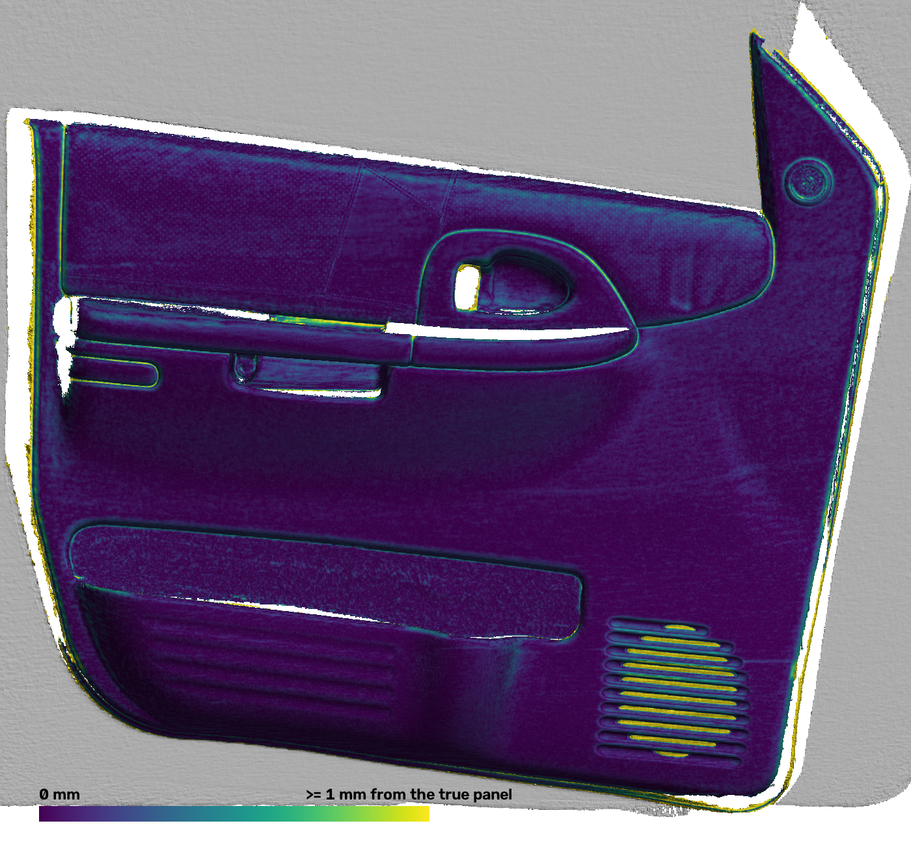
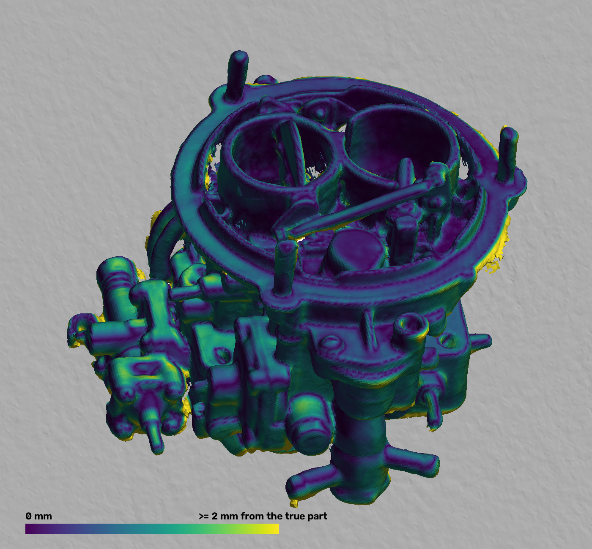

# OpenHandScan: end-to-end validation on simulated data

This document reports how accurately the whole processing chain works on data from the simulator
(`ohs.sim`). It covers calibration from recordings, the per-frame pipeline, offline processing and
export, compared against the simulator's ground truth. **Everything here is simulation.** The
numbers are an upper bound on what the real scanner will do; see
[Simulation limitations](#simulation-limitations).

Environment: Windows 11, Python 3.13, numpy 2.5.4, opencv-contrib 5.0.0, open3d 0.20.0 (CPU),
16 logical CPUs. Data: 1280x800 per camera, realistic lens model (distortion, 0.3 deg camera
rotation; rectification is not trivial), dot projector and both laser lines on. Each scan is 36
frames at 30 fps (1.2 s of hand-held motion: 63 mm and 28 deg of camera travel on the sphere scan)
with IMU at 416 Hz.

## How to reproduce

```
# fast checks (about 2 min for the three files)
C:\Users\Garage\.venvs\ohs\Scripts\python.exe -m pytest software\tests\test_app_pipeline.py software\tests\test_e2e_calibration.py software\tests\test_e2e_scan.py -q
# the full runs behind the table below (about 7 min); -s prints one "METRICS {...}" line per run
C:\Users\Garage\.venvs\ohs\Scripts\python.exe -m pytest software\tests\test_e2e_calibration.py software\tests\test_e2e_scan.py -m slow -s -q
```

## Results (full runs)

| Item | Metric | Result | Expectation |
|---|---|---|---|
| **(a) Stereo calibration**, 20 board views | fx error, left / right | -0.05 / -0.01 px | |
| | cx / cy error (left) | -0.01 / -0.14 px | |
| | baseline error | +0.005 mm | |
| | relative rotation error | 0.011 deg | |
| | row error after rectification, median / p95 | 0.006 / 0.025 px | < 0.3 px |
| | depth scale error (triangulation at 200-450 mm) | 0.001 % | |
| | reprojection rms | 0.075 px | < 0.5 px |
| **(b) Laser planes**, 8 views, true stereo, **margin** (default) | normal angle, vertical / horizontal | 0.0056 / 0.0054 deg | |
| | d error, vertical / horizontal | -0.016 / -0.018 mm | |
| | laser-point error, median / max (vertical; horizontal) | 0.011 / 0.13 mm; 0.028 / 0.24 mm | |
| (b) same views, **board** region | normal angle, V / H | 0.078 / 0.037 deg | |
| | d error, V / H | +0.26 / -0.13 mm | |
| | laser-point error, median / max (V; H) | 0.16 / 1.7 mm; 0.20 / 1.7 mm | |
| (b) same views, board + margin (`both`) | laser-point error, median (V; H) | 0.058; 0.048 mm | |
| (b) **estimated** stereo, margin | normal angle, V / H | 0.0077 / 0.013 deg | |
| | d error, V / H | -0.028 / -0.007 mm | |
| | laser-point error, median / max (V; H) | 0.019 / 0.17 mm; 0.14 / 0.75 mm | |
| (b) estimated stereo, board | laser-point error, median (V; H) | 0.16; 0.23 mm | |
| **(c) IMU calibration**, 7 s (1.2 s still, then rotation), 210 frames | R_ci error (estimated stereo / true stereo) | 0.025 / 0.031 deg | |
| | time-offset error | 0.019 / 0.014 ms | |
| | gyro-bias error | 0.087 mrad/s (0.005 deg/s) | |
| | rotation residual rms | 0.035 deg | |
| **(d) Markerless scan**, sphere on plane, true calibration | frames tracked | 36 / 36 (100 %) | > 90 % |
| | trajectory error, median / max | 0.19 mm, 0.035 deg / 0.29 mm, 0.077 deg | < 3 mm / 1 deg |
| | mesh distance, median / p95 | 0.20 / 0.67 mm (sphere 0.12, table 0.20) | median < 0.3 mm |
| | laser points, median / p95 | 0.068 / 0.28 mm (sphere 0.084) | median < 0.2 mm |
| **(e) Marker mode**, same recording | frames tracked | 36 / 36 | |
| | trajectory error, median / max | 0.94 mm, 0.22 deg / 3.8 mm, 0.93 deg | |
| | mesh, median / p95 | 0.71 / 2.0 mm (sphere 0.11, table 0.72) | |
| | laser points, median / p95 | 0.18 / 0.60 mm | |
| | tag map: tags, `refine_map` rms | 5 tags, 0.28 mm | |
| **(f) Markerless scan, car panel** (nearly featureless) | frames tracked | 36 / 36 | |
| | trajectory error, median / max | 0.63 mm, 0.039 deg / 0.97 mm, 0.065 deg | |
| | mesh, median / p95 | 0.29 / 1.17 mm (panel 0.11, floor 0.35) | |
| | laser points, median / p95 | 0.067 / 0.23 mm | |
| (f) same, tracking on raw depth (`track_filter_px=0`, the original design) | trajectory error, max | 13.3 mm, 2.4 deg | |
| **(g) Full chain**: (d) with the calibration estimated in (a)-(c) | frames tracked | 36 / 36 | > 90 % |
| | trajectory error, median / max | 0.23 mm, 0.035 deg / 0.34 mm, 0.079 deg | < 3 mm / 1 deg |
| | mesh, median / p95 | 0.27 / 0.77 mm | median < 0.3 mm |
| | laser points, median / p95 | 0.078 / 0.29 mm | median < 0.2 mm |

SGBM and Open3D are multi-threaded, so repeated runs can differ in the third significant digit.

Half resolution (640x400, the live preview), sphere scene, 24 frames (fast test): trajectory
error max 0.49 mm / 0.085 deg, mesh median 0.20 mm (2 mm voxels), laser median 0.15 mm.
The same recording without the IMU drifts 30 mm / 12 deg: the scene is symmetric about the
sphere axis, and the tracker flags it (`info["degenerate"]`).

## Timings

These are medians per frame on the CPU described above, from the full runs. Offline processing runs
at full resolution (1280x800); the live preview runs at half resolution (640x400, measured in the
fast tests).

| Stage (ms) | Offline 1280x800, markerless | Offline 1280x800, markers | Live 640x400, markerless |
|---|---|---|---|
| rectify (both images) | 2 | 2 | 1 |
| depth (SGBM + sub-pixel refinement) | 121-125 | 125 | 20-24 |
| laser lines (extract L+R, triangulate) | 24-26 | 26 | 9-12 |
| tracking-depth filter | 36-39 | - | 5 |
| ICP: ray cast / Gauss-Newton | 100-116 / 15-25 | - | 29 / 7-8 |
| TSDF integration: tracking model / reconstruction | 5 / 16-18 | - / 18 | 4 / 5 |
| marker detection + pose | - | ~44 | - |
| **total** | **348-361** | **217** | **86-100** |

Mesh extraction takes about 0.9 s per scan (0.8 M faces at 1 mm voxels); cleaning and export add
about 1 s. A 36-frame scan processes in about 15 s offline (`report.json` `wall_time_s` 14.8). The
simulator renders about 1 s per full-resolution stereo frame.

## GPU processing (M3, 2026-11-09)

The heavy steps now run on any OpenCL GPU (`ohs.compute`), and the CPU path above is the fallback.
- **Depth:** census semi-global matching on the GPU (`ohs/vision/depth_gpu.py`).
- **Tracking model:** a 2 mm TSDF on the GPU, with trilinear ray casting (`ohs/track/volume_gpu.py`).

"GPU mode" below means GPU depth and the GPU tracking model, the defaults when a GPU exists. "CPU mode" is `OHS_COMPUTE=cpu`.

**Depth against the true depth**, 1280x800, 8 frames of the sphere and car-panel scenes:

| | GPU | CPU (SGBM) |
|---|---|---|
| median abs. error | 0.316 mm | 0.369 mm |
| 95th percentile | 1.41 mm | 2.14 mm |
| off by > 2 mm | 1.8 % | 5.6 % |
| disparity off by > 1 px | 0.9 % | 4.1 % |
| bias | -0.002 mm | +0.117 mm |
| valid | 89.8 % (98.2 % where dots land) | 93.6 % (97.6 %) |

- **Where the GPU keeps no depth:** pixels with no dots near them, i.e. outside the projector's field. SGBM's depth there is mostly wrong (54 % of it is off by more than 2 mm).
- **640x400:** the GPU is also ahead there: off by > 2 mm 5.3 % vs 8.8 %, disparity off by > 1 px 1.1 % vs 2.8 %.

**Trajectory error, full runs** (median / max):

| Scan | VALIDATION (CPU, above) | GPU mode |
|---|---|---|
| sphere, 1280x800, 36 frames | 0.19 mm, 0.035 deg / 0.29 mm, 0.077 deg | 0.108 mm, 0.023 deg / 0.168 mm, 0.039 deg |
| car panel, 1280x800 | 0.63 mm, 0.039 deg / 0.97 mm, 0.065 deg | 0.110 mm, 0.025 deg / 0.261 mm, 0.034 deg |
| sphere, 640x400 (fast test) | max 0.49 mm / 0.085 deg | max 0.211 mm / 0.035 deg |

- **Mesh accuracy:** in GPU mode the mesh median is 0.065 mm (sphere) and 0.088 mm (car panel), against 0.20 mm and 0.29 mm above.

**Robustness over 15 scans** (3 scenes with extra seeds, at 1280x800 and 640x400; max trajectory error per scan):
- The GPU tracking model is better than Open3D's on 12 of 15 scans with SGBM depth, and on 11 of 15 with GPU depth.
- **This set exposed a weakness of the CPU path that the single validation seed hid.** On 3 of the 15 recordings (the sphere scene with extra seeds) the Open3D tracking model slides 13-42 mm with either depth. The GPU model stays below 0.4 mm on the same recordings.
  - The cause: Open3D's nearest-voxel ray cast drops most surface hits near the borders of the observed area. Those borders are exactly where stereo depth carries camera-fixed bias.
  - The GPU ray cast keeps a hit only when it is 8 mm inside the observed surface and its voxel has been fused at least 8 times (`FusionParams.gpu_border_mm`, `gpu_weight_threshold`).
- **GPU depth against SGBM:** on 26 of the 30 (scan, model) pairs, GPU depth tracks at or below SGBM's error. Three remaining pairs differ by a few thousandths of a degree or 0.05 mm, which is tracking noise. On the fourth, Open3D's model fails with either depth.
- **Depth fix that this set forced:** on the car panel, the area below the projector's field has no dots. Early GPU depth carried smooth but wrong depth into it from the neighbouring dots, and tracking slid 1.8 mm. Depth is now kept only where at least 20 % of a 15 x 15 window holds census texture.

**Speed (`ohs bench`, 90 frames, Radeon 680M integrated GPU in the Ryzen 7 7735U):** ms per frame, mean.

| Stage | CPU | GPU |
|---|---|---|
| depth | 123.9 | 68.7 |
| ray cast (tracking model) | 116 | 7.2 |
| whole frame, full quality | 338 (2.96 fps) | 187 (5.34 fps), **1.81x** |
| whole frame, preview quality | 83 (12.0 fps) | 58.5 (17.1 fps), 1.42x |

- **Shared power:** on this integrated GPU, the CPU stages that remain (laser lines, ICP) run slightly slower while the GPU works, because both share power and memory bandwidth.

**Speed on the owner's laptop** (i9-12900H, RTX 3070 Ti Laptop 8 GB, on AC power, same bench). All 50 GPU tests pass on NVIDIA's OpenCL compiler.

| Stage (ms, mean) | CPU | GPU |
|---|---|---|
| depth | 116.4 | 36.6 |
| ray cast (tracking model) | 111.9 | 5.9 |
| whole frame, full quality | 308 (3.24 fps) | 119 (8.38 fps), **2.58x** |
| whole frame, preview quality | 66.2 (15.1 fps) | 41.2 (24.2 fps), 1.60x |

- **Accuracy matches the 680M runs:** trajectory max 0.25 mm / 0.053 deg (GPU) against 0.68 mm / 0.174 deg (CPU).
- **Where the RTX still waits:**
  - The census-SGM kernels give it too little parallel work: depth takes 37 ms at full resolution, and at 640x400 it is no faster than the CPU.
  - ICP is slower in GPU mode, because the denser depth gives more source points.
  - Laser extraction, the tracking filter and the 1 mm reconstruction integration still run on the CPU.
  - These are the next tuning targets.
- **In the app:** a 15 s simulated scan (449 frames) meshed at full quality in about 1 min 50 s on the GPU.
- **Results files:** in `~/.ohs/bench/results/`; `ohs bench` reproduces them on any machine.

## GPU tuning (M3, 2026-11-10)

The first tuning round, from `ohs bench` per-stage tables on both machines. The tuning targets above turned out to be ordering and sampling more than kernels.

**What changed:**
- **The laser lines run in the background.** Two CPU threads extract them while the depth runs (on the GPU, or in SGBM's threads). On the laptop the frame now never waits for them. On the Radeon it still waits a little, because there the depth step's own CPU work competes with them. One thread was slower than two.
- **ICP samples every 8th pixel at its finest level** at full resolution (no level closer than 8 px at 1280 px width, scaled with the width; a 640 px preview keeps its strides of 16, 8 and 4).
  - First the strides themselves scaled with the width. At 320x200 that meant every 2nd pixel, and the CPU path's live-scan test then crashed in Open3D's ray cast in 2 of 3 runs. The minimum spacing leaves everything below full resolution as it was.
  - On five simulated scans the trajectory RMS went 0.13 / 0.24 / 0.08 / 1.06 / 0.74 → 0.14 / 0.19 / 0.08 / 0.69 / 0.68 mm.
  - It is 3–4 times faster.
  - Neighbouring pixels share the camera-fixed dot error, so the denser sampling added bias, not information.
- **The confidence TSDF weighs its pixels on the GPU.** Several full-image numpy passes on the CPU are gone, and one image fewer is uploaded. Its brick search now samples the same share of a brick at every voxel size: at preview every 4th pixel instead of every 2nd, and the mesh keeps its area within 0.06 %.
- **Stereo-matching work-groups (not changed):** a sweep of `GpuTuning.lines_v`, `lines_h` and `dpt` found the defaults fastest on both GPUs (22.5 ms per frame on the RTX, 72.8 ms on the 680M), and every setting gives the same disparities. Larger work-groups don't fit: the vertical SGM kernel is limited to 256 work-items on both GPUs.

**Speed, GPU mode** (ms per frame, mean; same bench, same accuracy):

| Machine | Quality | Before (a024ec4) | After (279d709) |
|---|---|---|---|
| RTX 3070 Ti laptop | full | 124.4 (8.0 fps) | **67.2 (14.9 fps)** |
| | preview | 53.1 (18.8 fps) | **28.4 (35.2 fps)** |
| Radeon 680M | full | 217.4 (4.6 fps) | **172.0 (5.8 fps)** |
| | preview | 73.0 (13.7 fps) | **67.0 (14.9 fps)** |

- The intermediate commit 880aa6b benched 72.6 / 33.0 ms on the laptop and 170.1 / 66.3 ms on the Radeon. The final version's minimum ICP spacing did not slow the preview down. The laptop's 5–14 % gain since then is probably mostly noise and temperature: its run was an hour later.
- The CPU path got faster too. On the laptop at full quality it went from 332 ms (3.0 fps) to 264 ms (3.8 fps), and its trajectory error fell from 0.33 mm / 0.075° to 0.24 mm / 0.028°. The GPU path is now 3.9 times faster than the CPU path at full quality and 2.3 times at preview.
- Trajectory error on the bench in GPU mode: 0.13 mm / 0.017° median at full quality (it was 0.15 mm / 0.035°), and 0.21 mm / 0.025° at preview (unchanged).
- **Per-stage times can mislead.** The tracking model's GPU integration is queued and returns at once, so the next frame's depth step waits for it: on the laptop the matcher alone takes 22.5 ms, while "depth" shows 27.2 ms. The whole-frame time is the number to trust.
**Round 2: the last two CPU steps on the GPU** (2b1eae0):
- **The tracking filter** (`ohs/track/filter_gpu.py`) gives `tracking_depth`'s map in four kernels:
  - edge test and block average;
  - a row and a column Gaussian pass;
  - an erosion with the offsets that `cv2.distanceTransform` itself rates within the radius;
  - the bilinear upsampling.

  On the bench recording 12 of 15.4 M pixels differ in validity, and the values agree within 0.014 mm.
- **The confidence TSDF's brick search** puts the frame's rays into a GPU hash set, and only the frame's brick list comes back. It gives the same bricks in the same order, and the same volume bit for bit. Beyond 512 bricks from the first camera (4 m at 1 mm voxels) it falls back to the CPU search.
- **A CPU filter bug found on the way:** the full-resolution path blurred `depth * valid`, and NaN × 0 is NaN, so a pixel without depth emptied the blur radius around it. It now blurs only the valid depth, as the half-resolution path always did. The pipeline uses the half-resolution path, so its scans were not affected.

| Machine | Quality | Round 1 (279d709) | Round 2 (2b1eae0) |
|---|---|---|---|
| RTX 3070 Ti laptop | full | 67.2 (14.9 fps) | **49.1 (20.4 fps)** |
| | preview | 28.4 (35.2 fps) | **25.5 (39.2 fps)** |
| Radeon 680M | full | 172.0 (5.8 fps) | **156.3 (6.4 fps)** |
| | preview | 67.0 (14.9 fps) | **63.0 (15.9 fps)** |

- On the laptop the filter went from 11.5 to 1.6 ms and the integration from 7.4 to 2.4 ms. "depth" went from 27.2 to 23.8 ms because it waits less on the queued GPU work: the matcher alone takes 22.5 ms. On the Radeon the filter went from 17 to 6.7 ms, mostly upload and download through the iGPU's driver, and the integration from about 15 to 9.7 ms.
- Since this morning (a024ec4) the GPU path is 2.5 times faster at full quality on the laptop (8.0 → 20.4 fps) and 2.1 times at preview. Trajectory errors are unchanged from round 1.
- **What limits it now:**
  - On the laptop the stereo matcher is 23.8 of 49 ms.
  - The two laser threads take about 16 ms each, so once the depth step gets below about 16 ms they become what the frame waits for.
  - At preview, ICP (5.3 ms, on the CPU) is the biggest tracking stage.
  - Every frame still crosses PCIe several times: the depth and sigma are downloaded, then uploaded again for the filter and the reconstruction, and the filtered depth goes up for the tracking model. Keeping them on the GPU would be the next step.

## Large and detailed parts (simulator, 2026-11-10)

Two real parts' 3D scans, rendered by the simulator's new `TriangleMesh` object (Open3D's Embree ray caster) with the usual dots, lasers and noise. Both were painted with low-contrast paint noise and set on a dark floor. They were processed as the Studio does (Make mesh, then Straighten with its laser crossings) and compared with the true mesh.
- **Door trim panel**, 946 × 868 × 135 mm, 0.49 M triangles: the Thunk3D ArcherS car door scan on Sketchfab (CC BY).
  - 1,410 frames (47 s): five overlapping passes along the panel, 150 mm apart.
- **Carburetor**, 186 × 186 × 196 mm, 0.5 M triangles: "Carburetor – Artec 3D Scanner" by Artec Group (CC BY 3.0).
  - 1,080 frames: two orbits looking down 30–65°.
- The models stay out of the repository; `ohs.sim.scene.mesh_on_floor` loads any OBJ, PLY, STL or glTF file.

**The door works.**

| | Door trim panel |
|---|---|
| Frames tracked | 1,410 of 1,410 |
| Trajectory error vs truth | median 0.34 mm, max 0.82 mm, 0.04° |
| Mesh vertices vs the true panel | median 0.07 mm, 92 % within 0.5 mm, p95 0.79 mm |
| Seen surface reconstructed | 99.5 % within 1 mm |
| Straighten | 25 loops, already within 0.12 mm: unchanged |
| Laser crossings | 1,661, within the lasers' scatter: unchanged |
| Time on the Radeon PC | track and fuse 280 s, Straighten 12 s, crossings 26 s |



The larger errors are where structured light always struggles:
- the speaker grille's slots, which the matcher bridges;
- thin skirts where the panel's edge meets the floor.

A metre of panel, scanned in five passes, did not drift.

**The carburetor exposed a tracking weakness: the tracking filter erases detailed parts.** It is now fixed (below).
- Only 596 of 1,080 frames tracked, and the trajectory slid away by up to 1.7 m, while the gyro kept the rotation right (0.09°).
- The tracking filter keeps only 3–9 % of the carburetor's depth pixels, against 52–78 % in the raw depth. It erodes 12 px around every depth step, and on a part like this every pixel is near one.
- What is left is the floor, a plane, which cannot hold the scanner's sideways motion.

The machined bracket preset suffered too, only less visibly. The trial below used 90 frames, median / max trajectory error in mm:

| Tracking input | Carburetor (300 frames) | Bracket | Car panel | Sphere | Door (400 frames) |
|---|---|---|---|---|---|
| Filtered (before) | lost: 1,190 mm by frame 336 | 1.01 / 6.90 | **0.10 / 0.31** | **0.13 / 0.22** | **0.18 / 0.34** |
| Raw depth, single model | 1.75 / 2.32 | | | | |
| Filtered, raw where the filter dropped it, whole scan | **1.48 / 1.86** | **0.36 / 0.95** | 0.16 / 0.52 | 0.24 / 0.44 | 0.16 / 0.51 |
| Raw only in frames that keep < 50 % | 2.01 / 3.75 | 0.27 / 2.31 | | 0.13 / 0.22 | 0.18 / 0.34 |
| **Shipped: decided at the start of the scan** | **1.48 / 1.86** | **0.36 / 0.95** | **0.10 / 0.31** | **0.13 / 0.22** | **0.18 / 0.34** |

**The fix: decide at the start of the scan whether the filtered depth can hold the pose.**
- **What decides it.** Each ICP now measures how well its input holds the weakest translation while the gyro holds the rotation: the translation block's smallest eigenvalue over the problem's largest (`info["trans_strength"]`).
  - With a filtered-only model, smooth parts hold 1e-3 to 1e-2: sphere p10 1.2e-3, car panel 2.6e-3, door 4.8e-3.
  - The bracket holds 1.1e-5 to 1.9e-5 and the carburetor 2.5e-5 to 3.8e-5.
- **The probe.** For the first 10 frames of a scan a second tracker runs on the filtered depth plus the raw depth wherever the filter dropped a pixel.
  - If the filtered tracker holds less than 5e-4 in any of those frames, the second tracker takes over for the whole scan, consistent from frame 0 (`detail_mode`). The report gives `detailed_part_from_frame`.
  - The threshold is above the 2e-4 a grown model needs, because a one-frame model flatters the filtered depth: the carburetor read 3.0e-4, 2.1e-4, then 1.3e-4 and falling, while smooth parts never dropped below 1.1e-3.
  - The carburetor and the bracket switch at frame 1. The sphere, car panel and door never switch, so their results are bit-identical to before.
- **What did not work**, in the order tried:
  - **Switching frame by frame** whenever the tracker's own "slide" flag or the strength said so: the carburetor still slid 0.7 m, and the bracket's median doubled. Once the raw frames put the part into the model, the filter's leftover fragments of it look well held, but they are biased.
  - **Switching for good after 2 weak frames in 5:** this deadlocked (5 of 300 frames tracked). The model didn't contain the part yet, so frames with the part failed the fitness gate and were never fused. Fusing them at the filtered pose freed it, but the slid frames left the model smeared (carburetor 49 mm).
  - **Raw depth only far (> 16–24 px) from the filter's surviving pixels:** a total failure, with 1 of 300 carburetor frames tracked.
  - **The filter's kept share, or the strength computed from the input's own normals:** neither separates the scenes. The floor inflates the share, and the dots' noise inflates self-normal constraints.
- **What is left of the per-frame idea:** a frame that fails a gate tries the raw-filled depth before it is lost. Weak frames are not retried: on the door that fired on 4.6 % of the frames (views mostly of floor) and made the worst frame worse (0.82 → 1.21 mm).
- **Not covered:**
  - A scan that starts on a smooth part and only later reaches a detailed one stays on the filtered depth. Start such scans on the detailed part.
  - On the CPU path, with no GPU (SGBM depth, Open3D tracking model), the probe misses the carburetor. Open3D's young model has noisy normals, which flatter the filtered depth (2e-3 to 9e-3 over the first 11 frames). The bracket is still caught at frame 3, and smooth parts stay above 2e-3. Detailed parts need a GPU for now.

**The full carburetor scan with the fix** (1,080 frames, processed as above):

| | Carburetor |
|---|---|
| Frames tracked | 1,080 of 1,080 (was 596) |
| Trajectory error vs truth | median 1.72 mm, max 3.22 mm; rotation median 0.33°, max 0.61° |
| Mesh vertices vs the true part | median 0.80 mm, p95 2.7 mm, p99 4.4 mm |
| Seen surface reconstructed | 72 % within 1 mm, 97 % within 2 mm |
| Straighten | 40 loops, already within 0.17 mm: unchanged |
| Laser crossings | 604, within the lasers' scatter: unchanged |



- The carburetor is still the hardest case. Its trajectory error is 5× the door's, its rotation error 18×, and its edges carry stereo skirts (yellow). The raw depth's camera-fixed dot error is what the filter was there to remove, and here it can't be.
- **Speed:** the probe costs a second tracker for 10 frames, +5–6 ms on the 90-frame bench's mean on the Radeon. Medians are unchanged within noise (probe on / off in the same run: full 155.6 / 153.5 ms, preview 66.4 / 63.9 ms). Over a real scan it amortises to under 1 %.

## The waits a user feels (2026-11-10)

Maintenance plan task F1. The Radeon 680M column is `ohs bench --frames 90 --quality both --device gpu`, three runs on the idle PC at 6e1c102; a range is the three runs. The RTX 3070 Ti column comes from the round 2 bench above (2b1eae0); the tail and the engine start have not been measured there yet. The targets were agreed with the owner on 2026-11-10.

| What the user feels | Radeon 680M | RTX 3070 Ti | Target |
|---|---|---|---|
| Live scanning (preview quality) | 15.1–15.3 fps | 39.2 fps | at least 15 fps on integrated graphics, 30 fps on a gaming GPU |
| Processing after the scan, full quality | 6.2–6.3 fps (158–162 ms a frame) | 20.4 fps (49.1 ms) | |
| → wait per minute of scanning, full quality | 9.5–9.7 min | about 2.9 min | at most 3 min on integrated graphics, 1 min on a gaming GPU |
| → the same at preview quality | 3.9–4.0 min | about 1.5 min | |
| Tail after the last frame, full quality (3 s scan, 1.09 M faces) | 1.8–1.9 s | not measured | |
| → the same at preview quality (0.25 M faces) | 0.33–0.37 s | not measured | |
| Engine start, new process to first status message | 1.9–2.0 s | not measured | |

- **Where it stands:** live scanning meets its target on both machines, on the Radeon only just. The wait after a scan misses its target by a factor of about 3 on both.
- **The wait per minute** is the bench's mean frame time × 3,600 frames (60 fps, every frame processed). It leaves out reading and decoding the frames. In the frame-step runs of the next section, `process_recording` as a whole took 199 s for the carburetor scan (1,080 frames) and 256 s for the door (1,410 frames), against 177 s and 222 s of frame time. That is about 19 ms more per frame and 3–6 s at the end, so the real wait is about 13 % above the bench's figure: about 11 min per minute of scanning on the Radeon.
- **The tail** at full quality: mesh extraction 0.56–0.59 s, cleaning 0.72–0.76 s, PLY 0.05–0.07 s, STL 0.46–0.47 s, laser points file 0.01 s. It grows with the scan. Not covered: the app's own step after processing, which reads the mesh back into the project and shows it.
- **The engine start:** the port accepts a connection after 1.1–1.2 s, and the app's "hello" message follows at once. The first status message comes about 0.8 s later. That time is in the engine, not in the connection (the WebSocket handshake takes 0.00–0.02 s). The 0.8 s start figure in the maintenance plan was taken differently and did not include Python's own start.

## Processing fewer frames after a scan: measurement (2026-11-10)

Maintenance plan task F2, step 1: measure only, no code change. Full quality on the Radeon 680M GPU path, through `process_recording` with the app's settings, every run twice.

- **What `frame_step` does:** with step s, every s-th recorded frame is processed. Skipped frames are never decoded, and every per-frame stage (rectify, laser extraction, depth, tracking, fusion) runs only on the processed frames. The laser profiles of skipped frames are dropped with them. All IMU samples are kept.
- **Real step:** the device records 60 frames a second, the simulated scans in this document 30. At the same hand speed, a 30 fps recording at step s shows the tracker the same motion per frame as a 60 fps recording at step 2s. Checked by simulating the sphere and the panel scan a second time at 60 fps with the same hand motion: 30 fps step 1 against 60 fps step 2 gives a mesh median of 0.0654 against 0.0665 mm (sphere) and 0.0886 against 0.0871 mm (panel). "Real step" below is the step on the 60 fps device.

Recordings at 60 fps (72 frames; the bracket 180):

| Scan | Real step | Wait per minute of scanning | Trajectory median / max, mm | Mesh median / p95, mm | Floor noise, mm |
|---|---|---|---|---|---|
| Sphere | 1 | 9.7–9.8 min | 0.111 / 0.185 | 0.0565 / 0.287 | 0.074 |
| | 2 | 5.1 min | 0.096 / 0.144 | 0.0665 / 0.309 | 0.091 |
| | 3 | 3.5 min | 0.090 / 0.158 | 0.0752 / 0.322 | 0.107 |
| | 4 | 2.7–2.9 min | 0.093 / 0.124 | 0.0832 / 0.338 | 0.122 |
| Car panel | 1 | 9.6–9.8 min | 0.087 / 0.324 | 0.0716 / 0.425 | 0.116 |
| | 2 | 5.0–5.1 min | 0.084 / 0.332 | 0.0871 / 0.456 | 0.156 |
| | 3 | 3.5 min | 0.113 / 0.266 | 0.1004 / 0.488 | 0.189 |
| | 4 | 2.7–2.9 min | 0.106 / 0.271 | 0.1094 / 0.509 | 0.211 |
| Bracket | 1 | 10.0–10.2 min | 0.479 / 0.889 | 0.0944 / 0.420 | 0.080 |
| | 2 | 5.1 min | 0.203 / 0.581 | 0.0902 / 0.384 | 0.088 |
| | 3 | 3.5 min | 0.304 / 0.446 | 0.0918 / 0.400 | 0.100 |
| | 4 | 2.6 min | 0.531 / 0.823 | 0.0916 / 0.412 | 0.108 |

The two long scans (30 fps recordings, so steps 1–4 are real steps 2–8):

| Scan | Real step | Wait per minute, frames only / whole run | Trajectory median / max, mm | Part median / p95, mm | Complete within 1 mm | Floor noise, mm |
|---|---|---|---|---|---|---|
| Carburetor (1,080 frames) | 2 | 4.9 / 5.5 min | 1.720 / 3.216 | 0.802 / 2.722 | 71.6 % | 0.070 |
| | 4 | 2.5 / 2.8 min | 1.576 / 2.766 | 0.746 / 2.490 | 75.1 % | 0.088 |
| | 6 | 1.7 / 1.9 min | 1.603 / 2.606 | 0.739 / 2.386 | 75.0 % | 0.099 |
| | 8 | 1.3 / 1.5 min | 1.566 / 2.395 | 0.717 / 2.280 | 75.2 % | 0.111 |
| Door (1,410 frames) | 2 | 4.7 / 5.4 min | 0.336 / 0.816 | 0.070 / 0.785 | 99.5 % | 0.081 |
| | 4 | 2.4 / 2.8 min | 0.263 / 0.720 | 0.075 / 0.683 | 99.4 % | 0.100 |
| | 6 | 1.6 / 1.9 min | 0.223 / 0.957 | 0.066 / 0.632 | 99.4 % | 0.111 |
| | 8 | 1.2 / 1.5 min | 0.213 / 0.859 | 0.069 / 0.579 | 99.3 % | 0.124 |

- **Time:** the wait falls almost exactly as 1 / step. The time per processed frame rises by 1–4 % at step 4 on the long scans (carburetor 163.5 → 167.8 ms, door 157.4 → 164.0 ms) and by 12–25 % on the scans of 36–72 frames, where a few frames carry the fixed costs of the start.
- **Trajectory:** holds up to real step 8. On the long scans it improves, because drift adds up over fewer steps (carburetor: median 1.72 → 1.57 mm, rotation 0.33 → 0.19°).
- **Large parts:** the error against the part does not get worse (carburetor median 0.80 → 0.72 mm; door median unchanged, p95 0.79 → 0.58 mm).
- **Smooth surfaces get noisier.** On the sphere and the panel the mesh median rises by 18–22 % at real step 2 and by 47–53 % at real step 4; the floor noise rises by 23–34 % at real step 2. Fewer frames average less noise away. The noise grows more slowly than 1 / √frames would give (× 1.23 at half the frames, not × 1.41).
- **Spread:** the GPU path repeats exactly: the trajectories of the two runs are byte-identical, and the mesh files differ only in the order of the vertices. The same hand motion recorded twice (30 fps and 60 fps, same real step) agrees within 2 % on the sphere and the panel. The rise in noise is far beyond that. The bracket is the exception: its trajectory error jumps between steps without a trend (0.48 / 0.20 / 0.30 / 0.53 mm), and its two recordings are 30–60 % apart, so it speaks neither for nor against.
- **Result under the plan's stop rule:** the mesh error and the noise rise beyond the spread, so the default stays at 1 on this evidence.
- **What this says about the figures above:** the accuracy validated in this document comes from 30 fps recordings, which is real step 2. Processing every frame of a 60 fps scan is 15–18 % better than that on smooth surfaces (mesh median 0.0565 against 0.0665 mm on the sphere, 0.0716 against 0.0871 mm on the panel). Real step 2 would give the accuracy validated here and halve the wait, from about 9.8 to about 5 min per minute of scanning on the Radeon. Which of the two becomes the default is the owner's decision (F2 step 3).
- **Floor noise** is this section's own measure: floor vertices at least 10 mm from the object, in 5 mm cells that all four steps of a recording cover, a plane fit per cell, 1.4826 × the median absolute deviation. It compares steps of one recording, not recordings with each other.
- **Motion per recorded frame** in the 30 fps scans: 1.7–3.4 mm and 0.17–0.82° median (carburetor at most 4.96 mm and 1.08°). That is a hand speed of about 50–100 mm/s and 5–25°/s: a calm hand.
- **Not measured:** fast or jerky hand motion and motion blur; Straighten and the laser-curve adjustment with fewer laser crossings (the laser points fall as 1 / step: carburetor 210 k → 55 k at real step 8); marker mode; the CPU path; the RTX laptop; a real IMU, whose gyro prior of 0.02° per processed frame is not widened for a longer gap between frames.

## Picking frames by motion against a fixed step: measurement (2026-11-10)

Maintenance plan task F2, step 2. The setting `process.frame_motion_deg` lets the gyro choose the frames: a frame is processed when the hand has turned by that angle since the last processed frame, or when `process.frame_max_gap` recorded frames have passed. It is off by default. Measured at code b890475, full quality on the Radeon 680M GPU path, through `process_recording` with the app's settings, one run each (the GPU path repeats exactly: six reruns of rows from the section above gave byte-identical trajectories). Scoring and floor noise as in the section above; the floor noise compares rows of one recording only.

**Steady hand (the 60 fps recordings above, cap 4).** The hand turns at a near-constant rate, so an angle picks the very frames of a fixed step: sphere 0.5° and bracket 0.5° pick the frames of step 2, sphere 0.9° and bracket 1.0° those of step 3, panel 0.4° those of step 2. Same frames, same result. Only the panel at a third of the frames differs:

| Scan | Setting | Frames | Trajectory median / max, mm | Mesh median / p95, mm | Floor noise, mm |
|---|---|---|---|---|---|
| Car panel | step 3 | 24 | 0.113 / 0.266 | 0.1004 / 0.488 | 0.1885 |
| | 0.7°, cap 4 | 24 | 0.117 / 0.351 | 0.1001 / 0.495 | 0.1890 |

**The two long scans (30 fps recordings; a gap of n frames is 2n on the 60 fps device):**

| Scan | Setting | Frames (by angle / by cap) | Trajectory median / max, mm | Mesh median / p95, mm | Part median / p95, mm | Complete within 1 mm | Floor noise, mm |
|---|---|---|---|---|---|---|---|
| Carburetor | step 2 | 540 | 1.576 / 2.766 | 0.284 / 1.193 | 0.746 / 2.490 | 75.1 % | 0.0896 |
| | 1.0°, cap 4 | 540 (539 / 0) | 1.562 / 2.777 | 0.297 / 1.196 | 0.737 / 2.484 | 75.5 % | 0.0898 |
| | 1.0°, cap 2 | 559 (508 / 50) | 1.606 / 2.953 | 0.293 / 1.198 | 0.747 / 2.496 | 74.8 % | 0.0885 |
| Door | step 2 | 705 | 0.263 / 0.720 | 0.109 / 0.551 | 0.075 / 0.683 | 99.43 % | 0.1007 |
| | 0.27°, cap 4 | 708 (677 / 30) | 0.259 / 0.787 | 0.094 / 0.512 | 0.072 / 0.661 | 99.44 % | 0.1035 |
| | 0.35°, cap 2 | 723 (348 / 374) | 0.271 / 0.711 | 0.112 / 0.550 | 0.077 / 0.682 | 99.43 % | 0.0993 |

**A hand that changes speed.** Two new 60 fps recordings of 270 frames (sphere and car panel) with the usual hand path on a warped clock: slow for 1 s, fast for 0.9 s (frames 78–131), slow again, a hover of 0.4 s, slow. Median speed and turn rate of the camera: slow 40–65 mm/s and 10–30°/s; fast 241 mm/s and 77°/s on the sphere (peak 356 mm/s, 94°/s), 154 mm/s and 28°/s on the panel (peak 294 mm/s, 39°/s); hover 2 mm/s. The angles were chosen to land on the frame counts of steps 2, 3 and 4; the count of step 4 needs cap 8.

| Scan | Setting | Frames | In the fast part | Trajectory median / max, mm | Drift across the fast part, mm | Mesh median / p95, mm | Floor noise, mm |
|---|---|---|---|---|---|---|---|
| Sphere | every frame | 270 | 54 | 0.240 / 0.394 | 0.327 | 0.0538 / 0.317 | 0.0642 |
| | step 2 | 135 | 27 | 0.201 / 0.353 | 0.122 | 0.0606 / 0.333 | 0.0783 |
| | step 2, one frame later | 135 | 27 | 0.154 / 0.354 | 0.345 | 0.0612 / 0.321 | 0.0779 |
| | 1.0°, cap 4 | 138 | 54 | 0.182 / 0.398 | 0.322 | 0.0593 / 0.333 | 0.0718 |
| | step 3 | 90 | 18 | 0.222 / 0.419 | 0.423 | 0.0664 / 0.335 | 0.0909 |
| | 1.6°, cap 4 | 87 | 27 | 0.206 / 0.410 | 0.345 | 0.0678 / 0.347 | 0.0901 |
| | step 4 | 68 | 13 | 0.217 / 0.367 | 0.328 | 0.0712 / 0.341 | 0.1011 |
| | 2.0°, cap 8 | 72 | 27 | 0.179 / 0.351 | 0.115 | 0.0705 / 0.358 | 0.0947 |
| Car panel | every frame | 270 | 54 | 0.138 / 0.448 | 0.273 | 0.0651 / 0.396 | 0.0963 |
| | step 2 | 135 | 27 | 0.164 / 0.419 | 0.190 | 0.0791 / 0.414 | 0.1231 |
| | step 2, one frame later | 135 | 27 | 0.169 / 0.429 | 0.158 | 0.0924 / 0.429 | 0.1217 |
| | 0.4°, cap 4 | 135 | 46 | 0.129 / 0.397 | 0.165 | 0.0743 / 0.404 | 0.1198 |
| | step 3 | 90 | 18 | 0.267 / 0.440 | 0.159 | 0.0883 / 0.421 | 0.1425 |
| | 0.7°, cap 4 | 88 | 26 | 0.119 / 0.291 | 0.351 | 0.0863 / 0.426 | 0.1433 |
| | step 4 | 68 | 13 | 0.172 / 0.476 | 0.281 | 0.0978 / 0.436 | 0.1585 |
| | 0.8°, cap 8 | 72 | 24 | 0.102 / 0.324 | 0.047 | 0.0917 / 0.437 | 0.1549 |

- **Tracking and time:** no run lost a frame, with either way of choosing. A processed frame costs the same either way (159–172 ms), so the wait depends on the number of frames only. Choosing the frames takes 0.2–0.5 ms per recorded frame.
- **How much the choice of frames alone moves the figures:** the rows "step 2, one frame later" process the other half of the frames. At the same count the mesh median moves by up to 17 % (panel 0.0791 against 0.0924 mm) and the trajectory median by up to 25 % (sphere 0.201 against 0.154 mm); the floor noise by about 1 %. One such control per recording, so this is a rough yardstick.
- **Same number of frames, steady hand: no measurable difference.** Mostly it is the same frames. On the long scans the part error, the completeness and the floor noise agree within about 3 %; the door's lower mesh median at 0.27° is inside the yardstick above.
- **A sliding hand:** the door turns too little for a normal angle. At 1.5°, cap 4 every pick but one is by the cap, which is exactly fixed step 4. The cap gives what a fixed step gives, nothing more.
- **A hand that changes speed:** the fast part gets 1.7–2 times as many frames as with a fixed step. The trajectory median is lower in all six pairs (sphere −7 to −18 %, inside the yardstick; panel −21 to −55 %, beyond it, with every error under 0.5 mm). The drift across the fast part goes both ways. The floor noise at the same count is 1–8 % lower on the sphere and within 3 % on the panel, partly because those runs have a few more frames. A small advantage that two recordings do not prove. It saved no scan here, because no fixed step failed.
- **It does not bring the noise back.** At half to a quarter of the frames the floor noise is 12–60 % above every frame, as in the section above. Fewer frames average less, however they are chosen.
- **An angle is not a fraction of the frames.** 0.5°, cap 4 keeps half the frames of the steady sphere scan, 174 of 270 of the sphere scan with the changing hand and 111 of 270 of the panel one (counts from the picker; those two were not processed). The wait then depends on how the hand moved.
- **Checked in review:** the panel rows "step 3" and "0.7°, cap 4" of the last table were run a second time on their own: byte-identical trajectories. The frame counts were recomputed with a separate script.
- **Not measured:** a real IMU (the simulated gyro starts with the calibrated bias and exact timing, so this is the best case for the angle); motion blur; a hand faster or jerkier than about 350 mm/s and 90°/s; Straighten and the laser stages with frames picked by motion; marker mode; the CPU path; the RTX laptop.

## Standard and Best quality (2026-11-10)

The owner's decision after the two measurements above (maintenance plan F2 step 3): the app offers two levels of the final mesh. **Standard**, the default, processes at most 30 frames per second of scanning (`[process] standard_frame_rate`): every 2nd frame of the 60 fps camera, every frame of a 30 fps recording. **Best** processes every frame. Picking frames by motion stays a setting, off.

- **What the figures in this file are:** the validation scans are 30 fps recordings, so every figure here outside the two sections above is what Standard gives on the 60 fps device, and none of them changes. Best is the "step 1" row of "Processing fewer frames after a scan": on smooth surfaces a mesh median 15–18 % lower, at about twice the wait.
- **The wait:** computed from the bench, not timed on a real scan. Standard needs 30 processed frames per second of scanning: about 4.8 times the scan's duration on the Radeon 680M (half of the 9.5–9.7 in "The waits a user feels") and about 1.5 times on the RTX 3070 Ti laptop (20.4 frames a second). Best is twice that. The targets in "The waits a user feels" (3 times and 1 time) are closer and not met yet.
- **Checked in review:** on the 60 fps recording `panel_vary_60` (270 frames) Standard processed 135 frames and its trajectory is byte-identical to the `frame_step = 2` run of the section above; Best processed 270 and is byte-identical to `frame_step = 1`; the old quality name "full" gives the same as Standard. The engine snapshot (30 fps recordings, 90 frames, GPU path) is identical to the one before the change.
- **Not measured:** a recording from the real camera. The frame rate is taken from the median time between the frames; jitter and dropped frames are covered by tests on made-up timestamps only.

## A narrower stereo search per frame: tried, not adopted (2026-11-10)

Maintenance plan F3, the simple form: one disparity range per frame, from the tracking model's last ray cast and the previous frame's depth plus 15 mm, with a full-range frame at the start, after a lost frame and every 10 frames. The plan's stop rule hit (a bench gain under 10 %), so the code is not in the engine; it is kept on the branch `experiment/f3-narrow-depth-search` for reference.

Bench on the Radeon 680M (GPU path, 90 frames, Standard, 1280×800), five pairs of runs off / on, three by the subagent that built it and two repeated in review:

| | Off | On | Change |
|---|---|---|---|
| Matcher, mean per frame | 78.8–84.5 ms | 72.6–75.7 ms | −5 to −14 % |
| Whole frame, mean | 159.0–163.9 ms | 152.6–156.4 ms | −2 to −7 % |
| Whole frame, median | 151.9–164.6 ms | 144.4–147.4 ms | −4 to −12 % |
| Wait per minute of scanning (every frame) | 9.54–9.81 min | 9.16–9.38 min | |
| Disparities searched, mean | 208 | 172.3 (10 of 90 frames at full range) | −17 % |

- **Why it does not pay:** in the simulated scans the depth in view runs from about 180 mm to the 450 mm limit in every frame, because the floor recedes behind the part. One range per frame has to cover all of it: with the margin about 163 to 486 mm. And the matcher's time does not fall in step with the range: 31 % fewer disparities gave 26 % less matcher time, since census, the sub-pixel step and the speckle filter do not depend on it.
- **Accuracy with it on:** within the 2 % yardstick of this file. The largest change was the trajectory median, +1.4 % (sphere and car panel at 1280×800); the mesh median moved by less than 0.1 %. These are the builder's runs; in review only the bench trajectory was repeated (median 0.1263 → 0.1257 mm).
- **A weakness found on the way:** a surface outside the narrowed range is not left without depth. Both matchers find a wrong match inside the range for 11 to 33 % of its pixels (planes, a 32-disparity range), 30 to 100 mm off, and the uniqueness and left-right checks let it through. Any later attempt at a narrowed search (a range per pixel) has to deal with this first.
- **GPU:** the disparity count and minimum are fixed when the OpenCL program is built (1.3 to 1.5 s per build on the 680M). The experiment makes the minimum a kernel argument and keeps one cached program per count.
- **Not measured:** the RTX laptop; the CPU path's timing; long scans and real parts against a far background, where the range could be narrower; a range per pixel.

## Where a frame's time goes (profile, 2026-11-10)

A profile of the frame after F2 to F4, to pick the next speed step. Radeon 680M, GPU path, Standard, the 90-frame bench (`ohs bench`), 1280×800. Measured with throwaway scripts that wrap functions with wall-clock timers (not kept in the repo); the engine's code was not changed. Python's cProfile gave wrong figures with the laser threads running and is not used here.

Stages, mean per frame over six runs (the bench's own timers):

| Stage | ms | What runs |
|---|---|---|
| Rectify | 2.3–2.4 | CPU |
| Depth (stereo matcher) | 79–82 | GPU; the main thread waits |
| Wait for the two laser threads | 16–17 | the threads start before the depth and should be done when it is |
| Tracking and fusion | 56–58 | ray cast 16, ICP 7.5–8, tracking filter 6–7, fusion 10, model update 1.8 |
| Laser points | 4–5 | CPU |
| **Whole frame** | **159–161** | median 152–155 |

Device time of the GPU work, from OpenCL's profiling events:

| Kernel | ms per run |
|---|---|
| `sgm_horizontal` | 32.0 |
| `sgm_vertical` | 23.7 |
| `census` | 6.3 |
| `lk_prep` | 1.4 |
| `sigma_z` | 1.0 |
| the 11 other matcher kernels together | 5.2 |
| **Matcher, sum** | **69.7** |
| Volume: ray cast / integrate / upload | 3.6 / 3.7 / 0.5 |

- **The matcher is GPU-bound:** 70 of its 79–82 ms are device time, and 56 of those are the two SGM kernels.
- **Tracking is mostly host time:** the volume's kernels take about 8 ms of device time per frame, the stage takes 56–58 ms. `MarkerlessTracker.track` is 37.7 ms per frame: finishing the ray cast 17.6 (7.0 of it waiting for the device), ICP 9.6, source points 2.8, cleaning the depth 1.9. The pipeline's tracking filter is 6.8 and the fusion 10.7.
- **The first frames cost more:** `_probe_track` took 78 ms per call, in the first 13 frames only. Over 90 frames that is 11 ms per frame; over a real scan of thousands of frames it is nothing. The bench overstates tracking by about that much.
- **Reading the recording is not in the bench's frame:** `cv2.imread` takes 16–17 ms per frame, one frame at a time with nothing read ahead. In Make mesh that is about a tenth of the wait per frame (the job on the 355-frame simulator scan ran at 4.8–5.4 frames a second, 185–208 ms per frame, against the bench's 160).
- **The mesh at the end:** 570 ms for 1.09 million triangles (436 ms of it the conversion to Open3D), clean-up 758 ms, STL export 442 ms. Once per job.

### The laser threads wait for Python's lock while the matcher runs

Laser extraction alone takes 13.9 ms for one image and 20.6 ms for two at once. In a frame each of the two threads needed 92 ms, of which about 21 ms was its own CPU time. `cv2.sepFilter2D` looked like 35 ms per call from Python; alone it takes 1.7–1.9 ms. The rest is waiting for Python's lock (the GIL) after the call returns.

The cause is in `GpuStereoMatcher._run` (`ohs/vision/depth_gpu.py`). Its OpenCL calls take 0.08 ms (kernel enqueues) + 0.5 ms (non-blocking copies) + 3.5 ms (the blocking copy at the end) of its 82 ms. The other 78 ms are spent in the first output copy: it is non-blocking, pyopencl returns an event for it that keeps the host array alive, the code drops that event at once, and pyopencl's clean-up of a dropped copy event waits for the copy to finish **without releasing the lock**. So the main thread holds the lock for nearly the whole matcher run, and the laser threads only get going when it is over.

Experiment: the events of the matcher's non-blocking copies kept alive until its blocking copy has returned (patched in from outside, the engine's code unchanged). Two pairs of bench runs:

| | Off | On | Change |
|---|---|---|---|
| Whole frame, mean | 159.5 / 160.4 ms | 153.3 / 152.9 ms | −3.9 % / −4.7 % |
| Whole frame, median | 151.6 / 151.7 ms | 144.9 / 145.4 ms | −4.4 % / −4.1 % |
| Wait for the laser threads | 16.2 / 16.0 ms | 0.7 / 1.3 ms | |
| Laser threads, wall time summed | 183.8 / 186.3 ms | 62.7 / 68.3 ms | |
| Depth | 79.4 / 80.2 ms | 88.0 / 87.2 ms | +8 to +9 ms |
| Wait per minute of scanning (every frame) | 9.57 / 9.62 min | 9.20 / 9.17 min | |

- **Same results in both modes:** trajectory median 0.126297 mm, depth error median 0.314194 mm, 1,088,827 triangles, 90 of 90 frames tracked, to the last digit printed.
- **The depth stage gets slower by 8 to 9 ms** once the laser threads really run beside it. Why is not looked into (the integrated GPU shares its power budget and memory with the CPU; the main thread also has to get the lock back). The frame still gains 6 to 7 ms.
- **The same pattern elsewhere:** `ohs/track/filter_gpu.py` and `ohs/track/recon_tsdf.py` also drop the events of non-blocking uploads. Whether those waits matter is not measured.
- **Not measured:** the snapshot guard on the patched run; the CPU path (it has no matcher on the GPU); the RTX laptop; live scanning, where the app's server threads are held up by the same lock for about 78 ms in every frame.

**Built on 2026-11-11 (plan F5):** the matcher now keeps those events itself. Old and new code, runs alternated (new, old, new, old, new):

| | Old | New |
|---|---|---|
| Whole frame, mean | 160.8 / 161.4 ms | 152.7 / 151.4 / 151.9 ms |
| Whole frame, median | 152.7 / 154.7 ms | 146.3 / 145.7 / 145.6 ms |
| Wait for the laser threads | 16.3 / 16.4 ms | 1.4 / 1.2 / 0.9 ms |
| Depth | 80.9 / 81.6 ms | 86.4 / 85.7 / 87.0 ms |
| Wait per minute of scanning (every frame) | 9.65 / 9.68 min | 9.16 / 9.08 / 9.11 min |

The mean frame is 5 to 6 % shorter. The accuracy figures are the same in all five runs, and the snapshot (`tools/snapshot.py`, 90 frames, preview and full) is identical to the one from before.

**Built on 2026-11-11 (plan F6):** the frame pass behind Make mesh now gets its images from a thread that reads up to two frames ahead (`RecordingReader.iter_ahead`). Timed on a real pass, not the bench: `process_recording` with default settings on the first 150 frames of a 355-frame simulator recording on disk (1280x800, Radeon 680M, GPU path), the time taken between the first and the last frame's progress call, old and new runs alternated (new, old, new, old, new, old):

| | Old | New |
|---|---|---|
| Time per frame, mean | 169.0 / 172.9 / 167.5 ms | 149.7 / 152.1 / 151.2 ms |
| Time per frame, median | 164.3 / 168.6 / 161.0 ms | 147.7 / 149.3 / 148.7 ms |
| Whole pass with its mesh | 28.5 / 29.0 / 28.3 s | 25.7 / 26.0 / 25.8 s |

That is 17 to 21 ms less per frame, about 11 %. All 150 frames are tracked and the mesh has 426,639 vertices and 845,817 faces in all six runs; the snapshot (`tools/snapshot.py`, 90 frames, preview and full) is identical to the one from before. Not measured: the RTX laptop, a recording on a slow disk, the CPU path. The later passes (`ohs/track/posegraph.py`, `spacetime.py`, `curve_ba.py`) still read their frames one at a time.

**Built on 2026-11-11 (plan F7): the tracker's time on the host.** A line-by-line timing of the frame pass on the same recording (335 frames timed, 149.9 ms per frame: depth 88.4, tracking with fusion 53.2, laser 4.2, rectify 2.5) shows where the tracker's 53 ms go:

| Part of tracking, per frame | Time | Of it, waiting for the device |
|---|---|---|
| Model view (ray cast) | 14.8 ms | 5.5 ms |
| Fusion into the reconstruction | 9.4 ms | 5.4 ms |
| ICP | 8.5 ms | none |
| Tracking filter | 5.8 ms | 4.6 ms |
| Counting the valid pixels (pipeline and tracker) | 3.7 ms | none |
| Source points | 2.7 ms | none |
| Fusion into the tracking volume | 2.4 ms | 1.7 ms |
| Depth range check, gyro prior, the rest | about 6 ms | none |

So about 17 ms are waits, and the host work that could go without changing a result was in two places. The model view built vertices and normals for all 1,024,000 pixels (8.2 ms) though ICP reads them only where a source point lands: it now builds them at those pixels, with the same arithmetic. And `np.count_nonzero` on a float32 depth map is slow: timed alone on a 1280x800 map, 3.6 ms where counting `depth != 0` takes 0.26 ms and gives the same number. Same measurement as for F6, old and new runs alternated (old, new, old, new, old, new):

| | Old | New |
|---|---|---|
| Time per frame, mean | 150.3 / 149.4 / 151.3 ms | 141.2 / 140.9 / 143.7 ms |
| Time per frame, median | 147.1 / 146.8 / 148.7 ms | 138.5 / 138.4 / 140.2 ms |
| Whole pass with its mesh | 25.7 / 25.5 / 25.9 s | 24.7 / 24.2 / 24.6 s |

That is 8 to 9 ms less per frame, about 6 %. All 150 frames are tracked and the mesh has 426,639 vertices and 845,817 faces in all six runs; the snapshot (`tools/snapshot.py`, 90 frames, preview and full) is identical to the one from before. Not measured: the RTX laptop, the CPU path (its model view comes from Open3D and is unchanged). What is left of the tracker is mostly waiting and the ICP's own arithmetic; the waits can be used for other work (noted under task E5 in `docs/MAINTENANCE_PLAN.md`).

**Built on 2026-11-11 (plan E4): the fusion no longer waits for the device.** The reconstruction volume's `integrate` ended with a wait for the GPU (5.4 ms per frame in the timing above), only to keep two small host arrays alive. It now returns as soon as the fusion is queued: the two arrays are kept until the next frame, and whatever reads or releases the volume waits first. The pass then goes on with the laser points and the next frame's rectification while the device works. A first version that still waited for the two small uploads gained nothing (140.0 / 141.5 / 140.3 ms per frame against 140.9 / 140.6 / 141.1), which shows what the wait was: the device was busy with the tracking volume's fusion, queued just before on the same GPU. Same measurement as for F7, old and new runs alternated:

| | Old | New |
|---|---|---|
| Time per frame, mean | 142.8 / 141.8 / 140.9 ms | 136.5 / 138.7 / 137.7 ms |
| Time per frame, median | 139.9 / 138.3 / 138.3 ms | 134.5 / 136.5 / 135.1 ms |
| Whole pass with its mesh | 25.1 / 24.3 / 24.3 s | 23.6 / 23.9 / 23.7 s |

That is about 4 ms less per frame, 3 %. All 150 frames are tracked and the mesh has 426,639 vertices and 845,817 faces in all six runs; the snapshot is identical to the one from before. A new test fuses frames with and without a wait after each and compares the volumes bit for bit, with the pool growing, a reset and a close straight after a frame. The fusion time the app reports per frame is now the time to queue it, not the time the device takes. Not measured: the RTX laptop.

**Built on 2026-11-11 (plan E5, first part): the laser points are computed beside the tracking.** The laser points of a frame need its depth and its laser lines, not its pose. They are now triangulated in one of the two laser threads while the frame is tracked and fused, and collected afterwards; the cloud and the count of rejected points are still updated on the main thread in the same order. Same measurement, old and new runs alternated:

| | Old | New |
|---|---|---|
| Time per frame, mean | 137.0 / 137.0 / 137.4 ms | 134.3 / 133.9 / 133.4 ms |
| Time per frame, median | 134.5 / 134.6 / 134.9 ms | 131.6 / 131.3 / 131.9 ms |
| Whole pass with its mesh | 23.7 / 23.9 / 23.6 s | 23.5 / 23.2 / 23.0 s |

That is about 3.3 ms less per frame, 2.4 %. All 150 frames are tracked and the mesh has 426,639 vertices and 845,817 faces in all six runs; the snapshot is identical. A new test, passing on the old code too, compares each frame's laser points, the cloud and the rejected counts with the direct computation, bit for bit. In the per-frame timings `laser_triangulate` is now the wait that is left after tracking, and `laser_triangulate_cpu` the work's own time. Not measured: the CPU path and the RTX laptop.

**Built on 2026-11-11 (plan E5, second part): the tracking filter reads the depth on the GPU and starts early.** The matcher's depth map was downloaded and then uploaded again for the tracking filter (4 MB), and the pass waited for the filter before doing anything else. The filter now reads the map from the matcher's own buffer on the device (the same values: the downloaded array is a copy of it), starts as soon as the depth is there, and is collected when the frame is tracked; the device filters while the host works out the gyro prior. Same measurement, old and new runs alternated:

| | Old | New |
|---|---|---|
| Time per frame, mean | 135.1 / 135.6 / 134.1 ms | 131.5 / 131.2 / 132.3 ms |
| Time per frame, median | 132.1 / 133.5 / 132.3 ms | 130.1 / 128.8 / 130.3 ms |
| Whole pass with its mesh | 23.4 / 23.4 / 23.6 s | 22.8 / 22.8 / 23.1 s |

That is about 3.2 ms less per frame, 2.4 %. All 150 frames are tracked and the mesh has 426,639 vertices and 845,817 faces in all six runs; the snapshot is identical. Two new tests: the filter started ahead, from an array or from a device buffer, gives the map of a plain call bit for bit; and what the tracker gets for a frame is the filter of that frame's depth map bit for bit (this one passes on the old code too). The buffer is used only where the device divides exactly, so that the depth on it is the depth the pipeline returns; elsewhere the map is uploaded as before, but the filter still starts early. In the per-frame timings `track_filter` is now the wait that is left. Not measured: the RTX laptop.

## Straighten: loop closure (M3 phase 2, 2026-11-09)

`ohs/track/posegraph.py` closes loops where a scan passes over an earlier part again:
- **Keyframes** every 30 mm, 10° or 2 s.
- **Candidates:** revisits that look at the same spot from a similar direction after at least 150 mm of travel.
- **Verification:** point-to-plane ICP, which moves only along the directions the surfaces actually measure, with limits on fitness, overlap and how much drift is plausible.
- **The fix:** a pose graph solved with Open3D's Levenberg-Marquardt and line process.
- **Safety:** it changes a scan only when the loops were off by more than 0.2 mm, their residual at least halves, and no odometry edge moves more than the drift model allows. Otherwise the scan comes back unchanged, with a plain verdict.

**Synthetic drift** added to good poses (a random walk per frame). "Gap" is the distance between the two passes' surfaces along their normals, i.e. what shows as doubled surfaces. RMS, mm, before → after:

| Scan | Drift per frame | Trajectory vs truth | Gap |
|---|---|---|---|
| bracket orbit, 60 frames (test) | 0.05° / 0.2 mm | 1.52 → 1.33 | 0.76 → 0.085 |
| bracket orbit, 60 frames (test) | 0.1° / 0.3 mm | 1.95 → 1.56 | 1.42 → 0.11 |
| sphere orbit, 180 frames | 0.05° / 0.2 mm | 2.15 → 1.53 | 1.90 → 0.10 |
| car-panel sweep, 180 frames | 0.1° / 0.3 mm | 3.57 → 2.41 | 2.44 → 0.25 |
| 1-minute scan, 1280x800, 720° | 0.05° / 0.2 mm | 2.73 → 2.33 | 1.34 → 0.10 |

**Real tracking:**
- The tracked poses of the car-panel sweep and of a 400° sphere orbit come back unchanged ("the passes already line up"): the gap is 0.04-0.08 mm.
- Frame-to-model tracking re-registers to its own model when it returns. What drift it has lies along directions no loop can measure: sliding along the panel, turning about the sphere's axis.

**No false loops:**
- True poses come back bit-identical in every scenario, including 48 loops on the 1-minute scan.
- Short scans give no candidates.
- Deliberately wrong candidates are rejected: offsets of 12-150 mm and tilts of 6°.
- A corrupted loop among good ones is pruned by the line process.

**Speed:** 8.1 s for a 1-minute 1280x800 scan on the Radeon 680M PC (105 keyframes, 48 candidates), and about 1 s for short scans.

**Limits:**
- Loops correct what the surfaces fix: distance and tilt, which is what doubles surfaces. They don't correct sliding along a plane or turning about a sphere's axis.
- The trajectory error against the truth improves much less than the gap. In single runs its maximum grew by up to 0.26 mm along unmeasured directions.
- Drift beyond about 20 mm couldn't be closed: see the next section for what changed that.

## Straighten for large drift (M3 phase 3, 2026-11-10)

Research plan 4.4.1. Three additions to Straighten (`ohs/track/posegraph.py`, "Large drift"):
- **A wider candidate gate** that grows with the camera travel between the two views.
- **A second check** for a candidate that fails: against wider drift bounds, first by ICP from the tracked pose, then from a global first guess (FPFH features matched by Fast Global Registration, else RANSAC, in Open3D; a guess implausibly far from the tracked pose is skipped). A loop that needs a large correction counts only when a second loop also passes.
- **A drift model scaled to what the loops show.** The default model allows about 2 mm between the ends of a 60-frame orbit. With more drift than that, the graph's line process took the loops as disagreeing and pruned them all.

**Setup:** the 400° bracket orbit of the tests (60 frames) and a 760° one (120 frames), 640x400, with drift added to the true poses: a random walk (as before, larger), or a steady drift (the same small motion after every frame, like a gyro bias). Errors are measured on true surface points seen by both passes, at 64 (400°) and 81 (760°) revisit pairs found from the truth, the same pairs for every method: the **gap** along the surface normal (doubled surfaces) and the **slide** along the surface. RMS, mm:

| Orbit | Drift per frame | End of scan off by | Gap: before → old → new | Slide: before → old → new |
|---|---|---|---|---|
| 400° | random 0.05° / 0.2 mm (the tests) | 2 mm | 1.01 → 0.27 → **0.17** | 2.1 → 2.0 → 2.0 |
| | random 0.3° / 1 mm | 11 mm | 5.3 → 3.5 → **0.98** | 12.6 → 12.0 → 11.7 |
| | random 0.5° / 2 mm | 11 mm | 8.1 → 8.1 (gave up) → **1.9** | 12.1 → 12.1 → 11.7 |
| | steady 0.2° / 1 mm | 17 mm | 8.1 → 1.3 → **1.1** | 19.5 → 19.2 → 22.3 |
| | steady 0.4° / 2 mm | 35 mm | 19.0 → 2.7 → **2.2** | 38.4 → 37.7 → 44.7 |
| | steady 0.8° / 4 mm | 78 mm | 50.1 → 50.1 (nothing verified) → **2.7** | 73.9 → 73.9 → 75.5 |
| 760° | random 0.05° / 0.2 mm | 1 mm | 1.04 → 0.21 → **0.18** | 1.5 → 1.8 → 1.9 |
| | random 0.3° / 1 mm | 7 mm | 6.0 → 2.5 → **1.1** | 9.4 → 10.8 → 6.3 |
| | random 0.5° / 2 mm | 31 mm | 9.8 → 9.8 → **1.6** | 15.1 → 13.9 → 11.6 |
| | steady 0.2° / 1 mm | 43 mm | 5.9 → 1.5 → **0.98** | 23.2 → 23.1 → 23.9 |
| | steady 0.4° / 2 mm | 87 mm | 9.4 → 3.6 → **2.0** | 47.3 → 47.2 → 48.7 |
| | steady 0.8° / 4 mm | 172 mm | 12.2 → 8.8 → **3.9** | 98.0 → 98.3 → 96.0 |

- **Doubled surfaces close in every case,** 3–18 times. The old version gave up on a random walk ten times the usual (the line process pruned every loop) and verified nothing at 78 mm.
- **Sliding is not fixed, by either version.** With steady drift the new one slides up to 17 % more. Loops measure distance and tilt, not sliding along the table that most of each view shows. The trajectory against the truth improves in most cases (400°, random 0.5°: 10.6 → 5.8 mm RMS) but stays far off with steady drift.
- **The global first guess** is what verified 1–3 loops at 78 mm (FGR is randomised: the gap after varies between 2.7 and 2.8 mm). Below about 35 mm, ICP from the tracked pose with the wider bounds was enough. On the CPU's depth, FGR once matched a view to its mirror image, 180° off: RANSAC is the fallback, and a guess farther from the tracked pose than the drift bounds is not tried.
- **Small drift:** the gap is a little better than before, the slide unchanged. True poses still come back unchanged (12 loops on the 400° orbit, 47 on the 760° one).
- **Time:** more candidates (14–18 instead of 5 on the 400° orbit, the cap of 48 on the 760° one): 3–6 s and 7–9 s.
- **Not tested:** drift beyond the gate (120 mm between two views), tracking losses that jump, symmetric or repetitive parts where a global match can be wrong, and real recordings.

## Laser-curve adjustment (M3 phase 3, 2026-11-10)

Research plan 7.3, poses only (`ohs/track/curve_ba.py`, run by Straighten). Where the laser curves of different frames cross on the surface, they must meet. All poses are solved together with the tracked motion as a prior, plus a weak term of each frame's depth against the fused surface. The poses change only when, fitted on half the crossings, the other half meet clearly better.

**Setup:** a 400° hand-held orbit around the sphere on the table, 60 frames at 1280x800, with drift added to the true poses, then Straighten (loops), then the adjustment, then a fuse. The mesh error is the median distance to the analytic surfaces, in mm.

| Drift per frame | Crossings | Held-out ratio | Sphere: Straighten → + crossings | Table: Straighten → + crossings | Trajectory RMS |
|---|---|---|---|---|---|
| none (true poses) | 596 | 1.86: unchanged | 0.086 → 0.086 | 0.089 → 0.089 | 0 |
| random 0.05° / 0.2 mm | 597 | 0.73 | 0.166 → **0.118** | 0.117 → **0.107** | 1.31 → 0.99 |
| random 0.1° / 0.3 mm | 580 | 0.46 | 0.238 → **0.141** | 0.191 → **0.172** | 1.50 → 0.88 |
| steady 0.1° / 0.5 mm | 630 | 0.46 | 0.973 → **0.484** | 0.270 → **0.258** | 8.49 → 5.79 |

The true poses give 0.086 (sphere) and 0.089 mm (table).

- **The weak dense term matters.** Without it, the frames that see few crossings (the far table) turned freely: in the first row with drift, the table went from 0.117 to 0.341 mm while the sphere improved.
- **The held-out test is what keeps it safe.** Fitting crossings that already meet bends good poses: with the true poses the fit moved the cameras by 0.38 mm RMS and the sphere got worse (0.086 → 0.098 mm). At 640x400 the lasers scatter more (0.15 mm median miss at the truth). There it also refused a small drift that it would have made worse (bracket orbit: trajectory 1.30 → 1.69 mm if applied). A real tracked 36-frame pass gave 63 crossings, under the minimum of 150, so it was left alone.
- **Few crossings on short scans.** A frame's horizontal line meets another frame's vertical line near where the two lines cross in the image, where the extraction drops points. Sweeping in two directions, or around the part, makes crossings.
- **Time:** about 8 s for 60 frames at full resolution (curves 2.6 s, depth 4.4 s, solve 0.8 s), plus a second fuse when the poses change. Up to 200 frames are used; the rest follow by interpolation.
- **Not done:** the laser planes and the camera-IMU time offset as unknowns (self-calibration), the IMU term. Not tested on real recordings.

## Degeneracy-aware tracking (M3 phase 3, 2026-11-09)

The tracker now reports which motions the surface can't pin down, `info["weak"]`: "slide" (a flat area) and "turn" (a sphere's axis, a flat area's normal). The live app turns them into hints. Two ways from `docs/RESEARCH_PLAN.md` (4.3.1, 4.3.2) to also *act* on weak directions were tried and dropped, because they made tracking worse.

**Setup:** GPU depth and GPU tracking model, realistic rendering. The scans:
- 6 short car-panel scans (24–36 frames, 640x400 and 1280x800);
- 9 short sphere-on-plane scans;
- 3 car-panel sweeps (180 frames, 12 s, two passes back and forth, 640x400).

Maximum trajectory error against the truth, mm:

| Scans | Gyro | Tracker as shipped | Remap weak directions | Stable sampling |
|---|---|---|---|---|
| Car panel, 6 short | on | 0.26–1.62 | 0.24–3.91 | 0.39–2.55 |
| | off | 0.59–3.44 | 17.3–82.5 | 0.84–12.4 |
| Sphere on plane, 9 short | on | 0.17–0.35 | 0.28–22.5 | 0.19–0.34 |
| | off | 24.4–132 | 19.9–81.7 | 50.5–302 |
| Car-panel sweeps, 3 × 12 s | on | 1.9 / 3.0 / 5.8 | 57 / 13 / 48 | 4.2 / 4.6 / 5.0 |
| | off | 3.3 / 3.0 / 7.0 | 131 / 50 / 432 | 4.3 / 5.2 / 7.4 |

- **Remapping** (Zhang, Kaess and Singh 2016): ICP never moves along weak directions, so they stay at the prediction. It was tried with a threshold that catches the panel's weakest directions (an eigenvalue ratio of 1e-3; the panel's is 1e-4 to 6e-4). That throws away the little, correct information the crease and the hole edge give, and the errors of the gyro and of the constant-velocity model build up instead, worst on the sweeps' turnarounds. The shipped tracker's soft priors blend the two. At the shipped threshold (5e-5), remapping would only touch the sphere's unobservable turn, which the gyro prior already holds.
- **Geometrically stable sampling** (Gelfand et al. 2003, a vectorised and balanced variant, from a grid twice as dense): the points that say the most about weak directions sit at grazing angles (a sphere's rim, the flanks of a crease), where stereo depth is least reliable. Leaving out points more than 60° from the view ray didn't fix it. It may pay off once points carry a depth confidence (phase 3, item 2).

**The weak-direction hints** use the existing `degenerate_eig_ratio` (5e-5):
- **Car-panel scans:** nothing is flagged (their weakest ratios are 1e-4 to 6e-4).
- **Sphere scans:** "turn" is flagged in 87–100 % of frames, about the axis through the sphere. With the gyro that needs no hint (0.17–0.35 mm); without it the hint shows, and those scans drift 24–132 mm.
- **A flat area with nothing else in view** gives "slide" and "turn" (`tests/test_track_markerless.py`). The slide hint shows even with the gyro, which holds rotations only.

## Depth confidence (M3 phase 3, 2026-11-09)

Each depth pixel now has a standard deviation, and each mesh vertex one too. Fusion still averages every frame equally: weighting frames by their sigma made the mesh worse.

**Per-pixel sigma** (`DepthEstimator.compute_with_sigma`, `SigmaModel` in `ohs/vision/depth.py`):
- σ_d comes from the Lucas-Kanade residual of the sub-pixel refinement, with a floor and terms for nearby holes, grazing incidence and the near end of the range. σ_z = z²·σ_d / (f·B).
- Fitted per backend on 12 simulated recordings with true depth (bracket, car panel, sphere on plane; full and half resolution; two seeds each).

| Backend | 2σ covers the true depth error | Per recording | Extra time at full resolution |
|---|---|---|---|
| GPU (Census SGM, OpenCL) | 96.7 % | 92.1–99.2 % | about 4–5 ms (the sigma model runs as kernels) |
| CPU | 95.9 % | 90.3–99.1 % | about 43 ms |

**Reconstruction** (`ConfidenceTsdf`, `ohs/track/recon_tsdf.py`, the default with a GPU):
- With equal weights it averages like Open3D: on the same frames its mesh has 72,404 vertices against Open3D's 72,402, in the same places apart from the rim of the scanned area (`tests/test_track_recon_tsdf.py`).
- **Weighting by 1/σ²** (Curless and Levoy 1996; Nguyen et al. 2012) **made the mesh worse**: the median error rose 15–25 % and more stray surface was left. A gentler weight, flat up to a knee, gained nothing. Both were dropped.
- On the GPU it integrates a frame in about 20–28 ms at full resolution (Open3D on the CPU: 16–19 ms). Its numpy twin takes about 0.5 s, so without a GPU the default stays Open3D, with no confidence.

**Per-vertex sigma** ("honest averaging", research plan 7.10). **Replaced on 2026-11-13** by the model of "The vertex sigma" further down; the rule and the numbers in this list are the first version's (it was 4 to 5.5 times too large on flat surface and too small at edges):
- Each voxel keeps the variance of what it averaged and counts only *independent looks*. A frame counts as a new look only once the voxel's pixel has moved by the dot spacing (10 px at 1280 px) since the last one; nearby frames see the same dots, so their errors are correlated. σ² = max(Σw²σ² / (Σw)² · n, observed scatter) / looks.
- A scanner held still gets one look however many frames it takes, so its sigma stays that of one frame (tests).
- On the simulated scans, 2σ covers the true surface error for 94.9–100 % of the vertices.
- The sigma finds the worse parts. On the car-panel scan, the vertices with σ ≤ 1 mm have a median error of 0.070 mm and a p95 of 0.30 mm; over all vertices it is 0.085 and 0.47 mm.

**In the app:** "Confidence" shading in the viewer and the Process page, with a legend and the share of the surface within 0.1 / 0.3 mm. The viewer also shows the sigma under the cursor. Each vertex's sigma follows every mesh edit (`ohs.mesh.carry_sigma`; filled holes are "not measured") and is written to `mesh.ply` as the vertex property `quality`.

## Refine with lasers (M3 phase 3, 2026-11-10)

The laser lines are triangulated on their calibrated planes, independently of the dense stereo. A new Process stage pulls the fused surface onto them where the two disagree (`ohs.mesh.anchor_to_points`, research plan 4.2.4). A per-frame check also drops laser points that disagree with that frame's dense depth (4.2.3).

**Setup:** the car panel and the sphere on a plane, 1280x800, fused at the true poses, so only depth errors count. Errors are signed distances to the analytic surfaces, for the vertices within 3 mm of a laser point. The laser points themselves are 0.044 mm (car) and 0.053 mm (sphere) from the truth (median; p95 0.22 and 0.28 mm).

Median error near the laser lines, before → after:

| Dense depth | Car panel | Sphere on a plane |
|---|---|---|
| As simulated (no bias) | 0.0359 → 0.0359 mm | 0.0423 → 0.0426 mm |
| Biased: 0.1 % scale and a 0.3 mm bowl, fixed to the camera | 0.236 → 0.046 mm (mean −0.242 → −0.023) | 0.262 → 0.064 mm (mean −0.258 → −0.028) |
| A 0.3 mm wave of 40 mm wavelength on the mesh | 0.117 → 0.097 mm | 0.117 → 0.096 mm |

- **What it fixes:** smooth biases of the dense depth, the kind calibration errors and real optics leave. A 40 mm wave is near its limit (the correction is smooth on a 5 mm scale).
- **What it can't fix on the simulator:** the fused surface is already as accurate as the laser points (0.036–0.042 mm against 0.044–0.053 mm), so there is nothing to gain without a bias. Each frame's line also has correlated errors of about 0.05–0.08 mm (its plane, its centre biases), and following them made the unbiased sphere 19 % worse. So corrections under 0.1 mm are not applied; from 0.2 mm they apply in full.
- **Where the lasers swept:** only there. On these short scans 7–13 % of the vertices lie within 3 mm of a laser point; elsewhere the mesh keeps its bias, and the correction fades out within about 15 mm.
- **The solver:** the plan's least-squares form with a bi-Laplacian took 12 s and did not converge on 500,000 vertices. Normalized convolution by heat diffusion on the mesh takes about 0.8 s, with three rounds of robust re-weighting (Tukey).
- **In the app** (a 449-frame simulated scan, 65,000 laser points): as simulated, the stage says the mesh already agrees (0.08 mm median difference) and changes nothing, so the edits stay. With its track mesh pushed 0.4 mm off, it pulled 9.7 % of the surface back: the median distance to the lines fell from 0.41 to 0.07 mm. The stage only changes the mesh when at least 1 % of it would move (unbiased scans: 0.4–0.7 %).
- **The per-frame check** keeps a laser point within 4 sigma (at least 1 mm) of the dense depth at its pixel or 6 px to either side. Reading only the point's own pixel dropped 0.3–3.3 % of the true points, almost all on the horizontal line: it runs along the epipolar rows, so the matcher has nothing to hold on to there. With the side samples it drops 0.00–0.12 % (4 clean scans). The simulator has no glossy reflections yet (research plan 6.2), so what it catches on real parts is untested.

## Refine from the images: spacetime stereo trial (M3 phase 3, 2026-11-10)

A trial build of research plan 7.2 (`ohs.track.spacetime`). Small patches of the fused surface are searched along their normals for where the left and right images of every frame agree, and the vertices move onto the patches. Each frame lights a patch with a different arrangement of dots.

**Setup:** four 36-frame simulated scans at 1280x800 with the realistic lens: the sphere on a plane and the car panel, two seeds each. Track and fuse run as in the app (tracked poses, 0.06–0.13 mm median pose error), then the stage runs with its defaults. Errors are distances to the analytic surfaces, for the vertices it refined. "Fit only" moves the vertices onto the same patches without the image search: what a local surface fit alone does.

Median / p95 error, and the share off by more than 0.2 mm:

| Scan | Region | Fused | Fit only | Refined from the images |
|---|---|---|---|---|
| Sphere, seed 0 | sphere | 0.081 / 0.276 mm, 12.4 % | 0.066 / 0.175 mm, 3.2 % | **0.044 / 0.129 mm, 0.9 %** |
| | table | 0.044 / 0.149 mm, 1.6 % | 0.024 / 0.093 mm, 0.7 % | **0.019 / 0.072 mm, 0.1 %** |
| Sphere, seed 1 | sphere | 0.062 / 0.281 mm, 10.1 % | 0.042 / 0.232 mm, 6.4 % | **0.021 / 0.084 mm, 0.1 %** |
| | table | 0.050 / 0.161 mm, 2.1 % | 0.028 / 0.097 mm, 0.5 % | **0.026 / 0.089 mm, 0.2 %** |
| Car panel, seed 0 | panel | 0.043 / 0.148 mm, 1.6 % | 0.028 / 0.113 mm, 0.7 % | **0.023 / 0.093 mm, 0.7 %** |
| Car panel, seed 1 | panel | 0.046 / 0.152 mm, 2.1 % | 0.026 / 0.112 mm, 1.6 % | **0.022 / 0.078 mm, 0.5 %** |

- **What it measured:** 45 and 60 % of the sphere scans' surface, 25 and 19 % of the car panel's. A patch needs dots in at least 16 frames. The rest of the surface keeps the fused mesh.
- **The whole sphere**, measured or not: median 0.088 → 0.048 mm and 0.071 → 0.025 mm. The whole panel: 0.043 → 0.024 mm and 0.047 → 0.023 mm.
- **At the true poses** (seed 0, fused at them too) the sphere goes 0.071 → 0.015 mm (p95 0.337 → 0.097; fit only 0.035), 4.7 times, as the prototype found. The panel goes 0.036 → 0.012 mm (fit only 0.013). So with tracked poses the tracking error is now the limit. (On the same tracked mesh, the true poses give 0.017 mm.)
- **Refining the poses against the images, first try: no gain.** Each frame's pose was fitted to where that frame alone put the refined patches (its own left-right cost minimum), along the measurable directions, then the patches were searched again. The poses became more consistent: the error after a best rigid fit fell from 0.051 to 0.027 mm and from 0.133 to 0.046°. The shape didn't improve: 0.037 → 0.038 mm after a rigid fit to the truth, against 0.019 mm with the true poses. Smoothing the corrections over time didn't help either. A frame's own offsets carry its camera-fixed matching error, which a per-frame fit turns back into pose error (research plan 7.2).
- **Where the gain comes from:** on the sphere, mostly the images (fit only gets a third of it). On the panel and the table, mostly the fit: the fused mesh at 1 mm voxels is noisy from vertex to vertex, and a smooth patch over 7 mm removes that. The panel's simulated paint shows the dots with little contrast, and most of its cost curves are flat.
- **Around the panel** (its unmodelled edges and the stand, labelled "floor" by the analytic check) the result is worse than the fit alone (0.072 → 0.051 mm, fit only 0.037). The simulator can't say whether that is real.
- **Speed** (Radeon 680M, with other work running): 11–18 s for 36 frames, of which the GPU search is 2–5 s. Placing the patches, finding which frames see them (ray casts on the CPU) and moving the vertices take the rest. A 449-frame scan in the app (120 frames read): about 25 s, 55 % of the surface measured. The CPU twin of the search does about 20,000 patch-frame-offset comparisons a second, so a short scan takes about 20 minutes without a GPU.
- **What didn't work, on the way:** patches sized in mm (4 mm is 4 px at 640x400, too small to match); a quadric fitted to the 2.5 mm the patch covers (its curvature is noise); testing for texture at every offset (frames dropping in and out made sharp false minima); and a smooth correction field instead of moving the vertices onto the patches (the patches improved, the mesh barely did). Exact bilinear rectification instead of OpenCV's 1/32-pixel remap changed nothing.
- **Not covered:** real speckle and MJPEG, glossy paint, the bracket's sharp edges, real recordings. The vertex sigmas are kept as they were: the curvature of the cost did not predict the error, so the stage doesn't claim a lower sigma yet.

## Measurement-safe edits (M3 phase 3, 2026-11-10)

**Simplify to a tolerance** (`decimate(..., max_error_mm=)`). The deviation is how far each vertex of the mesh before lies from the surface after, checked against every face nearby:

| Mesh | Tolerance | Triangles kept | 99.9 % within | Largest |
|---|---|---|---|---|
| 449-frame scan, 853,000 triangles | 0.01 mm | 72 % | 0.007 mm | 0.017 mm |
| | 0.02 mm | 55 % | 0.016 mm | 0.038 mm |
| | 0.05 mm | 29 % | 0.045 mm | 0.089 mm |
| | 0.1 mm | 15 % | 0.089 mm | 0.14 mm |
| The same, holes up to 30 mm filled | 0.02 mm | 55 % | 0.016 mm | 0.062 mm |
| Car panel, short scan | 0.02 / 0.05 mm | 66 / 44 % | 0.017 / 0.051 mm | 0.057 / 0.109 mm |
| Sphere on a plane, short scan | 0.02 / 0.05 mm | 60 / 34 % | 0.015 / 0.046 mm | 0.061 / 0.129 mm |

- The first version bounded only the quadric's mean distance; its largest deviation was about 1 mm whatever the tolerance. That came from straightening the ragged outer edge, and from flattening folds where a vertex's faces point every way: a fill patch lying back to back with a scan face, or the fold where the sphere meets the table. Both are now held.
- About 8 s for 850,000 triangles, plus about 6 s to measure the deviation that the edit reports.

**Smoothing within 2σ** (`smooth(..., limit=2 * sigma)`), checked on the fused car panel and sphere, error against the analytic surface (median, low-σ half / high-σ half):

| | Car panel | Sphere on a plane |
|---|---|---|
| Before | 0.054 / 0.137 mm | 0.045 / 0.100 mm |
| Bilateral 50 %, plain or within 2σ (the same) | 0.042 / 0.119 mm | 0.036 / 0.089 mm |
| Taubin 50 %, plain or within 2σ (the same) | 0.047 / 0.127 mm | 0.040 / 0.094 mm |

The limit never binds here: smoothing moves points by hundredths of a millimetre, while these short scans' σ is about 0.5 mm. Smoothing doesn't hurt the confident half on the simulator either. The limit is a guarantee for scans where σ is small, not a gain on these.

**Pieces that hang on by a vertex** (2026-11-13). A fused scan has lone triangles and small flaps that touch the surface at a single vertex: 1,710 lone triangles on 12 meshes, and on each Standard scan (1.4–1.7 million triangles) 58–101 such pieces, the largest 173 triangles and 17 mm long. With pieces counted by shared vertices they were part of the surface, and Remove floaters left 11–19 lone triangles and 340–870 faces of flaps on each scan. Against the true surface (four scans fused with the true poses) the surface is 0.03–0.04 mm off in the median and 0.20–0.27 mm at 90 %; these pieces are 0.18–0.33 mm off in the median and 0.8–1.0 mm at 90 %: the noisy fringe. Remove floaters now counts a piece as faces joined through shared edges, so each flap is judged by its own size. With the Default recipe's limits (5 mm, 1 % of the triangles) 4,714 more faces go on the 12 meshes (0.03 % of a scan), no face stays that went before, and no lone triangle is left. The edit takes about 1.1 s on 1.7 million triangles (0.45 s before).

**Filled faces** are flagged by `fill_holes`. The flags follow every edit (carried exactly by delete, keep and smooth; by nearest face for floaters and simplify) and reach `mesh.ply`; tests cover it.

**Watertight:** `fill_holes(..., include_borders=True)` closes the outer edge within the size limit, for example a sphere cut flat where it sat on the table.

## Fitted shapes against the truth (M5 first slice, 2026-11-12)

One click in the viewer fits a plane, a cylinder or a hole (`ohs.measure.fit_at`) and shows a ± value. This checks those numbers on simulated scans of parts with known shapes.

**In short:**
- **The ± values are too small, mostly because of systematic errors.** They describe the scatter of the points around the fit. The scan's shapes are also biased (stereo, fusion, tracking), the same way on every seed, and the ± does not know that.
- **No single factor repairs it.** For ±2σ to cover the truth 95 % of the time, the ± would have to grow by 1 to 5 times at true poses and by 5 to 60 times with tracking, depending on the quantity.
- **With tracking, a Ø 14 mm boss reads 0.4 mm large and a Ø 16 mm shaft 1.1 mm large**, shown as ± 0.06 to 0.08 mm.
- **The Ø 25 mm hole in the car panel cannot be fitted at all:** the stereo depth fills the hole in, and the fused opening is Ø 12 to 14 mm.

**Setup:**
- Scenes: `bracket` (240 frames, a 400° orbit at 200–280 mm) and `car_panel` (200 frames, a 400° orbit centred on its hole), 1280x800, realistic lenses and noise, dots and lasers on, seeds 0–4.
- Processed as the app's Make mesh at Standard quality on the GPU path, then the Default recipe's edits (remove floaters, fill holes up to 5 mm). Meshes of 1.3–1.7 M faces; the median vertex sigma is 0.41–0.45 mm.
- Two pose sources: the true poses (fusion and fitting only), and real tracking (what a user gets; all frames tracked, trajectory error 0.1–1.25 mm median). Straighten changed none of the ten scans.
- Per shape, 3 clicks on the true surface, so 15 fits per shape and pose source. The tracked meshes are aligned to the truth by a best fit first, so position errors are after that alignment.

**At true poses** (error median / worst; ± is the median 1σ shown):

| Shape | Quantity | Error | ± shown | ±2σ covers |
|---|---|---|---|---|
| Boss, Ø 14 (two of them) | diameter | −0.08 to −0.12 / −0.22 mm | 0.06 mm | 47–67 % |
| | axis direction | 5.6° / 10.3° | 1.2° | 0 % |
| | axis position | 0.2 / 0.25 mm | 0.05 mm | 0 % |
| Shaft, Ø 16 | diameter | +0.21 / +0.55 mm | 0.07 mm | 33 % |
| | axis direction | 0.15° / 0.54° | 0.19° | 73 % |
| | axis position | 0.17 / 0.35 mm | 0.05 mm | 7 % |
| Table | normal | 0.0003° / 0.0009° | 0.0002° | 73 % |
| | offset | 1.7 / 2.3 µm | 0.3 µm | 0 % |
| Base top | normal | 0.026° / 0.051° | 0.021° | 100 % |
| | offset | 0.013 / 0.016 mm | 0.005 mm | 27 % |
| Upright face | normal | 0.08° / 0.23° | 0.05° | 60 % |
| | offset | 0.065 / 0.100 mm | 0.010 mm | 0 % |

**With tracking:**

| Shape | Quantity | Error | ± shown | ±2σ covers |
|---|---|---|---|---|
| Boss, Ø 14 | diameter | +0.36 to +0.39 / +0.61 mm | 0.06 mm | 0 % |
| | axis direction | 7.7–8.5° / 13.8° | 1.1° | 7 % |
| | axis position | 0.29–0.37 / 0.79 mm | 0.05 mm | 0–7 % |
| Shaft, Ø 16 | diameter | +1.07 / +1.68 mm | 0.08 mm | 13 % |
| | axis direction | 0.45° / 1.37° | 0.23° | 47 % |
| | axis position | 0.72 / 1.09 mm | 0.05 mm | 7 % |
| Base top | offset | 0.027 / 0.037 mm | 0.005 mm | 0 % |
| Upright face | offset | 0.48 / 1.27 mm | 0.011 mm | 0 % |
| | normal | 0.16° / 1.13° | 0.06° | 33 % |

- Convex features come out 0.2–0.5 mm fatter in radius with tracking, much the same on every seed.
- On two seeds the tracked upright face sits about 1.2 mm off: frames fused with 0.7–1 mm of relative pose error distort the mesh.

**Why the ± is too small:**
- **Bias.** At true poses the spread from seed to seed is about the size of the ± (0.4–1.6 times). The rest of the error is the same on every seed: the upright face 0.06 mm off, the shaft's radius 0.15 mm large (the stereo depth fattens foreground objects), and the 8 mm boss walls wavy by ±0.3 mm (the TSDF at the corners with the plate and the cap), which tilts their axis by 5–6°.
- **Neighbouring vertices share their errors.** On the planes the true errors of vertices 1 mm apart correlate 0.5–0.6. A fit that treats them as independent is too sure by about 7–10 times.
- **The vertex sigma is 2–6 times too large**, which hides most of the second point today: 2σ covers 99–100 % of the vertices where 95 % would be right. If sigma is made honest, the fits' ± shrink and their coverage falls further.

Factor by which the ± would have to grow for ±2σ to cover 95 %:

| Quantity | True poses | Tracking |
|---|---|---|
| Radius | 2.0 | 10.9 |
| Axis direction | 3.9 | 5.0 |
| Axis position | 2.3 | 10.5 |
| Plane normal | 2.1 | 5.6 |
| Plane offset | 3.8 | 61 |

**The regions a click takes** (share of the true face taken, median and smallest, at true poses):

| Shape | Share taken | Tolerance used | True noise of the face (RMS) |
|---|---|---|---|
| Bosses | 98 % (96 %) | 1.2–1.4 mm | 0.37 mm |
| Shaft | 62 % (38 %) | 0.14 mm | 0.36 mm |
| Base top | 79 % (21 %) | 0.10 mm | 0.15 mm |
| Upright face | 64 % (28 %) | 0.16 mm | 0.26 mm |
| Table near the part | 77 % (54 %) | 0.05 mm | 0.095 mm |

- **Regions stop early on the shaft and the planes.** The tolerance comes from the seed patch, which sits on the best-measured spot, so it is below the face's own noise.
- **On the bosses the seed is larger than the 8 mm wall**, takes in the edges, and the tolerance becomes 1.2–1.8 mm.
- A click takes 0.4 s; a table plane of 330–400k points 1.1 s (worst 2.3 s).

**"Flat within":** on truly flat faces the label (largest minus smallest distance) read 0.14 mm (table), 0.32 mm (base top) and 0.48 mm (upright face), all of it error. Robust versions (the central 99 %, or 6 × RMS) are only 10–25 % smaller. The label is about 3 times the region's tolerance: the region only takes points within the tolerance, so the label mostly restates it, and on a part that really is out of flat it would cut the deviation off.

**The hole:**
- 30 clicks (5 seeds, 3 clicks, 2 pose sources): 26 answered "the faces around this hole's edge are not flat", 3 fitted a wrong loop (Ø 13.7 mm against the true 25.2), and 2 hit a bug (a filled pin hole nearer the click than the hole's edge; fixed the same day with a test).
- The fused panel follows the truth only down to a radius of 11–12 mm. Then a lip sags into the hole; the opening is Ø 11.9–13.9 mm, 0.9–2.9 mm below the panel.
- The cause is in each depth map: one camera does not see the background through the hole near its edge (it is 120 mm below, a step of about 75 px in disparity), and the stereo matcher carries the panel 1–3 mm into the hole. Fusing views from all round adds these up.
- With a block 10 mm under the hole the panel ends near the true edge, but a skirt joins it to the block, and the hole still cannot be fitted.
- So there is no hole-diameter bias to quote. The simulator needs a hole with an edge that can be measured (a sheet with thickness, or a bore with a wall).

**What follows:**
- The app must not show the ± as an accuracy. Until the biases are dealt with, it is the fit's own scatter.
- Open work, in the plans: holes filled in by the stereo depth; convex features fattened; the pessimistic vertex sigma; the region's tolerance; the flatness label.

Scripts and raw results: scratchpad `m5v\` of the session of 2026-11-12 (`summary_all_clicks.md`).

**Measured again on 2026-11-13**, with the engine as it is now: the new vertex sigma, the gap guard on, and the Fit tool's refusal of a drifted cylinder. The same ten recordings, clicks and method; 15 fits per shape and pose source (the two bosses together: 30). Error is the median of its size.

| Shape | Quantity | True poses, before → now | Tracking, before → now |
|---|---|---|---|
| Bosses, Ø 14 | radius | 0.05 → 0.16 mm (all small) | 0.18 → 0.39 mm (all large) |
| | axis direction | 5.6° → 7.5° | 8.0° → 12.5° |
| | axis position | 0.18 → 0.07 mm | 0.32 → 0.61 mm |
| | clicks answered | 30 → 26 of 30 | 30 → 27 of 30 |
| Shaft, Ø 16 | radius | 0.10 → 0.08 mm (worst 0.27 → 0.16) | 0.53 → 0.60 mm (worst 0.84 → 1.30) |
| | axis position | 0.17 → 0.03 mm | 0.72 → 0.74 mm |
| Base top | normal / offset | 0.026° → 0.010° / 0.013 → 0.004 mm | 0.045° → 0.015° / 0.027 → 0.012 mm |
| Upright face | normal / offset | 0.079° → 0.035° / 0.065 → 0.023 mm | 0.16° → 0.09° / 0.48 → 0.72 mm |
| Car-panel hole, Ø 25.2 | clicks answered | 0 → 15 of 15 | 3 (a wrong loop, Ø 13.7) → 15 of 15 |
| | diameter | Ø 24.0 (1.2 mm small, worst 1.6) | Ø 24.1 (1.1 mm small, worst 1.4) |
| | centre | 0.18 mm | 0.32 mm |

- **The hole can be measured now**, about 1.2 mm small in diameter. Its ± (0.11 mm in radius) does not cover that; the centre's ± (0.2 mm) does.
- **Planes and the shaft at true poses are better.** A plane's region also takes more of its face: the table 30 % → 91 %.
- **The bosses are worse**, and with tracking by a factor of two in radius. Three things changed for them, told apart on the same meshes:
  - *The new sigma as the fit's weight.* On meshes that are the same as before to the vertex (true poses, guard off), a boss fitted with the old sigma reads 0.05 mm small with its axis 5.6° off; with the new sigma 0.13 mm and 8.6°; with no weights at all 0.04 mm and 4.6°. The new sigma holds bias terms (curvature, border, gaps) that are large and very uneven on an 8 mm stub, so `1 / sigma²` leaves the fit to a narrow band of the wall. The shaft does not change (0.10 mm either way).
  - *The gap guard.* It takes the rim off the walls: at true poses the bosses read another 0.03–0.1 mm smaller (0.15 mm with the old sigma as weight).
  - *Refused clicks.* With the guard, 3 or 4 of 30 clicks on a boss answer "its curvature is not clear": the seed has fewer points to see the round with. Another click on the same boss is answered.
- **The ± is still too small almost everywhere**, as expected: the new sigma is smaller on flat surface and the errors are biases. Share of the fits whose ± 2σ covers the truth, before → now: a cylinder's radius 49 → 32 % (true poses) and 4 → 0 % (tracking); axis direction 24 → 39 % and 20 → 33 %; axis position 2 → 93 % and 4 → 2 %; plane normal 69 → 58 % and 20 → 31 %; plane offset 16 → 22 % and 13 → 9 %.
- **Other weights, tried on the same meshes** (as shipped, guard on), bosses, radius / axis direction / axis position:

| Weight of each point in the fit | True poses | Tracking |
|---|---|---|
| `1 / sigma²` (as it is) | 0.16 mm / 7.5° / 0.07 mm | 0.39 mm / 12.5° / 0.61 mm |
| The same for every point of the region | 0.12 mm / 3.8° / 0.25 mm | 0.22 mm / 5.4° / 0.63 mm |
| No point more than the region's median | 0.20 mm / 4.9° / 0.12 mm | 0.32 mm / 10.8° / 0.58 mm |
| Sigma kept within 2 times the region's median | 0.14 mm / 7.5° / 0.09 mm | 0.35 mm / 10.6° / 0.63 mm |

  Equal weights give the bosses back most of what they lost with tracking (and a better axis than before), and the shaft a little (0.60 → 0.49 mm). They cost the bosses' axis position at true poses (0.07 → 0.25 mm), and the planes: base top offset 0.004 → 0.007 mm (true poses) and 0.012 → 0.017 mm (tracking), the table's offset 0.002 → 0.008 mm. So a candidate is equal weights for cylinders only.

**Adopted on 2026-11-13 (the user's decision): a cylinder's fit weighs every point of its region the same**, with the region's median sigma for the ± values; planes keep `1 / sigma²`. With the engine changed, the bracket's cylinders read (before → after the change; the planes' numbers are identical):

| Shape | Quantity | True poses | Tracking |
|---|---|---|---|
| Bosses, Ø 14 | radius | 0.16 → 0.12 mm | 0.39 → 0.22 mm |
| | axis direction | 7.5° → 3.8° | 12.5° → 5.4° |
| | axis position | 0.07 → 0.25 mm | 0.61 → 0.63 mm |
| Shaft, Ø 16 | radius | 0.08 → 0.09 mm | 0.60 → 0.49 mm |
| | axis direction | 0.12° → 0.16° | 0.40° → 0.53° |
| | axis position | 0.03 → 0.04 mm | 0.74 → 0.68 mm |

Against the study of 2026-11-12 the bosses with tracking are now 0.18 → 0.22 mm in radius and 8.0° → 5.4° in axis direction; their axis position stays worse (0.32 → 0.63 mm). The shaft's ± at true poses shrinks (0.053 → 0.031 mm) and covers its radius for 20 % of the fits instead of 87 %. It rests on two bosses and one shaft of one simulated part.

**The bosses' two remaining losses, looked into on 2026-11-13** (the same meshes, gap guard on):

- **The axis position with tracking is the mesh's, not the fit's.** A circle through the vertices of the true wall, seen along the true axis (no Fit tool in it), is 0.55 mm off centre in the median of the ten walls; the Fit tool answers 0.58 mm, and within 0.1 mm of the wall's own position on each. On the meshes of 2026-11-12 (four scans) the walls were 0.48 mm off and that Fit tool said 0.52. So the tracked scan has a boss 0.4–0.6 mm from its place after the best fit of the whole scan, and the Fit tool reports it there. Two tracking runs of one recording put the same boss up to 0.3 mm apart. The gap guard adds to it: without the guard the ten walls are 0.41 mm off, with it 0.55 mm, and none of the ten is nearer.
- **At true poses the wall is 0.25 mm off centre and leans 4.4°**, the same way on every seed: a bias of the depth and the fusion on an 8 mm wall (since found: mostly the mesh's truncation; "Where a tracked scan's shape errors come from"). The Fit tool reports 0.23 mm and 4.3°. The 0.07 mm of the `1 / sigma²` weights was the fit landing nearer the truth than the wall it was fitted to.
- **The refused clicks were all the same one**: the side of the boss that faces the upright, refused at the seed with "its curvature is not clear (radius 7 ± 1 mm)". The radius was right. The ± came from the vertex sigma, 0.6–0.8 mm on a wall whose points scatter 0.2–0.3 mm.
- **Changed: a seed that bends through 45° of the round or more is judged by its scatter where the sigma is pessimistic.** On these meshes a real cylinder's seed covers 60° to 274° of its round (100 seeds), and the seed of a flat face clicked as a cylinder at most 36° of the cylinder fitted to it (114 seeds on the table, the base, the upright and the floor). Result: 59 of 60 boss clicks are answered (52 before); the new answers read like the others (bosses' radius with tracking 0.22 → 0.23 mm in the median, the worst 0.45 mm as before; at true poses unchanged). All 110 clicks on flat faces are refused as before, each for the same reason, and so are the eight meshes of the Fit tool's short-scan case. A side effect: some shaft clicks pass with their first, smaller seed, and the shaft's radius with tracking reads 0.49 → 0.52 mm in the median (the worst 1.03 mm as before). A cylinder seen over less than 45° with a pessimistic sigma is refused as before.

Scripts and rows: scratchpad `m5v2\` (`run.sh`, `compare.py`, `weights.py`, `run_var.sh`, `compare_var.py`, `boss_diag.py`, `seed_study.py`).

## The Check answer against the truth (M5 third slice, 2026-11-12)

`ohs.mesh.weak_areas` passes a face when 2 × its mean vertex sigma is within the tolerance. Measured on the 20 meshes of the study above (bracket and car panel, 5 seeds, true poses and tracking), per face and weighted by area. "Part" leaves out the table and the floor, which are 87–97 % of the surface.

**In short: the answer is safe but too pessimistic to be useful, and no single factor repairs it.**

| Surface | Tolerance | Engine says OK | Truly within | Of the passed surface, truly within |
|---|---|---|---|---|
| Bracket, whole scan | 0.3 / 0.5 / 1.0 mm | 10 / 24 / 56 % | 93–94 / 98 / 99.6–99.9 % | 100 / 100 / 99.8–100 % |
| Car panel, whole scan | 0.3 / 0.5 / 1.0 mm | 11 / 34 / 58 % | 90 / 96 / 99 % | 100 / 100 / 99.3 % |
| Bracket part, true poses | 0.3 / 0.5 / 1.0 mm | 0.1 / 4 / 39 % | 83 / 94 / 99 % | 100 / 100 / 99.4 % |
| Bracket part, tracked | 0.3 / 0.5 / 1.0 mm | 0.1 / 3 / 38 % | 60 / 76 / 90 % | 100 / 100 / 92 % (76–99 % over seeds) |
| Car panel part | 0.3 / 0.5 / 1.0 mm | 57 / 76 / 95 % | 92 / 92 / 93 % | 100 / 100 / 97 % |

- **Safe:** what it passes is practically always good, and up to 0.5 mm it flags all of the truly bad surface.
- **Not useful:** at 0.3 mm it lists 90 % of the surface as needing another pass, and only 6–11 % of that really is out.
- **At 1.0 mm it misses real errors:** 11 % (true poses) to 27 % (tracked) of the bracket's truly bad surface passes; on the panel, 42 % of the bad edge and hole-rim surface passes.

**A smaller factor** (k below 2, as if sigma were that much too large): on the whole scan k = 0.5 is the smallest that keeps "passed and truly within" at 95 % (95.6 % in the worst case, below 95 % on some seeds). On the bracket part no k below 1 works: 80–86 % at k = 0.67, 63–85 % at k = 0.5. The panel part could take k = 0.67 to 1 up to 0.3 mm.

**Why:**
- On flat surface the 95th percentile of the true error is about 0.4 × sigma: sigma is about 2.5 times too large there.
- On the bracket itself it is 0.7–1.7 × sigma: bias at edges and small features, and the pose error of tracked scans, which sigma does not know.
- At the panel's border and where its hole is filled in, faces with a sigma of 0.3–1 mm sit 3–5 mm from the truth.

**What follows:** the Check panel is not built into the app yet. It needs a sigma that is right on flat surface (about 2.5 times smaller) and a bias term near edges, small features, hole rims, borders and depth steps, and for tracking. The harness can check any new version (scratchpad `m5v\check\`, `partA_run.py`).

## The deviation map against the truth (M5 second slice, 2026-11-12)

Same meshes. Smoothing as the Process page applies it, then `ohs.mesh.surface_offset` against the mesh before.

**The Smooth tab's default (Taubin 50 %, edges kept, within 2σ), 5 seeds:**

| Scan | Map: RMS / 95 % / largest move | True error RMS, before → after | True error median |
|---|---|---|---|
| Bracket, true poses | 0.038 / 0.083 / 0.46 mm | 0.145 → 0.136 mm | 0.029 → 0.023 mm |
| Bracket, tracked | 0.033 / 0.071 / 0.51 mm | 0.187 → 0.180 mm | 0.056 → 0.053 mm |
| Car panel, true poses | 0.047 / 0.105 / 0.54 mm | 0.389 → 0.384 mm | 0.037 → 0.029 mm |
| Car panel, tracked | 0.044 / 0.096 / 0.57 mm | 0.399 → 0.394 mm | 0.075 → 0.069 mm |

- **Smoothing helps a little:** the RMS error falls 2–6 % and the median 5–20 %, on flat surface where noise dominates. Of the vertices the map shows moving by more than 0.02 mm, 58–60 % got closer to the truth and 30–36 % further away.
- **The map is right about what it shows:** its value correlates 0.91–0.92 with the real change of the error on the bracket (0.53–0.58 on the panel, where almost nothing moves).
- **Vertices mostly slide:** the mean move is 0.13–0.14 mm, of which about 0.04 mm is across the surface. The map shows only that part, which is the part that changes the shape.
- **The "within 2σ" limit does nothing today:** with a sigma of about 0.4 mm it never binds. Taubin with and without it gives the same numbers.

**Edges** (bracket, true poses): smoothing rounds them, and they are the only class that gets worse.

| Setting | Mean error on edges | Edge vertices worse by more than 0.05 mm | Worst inward move | Harmed vertices the map shows above 0.05 / 0.1 mm |
|---|---|---|---|---|
| Taubin 50 % (the default) | 0.259 → 0.279 mm | 28 % | 0.47 mm | 65 % / 24 % |
| Bracket recipe (bilateral 25 %) | 0.259 → 0.272 mm | 16.5 % | 0.18 mm | 77 % / 8 % |
| Body-panel recipe (bilateral 50 %) | 0.259 → 0.287 mm | 33 % | 0.30 mm | 87 % / 16 % |
| Bilateral 100 %, no limit | 0.259 → 0.318 mm | 51 % | 0.41 mm | 92 % / 67 % |

- The map shows the rounding (edges exceed 0.1 mm three times as often as flat surface) but undersized: its largest edge value is 0.27 mm where the worst real move is 0.47 mm.
- **At a scale limit of 0.1 mm most of the harm is hidden; at 0.05 mm most of it shows.** The legend's default limit was changed to 0.05 mm for this.
- The colour cannot tell harm from help: of the edge vertices above 0.1 mm, 74 % got worse and 21 % better.

Scripts and tables: scratchpad `m5v\check\` (`partA_tables.md`, `partB_tables.md`).

## Holes filled in: the cause, and fixes tried (2026-11-12)

A study with prototypes outside the repository. Since 2026-11-13 the guard it recommends is in the engine and **on by default** ("The gap guard in the engine" at the end of this section).

**In short:**
- **The fill is the stereo matcher's, all of it.** Its windows spread the panel's depth into a hole whose background it cannot see. The fusion adds nothing: fused from true depth, the same hole fits Ø 26.17 (truth 25.20).
- **It is not a half-occlusion effect.** The fill is on every side of the hole, so a left-right check does not remove it.
- **Fusion acts as a union.** No frame ever measures the background, so nothing clears a filled voxel; the fused hole is set by the worst frames.
- **A guard that drops depth within 8 px of a patch without depth opens a Ø 25 mm hole** to a fit of Ø 24.4–25.2, for about 1.5 ms per frame on the GPU. It costs coverage on side walls and makes convex features read smaller.
- **Small holes over a far, dark background stay closed** (Ø 6 and Ø 10 mm with the floor 120 mm below) with every fix tried.

**Setup:** simulated 1280x800 scans, Standard quality, GPU path, the Default recipe's edits, true poses unless "tracked". The car panel's hole as the engine fits it on the true surface: Ø 25.20 mm. A new scene, the plate (below), has holes with walls.

**Cause** (car panel, seeds 0 and 1, 30 frames at the true pose). Behind the hole, as a median share of the in-hole pixels: 86 % is seen by the left camera only (the 120 mm step is about 75 px of disparity, close to the hole's own width), 77 % is in the dot projector's shadow, 5 % is both lit and seen by both cameras. The background is matched correctly for 0–0.1 % of the pixels at every stage.

| Matcher stage (GPU) | In-hole pixels given the panel's depth | Without depth | Fill reach, median / 90 % / largest | Opening per frame |
|---|---|---|---|---|
| Raw best match | 55 % | 0 % | 2.30 / 6.95 / 12.2 mm | Ø 19.1 |
| + uniqueness | 40 % | 35 % | 1.61 / 4.43 / 10.8 mm | Ø 20.0 |
| + texture support | 35 % | 52 % | 1.36 / 3.16 / 7.6 mm | Ø 20.0 |
| + the existing left-right check | 35 % | 54 % | 1.35 / 3.14 / 7.6 mm | Ø 20.0 |
| Final (median, speckle, validity) | 36 % | 58 % | 1.33 / 2.93 / 5.4 mm | Ø 19.9 |
| CPU path (SGBM), final | 41 % | 32 % | 1.66 / 6.33 / 11.5 mm | Ø 20.75 |

- **Every side:** the fill's mean direction against the baseline has a cosine of −0.05, and 43–48 % of it is on the +x side. It is window fattening (census 9x7, texture support 15x15, the SGM paths) into a dark region with nothing to match. The typical reach is 1.3 mm, about 4 px at 250 mm.
- **The left-right check** rejects about 2 % of the fill. A full check against the right view's own map removes about 12 %: the right view fills its hole the same way, so the two agree.
- **The sigma flags it:** fill pixels have a median `sigma_z` of 34 mm (10 % below 4.8 mm), against 0.48 mm on the panel 1–4 mm outside the edge.
- **With a lit block 10 mm under the hole,** 85 % of the hole is matched correctly; the fill shrinks to 0.5 mm median and becomes one-sided (62–83 % on the half-occluded side). The dark, far background is the bad case.

**Fixes, fused at true poses.** Hole: the engine's fit on the car panel, seeds 0 / 1 / 2. Bracket (seed 0): mesh error of the part, radius error of the two bosses and the shaft, and the share of the side walls with a vertex within 1 mm.

| Fix | Hole fit Ø (truth 25.20) | Bracket error, median / 95 % | Bosses / shaft radius error | Side walls covered (shaft) | Cost |
|---|---|---|---|---|---|
| None | fails (opening Ø 12.5, sagging 1.45 mm) | 0.097 / 0.65 mm | −0.01 / −0.07 / +0.12 mm | 97.5 % (83 %) | |
| Full left-right check | 18.24 | 0.079 / 0.63 mm | +0.04 / −0.03 / +0.16 mm | 97.6 % (81 %) | +66 ms per frame |
| Erode 8 px, both sides of a depth edge | 24.98 / 25.04 / 24.84 | 0.065 / 0.50 mm | −0.35 / −0.41 / −0.18 mm | 86 % (58 %) | 7 % of pixels |
| **Guard: 8 px, on the side without depth only** | **24.41 / 24.54 / 24.38** | **0.066 / 0.49 mm** | **−0.14 / −0.16 / −0.12 mm** | **95.3 % (74 %)** | **1.0–1.7 ms, 5 % of pixels** |
| Drop `sigma_z` above 3 mm | 25.34 / 25.37 / 25.37 | 0.053 / 0.39 mm | −0.07 / −0.10 / −0.06 mm | 85.5 % (58 %) | 24 % of pixels |
| Carve free space in the TSDF (weight 4) | fails | 0.148 / 1.11 mm | −0.27 / −0.32 / −0.16 mm | 92 % (82 %) | |
| Stricter matcher settings (support 40 %, census 7x5) | fails | | | | |

- **The guard:** a pixel without depth whose 5x5 neighbourhood is mostly without depth too is a "patch" (single gaps between dots do not count); depth within 8 px of a patch is dropped. Its GPU kernels, a numpy twin and the CPU path agree exactly (0 differing pixels on 3 frames).
- **Erosion width alone** (seed 0): 4 / 6 / 8 / 10 px fit Ø 21.1 / 23.0 / 25.0 / 26.6. The 8 px is tuned on this simulator.
- **What the guard changes elsewhere:** the car panel keeps 99.97 % coverage and its 95 % mesh error falls from 2.31 to 0.83–0.94 mm. Bosses and the shaft read 0.09–0.24 mm smaller in radius: the shaft goes from +0.12 to −0.12 mm, so it overshoots.
- **Carving cannot work on the car panel:** there is no measured background to carve with. It thins the bracket.

**With tracking** (trajectory error median / largest; one seed each, so not conclusive):

| Scan | None | Guard in the matcher (the tracker sees it too) | Guard on the fused depth only |
|---|---|---|---|
| Car panel, seed 0 | 0.14 / 0.38 mm; hole fails | 0.14 / 0.45 mm; Ø 24.50 | 0.14 / 0.38 mm; Ø 25.15 |
| Bracket, seed 0 | 0.73 / 1.33 mm | **1.29 / 5.20 mm** | 0.73 / 1.33 mm |
| Bracket, seed 1 | 1.25 / 2.50 mm | 1.30 / 2.51 mm | 1.25 / 2.50 mm |
| Plate, floor 120 mm, seed 0 | 0.70 / 8.01 mm; Ø 25 fails | 1.80 / 7.77 mm; Ø 22.46 | 0.70 / 8.01 mm; Ø 22.58 |

- The guard inside the matcher also changes what the tracker sees, and one bracket scan tracked much worse. On the fused depth only, tracking is unchanged by construction.
- The bracket's tracked cylinders vary a lot from seed to seed, more than any fix moves them (shaft radius error with no fix +0.50 / +0.63 mm; with the fused-only guard +0.53 / +0.94 mm).

**The plate scene** (study script `plate_scene.py`; the simulator needed no change): a 160x90x3 mm plate with through holes Ø 25, 10 and 6 mm and real hole walls, a 28 mm block with a blind bore Ø 10 x 8 mm, the floor 10 mm or 120 mm below, seeds 0–2. Hole fit Ø at true poses:

| Hole, floor | None | Guard | `sigma_z` above 3 mm dropped |
|---|---|---|---|
| Ø 25, 120 mm | fails / 12.74 / 13.71 | 23.84 / 23.64 / 23.68 | 24.63 / 24.53 / 24.53 |
| Ø 10 and Ø 6, 120 mm | closed | closed | closed |
| Ø 25, 10 mm | fails ("not flat") | fails | fails |
| Ø 10, 10 mm | fails | fails | 10.07 / 9.42 / 9.62 |
| Ø 6, 10 mm | closed | closed | closed |
| Blind bore Ø 10 (Cylinder on its wall) | 9.20–9.25, axis 4.5–8.5° off | | 9.43–9.65 |

- **Where the top surface ends is close to the truth** even where the fit fails: with the guard, Ø 25.3–25.7 at 120 mm and Ø 26.4–26.7 at 10 mm.
- **Floor 10 mm below:** the mesh runs from the plate down the wall to the floor, so the Hole tool says "not flat, use Cylinder", and a 3 mm wall is scanned too poorly for a cylinder. The Hole tool would have to fit the edge of the flat top region instead of the mesh's boundary loop.
- **Small holes at 120 mm** are filled completely in every frame (Ø 10: 83 % of its pixels, Ø 6: 67 %): the background's parallax, about 19 mm, is larger than the hole, so no pixel inside is left without depth for a guard to start from. A "projected dot within R px" test was tried and rejected: it removed 25–35 % of the plate's own depth first.

**What follows:**
- The candidate fix is the guard on the depth that is fused, not inside the matcher. It was measured with the numpy prototype; a GPU version inside the fusion (about 1 ms) is not built.
- It changes every scan (about 5–8 % fewer depth pixels fused, thinner side-wall coverage, convex features 0.2–0.5 mm smaller in diameter), so it is not adopted without a decision.
- Still unknown: more tracking seeds; whether 8 px suits real images (ambient light, MJPEG, the real dot density); small holes over a dark background, which need another cue (the laser lines' end points trace a rim); the remaining −0.7 to −1.4 mm on Ø 25 at true poses.

Scripts, diffs and tables: scratchpad `holes\` (`RESULTS.md`, `proto_*.diff`, `res\`).

**The gap guard in the engine (2026-11-13).** The guard on the fused depth is now built into the reconstruction (`ohs/track/recon_tsdf.py`, "The gap guard"; `PipelineParams.gap_guard_px`), on the GPU, in the numpy twin and for the Open3D reconstruction. On more tracked scans it opens the holes every time, but on a small part with many edges it costs more with tracking than was known. It was first committed switched off; **it is on by default since the user's decision of 2026-11-13** (holes are what car parts are mounted by), and `gap_guard_px=0` turns it off.

How it was checked: 16 simulated recordings (car panel and bracket, seeds 0–4; the plate 120 mm and 10 mm above the floor, seeds 0–2), Standard quality. Each was tracked once and then fused four times: at that same tracked trajectory and at the true poses, with the guard off and on. So off and on differ in nothing but the guard.

| Scene | Poses | Measure | Guard off | Guard on |
|---|---|---|---|---|
| Car panel, Ø 25 hole (as fitted: 25.20) | tracked | Hole fit | fails on 4 of 5, Ø 11.5 on one | Ø 23.8–24.3 |
| | true | Hole fit | fails on 5 of 5 | Ø 23.6–24.1 |
| | both | Panel error, 95 % | 1.8–2.5 mm | 0.6–1.0 mm |
| | both | Panel covered | 100 % | 99.97–100 % |
| Plate 120 mm above a dark floor, Ø 25 | tracked | Hole fit | fails, or Ø 10.7–12.1 | Ø 22.0–22.1 |
| | true | Hole fit | fails, or Ø 11.4–12.2 | Ø 23.4–23.6 |
| | both | Plate error, 95 % | 3.0–3.4 mm | 1.7–2.2 mm |
| Plate 10 mm above the floor, Ø 25 | both | Hole fit | fails ("not flat") | fails ("not flat") |
| | both | Plate error, 95 % | 3.0–3.2 mm | 2.0–2.2 mm |
| Bracket | true | Object error, median / 95 % | 0.092–0.097 / 0.60–0.65 mm | 0.060–0.066 / 0.49–0.51 mm |
| | true | Radius error: bosses / shaft | −0.08 to −0.18 / +0.07 to +0.11 mm | −0.10 to −0.22 / −0.02 to −0.12 mm |
| | true | Object covered | 95.8–96.2 % | 94.2–95.3 % |
| | tracked | Object error, median | 0.12–0.30 mm | 0.11–0.24 mm (better on 5 of 5) |
| | tracked | Object error, 95 % | 0.78–1.34 mm | 0.91–1.45 mm (worse on 4 of 5, by 0.1–0.2 mm) |
| | tracked | Radius error: left boss / right boss / shaft | +0.19 to +0.39 / +0.18 to +0.44 / +0.46 to +0.86 mm | +0.30 to +0.66 / +0.20 to +0.45 / +0.55 to +0.94 mm |
| | tracked | Object covered | 72.6–94.4 % | 67.7–91.8 % (1.1 to 7.4 points less) |

- **Holes:** the Ø 25 hole over a far background can be measured on every one of the 16 runs where it could not before, 1.1 to 1.6 mm small at true poses and 0.9 to 3 mm small with tracking. Small holes (Ø 6–10 mm) and the hole 10 mm above the floor are as before.
- **The floor and the flat surface get better** everywhere (floor error 95 %: 0.29 → 0.23 mm at true poses, 0.36 → 0.28 mm tracked).
- **The cost is on the bracket with tracking:** less of the part is covered, its worst errors grow, and the bosses read 0.01–0.27 mm larger than without the guard. The likely reason: a voxel next to a gap keeps only the frames in which it was away from the gap, so fewer frames average out the tracking error there.
- **The sigma with the guard:** counted on the depth as the matcher made it, the "observations next to missing depth" all but vanish with the guard on, and 2σ then covered only 90–94 % (first run, car panel). The count now treats what the guard drops as missing. With that, 2σ covers 96.5–96.8 % (tracked) and 97.7–97.9 % (true poses) of the car-panel scans, as without the guard, and 95.8–96.8 % and 98.0–98.3 % of the bracket's. On the bracket's small faces with tracking it covers less than without the guard (upright 70–100 % against 79–100 %, base 89–96 % against 91–99 %), and the panel's outer edge and rim 77–81 % against 84–89 %.
- **Speed:** a frame takes 1.2 to 1.6 ms longer with the guard on (median over the 16 recordings: 91.6 → 92.8 ms tracked poses, 90.4 → 92.0 ms true poses). Switched off, a scan comes out as before the guard: the same vertices and the same sigma.
- **The CPU path** (the Open3D reconstruction, which gets its depth guarded; one car-panel and one bracket scan at true poses): the car panel's error falls from 0.129 / 2.53 to 0.111 / 1.91 mm (median / 95 %), but its hole still fails to fit (the CPU matcher fills further in than 8 px); the bracket's object error falls from 0.149 / 2.0 to 0.128 / 0.57 mm and its shaft reads +0.09 mm instead of +0.39 mm, with 3.7 points less coverage (95.5 → 91.8 %). A frame takes 13 ms longer there (157 → 170 ms).
- **An idea, since tried:** decide per voxel instead of per pixel. A filled-in voxel is next to a gap in every frame that sees it; real surface next to a moving shadow is also seen away from one. Keeping every observation of a voxel that was seen away from a gap a few times should keep the bracket's coverage and still open the holes. Tried on 2026-11-16 and rejected (next section).
- **The tracked bracket rows above are out of date.** With the tracking of 2026-11-16 (trajectory error 0.49–0.76 mm median) the guard costs the tracked bracket 0.7–2.0 points of coverage, not 1.1–7.4; its 95 % error is better with the guard than without on all 5 seeds (0.45–0.49 against 0.50–0.96 mm), and the bosses no longer read larger (next section).

Scripts and rows: scratchpad `holes\` (`guard_ab.py`, `guard_ab_summary.py`, `res\guard_ab.jsonl`).

## The gap guard per voxel: tried and rejected (2026-11-16)

A study with a patched copy of the engine outside the repository; nothing in the engine changed. The idea is the last one in "The gap guard in the engine": hold back what the guard would drop until the voxel has been seen away from a gap K times, then fuse it after all.

**In short:** no. It wins back half of the bracket's lost coverage at best (K=2: 0.4–1.0 points) and gives back the bias the guard removes, so the bracket's errors return to the level without the guard, and K=2 closes the holes again by 0.4–0.8 mm. K=4 wins back almost nothing. The guard stays per pixel.

**The rule as built:** an observation the per-pixel guard would drop is held aside while its voxel has fewer than K observations away from a gap; only observations within 2 voxels of the surface count. Once a voxel has K, it fuses everything. When the mesh is made, the held observations are merged into the mean and the count of the voxels that reached K. 16 more bytes per voxel (64 → 80 B with the thin-wall channels), 1.1–1.3 ms more per frame on the GPU (fusion alone: off 21.1, per pixel 23.0, K=2 24.3, K=4 24.1 ms; 6 alternating rounds of 60 frames). Checked exactly: K=0 gives the mesh without the guard and a very large K today's mesh, vertex for vertex.

**Setup:** the 16 recordings of "The gap guard in the engine", on the engine of 3c0aa5f, each tracked once and fused at the tracked and the true poses with four guards: off, per pixel (today), per voxel K=2 and K=4. Ranges over seeds; hole fits from 3 clicks per recording.

| Scene | Poses | Measure | Off | Per pixel (today) | K=2 | K=4 |
|---|---|---|---|---|---|---|
| Car panel, Ø 25 hole (as fitted: 25.20) | tracked | Hole fit | fails 13 of 15 | 23.82–24.23 | 23.03–23.71 | 23.88–24.20 |
| | true | Hole fit | fails 15 of 15 | 23.49–24.11 | 23.26–23.53 | 23.71–24.10 |
| | tracked | Panel error, 95 % | 2.03–2.18 mm | 0.60–0.80 | 0.59–0.82 | 0.57–0.75 |
| Bracket | tracked | Object error, median | 0.094–0.175 mm | 0.073–0.227 | 0.090–0.172 | 0.089–0.171 |
| | tracked | Object error, 95 % | 0.50–0.96 mm | **0.45–0.49** | 0.48–0.54 | 0.48–0.54 |
| | tracked | Object covered | 96.3–96.8 % | 94.5–95.6 | 95.2–96.0 | 94.5–95.6 |
| | tracked | Radius error: shaft / bosses | +0.01 to +0.18 / −0.31 to −0.10 mm | −0.07 to +0.07 / −0.27 to −0.07 | +0.01 to +0.18 / −0.32 to −0.13 | +0.01 to +0.16 / −0.31 to −0.13 |
| | true | Object error, median / 95 % | 0.090–0.098 / 0.49–0.62 mm | **0.056–0.062 / 0.42–0.43** | 0.087–0.095 / 0.46–0.48 | 0.086–0.095 / 0.46–0.48 |
| | true | Object covered | 96.2–96.6 % | 94.3–95.3 | 94.9–95.8 | 94.4–95.5 |
| Plate 120 mm above the floor, Ø 25 | tracked | Hole fit | 10.3–23.4 | 18.1–22.1 | 15.6–21.5, 1 fails | 17.7–21.9 |
| | true | Hole fit | 23.4–23.8, 1 fails | 23.4–23.6 | 22.8–23.2 | 23.2–23.5 |
| Both plates | both | Plate error, 95 % | 2.4–3.1 mm | 1.3–2.0 | 1.6–2.6 | 1.5–2.2 |

- Coverage of the car panel and the plates is 99.4–100 % in every variant. The floor's 95 % error is the same as with today's guard or slightly better (K=4 by about 0.05 mm).
- The Ø 25 hole 10 mm above the floor fits in every variant (about Ø 24.4–25.8): the Hole tool reads holes with a wall since 2026-11-14.

**Why it fails** (fused at true poses with K never reached, counting each voxel's observations away from a gap):
- **The bracket's lost voxels are never seen away from a gap.** Of the about 1,450 voxels with 3 or fewer fused observations (seed 0), 70 % have none away from a gap and only 5 % have 3. No K brings them back.
- **The rest get their bias back.** 84 % of the bracket's surface voxels have observations near a gap, and 87 % of those are seen away from one 16 times or more, so they unlock at any K. The observations near a gap are biased (the upright's surface sinks by about 0.06 mm), so the error returns to the level without the guard. **The guard's gain on the bracket is a bias filter**, everywhere, not only at holes, and the per-voxel rule removes exactly that.
- **The premise does not hold for the hole either.** In the 3 mm inside the rim, 49 % of the filled voxels are seen away from a gap twice or more, 38 % four times or more: frames where the fill reaches further than the guard's 8 px. That is why K=2 closes the holes by 0.4–0.8 mm.
- Not explained: K=4 covers slightly less than per pixel on the bracket's upright and side walls in some runs (96.0 against 96.4 %), although it fuses more observations. Probably the restored bias moves the surface more than 1 mm from part of the truth; not checked.

Scripts, the patch and rows: scratchpad `voxguard\` (`voxguard_recon_tsdf.diff`, `vox_ab.py`, `vox_summary.py`, `diag_vfar.py`, `bench_fuse.py`, `res\vox_ab.jsonl`, `res\diag_vfar.jsonl`).

## The Hole tool on holes with a wall (2026-11-14)

The Hole tool fitted a circle to an open edge of the mesh. Where the mesh runs on from the flat face down a hole's wall (a bore, a hole in a thick plate, a hole with a floor close under it) there is no open edge at the rim, and the tool answered "no hole edge within 10 mm" or "the faces around this hole's edge are not flat". It now reads such a hole from the flat face around the click (`ohs/measure/region.py`, "A hole with a wall"). A hole that has an open edge is measured as before.

**How:**
- The flat face grows from the click as for the Plane tool, and its edges are searched for a hole. This only finds the hole.
- The hole's edge is the line inside it where the surface is 0.5 mm below the face (`RIM_DROP_MM`; three of the face's tolerances when that is more): the points where the mesh's edges cross that level, with a circle fitted to them.
- Inside that line the surface must go on down to 1.5 mm or more. A shallower dip is a dent, or a hole that the scan has closed, and the answer says so.
- Where the surface rises from the face by 1.5 mm or more, the edge is the foot of a boss or a step, and the answer says that. A lower bump counts as the face.

**Why a level, and not where the flat face ends:** the face's region stops where its own tolerance says, and that depends on the click. Read at the region's edge, the Ø 25 mm hole of the plates below came out between 27.2 and 39.7 mm over 17 clicks (one was refused). Read at a fixed level it is the same from every click within 0.02 mm.

**On scans** (the plates of "Holes filled in": a 3 mm plate with holes of Ø 25, 10 and 6 mm, 10 mm or 120 mm above the floor; three recordings each, Standard quality, GPU path, the engine of 2026-11-14; three clicks per hole, 3 mm outside the true rim, so nine answers per row):

| Plate | Hole | Poses | Before | Now |
|---|---|---|---|---|
| 10 mm above the floor | Ø 25 | true | refused 9 of 9 ("not flat") | Ø 25.57–25.70, centre within 0.22 mm |
| | | tracked | refused 9 of 9 | Ø 25.35–25.51 on 8 clicks; 1 refused ("the surface rises") |
| | Ø 10 | true | refused 9 of 9 | Ø 10.28–10.60, centre within 0.13 mm |
| | | tracked | refused 9 of 9 | Ø 9.66–10.10 |
| | Ø 6 | both | refused ("no hole edge") | refused: "the surface dips only 0.7–1.0 mm … a dent, or a hole that the scan has closed" |
| 120 mm above the floor | Ø 25 | true | Ø 23.43–23.60 | the same (it has an open edge) |
| | | tracked | Ø 21.90–22.09 | the same |
| | Ø 10 and Ø 6 | both | refused ("no hole edge") | refused: "the surface dips only 0.6–1.0 mm …" (2 clicks of 36 still "no hole edge") |

- **A hole over a near floor can be measured now**, about 0.6 mm large in diameter at the true poses (Ø 25: +0.57 to +0.70 mm; Ø 10: +0.28 to +0.60 mm), and −0.3 to +0.5 mm with tracking. A tracked mesh's centre is given in its first camera's frame here, so its 0.75–1.16 mm include the tracking error.
- **The reading depends on the level, because a fused rim is a rounded shoulder and not a corner.** The Ø 25 mm hole reads 26.7 mm at 0.15 mm below the face, 26.1 mm at 0.3 mm, 25.6 mm at 0.5 mm, 24.9 mm at 1 mm and 24.3 mm at 2 mm; the Ø 10 mm hole 11.7, 11.2, 10.6, 9.7 and 9.1 mm. On these plates the true diameter is crossed at about 0.8–0.9 mm. The level was not tuned to that: one plate thickness, one floor distance and one scanning distance do not fix a rule. 0.5 mm is the first level clearly below the face's own scatter.
- **Holes the scan has closed are refused in words.** The Ø 6 mm holes, and the Ø 10 mm hole over the far floor, are dents 0.6–1.0 mm deep in the mesh. With the depth test left out the tool gave Ø 5.3–7.9 mm for the Ø 10 mm hole and Ø 2.8–4.1 mm for the Ø 6 mm holes, two of those answers without a warning about the edge.
- **The fit's ± does not cover this.** It comes from the scatter of the points about the circle, not from the shoulder's bias: ± 0.08–0.10 mm in diameter for the Ø 25 mm hole (1σ), against +0.6 mm, and ± 0.17–0.20 mm for the Ø 10 mm hole.
- **Not measured:** real scans; a countersunk or chamfered hole (the level then lies on the chamfer, and the diameter read is the chamfer's at that depth); holes in a wall that is not flat.

**Tests** (`tests/test_measure_region.py`; they failed first with "no hole edge within 10 mm"): a bore in a plate from two sides, a blind hole with a floor 3 mm down, the same answer from four clicks, the foot of a boss refused, a 0.9 mm dent refused. The 22 tests that were there pass unchanged.

Scripts: scratchpad `shape\` of the session of 2026-11-14 (`hole_eval.py`, `hole_summ.py`; `results\hole_eval6.jsonl`).

## The vertex sigma: why it was too large, and the model that replaced it (2026-11-13)

A study with prototypes outside the repository, and then the model built into the engine: **adopted on 2026-11-13** ("In the engine" at the end of this section). The geometry is not touched by any of it; the sigma stored with every new scan is.

**In short:**
- **The pixel sigma is about right. The way a voxel averages it is not.** A few observations with a hugely inflated sigma (pixels next to a gap, where the matcher multiplies sigma by up to 121) dominate the mean of the variances, and three smaller effects add to it. Together: 4 to 5.5 times too large on flat surface.
- **The "independent looks" rule is not the cause.** Errors of one surface point are almost uncorrelated between frames here, and the true error of a fused point falls as 1 / √(observations).
- **A candidate model is 3.4 times tighter on flat surface and larger at edges.** With it the Check answer passes 56–58 % of a scan at ± 0.3 mm (today 10.6 %; truly within 92 %), and 99.8 % of what it passes is truly within.
- **It does not reach every goal:** it is still about 1.5 times too large on flat surface, edges with tracking reach 89 % within 2σ, and a per-vertex sigma cannot see a tracking error that shifts a whole region.

**Setup:** the 20 meshes of the fitted-shapes study, every recording processed again with extra per-voxel channels (geometry identical to 1e-13 mm), and 440 single frames against the renderer's true depth. Models were fitted on seeds 0–2 and are reported on seeds 3–4. Region classes as in the Check study. A calibrated 1σ gives a median |error| / σ of 0.67 and 95 % within 2σ.

**The pixel sigma** (single frames, flat well-seen pixels): median |error| / σ is 0.60 on the bracket and 0.48 on the car panel, with 92 % and 97 % within 2σ. Next to pixels without depth the sigma is 40–95 mm where the error is about 0.7 mm: that factor is tuned to cover the tail, not as a variance.

**Where the factor comes from** (vertex sigma against a calibrated one, true poses, median factors):

| Surface | Total | Inflated pixels in the mean of the variances | Other pixel inflation (incidence, the cap) | Depth along the ray instead of the normal | Looks counted below observations |
|---|---|---|---|---|---|
| Car panel, flat | 4.1x | 1.24x | 2.17x | 1.41x | 1.20x |
| Bracket, faces | 4.9x | 2.28x | 1.29x | 1.34x | 1.64x |
| Bracket, table | 5.5x | 1.06x | 2.70x | 2.02x | 1.04x |

- **The observed-scatter term of the `max()` rule never wins** (0 % of the area): sigma is always the predicted term.
- **Looks:** errors of one surface point decorrelate after 5–10 px of image movement, and frames 0.1 s apart move 16 px (correlation 0.03). The true fused error is 0.245 mm at 10 observations and 0.042 mm at 150. On the bracket's own faces it is the other way round: about 15 effective looks against 26 counted, because the error there has a bias that stays.
- **Interpolating onto the vertices is exact** (2e-6 mm); the default for depth without sigma is never used.

**What predicts the bias** (rank correlation with the true |error|, tracked / true poses): the share of observations within 6 px of a gap +0.55 / +0.30; the mesh's curvature +0.60 / +0.22; distance to the mesh border −0.40 to −0.53; scatter beyond what the pixels predict marks the 0.3–4.6 mm errors of fill-in surfaces. Depth steps, grazing views and 1 / √(observations) added nothing once these were in.

**The candidate model:** the scatter of the distance along the normal divided by the looks, plus four bias terms: observations near a gap, scatter beyond the prediction, curvature, and nearness to the mesh border. Five fitted constants. Seeds 3–4, median |error| / σ and share within 2σ:

| Poses, sigma | Flat | Table, floor | Edge | Small feature | Hole rim | Border |
|---|---|---|---|---|---|---|
| True, today | 0.15 / 99.6 % | 0.16 / 100 % | 0.56 / 74.5 % | 0.18 / 99.5 % | 0.13 / 99.2 % | 0.17 / 95.3 % |
| True, candidate | 0.40 / 98.8 % | 0.48 / 96.7 % | 0.52 / 91.4 % | 0.12 / 99.0 % | 0.34 / 95.8 % | 0.38 / 99.2 % |
| Tracked, today | 0.18 / 98.1 % | 0.16 / 100 % | 0.69 / 73.8 % | 0.34 / 97.5 % | 0.13 / 99.3 % | 0.18 / 95.5 % |
| Tracked, candidate | 0.46 / 95.7 % | 0.54 / 96.7 % | 0.53 / 89.0 % | 0.21 / 95.7 % | 0.33 / 97.4 % | 0.38 / 99.3 % |

- The median sigma on flat surface goes from 0.141 to 0.041 mm; at edges it rises from 0.40 to 0.59–0.65 mm.
- **Today's sigma covers edges only 74 % of the time.** The earlier "2σ covers 95–100 % of the vertices" holds over a whole mesh because flat surface dominates.
- **Tracking:** on the bracket's flat faces the tracked error is twice the one at true poses (0.165 against 0.080 mm median) and the candidate covers 89 % there. That is a shift of a whole region; a constant floor fitted for it came out at 0. It would need a per-scan pose-quality term (not tried).
- Car-panel edges reach 88 % (true poses) and 86 % (tracked).

**The Check answer with it** (`weak_areas`, k = 2, all 20 meshes pooled by area):

| Poses | Tolerance | Truly within | Today: passed / of that truly within | Candidate: passed / of that truly within (lowest mesh) |
|---|---|---|---|---|
| True | 0.1 mm | 66 % | 0.3 % / 100 % | 13.6 % / 98.2 % (97.7 %) |
| True | 0.2 mm | 85 % | 2.7 % / 100 % | 41.4 % / 99.6 % (99.4 %) |
| True | 0.3 mm | 92.5 % | 10.6 % / 100 % | 56.0 % / 99.8 % (99.6 %) |
| True | 0.5 mm | 97.6 % | 28.6 % / 100 % | 71.1 % / 99.9 % (99.9 %) |
| Tracked | 0.1 mm | 65 % | 0.3 % / 100 % | 19.4 % / 98.7 % (98.4 %) |
| Tracked | 0.3 mm | 91.7 % | 10.5 % / 100 % | 57.6 % / 99.8 % (99.7 %) |
| Tracked | 0.5 mm | 97.1 % | 28.5 % / 100 % | 71.6 % / 99.9 % (99.9 %) |

- Seeds 3–4 alone give the same numbers within a point. Of the truly bad area, 98–99 % is still flagged up to 0.5 mm.
- A variant with a larger bias term passes less (49–52 % at 0.3 mm) and reaches 93.6 % on tracked edges.

**Cost** (measured in the real pipeline on one car-panel scan, where the patched engine gave the same geometry and the same calibration as the study): 28 → 44 bytes per voxel (the pool of one scan 448 → 704 MB); 3.2 → 9.4 ms of host time per frame, most of it a distance transform on the CPU that the matcher already computes on the GPU; 5.7 s more at mesh extraction (numpy, not optimised).

**What follows:**
- The candidate makes the Check panel useful (it passes more than half of a scan instead of a tenth, and stays safe).
- Risks: simulator only (two scenes, one way of moving); five constants fitted on it; the model divides by the looks, counted as one per 10 px of image movement, and whether a real dot pattern's errors decorrelate over that distance is not known (here they do, within 5–10 px). The CPU reconstruction path still has no sigma.

**In the engine (adopted 2026-11-13, `ohs/track/recon_tsdf.py`):**
- **What was built:** the fusion kernel keeps, per voxel, the scatter along the normal, the count of observations next to missing depth, and the predicted variance without the matcher's factor. Two more kernels measure the distance to missing depth on the GPU (Euclidean, as the GPU matcher measures it; the prototype used a CPU transform with a slightly different metric). The curvature and border terms are added when the mesh is made. The numpy twin does the same, and the tests compare the two.
- **The geometry is unchanged:** the same vertices to 1e-13 mm on the six scans whose processing repeats exactly (four at true poses, two tracked).
- **It is the prototype's sigma:** on the scan the prototype was run on, the median ratio of the two is 1.000 (1st to 99th percentile 0.81–1.17, from the two distance metrics).
- **Held-out scans with the engine's sigma** (seeds 3–4: three meshes at true poses, two tracked), median |error| / σ and share within 2σ:

| Poses | Flat | Table, floor | Edge | Small feature | Hole rim | Border |
|---|---|---|---|---|---|---|
| True | 0.44 / 98.9 % | 0.54 / 96.7 % | 0.55 / 91.6 % | 0.11 / 99.7 % | 0.32 / 96.6 % | 0.41 / 99.1 % |
| Tracked | 0.47 / 97.2 % | 0.56 / 96.0 % | 0.55 / 89.8 % | 0.16 / 98.2 % | 0.34 / 97.2 % | 0.38 / 99.3 % |

- **The Check answer on those meshes** (passed / of that truly within, lowest mesh in brackets): at ± 0.3 mm 58.5 % / 99.8 % (99.7 %) at true poses and 59.7 % / 99.8 % (99.6 %) tracked, where 92 % is truly within and the earlier sigma passed 11 %. At ± 0.1 mm 16.9 % / 99.2 % and 20.8 % / 98.5 %; at ± 0.5 mm 72.5 % and 72.9 %, both 99.9 %.
- **Cost, measured:** 28 → 40 bytes per voxel (the earlier per-pixel variance sum is no longer kept), the pool of one scan 448 → 640 MB. A frame takes 88 → 90 ms (medians of two runs each, alternating; the host's share of fusion stays 2.9 ms). Making the mesh takes 1.1–1.7 s longer (0.7–0.9 million vertices; the prototype: 5.7 s).
- **Preview quality (640 px, 2 mm voxels) was not in the study.** With the constants as fitted, 2σ covered only 91–92 % of the vertices there (true poses, two scans). The errors next to gaps, edges and borders are about twice as large at twice the voxel size, so the bias constants that are lengths now grow with the voxel size (never below the fitted 1 mm). With that, 2σ covers 98.1–98.4 % on four scans (two of them not used for the choice) and the flat panel reads 0.49 / 98.8 %, as at Standard quality. The panel's outer edge and hole rim, where the error at this quality is 2.6 mm (median), are covered 52–55 % (the earlier sigma: 28 %).
- **Still true:** car-panel edges reach 86–90 %; the sigma on flat surface is about 1.5 times too large; a tracking error that shifts a whole region is not seen; all of it is simulated. Not run: this model with the CPU matcher (its factor is taken out the same way, but the constants were fitted with the GPU matcher's sigma).
- **Smoothing's "within 2σ" limit binds now** (measured on one car-panel and one bracket scan, true poses, the Smooth tab's default): it holds back 18 % and 28 % of the vertices. The RMS error after smoothing is the same with and without the limit (to 0.001 mm). The median error on flat surface improves a little less with it: panel 0.0203 → 0.0174 mm against 0.0168 mm without the limit; the bracket's table 0.0271 → 0.0236 mm against 0.0211 mm. Nothing gets worse than before smoothing.
- **Not measured again:** a fit's ±, which follows the smaller sigma where the points agree with it. The Confidence legend's shares within 0.1 / 0.3 mm rise.

Scripts, the diff and tables: scratchpad `sigma\` (`RESULTS.md`, `proto_sigma_v2_recon_tsdf.diff`, `validate_prod.py`, `check_prod.py`, `preview_check.py`, `res\`).

## Where a tracked scan's shape errors come from (2026-11-14)

A study outside the repository. It points to two changes ("The two changes" below): **the first, 4 mm in the GPU tracking model, is in the engine since the same day**; the second, a shorter band in the mesh on both sides, is not made. A third, a band in the mesh that is short only behind the surface, came out of a prototype and **is in the engine since the same day for scans without markers** ("In the engine since 2026-11-14", after the prototype). "As it was" in the tables is the engine before that change.

**In short:**
- **Tracking is the largest share, and the tracker makes it itself.** With the true depth and the true poses the bracket's mesh is 0.010 mm from the part (median). The measured depth brings that to 0.065 mm and tracking to 0.11–0.22 mm (0.156 mm in the median), with the whole part about 0.3 mm too fat. Tracking does the same when it is fed the true depth.
- **The cause is the tracking model's truncation.** The model (2 mm voxels) marks everything up to 8 mm behind a surface as inside the part. Near a convex edge and on a thin feature that reaches into the open air on the other side, so the model swells as the scan goes round. Frames are registered to the swollen model, the cameras land 0.3–0.5 % too far out, and the mesh is fused too fat.
- **With 4 mm instead of 8 mm in the tracking model** the share of the part more than 0.3 mm off falls from 42 % to 20 % (13 % at true poses), and the upright face's offset from 0.72 to 0.17 mm. This holds for the GPU model only: the Open3D model of the CPU path gets worse with it. The GPU model has 4 mm since 2026-11-14.
- **A rest remains:** each frame is pulled about 0.1 mm ahead along the direction of motion, which leaves the camera path 0.05–0.2 % too large. Not solved.
- **The mesh itself has the same fault at a smaller size** (1 mm voxels, 4 mm truncation): a sheet thinner than 4 mm that is seen from both sides comes out too thick. A 2 mm flange reads 3.2 mm at true poses and 4.5 mm with tracking.

**Setup:**
- The five bracket recordings of the fitted-shapes study (240 frames, a 400° orbit, 1280x800), processed as the app's Make mesh at Standard quality on the GPU path, then the Default recipe's edits.
- The renderer's true depth of every frame, on the rectified left camera's pixel grid (it agrees with the matcher's depth to 0.004 mm in the median; the matcher's own scatter is 0.5 mm).
- Depth sources: the matcher's depth; the true depth at the matcher's pixels with the matcher's sigma (only the values change); the same plus random noise of the matcher's size, correlated over 7 px.
- Pose sources: the true poses; tracking on that depth.
- The mesh against the part's exact shape: every measured vertex's signed distance (+ = outside the material), on the part without the table. A tracked mesh is first aligned by a best fit, as in the fitted-shapes study.

**The shares** (medians of the five scans):

| Depth | Poses | Median distance | 95 % level | More than 0.3 mm off | Mean (+ = too fat) |
|---|---|---|---|---|---|
| True | True | 0.010 mm | 0.40 mm | 6.5 % | +0.04 mm |
| True plus noise | True | 0.028 mm | 0.41 mm | 6.7 % | +0.04 mm |
| Matcher | True | 0.065 mm | 0.50 mm | 13 % | +0.02 mm |
| Matcher | Tracked (the app as it was, 8 mm in the tracking model) | 0.156 mm | 1.18 mm | 42 % | +0.29 mm |
| True | Tracked (8 mm) | 0.260 mm | 0.70 mm | 44 % | +0.30 mm |
| Matcher | Tracked (the app now, 4 mm on the GPU path) | 0.148 mm | 0.60 mm | 20 % | +0.15 mm |

- **Fusion alone:** the median is small, but 6.5 % of the part is more than 0.3 mm off. That is the mesh's own truncation at edges (below).
- **The matcher's depth:** random noise explains 0.03 mm of its 0.065 mm; the rest is its patterns.
- **Tracking:** the shaft's radius reads +0.47 mm, the bosses' +0.23 mm, the upright face sits 0.72 mm off (0.09–0.88 mm over the five scans).

**The camera path is too large.** After a best fit of the tracked camera centres onto the true ones, a similarity fit still wants to shrink the path by 0.3–0.5 % on every scan (0.8–1.4 mm at the median distance of 257 mm). In the camera's own frame the error is much the same for the whole scan: the tracked camera stands about 0.6 mm farther out from the part than the real one did. A surface seen from a camera that stands too far back is fused too near that camera, so every convex shape grows.

**One step from the truth.** The tracking model was built at the true poses from the true depth; every fourth frame was then registered to it from its true pose with the tracker's own ICP. A perfect chain answers "stay".
- With 8 mm truncation the answer drifts away from the part as the scan goes on: 0.0 mm in the first sixth of the scan, 0.55 mm in the last. In the model the part's surfaces move towards the camera at the same time: the base by 0.28 mm, the bosses by 0.2–0.4 mm. The table does not move.
- With 4 mm the answer stays within 0.13 mm for the whole scan and the surfaces stay where they are.
- A flat face far from an edge is not affected: the face of an 8 mm wall seen from both sides stays within 0.03 mm at either setting. A 4 mm wall swells by 0.83 mm a side at 8 mm, and is within 0.1 mm at 4 mm (exact depth, a wall on a table, 36 views).

**The truncation of the tracking model, on the five scans** (matcher's depth, tracked; GPU path):

| Truncation | More than 0.3 mm off | 95 % level | Mean (+ = too fat) | Upright face offset | Shaft radius | Boss radius |
|---|---|---|---|---|---|---|
| 8 mm (as it was) | 42 % | 1.18 mm | +0.29 mm | 0.72 mm | +0.47 mm | +0.23 mm |
| 6 mm | 31 % | 0.70 mm | +0.22 mm | 0.24 mm | +0.30 mm | +0.15 mm |
| 4 mm (now) | 20 % | 0.60 mm | +0.15 mm | 0.17 mm | +0.17 mm | +0.03 mm |
| 3 mm | 17 % | 0.59 mm | +0.09 mm | 0.09 mm | +0.12 mm | −0.05 mm |
| True poses | 13 % | 0.50 mm | +0.02 mm | 0.01 mm | 0.00 mm | −0.13 mm |

- **The median distance does not follow:** 0.156 mm at 8 mm and 0.148 mm at 4 mm. Two scans get better (0.22 → 0.07 and 0.21 → 0.15 mm), one stays, two get worse (0.15 → 0.30 and 0.16 → 0.22 mm) while their 95 % levels fall from 1.4 to 0.6 mm.
- **3 mm is one and a half voxels:** the model covers less of each view (76 → 70 % in the one-step check), the bosses' axis tilt grows from 3.4° to 5.1° and the table's offset from 0.001 to 0.010 mm.
- The camera path with 4 mm is 0.05–0.2 % too large (with the true depth 0.04–0.13 %).

**Other scenes with 4 mm** (GPU path): the end-to-end tests' sphere and car-panel scans keep their numbers (the full sphere scan's worst pose error 0.149 → 0.153 mm, the car panel's 0.297 → 0.293 mm), and so do the five 200-frame car-panel scans of the fitted-shapes study (pose error 0.20 → 0.19 mm in the median, the hole 0.94 → 0.90 mm small in diameter). The sphere scan without the gyro, which the tracker flags as it is, drifts 59 mm instead of 38 mm. The whole test suite on the GPU path: 749 passed, 1 failed, and that one is the benchmark test's CPU half.

**The CPU path does not take it.** The Open3D tracking model gets worse as the truncation shrinks: the half-resolution sphere scan's worst pose error is 0.43 mm at 8 mm, 1.6 mm at 6 mm and 5.3 mm at 4 mm, and 14 tests of the suite fail (how many of them by the change and how many by the machine being busy at the time was not separated). With the true depth it behaves like the GPU model at 4 mm, so it is the noisy depth it cannot take. A likely reason, not tested: that model never clears the space in front of a surface, so it needs the wide band to average bad depth away.

**What remains after 4 mm.** In the one-step check a frame is pulled along the camera's own x axis: +0.19 mm on the scans that sweep towards +x, −0.09 mm on a scan that sweeps the other way, so about 0.13 mm of it follows the motion and 0.05 mm is fixed to the camera. The pull along the viewing direction is zero. The gyro holds each frame's rotation, so steps that are a little too long make the orbit a little too wide. The lead is there with the unfiltered matcher's depth as well; with the true depth, unfiltered, it is 0.06–0.08 mm and does not flip. Where it comes from is open.

**The mesh's own truncation** (1 mm voxels, 4 mm): the same rule, half the size. A wall thinner than 4 mm that is seen from both sides swells: with exact depth a 1 mm wall reads 2.3 mm, a 2 mm wall 2.8 mm and a 3 mm wall 3.1 mm; at 2 mm truncation each is right within 0.1 mm a side. Faces within 4 mm of a convex edge swell too, which is the 6.5 % above. On the five bracket scans at true poses:

| Truncation of the mesh | True depth: 95 % level / more than 0.3 mm off / boss axis tilt | Matcher's depth: the same | Boss radius (matcher) | Table offset (matcher) |
|---|---|---|---|---|
| 4 mm (as it is) | 0.40 mm / 6.5 % / 3.6° | 0.50 mm / 13 % / 4.4° | −0.13 mm | 0.008 mm |
| 3 mm | 0.21 mm / 3.4 % / 3.2° | 0.41 mm / 9.9 % / 3.9° | −0.25 mm | 0.001 mm |
| 2 mm | 0.11 mm / 1.1 % / 0.5° | 0.37 mm / 7.8 % / 1.6° | −0.36 mm | 0.031 mm |

- **What 2 mm repairs:** the edges, and the bosses' lean of 4–5° and their axis 0.25 mm off centre (0.09 mm at 2 mm), which the fitted-shapes study listed as a bias of the depth and the fusion. Flat faces scatter less: the base top's vertices 0.13 → 0.06 mm.
- **What it costs with the matcher's depth:** the bosses read 0.36 mm small in radius instead of 0.13 mm. With the true depth they are right (−0.02 mm), so the shrinkage is the depth's and the gap guard's, and the swelling had been hiding 0.15 mm of it. Flat faces sink by 0.03 mm. A boss wall has 20 % fewer vertices, the part 3 % fewer.

**A sheet-metal part** (one simulated scan as the bracket's: a 2 mm foot on the table, a 2 mm flange and ribs of 1 and 3 mm, all seen from both sides; the thickness is the distance between the planes fitted to a wall's two faces):

| | 2 mm flange | 1 mm rib | 3 mm rib |
|---|---|---|---|
| As it was (tracking model 8 mm), tracked | 4.46 mm | 3.32 mm | 5.19 mm |
| Tracking model 4 mm (now) | 3.37 mm | 2.89 mm | 3.85 mm |
| Tracking model 4 mm, mesh 3 mm | 2.89 mm | 2.33 mm | 3.82 mm |
| Tracking model 4 mm, mesh 2 mm | 2.73 mm | 1.95 mm | 3.78 mm |
| True poses, mesh 4 mm (as it is) | 3.17 mm | 2.73 mm | 3.19 mm |
| True poses, mesh 3 mm | 2.61 mm | 1.86 mm | 2.96 mm |
| True poses, mesh 2 mm | 2.07 mm | 1.23 mm | 2.89 mm |

With tracking 0.7–1 mm stays even with both changes: the tracking model's 2 mm voxels cannot hold a 1–2 mm sheet.

**The two changes** (both change scan results):
- **A. The GPU tracking model's truncation 8 → 4 mm: in the engine since 2026-11-14** (the owner's decision). `FusionParams.gpu_trunc_mult` gives the GPU model its own truncation in voxels; the pipeline sets 2 for its tracking model (`TRACK_GPU_TRUNC_MULT`), and `report.json` records the result as `params.tracking.trunc_mm`. The Open3D model of the CPU path keeps 8 mm, so the two paths differ in one more setting and a scan processed without a GPU is as fat as before. A tracker made without the pipeline is unchanged.
  - **Guard:** `test_the_gpu_tracking_model_keeps_a_thin_wall_in_place` fuses the 4 mm wall above into the pipeline's own tracking model and wants its face within 0.15 mm. Before the change it failed with −0.87 mm. `test_the_open3d_tracking_model_keeps_its_wide_truncation` holds the CPU path at 8 mm.
  - **Suite after the change:** GPU path 752 passed, 2 skipped; CPU path 706 passed, 48 skipped. The benchmark test whose CPU half failed in the study passes: the study's switch had changed both paths.
  - **The five bracket scans again, with the engine as it is now:** the same as the study's 4 mm runs within the run-to-run scatter (19.9 % more than 0.3 mm off, 95 % level 0.60 mm, median 0.148 mm, mean +0.15 mm, upright face 0.17 mm, shaft radius +0.18 mm, boss radius +0.03 mm).
  - **Every tracked number elsewhere in this document that was measured on the GPU path before 2026-11-14 was made with 8 mm.** The end-to-end tests' sphere and car-panel scans keep theirs (above); parts with edges, such as the bracket of the fitted-shapes study, read up to 0.3 mm less fat now and were not measured again there.
- **B. The mesh's truncation 4 → 2 mm (or 3 mm): not made.** Measured above at true poses and on the sheet part, and then on other scenes (next paragraph): it is not a clear gain as it stands. A rule that is short only behind the surface was then tried as a prototype (the paragraph after that), and its form with the cut at 2 voxels is in the engine since 2026-11-14.

**B on other scenes** (2 mm, together with A, GPU path, 1 mm voxels):
- **Smooth scenes get a little worse.** The end-to-end tests' full sphere scan: mesh distance 0.061 → 0.065 mm in the median and 0.257 → 0.301 mm at the 95 % level. Their car panel: 0.083 → 0.086 and 0.389 → 0.401 mm. The five 200-frame car-panel scans: the floor's offset 0.002 → 0.007 mm, the hole's centre 0.33 → 0.42 mm, its diameter 0.90 → 0.87 mm small.
- **Poor poses get clearly worse.** Marker mode, whose poses are 0.9 mm off in the median: mesh distance 0.49 → 0.61 mm in the median and 1.48 → 2.47 mm at the 95 % level. A narrow band cannot average frames that do not agree.
- **A model that also tracks does not take it** (the car panel with `track_filter_px=0`, an Open3D model): pose error 1.4 → 3.0 mm in the median, as with A on the CPU path.
- **Not measured properly:** half resolution and the processing studio's preview (2 mm voxels). The switch of the study set 2 mm there too, which is one voxel and too little. The five failures it gave in the processing studio's tests (two on the GPU path, three on the CPU path; those tests scan at half resolution) were not looked into further and say nothing about two voxels.
- So a shorter band alone trades the thin walls and the edges against smooth surfaces and poor poses. A rule that is short only behind the surface, or that weighs what lies behind a surface less, is the thing to try next.

**A band that is short only behind the surface: prototype (2026-11-14).** Tried in a scratch copy of the engine, and the numbers of this paragraph are the prototype's. Its form with the cut at 2 voxels went into the engine the same day ("In the engine since 2026-11-14" below). The rule changes the mesh model's integration only (the GPU kernel and its numpy twin in `ohs/track/recon_tsdf.py`). In front of a surface the band stays 4 voxels. Behind a surface an observation counts in full down to a cut. Beyond the cut it either does not count ("plain stop") or counts with a weight of 0.001 down to the 4 voxels of today ("low weight"). "Behind" is measured along the view, as the signed distance is, or at right angles to the surface (the distance times the cosine between the ray and the depth map's normal).

*Exact depth* (the engine's mesh model at 1280x800 and 1 mm voxels, a wall on a table, 36 views; wall thickness read in mm. In the last two columns every view is fused at a pose that is off by a random error; median of three seeds):

| Rule behind the surface | 1 mm wall | 2 mm wall | 3 mm wall | 2 mm wall, poses 0.3 mm off | Thick block, poses 0.9 mm off: median distance / table offset |
|---|---|---|---|---|---|
| Today (4 mm along the view) | 2.26 | 2.64 | 3.13 | 2.69 | 0.21 / −0.05 mm |
| Stop at 3 mm along the view | 1.90 | 2.36 | 2.87 | 2.28 | 0.23 / −0.06 mm |
| Stop at 2 mm along the view | 0.86 | 1.98 | 2.80 | 1.85 | 0.50 / −0.18 mm |
| Fading from 1 to 3 mm along the view | 1.06 | 2.01 | 2.81 | 1.94 | 0.51 / −0.23 mm |
| Stop at 2 mm at right angles | 2.12 | 2.43 | 2.91 | 2.39 | 0.23 / −0.07 mm |
| Stop at 1.5 mm at right angles | 1.62 | 1.99 | 2.91 | 2.02 | 0.28 / −0.19 mm |

- **The band behind the surface has to stay two to three times as deep as the frames disagree.** Shorter, and the surface sinks inward: the observations a little behind it are dropped while those in front of it all count. At 0.3 mm of disagreement (tracking) a cut at 1.5–2 mm costs nothing; at 0.9 mm (marker mode) it does.
- **Fading weights are worse than a stop** that gives the walls the same thickness (five other fades were tried; all worse where the poses disagree).
- **Along the view a stop shrinks faces that lie between voxel planes** by 0.05–0.1 mm a side (the 3 mm wall reads 2.80 mm), and on real scans it sinks the table. At right angles a thick wall is as today: a 7 mm wall reads 6.898 mm with both. Today's rule, seen at right angles, is a cut at 4 mm times the cosine (2.8 mm at 45°).
- **A plain stop below 1.73 voxels (√3) makes pinholes:** grid cells at the surface are left without all eight values, and marching cubes leaves them open. With the low weight those cells have their values again, and the walls read as with the plain stop.

*The five bracket scans* (matcher's depth, GPU path, with change A; medians):

| Mesh rule | True poses: more than 0.3 mm off / 95 % level / boss radius / boss tilt | Tracked: more than 0.3 mm off / 95 % level / median | Tracked: shaft radius / boss radius / boss tilt | Tracked: table offset |
|---|---|---|---|---|
| Today | 13.0 % / 0.50 mm / −0.13 mm / 4.4° | 19.9 % / 0.60 mm / 0.148 mm | +0.18 mm / +0.03 mm / 3.5° | 0.001 mm |
| 3 mm on both sides | 9.9 % / 0.41 mm / −0.25 mm / 3.9° | 15.3 % / 0.49 mm / 0.139 mm | +0.18 mm / −0.07 mm / 2.3° | 0.013 mm |
| 2 mm on both sides (B) | 7.8 % / 0.37 mm / −0.36 mm / 1.6° | 11.4 % / 0.43 mm / 0.124 mm | +0.14 mm / −0.18 mm / 1.4° | 0.058 mm |
| Stop at 2 mm at right angles, low weight | 10.5 % / 0.43 mm / −0.27 mm / 3.2° | 16.5 % / 0.51 mm / 0.138 mm | +0.10 mm / −0.10 mm / 1.7° | 0.006 mm |
| Stop at 1.5 mm at right angles, low weight | 10.5 % / 0.43 mm / −0.32 mm / 1.9° | 14.8 % / 0.50 mm / 0.131 mm | +0.07 mm / −0.16 mm / 1.6° | 0.014 mm |

- The plain stops read within 0.6 points of their low-weight forms (15.9 % and 14.4 % tracked).
- With the true depth at true poses the 1.5 mm rule leaves 1.4 % of the part more than 0.3 mm off (today 6.5 %, 2 mm on both sides 1.1 %), and the bosses' radius is right (−0.01 mm).
- Cuts at 1.25 and 1 mm at right angles read 13.3 % and 13.0 % tracked, with the table 0.022 and 0.038 mm off and the smooth scenes below worse.

*The sheet part* (thickness read: 2 mm flange / 1 mm rib / 3 mm rib):

| Mesh rule | True poses | Tracked |
|---|---|---|
| Today | 3.17 / 2.73 / 3.19 mm | 3.37 / 2.89 / 3.85 mm |
| 3 mm on both sides | 2.61 / 1.86 / 2.96 mm | 2.89 / 2.33 / 3.82 mm |
| 2 mm on both sides (B) | 2.07 / 1.23 / 2.89 mm | 2.73 / 1.95 / 3.78 mm |
| Stop at 2 mm at right angles, low weight | 2.72 / 2.04 / 3.06 mm | 3.02 / 2.46 / 3.82 mm |
| Stop at 1.5 mm at right angles, low weight | 2.48 / 1.72 / 2.95 mm | 2.90 / 2.24 / 3.79 mm |

*Smooth scenes and poor poses* (the end-to-end tests' mesh distance, median / 95 % level; the five 200-frame car-panel scans):

| Mesh rule | Full sphere | Car panel | Marker mode | Five car-panel scans: hole diameter / hole centre |
|---|---|---|---|---|
| Today | 0.061 / 0.256 mm | 0.083 / 0.389 mm | 0.489 / 1.478 mm | −0.90 / 0.33 mm |
| 3 mm on both sides | 0.061 / 0.259 mm | 0.083 / 0.383 mm | 0.516 / 1.722 mm | not run |
| 2 mm on both sides (B) | 0.065 / 0.301 mm | 0.086 / 0.401 mm | 0.607 / 2.469 mm | −0.87 / 0.42 mm |
| Stop at 2 mm at right angles, low weight | 0.061 / 0.257 mm | 0.083 / 0.393 mm | 0.508 / 1.562 mm | −0.91 / 0.33 mm |
| Stop at 1.5 mm at right angles, low weight | 0.062 / 0.263 mm | 0.086 / 0.413 mm | 0.552 / 1.772 mm | −1.01 / 0.40 mm |

The half-resolution sphere scan keeps its numbers with the last three rows (0.118 / 0.52 mm). 3 mm on both sides was run as three voxels there, the two right-angle rules as 2 and 1.5 voxels.

*Pinholes* (open boundary loops in the raw mesh of the tracked scans: the bracket's median of five / the car panel's median of five / the sheet part):

| Mesh rule | Open loops |
|---|---|
| Today | 1201 / 600 / 1232 |
| 3 mm on both sides | 2957 / not run / 3146 |
| 2 mm on both sides (B) | 8989 / 2553 / 9373 |
| Stop at 2 mm at right angles, plain | 1538 / 836 / 1528 |
| Stop at 2 mm at right angles, low weight | 1330 / 774 / 1343 |
| Stop at 1.5 mm at right angles, plain | 2299 / 1425 / 2332 |
| Stop at 1.5 mm at right angles, low weight | 1537 / 1116 / 1524 |

On the processing studio test's short recording (10 frames, 640x400, two seeds): today 57 and 66 loops, the plain stop at 1.5 mm 261 and 219, with the low weight 67 and 74.

*The test suite in the scratch copy:*
- **Plain stop at 1.5 mm:** GPU path 751 passed, 1 failed; CPU path 706 passed. The failure is `test_overlays` of the processing studio: one of the extra pinholes has a perimeter below 0.0005 mm, which the hole list rounds to 0.0.
- **Low weight at 1.5 mm:** GPU path all passed (752). CPU path 705 passed, 1 failed: `test_the_refined_mesh_is_closer_to_the_truth`, which sits on its limit there (maintenance plan, A6). The CPU path does not use the rule (its mesh model is Open3D's), and alone the test passed four times of four (twice with today's rule, once with each stop at 1.5 mm), its 95 % move 0.290–0.300 mm against the limit of 0.3 mm.
- **Low weight at 2 mm:** GPU path all passed. The CPU path was not run again.

*What it comes to:*
- **Stop at 2 mm at right angles, with the low weight: gains at almost no cost where measured.** The tracked bracket goes from 19.9 % to 16.5 % more than 0.3 mm off, the bosses' tilt from 3.5° to 1.7°, the 2 mm flange from 3.37 to 3.02 mm. The sphere and both car-panel sets keep their numbers. Marker mode's 95 % level goes from 1.48 to 1.56 mm, and the raw mesh has more pinholes (11 % on the bracket, 29 % on the car panel).
- **At 1.5 mm it gains a little more** (14.8 %, flange 2.90 mm) **and costs more:** marker mode 1.77 mm, the car panel's hole 0.11 mm smaller, the car panel's 95 % level 0.39 → 0.41 mm, more pinholes again (28 % on the bracket, 86 % on the car panel).
- **A plain 3 mm on both sides gets as far as the 1.5 mm rule** on the bracket and the sheet part and leaves the smooth scenes alone, with one number changed. It makes two and a half times today's pinholes, and marker mode reads 1.72 mm.
- **Every shorter rule shows the small bosses' shrinkage** that the swelling hides today: their radius with tracking goes from +0.03 mm to −0.07 … −0.18 mm.
- **Thin walls stay 0.9–1 mm too thick with tracking under every rule.** That part is the tracking model's 2 mm voxels.

**In the engine since 2026-11-14 (the owner's decision): the stop at 2 voxels at right angles with the low weight, automatic by mode.**
- **The setting:** `PipelineParams.thin_walls`, `[process] thin_walls` in the config file, and "Thin walls and edges" on the app's Settings page. `"auto"` (the default) turns the rule on for a scan without markers and leaves marker mode as it was, because of marker mode's cost above. `"on"` and `"off"` force it. `report.json` records the setting and the cut as `params.reconstruction`. The rule itself is `ConfidenceTsdf(back_mm=...)`; the cut is `BACK_VOXELS` (2 voxels) and the weight beyond it `BACK_WEIGHT` (0.001).
- **The CPU path is unchanged.** Its mesh model is Open3D's, which cannot take the rule, so the two paths differ in one more thing: a scan processed without a GPU keeps the thicker walls. `"on"` there logs a warning.
- **Guards:**
  - `test_the_mesh_model_keeps_a_thin_wall_thin`: the pipeline's own mesh model on a 2 mm wall reads 2.65 mm with `"off"` and 2.43 mm with `"auto"`; the test wants less than 2.48 mm.
  - `test_a_short_band_behind_the_surface_keeps_a_thin_plate_thin`: a 5 mm plate seen square on from both sides (2 mm voxels) reads 11.4 mm with the whole band and 5.4 mm with the short one, on the GPU and in numpy.
  - `test_thin_walls_follows_the_mode_unless_it_is_forced`.
- **Off is as before:** with the rule off, every channel of a fused volume is bit-identical to the engine before the change, on the GPU and in numpy (13 frames).
- **Speed:** one integration at 1280x800 with 1 mm voxels (Radeon 680M, a wall on a table, median of 108, three rounds) takes 22.0–22.2 ms before, 21.6–22.0 ms with the rule off and 21.9–22.5 ms with it on.
- **The scans again, with the engine itself:** the prototype's numbers.
  - Bracket, five scans: 10.5 % more than 0.3 mm off at true poses; tracked 16.2 % (the prototype's run read 16.5 %; the raw meshes have the same 1330 open loops), 95 % level 0.51 mm, median 0.138 mm, shaft radius +0.10 mm, boss radius −0.10 mm, boss tilt 1.7°.
  - Sheet part: 2.72 / 2.04 / 3.06 mm at true poses, 3.02 / 2.46 / 3.82 mm tracked.
  - End-to-end tests: full sphere 0.061 / 0.257 mm, car panel 0.083 / 0.393 mm. Marker mode is as before, 0.489 / 1.478 mm: the rule is off there.
  - Five car-panel scans: floor offset 0.002 mm, hole 0.91 mm small in diameter.
- **The vertex sigma keeps its coverage** (on the prototype's meshes, whose fused channels are the engine's): 2 sigma covers 99.2 % of the tracked bracket's vertices (99.2 % before) and 99.6 % at true poses (99.5 %), and 96.3 % on the car panel (96.2 %). The bracket's median sigma falls from 0.47 to 0.43 mm.
- **Suite after the change** (763 tests): GPU path 757 passed, 2 skipped; CPU path 708 passed, 51 skipped; and 4 failed on both, all in `test_app_cli.py`: the tests' stand-in for `PipelineParams` did not have the new field. With the field added, that file and `test_app_live.py` pass on both paths (66 tests each); the whole suite was not run again after that.
- **Every Standard, Best or Preview mesh of a scan without markers that was made on the GPU path before 2026-11-14 had the whole band.** Smooth scenes keep their numbers. Parts with edges and thin walls read a little thinner now, and small bosses about 0.1 mm smaller in radius; the fitted-shapes study was not measured again.
- **Still open:** with tracking, thin walls stay about 1 mm too thick (the tracking model's 2 mm voxels); a mesh model for the CPU path that can take the rule.

**Thin walls with tracking: the tracking model (study of 2026-11-14 in scratch copies of the engine; its last variant is in the engine since the same day, "In the engine" below).** With tracking a thin wall reads 0.3–1.2 mm thicker than at the true poses. The tracked mesh takes its walls from the tracking model: a frame is registered to the model's faces, so where the model's wall is too thick the cameras on its two sides stand too far apart.

*The tracking model on exact depth* (a wall on a table, 36 views, 1280x800; where the wall's face sits after both sides were seen, + = deeper than it is):

| Grid / band | 1 mm wall | 2 mm wall | 3 mm wall | 4 mm wall |
|---|---|---|---|---|
| 2 mm / 4 mm (the engine) | −0.53 mm | +0.15 mm | +0.40 mm | 0.00 mm |
| 1.5 mm / 3 mm | −0.27 mm | +0.25 mm | +0.01 mm | +0.01 mm |
| 1 mm / 4 mm | −0.65 mm | −0.41 mm | −0.04 mm | +0.02 mm |
| 1 mm / 3 mm | −0.46 mm | −0.25 mm | +0.10 mm | +0.01 mm |
| 1 mm / 2 mm | +0.06 mm | +0.04 mm | +0.09 mm | +0.01 mm |

Only a 1 mm grid with a 2 mm band holds every wall. A finer grid alone does not: the band has to be no wider than the wall.

*On scans* (matcher's depth, tracked, GPU path, Standard quality). The sheet part in three recordings (seeds 0–2; 2 mm flange / 1 mm rib / 3 mm rib, the range over the three) and the five bracket scans (share of the part more than 0.3 mm off, per scan and in the median; the part's mean offset, + = too fat):

| Tracking model | Sheet part: flange / 1 mm rib / 3 mm rib | Bracket per scan | Median | Mean offset |
|---|---|---|---|---|
| True poses (no tracking) | 2.72–2.85 / 1.96–2.04 / 3.04–3.06 mm | | 10.5 % | −0.02 mm |
| The engine (2 mm grid, 4 mm band) | 3.01–3.20 / 2.46–2.80 / 3.66–4.30 mm | 12 / 16 / 47 / 14 / 27 % | 16.2 % | +0.12 mm |
| 1 mm grid, 2 mm band | 2.69 / 2.22 / 2.99 mm (seed 0 only) | 45 / 19 / 52 / 63 / 24 % | 45 % | +0.12 mm |
| The engine's grid; nothing integrated from more than 2 mm behind a surface at right angles | 2.70–2.89 / 2.26–2.56 / 2.90–3.61 mm | 43 / 13 / 21 / 13 / 15 % | 15.1 % | −0.01 mm |
| The same, but only for voxels integrated 4 times already | 2.72–2.98 / 2.41–2.56 / 3.19–3.71 mm | 13 / 13 / 32 / 13 / 13 % | 13.3 % | +0.01 mm |
| The same with 16 times | 2.83–3.07 / 2.42–2.73 / 3.55–4.13 mm | 12 / 13 / 43 / 13 / 16 % | 13.0 % | +0.05 mm |
| The same with 1.5 mm and 4 times | 2.63–2.89 / 2.31–2.41 / 2.95–3.37 mm | 18 / 15 / 19 / 18 / 15 % | 17.7 % | −0.06 mm |
| More than 2 mm behind along the view, voxels integrated 4 times | 2.60–2.79 / 1.99–2.36 / 2.78–3.08 mm | 34 / 30 / 14 / 43 / 17 % | 30.1 % | −0.13 mm |

- **The 1 mm grid with the 2 mm band reaches the true poses' walls and is too fragile.**
  - The second frame of a scan is registered to a model made of one frame, with the camera already 5 mm on. That model gives the ray cast 80,000 pixels where the engine's gives 123,000, the registration's fitness is 0.47 against 0.80, and the pose lands 3–11 mm off and stays there.
  - On the bracket it slips by 6 mm at one frame of one scan and by 400 mm for a frame of another. It costs 15 ms a frame (tracking 78 ms against 63 ms) with a window of 512 voxels.
  - With a 3 mm band the start is sound and the walls are not (2.85 / 2.41 / 3.74 mm on seed 0).
- **The cut along the view repairs the sheet part and shrinks the bracket.** Seen at a slant, a voxel just inside a surface lies "deep" along the view, so thick bodies lose the votes that hold their surface: the bracket comes out 0.13 mm too thin and the car panel's hole 0.17 mm smaller.
- **At right angles, for every voxel, the bracket is right in four scans and slips in the fifth** (43 % in one run and 63 % in a second run of the same scan)**:** 5–6 mm at one frame, where the scene holds one direction weakly (the registration's weakest-to-strongest ratio is 4e-5 there, at the tracker's own limit of 5e-5; the engine's model sits just above it and gets through).
- **At right angles, only for voxels that were integrated 4 times, nothing slips** (largest step between two frames 1.5 mm; the engine's 2.0 mm), the bracket's fatness is gone and the thin walls are a third to a half of the way to the true poses' values.
  - The end-to-end tests' sphere and car panel keep their numbers (0.061 / 0.257 mm and 0.084 / 0.393 mm), and so do the five car-panel scans (hole 0.90 mm small in diameter, floor 0.001 mm).
  - The sphere scan without the gyro, which the tracker flags, drifts 109 mm instead of 59 mm.
- **What stays open:** walls under about 2 mm with tracking. They need the 1 mm grid, and a start and a hold in weak directions that take it.

**In the engine since 2026-11-14 (the owner's decision): the stop at right angles for voxels integrated 4 times.**
- **What it is:** `GpuTsdfVolume(back_mm=..., back_after=...)`, set through `FusionParams.gpu_back_voxels` (in voxels) and `gpu_back_after`. The pipeline's GPU tracking model asks for 1 voxel, 2 mm (`TRACK_GPU_BACK_VOXELS`), after 4 integrations; `report.json` records it as `params.tracking.back_mm`. The Open3D model of the CPU path has no such rule, and a tracker made without the pipeline is unchanged.
- **Guard:** `test_the_gpu_tracking_model_keeps_a_1_mm_wall_in_place` fuses a 1 mm wall into the pipeline's own tracking model from all round: its face sat 0.53 mm off before the change and sits 0.07 mm off now (the test allows 0.2 mm). Walls of 2 mm and more are as before on exact depth (the rule cuts at 2 mm); what it changes for them on scans comes from the noisy depth and the slanted views.
- **Off is as before:** with the rule off, the volume after 36 views is bit-identical to the engine before the change.
- **Time:** the bracket scan processed twice each way, in turn: tracking 66.8 and 66.2 ms a frame with the rule, 68.1 and 67.5 ms without; the whole frame 179 and 178 ms against 183 and 179 ms. No cost that can be measured.
- **The scans again with the engine itself:** the study's numbers. Bracket 13 / 13 / 33 / 13 / 13 %, median 13.4 %, mean offset +0.01 mm, largest step 1.5 mm; sheet part 2.72–2.98 / 2.41–2.56 / 3.19–3.71 mm; end-to-end sphere 0.061 / 0.257 mm and car panel 0.084 / 0.393 mm; five car-panel scans: hole 0.90 mm small, floor 0.001 mm; the sphere without the gyro 109 mm.
- **Suite after the change** (769 tests): GPU path 767 passed, 2 skipped; CPU path 717 passed, 52 skipped.
- **Every tracked number in this document that was measured on the GPU path before this change was made without it.** Smooth scenes keep theirs. A part with edges reads about 0.1 mm less fat (the bracket's mean offset +0.12 → +0.01 mm), and its small bosses 0.08 mm smaller in radius (−0.10 → −0.18 mm; at the true poses −0.27 mm).

Scripts: scratchpad `shape\` of the session of 2026-11-14 (`edit_track1.py`, `edit_track2.py`: the switches; `wall_proto.py`, `start_probe.py`, `tab_sheet.py`, `chain11.sh` to `chain18.sh`).

**Limits of this study:** one part with five seeds and one sheet part with one seed, all simulated; one scan pattern (an orbit); Standard quality only.

Scripts and rows: scratchpad `shape\` of the session of 2026-11-14 (`run.sh`, `run_variant.py`, `measure.py`, `table.py`, `traj.py`, `icp_bias.py`, `wall_proto.py`, `sheet.py`; `results\measure.jsonl`, `results\sheet.jsonl`). The prototype: `edit_back.py`, `edit_back2.py`, `edit_back3.py` (the rule, applied to a copy of `recon_tsdf.py`), `wall_recon.py`, `run_c.sh`, `loops_count.py`, `panel_table.py`, `summ3.py`; `results\wall_recon.jsonl`, `results\wall_recon2.jsonl`.

## Four line lasers (simulator, 2026-11-15)

The 4-laser variant adds a second vertical-line laser on the left of the cameras (`vertical_2`) and a second horizontal-line laser low on the right (`horizontal_2`). The software takes any set of line lasers: a name says the direction of the line (`vertical…`, `horizontal…`), the setting `[lasers] lines` says which lasers the build has, and the calibration fits one plane per laser. With the two standard lasers every result is bit for bit what it was (`tools/snapshot.py`: the code before this work against the code now, identical).

Everything below is from the simulator. Nothing here has been measured on hardware.

**How a point gets its plane.** The two lines of a direction are extracted together. Where they come closer than the extraction can separate, that stretch is dropped. Each remaining point is triangulated with both planes of its direction. For a vertical line, a plane is ruled out when its 3D point does not land on a vertical line in the other camera's image. A horizontal line runs along the camera rows, so that check cannot rule out a plane there. In both directions a plane is ruled out when the dot-stereo depth around the point (the median of five samples) is closer to the other plane's point by more than the depth's own tolerance. A point that still fits both planes is kept only where the two 3D points agree, which is where the sheets cross; otherwise it is dropped. A laser on the left of the cameras is measured from the right camera, because the camera farther from the sheet sees it at the better angle: this brought the error of `vertical_2` down to that of `vertical` (0.035 against 0.036 mm median on the bracket).

### Where the two new lasers point

Two sheets of the same direction that both cross the centre line meet at some distance, and around that distance their lines lie on top of each other in the image. The first build aimed all four sheets at the centre 250 mm out, which puts both meetings inside the working range. Eleven aims of the second pair were compared (`ohs/sim/nominal.py`, `LASER_LAYOUTS`) on 15-frame scans at 220, 250, 290 and 330 mm, two seeds each, 1280x800, true poses, so 120 frames per row:

| Aim of the second pair | Points per frame | Horizontal points dropped as merged, at the worst distance | Points on the wrong plane | Part covered | Walls covered |
|---|---|---|---|---|---|
| **Bracket** | | | | | |
| two lasers | 692 | – | – | 0.110 | 0.038 |
| both cross at 250 mm (`4-cross250`, the first build) | 977 | 24 % at 220 mm | 161, up to 1.4 mm off | 0.145 | 0.090 |
| both cross at 350 mm (`4-cross350`) | 1,095 | 15 % at 250 mm | 18, about 100 mm off | 0.145 | 0.076 |
| both cross at 450 mm (`4-cross450`) | 1,117 | 37 % at 290 mm | 27, up to 1.1 mm off | 0.144 | 0.085 |
| both cross at 600 mm (`4-cross600`) | 1,152 | 40 % at 330 mm | 33, up to 7 mm off | 0.139 | 0.085 |
| both straight ahead (`4-straight`) | 1,438 | none | none | 0.115 | 0.039 |
| both turned away, 2° and 5° (`4-apart`) | 1,493 | none | none | 0.115 | 0.038 |
| **`vertical_2` crosses at 250 mm, `horizontal_2` 5° away (`4`, chosen)** | **1,367** | **none** | **none** | **0.139** | **0.061** |
| `vertical_2` crosses at 450 mm, `horizontal_2` 5° away (`4-v450-hapart`) | 1,419 | none | none | 0.127 | 0.064 |
| **Sphere on a plane** | | | | | |
| two lasers | 833 | – | – | 0.176 | 0.125 |
| both cross at 250 mm | 1,263 | 19 % at 220 mm | 194, up to 1.9 mm off | 0.212 | 0.155 |
| both cross at 450 mm | 1,319 | 30 % at 290 mm | 173, up to 3.3 mm off | 0.213 | 0.172 |
| both turned away | 1,675 | none | none | 0.182 | 0.127 |
| **`vertical_2` crosses at 250 mm, `horizontal_2` 5° away (`4`, chosen)** | **1,562** | **none** | **none** | **0.222** | **0.153** |

"Covered" is the share of the true surface (sampled every 1 mm) with a laser point within 1 mm after the 15 frames. "Walls" are the part's faces more than 60° from the table plane. "None" for dropped points means under 0.5 %.

- **A crossing sheet lights the walls; a sheet that does not cross adds points on what the first pair already sees.** With the second pair crossing, the bracket's walls are covered up to 2.4 times as well as with two lasers. With the second pair straight ahead or turned away the walls gain nothing.
- **A crossing pair loses its points around the meeting distance,** in a band about 20 mm deep, and the points on the wrong plane are there too. For the horizontal pair the band costs 15–48 % of the horizontal points at one of the four distances, wherever the crossing is put.
- **The chosen aim crosses only the vertical pair.** The left laser is the mirror of the right one, so the two vertical sheets meet 254 mm from the left camera. The vertical pair loses 3–12 % of its points at 250–330 mm and under 1 % at 220 mm. The low laser points 5° down, away from the centre line, so the two horizontal sheets are 39 mm or more apart up to 450 mm from the camera (they meet about 640 mm out). In the 240 frames no point of either direction went to the wrong plane.
- **What it gives up:** on the bracket the walls are covered 0.061 against 0.085–0.090 with a crossing horizontal pair. On the sphere there is no difference (0.153 against 0.155). The aim is two numbers in `hardware/scanner.scad`. A build that scans mostly deep parts can cross both pairs at 450 mm and accept the band at 290 mm.
- **On a car panel** (3 seeds at 250, 290 and 330 mm, chosen aim): 1,406, 1,268 and 1,342 points per frame against 804 with two lasers (all distances), no horizontal point dropped, none on the wrong plane, median error 0.065–0.095 mm.

### A tracked scan with two and with four lasers

The sphere-on-plane scan through `process_recording` (realistic camera model, markerless tracking, default settings at full resolution, GPU path), once rendered with two lasers and once with four at the chosen aim:

| | 640x400, 24 frames | | 1280x800, 36 frames | |
|---|---|---|---|---|
| | 2 lasers | 4 lasers | 2 lasers | 4 lasers |
| Laser points | 11,883 | 23,680 | 26,357 | 53,484 |
| Laser points: median / 95 % error | 0.140 / 0.60 mm | 0.135 / 0.55 mm | 0.061 / 0.28 mm | 0.061 / 0.26 mm |
| Mesh vertices with a laser point within 1 mm | 4.9 % | 8.8 % | 5.1 % | 9.5 % |
| Mesh: median / 95 % error | 0.118 / 0.52 mm | 0.119 / 0.51 mm | 0.061 / 0.26 mm | 0.061 / 0.26 mm |
| Trajectory: median / largest position error | 0.16 / 0.22 mm | 0.16 / 0.28 mm | 0.11 / 0.15 mm | 0.13 / 0.20 mm |
| Trajectory: largest rotation error | 0.039° | 0.039° | 0.025° | 0.025° |
| Frames tracked | all | all | all | all |

- **Twice the laser points, as accurate as with two lasers,** and the lines pass over nearly twice as much of the surface.
- **The mesh does not change.** It is built from the dot-stereo depth; the laser points come into it only through "Refine with lasers", which is measured further down ("Refine with lasers with two and with four lasers").
- **Tracking is slightly less exact in position** (the largest error 0.05–0.06 mm larger; one scan each, so this may be noise): four lines cover more of the dot pattern that the depth is matched on.
- **Cost:** a frame takes 59 → 89 ms at 640x400 and 142 → 195 ms at 1280x800 (median per frame, Radeon 680M, nothing else running). The extraction of the lines is 10 → 28 ms and 16 → 62 ms of that; at 640x400 the tracker's share also rose by 7 ms in this run. Not optimised at that point; the next line is.
- **Cost after a first speed-up (2026-11-15, plan E8):** two helpers of the extraction do less work for the same output (bit for bit, `tests/test_vision_laser_speed.py`). Old and new code alternated on the recordings of the table above, Radeon 680M, GPU path, nothing else running:

  | | 640x400 | 1280x800 |
  |---|---|---|
  | Extraction of one image, alone, four lasers: old | 13.0 / 13.2 ms | 35.7 / 37.3 ms |
  | The same, new | 9.6 / 9.6 ms | 26.7 / 25.5 ms |
  | The same with two lasers (not changed) | 3.7 ms | 11.6 ms |
  | Whole frame, median, four lasers: old | 88.1 / 87.4 / 85.1 ms | 185.2 / 184.6 / 186.5 ms |
  | The same, new | 83.1 / 93.4 / 84.0 ms | 166.3 / 169.9 / 167.1 ms |
  | Of it, waiting for the lines: old | 33.1 / 29.2 / 32.1 ms | 61.9 / 49.6 / 59.8 ms |
  | The same, new | 26.8 / 29.1 / 27.9 ms | 40.9 / 41.1 / 44.0 ms |
  | Whole frame with two lasers, same session | 63.4 ms | 133.6 ms |

  At 1280x800 the frame is 17 to 19 ms shorter (about 10 %). At 640x400 the gain is about 3 ms and within the spread of these 24-frame runs (one new run read 93.4 ms). Four lasers still cost about 33 ms a frame over two at 1280x800 and about 20 ms at 640x400. What is left in the extraction: linking the candidates of each row into lines is a loop in Python (8.5 of the 25 ms per image at 1280x800, 3.4 of 9.6 ms at 640x400); two ways to do part of it in bulk were measured and would save 3 to 4 % of the frame, which was not worth their code. Assigning each point to its plane (`laser_points`) takes 6.4 ms a frame alone against 1.1 ms with two lasers; the frame does not wait for it (0.3 ms).
- **The same on a PC with a separate graphics card (2026-11-15):** the laptop with the RTX 3070 Ti Laptop GPU, `tools/frame_timing.py` at d4af63a, one run, on the charger in Windows' "Best performance" mode, with the laptop's usual background programs running. The script simulates its own short scans, so the figures are not those of the table above:

  | | 640x400 | 1280x800 |
  |---|---|---|
  | Extraction of one image, alone: two lasers | 3.1 ms | 9.5 ms |
  | Four lasers, old | 10.1 ms | 28.6 ms |
  | Four lasers, new | 7.6 ms | 18.7 ms |
  | Whole frame, median: two lasers | 23.3 / 22.8 ms | 43.5 / 41.8 ms |
  | Four lasers, old | 34.6 / 34.8 ms | 80.0 / 84.8 ms |
  | Four lasers, new | 33.4 / 32.2 ms | 61.2 / 65.0 ms |
  | Of it, waiting for the lines: old | 4.9 / 9.8 ms | 26.9 / 27.8 ms |
  | The same, new | 4.5 / 4.5 ms | 11.5 / 12.8 ms |
  | One extraction (four lasers) in a thread: alone / beside the matcher | 7.6 / 7.6 ms | 19.2 / 18.8 ms |
  | Two extractions beside the matcher, each | 14.8 ms | 31.9 ms |
  | One extraction in a second process: alone / while the matcher runs | 7.7 / 7.9 ms | 19.4 / 20.1 ms |

  There the frame is 19 to 20 ms shorter at 1280x800 (about a quarter) and 1 to 2 ms at 640x400. Four lasers still cost about 20 ms a frame over two at 1280x800 and about 10 ms at 640x400. Work on the processor is not slowed by the matcher there (on the Radeon PC it is, 4 to 7 times: `docs/MAINTENANCE_PLAN.md`, F8). What makes the frame wait on the laptop is that the two extractions hold each other up: each takes 32 ms when both run, against 19 ms alone, and the depth is done after 23 ms. The likely reason is the linking loop, which is Python code and so runs in one thread at a time; that is not measured apart. The script's "matcher alone" read 26.9 ms (640x400, four lasers) and 29.6 ms (1280x800, two lasers) where the matcher beside an extraction took 10.5 and 21.5 ms: most likely the graphics card clocking up after a pause. The script now runs the matcher a few times before each case; that is not rerun on the laptop.
- **Tracking no longer waits for the lines (2026-11-15, plan E9): the same results, and no shorter frame.** The frame used to collect the laser lines before it was tracked; now a laser thread collects them and triangulates while the frame is tracked. Old and new code alternated with `tools/frame_timing.py`, median ms a frame with four lasers:

  | | 640x400 | 1280x800 |
  |---|---|---|
  | RTX laptop, old | 32.0 / 30.8 / 32.0 / 32.3 | 51.0 / 61.7 / 53.9 / 56.4 |
  | RTX laptop, new | 31.0 / 32.5 / 33.8 / 31.4 | 52.5 / 62.0 / 53.5 / 55.8 |
  | Radeon PC, old | 126.1 / 120.3 / 121.7 / 131.1 | 226.3 / 219.2 / 214.2 / 227.5 |
  | Radeon PC, new | 128.8 / 109.1 / 117.5 / 113.8 | 213.0 / 226.3 / 208.9 / 212.9 |

  On both machines the wait for the lines goes to zero and the tracking takes about that much longer (laptop, 1280x800: wait 7–13 ms to 0, tracking 15–20 to 25–34 ms; Radeon: wait 72–80 to 0–5 ms, tracking 54–59 to 100–107 ms). The laser threads and the tracker do not really work at the same time: on the Radeon PC the processor is slowed by the GPU, and on the laptop the likely reason is that both are mostly short Python and numpy steps, which run in one thread at a time. The Radeon PC also ran slower in this session than in the morning's table above with the same code (two lasers 154 against 135 ms at 1280x800); the reason is not known, so compare within this table only. The snapshot of 90 frames (preview and full, GPU path) is identical before and after.
- **The linking loop compiled with numba (2026-11-15, plan E10; optional, the same lines without it).** The loop that links each row's candidates into lines was the Python part left in the extraction. With numba installed it runs as compiled code outside Python's lock. numba on and off in turns with `tools/frame_timing.py` on the Radeon PC, median ms a frame:

  | | 640x400 | 1280x800 |
  |---|---|---|
  | Four lasers, without numba | 112.8 / 113.1 / 117.1 / 119.7 | 213.9 / 208.3 / 214.2 / 212.7 |
  | Four lasers, with numba | 100.5 / 95.9 / 99.9 / 103.8 | 174.9 / 175.0 / 181.7 / 175.9 |
  | Two lasers (do not use it) | 70–83 | 146–152 |
  | RTX laptop: four lasers, without numba | 33.3 / 33.6 / 31.7 / 40.5 | 66.2 / 68.4 / 58.0 / 54.3 |
  | RTX laptop: four lasers, with numba | 34.0 / 32.0 / 31.0 / 31.5 | 56.4 / 51.7 / 42.9 / 44.2 |
  | RTX laptop: two lasers | 23–25 | 37–47 |

  That is about 36 ms a frame less at 1280x800 (17 %) and about 16 ms at 640x400 (14 %). The lines are the same bit for bit (`tests/test_vision_laser_link.py`; the 120 four-laser images of the two recorded scans). Starting numba costs about a second when the pipeline is built, and 6.4 s the first time ever, when the loop is compiled. On the laptop (the last three rows; one "on" and one "off" run of two rounds each, twice) the frame is about 13 ms shorter at 1280x800 in each pair of runs, about a fifth; the laptop itself ran 6 to 8 ms slower during the first pair, two lasers included, so compare the first two figures of a row with each other and the last two with each other. At 640x400 nothing stands out of the spread there. One image alone takes 13.5–14.1 ms with numba against 19.2–19.4 ms at 1280x800, and 5.3–5.4 against 7.7–7.9 ms at 640x400.

### Refine with lasers with two and with four lasers (2026-11-15)

What four lasers do for the mesh. The method is that of "Refine with lasers" above: the sphere on a plane and the car panel at 1280x800, fused at the true poses so that only depth errors count, once as simulated and once with a smooth bias put into the dense depth (0.1 % in scale and a 0.3 mm bowl, fixed to the camera); then `ohs.mesh.anchor_to_points` with its defaults. Errors are signed distances to the analytic surfaces. "Near the lines" are the vertices within 3 mm of a laser point. A throwaway script; the two-laser columns of the 36-frame scans repeat the figures of the earlier study (0.26 → 0.06 mm on the sphere, 0.23 → 0.04 mm on the panel).

With the biased depth, 150-frame scans:

| | Sphere, 2 lasers | Sphere, 4 lasers | Car panel, 2 lasers | Car panel, 4 lasers |
|---|---|---|---|---|
| Laser points in the cloud | 117,555 | 222,495 | 109,957 | 187,812 |
| Share of the surface near the lines | 16.0 % | 21.3 % | 12.0 % | 17.3 % |
| Median error near the lines, before → after | 0.275 → 0.048 mm | 0.283 → 0.042 mm | 0.248 → 0.043 mm | 0.255 → 0.039 mm |
| Mean offset near the lines, before → after | −0.272 → −0.027 mm | −0.284 → −0.029 mm | −0.265 → −0.065 mm | −0.283 → −0.042 mm |
| Share of the mesh moved | 16.4 % | 20.4 % | 11.3 % | 16.7 % |
| Mean offset of the whole mesh, before → after | −0.308 → −0.266 mm | −0.308 → −0.252 mm | −0.425 → −0.399 mm | −0.425 → −0.381 mm |

The same on 36-frame scans: the share near the lines is 7.4 % and 13.6 % on the sphere and 13.7 % and 18.2 % on the panel; the median error near the lines goes 0.260 → 0.061 mm and 0.275 → 0.056 mm on the sphere, 0.232 → 0.044 mm and 0.233 → 0.047 mm on the panel; the whole mesh's mean offset −0.280 → −0.259 mm and −0.280 → −0.240 mm on the sphere, −0.385 → −0.353 mm and −0.386 → −0.343 mm on the panel.

- **Where the lines pass, four lasers correct as well as two**, within a few hundredths of a millimetre either way.
- **They pass over more of the part:** 1.3 to 1.4 times the surface on the 150-frame scans and 1.3 to 1.8 times on the 36-frame ones, with 1.7 to 2 times the laser points. The two extra lines partly sweep where the first two already did.
- **Most of the mesh is still out of reach.** With four lasers the lines come within 3 mm of 14 to 21 % of the surface, so the whole mesh keeps most of its bias: its mean offset falls by 0.04 to 0.06 mm with four lasers, by 0.02 to 0.04 mm with two. A longer scan does not raise the share much on these scenes (with two lasers 7 → 16 % on the sphere and 14 → 12 % on the panel). Likely reason, not checked: the simulated hand keeps the scanner aimed at the middle of the part, so the lines stay near the middle of the picture, and a longer scan also sees more surface. Sweeping the lines over the part on purpose is what would raise the share; that is not simulated here.
- **Without a bias the stage changes nothing with either build:** 0.2 to 0.8 % of the mesh would move, under the 1 % at which the app applies it, and the error near the lines stays where it was (0.025–0.026 mm on the 150-frame sphere, 0.026–0.029 mm on the panel).
- **A 0.3 mm wave of 40 mm wavelength** on the mesh goes 0.113–0.116 → 0.091–0.097 mm near the lines with both builds, as before.
- **The laser points themselves** are as far from the truth with four lasers as with two (median 0.059 and 0.060 mm on the sphere, 0.052 and 0.053 mm on the panel), and about 1 % of them are set aside as outliers with either build (up to 2 % on the panel with four lasers).
- **Not covered:** tracked poses (the stage then also meets tracking errors), the bracket, and real scans, where the dense depth's real biases are what the stage is for.

### Calibration of four planes

The laser calibration fits the planes of a direction one after the other from the board points of all views (the plane with the most points first, then the next from what is left) and names them by where each sheet starts: a plane's intercept with the camera's x axis (vertical) or y axis (horizontal) is about where its laser sits. It needs nothing of the build's design, so other positions and aims calibrate the same way.

| Views (simulated board, 8 views, 200–390 mm) | Aim | Plane angle error | Plane offset error | Laser-point error from it, median / largest |
|---|---|---|---|---|
| rendered calibration set | `4` (chosen) | 0.002–0.008° | 0.009–0.037 mm | 0.010–0.037 / 0.07–0.19 mm |
| | `4-cross250` | 0.002–0.004° | 0.000–0.024 mm | 0.010–0.035 / 0.05–0.25 mm |
| | `4-cross350` | 0.004–0.009° | 0.023–0.043 mm | 0.018–0.048 / 0.07–0.22 mm |
| the app's virtual board camera | `4` (chosen) | 0.005–0.011° | 0.026–0.040 mm | 0.023–0.033 / 0.14–0.21 mm |

The ranges are over the four planes. The two-laser calibration's limits in the tests are 0.03° and 0.1 mm; all four planes are inside them, each under its right name.

- **Views at the meeting distance do no harm.** With three extra views at 254 mm, square to the camera, where both pairs of `4-cross250` lie on top of each other, the fit leaves out the points within 2 mm of the other sheet (51 vertical, 264 horizontal) and the planes are as good as without those views.
- **Views on one side of the meeting distance are enough to tell the planes apart.** With `4-cross250` and 8 views all nearer than 230 mm, or all farther than 280 mm, all four planes were found and named right. What the accuracy follows is the spread of distances: 0.009–0.015° and up to 0.9 mm largest point error from the 8 near views (191–218 mm), 0.003–0.007° and up to 0.33 mm from the 8 far views (295–392 mm). The app's guide asked for views nearer and farther than a meeting distance inside 150–450 mm until 2026-11-15, which was more than the fit needs; it no longer does (`docs/MAINTENANCE_PLAN.md`, F7).
- **A meeting distance outside 150–450 mm is not reported.** With the chosen aim the capture panel's note (the two lines run into each other about 254 mm away) speaks of the vertical pair only.

### Four lasers, one at a time (2026-11-16)

With each laser on its own Pico pin (firmware 1.2.0: `EMIT v h d v2 h2`; the second vertical laser on GP0, the second horizontal one on GP1), the app's laser calibration takes, for every view, the frame with all lasers on (the one the guide judged) and then one frame per laser with only that laser lit. It waits 3 camera frames after each switch (1 on the simulator), and the board must not move by more than 2 px meanwhile. The recording says which laser each frame shows (`meta["lit"]`). The solve uses only the one-laser frames and fits each laser on its own frames: no separation of a pair, no naming by where the sheets start, and no points left out near the other sheet of the pair.

Same simulated board camera and poses as the last row of the table above (aim `4`, 8 views):

| | Plane angle error | Plane offset error | Laser-point error from it, median / largest |
|---|---|---|---|
| All four lines at once (the table above) | 0.005–0.011° | 0.026–0.040 mm | 0.023–0.033 / 0.14–0.21 mm |
| One laser at a time | 0.003–0.006° | 0.007–0.022 mm | 0.010–0.024 / 0.09–0.17 mm |

- **About twice as accurate**, mostly because each laser keeps all its points: with all lines on, the extraction drops the stretches where the two lines of a pair run close, and the fit leaves out points within 2 mm of the other sheet.
- **In the app** (the simulator through the server, `tests/test_server_calibration.py`): each view has its four one-laser frames, deleting a view deletes them, the result lists each view once, and the four planes are within 0.2° and 0.5 mm of the truth by name. The session says `one_at_a_time` and its guidance asks the user to hold the board still.
- **When it is used:** four lasers configured, `[lasers] own_channels` true (the default) and either the simulator or a Pico with firmware 1.2.0 or later. With older firmware the lasers are calibrated together, as before, and the app says why. A build whose pairs share a pin sets `own_channels = false`.
- **Brightness per laser** (`[lasers] brightness`, percent of the family's level): sent to the Pico with the levels; with all at 100 the firmware gets the old three-level `EMIT`, so a 2-laser build and older firmware see no change (`tests/test_devices_pico.py`).
- **Not done:** the command line's `ohs calibrate lasers` still records all lines at once; nothing of this has run on the real scanner. The self-test checks each laser on its own since 2026-11-16 (802b442).

### Limits

- Simulator only. The real lasers' line width and speckle, and how well two lines of one direction can be told apart on a dark or shiny part, are not known.
- The two lasers of a direction share one switch channel and are on together.
- Around 254 mm the two vertical lines cross in the image. Those stretches are dropped (3–12 % of the vertical points at 250–330 mm). With the first build's aim, kept points near a meeting distance were up to 1.4 mm off; with the chosen aim none was seen in 240 frames, which does not prove there are none.
- The laser points do not improve the mesh by themselves; "Refine with lasers" uses them. With four lasers it reaches about a third to four fifths more of the surface, which on these scans is still about a fifth of it (above).
- Not measured: more than two lasers per direction; lines that are far from vertical or horizontal in the image; the CPU path's speed.

**Tests:** `tests/test_vision_laser.py` (two lines per direction: tilted, curved, gapped, crossing; the plane of every kept point against the truth), `tests/test_calib_laser_sets.py`, `tests/test_sim_board_camera.py`, `tests/test_sim_datasets.py`, `tests/test_sim_nominal.py`, `tests/test_e2e_scan.py` and `tests/test_track_curve_ba.py` (tracked scans with four lasers), `tests/test_server_calibration.py` and `tests/test_server_setup.py` (the laser set through the app).

**Suite with the variant in** (819 tests, the code of 2026-11-15 with the chosen aim): GPU path 813 passed, 6 skipped; CPU path 763 passed, 56 skipped. After the faster extraction and the change to the calibration guide (828 tests, commit c706c2b): GPU path 822 passed, 6 skipped; CPU path 772 passed, 56 skipped. With tracking no longer waiting for the lines (829 tests, commit bb5ca37): GPU path 823 passed, 6 skipped; CPU path 772 passed, 56 skipped, 1 failed: the calibration wizard's stereo step got 8 of the 10 views it wants in the time it allows, in a run that took a third longer than usual. That test passed twice on its own afterwards and does not use the changed code (`docs/MAINTENANCE_PLAN.md`, F10). With the linking loop compiled by numba (839 tests, commit 9b4cc6c, numba installed): GPU path 833 passed, 6 skipped; CPU path 783 passed, 56 skipped; the wizard test passed in both. After the night of 2026-11-15/16 (several scans, the faster point assignment, the trial exe; 859 tests, commit bb7b30c): GPU path 853 passed, 6 skipped; CPU path 803 passed, 56 skipped.

Scripts: scratchpad `lasers4\` of the session of 2026-11-14/15 (`study2.py`, `summarise2.py`, `compare_scans.py`; results in `s2\`, `s3\`, `cmp2\`) and `shape\one_side.py`.

## Aligning and merging two scans (simulator, 2026-11-15)

A first slice of M4 (`ohs/align/`, research plan 4.7): two scans of one part are aligned to each other from their meshes, and merged into one model from their raw frames. In the app since the same day as "Align two scans" on the project page (`docs/APP_API.md`, "M4 first slice"); the figures below are the engine's.

**How it aligns** (`ohs.align.align_pair`):

- **The table is set aside.** On a table scan one plane is most of the mesh: 93–97 % on the bracket and sphere scans, 65–68 % on the car panel. Left in, it decided everything: with the table, every first guess on the bracket came out about 100° wrong, with a *better* score than the truth (the tables lie on each other in any position). The largest plane, when it holds 30 % or more of the surface, is taken for the support; it and whatever lies behind it are removed (a mesh grows a fringe at a table's rim and underside: 1–7 % of what was left on the GPU path and 26–33 % on the CPU path, where it made the result unsteady), and the rest is matched as the part.
- **First guesses from the shape:** FPFH features matched by Fast Global Registration and by RANSAC with eight seeds. On the bracket the RANSAC guesses start 4–40 mm and 2–17° off, and FGR's is usually wrong altogether.
- **An ICP that is free in all six directions** from every guess. The ICP of Straighten keeps the starting pose along directions the surfaces pin weakly; with it the guesses ended 2–14 mm from the truth, each somewhere else. Free, eight of nine end at the same pose.
- **The pick and the checks:** the pose with the largest share of matching surface wins. It is accepted only if a second guess ended at the same pose, if no guess that ended elsewhere scores nearly as well (a symmetric part, a surface that slides on itself), and if the residuals within 3 mm stay tight. Otherwise it says in words what to do (a rough starting pose, more overlap).
- **Same setup:** when the part was not moved on the table between the scans, the two table planes are made to coincide (height and tilt) and the part is fitted once more along the three motions that are left. A first version ran an ICP on part and table points together and gave a different answer on every run (0.08° to 0.58° on the same pair).

**Alignment against the truth.** Two 60-frame scans of one scene from two sides, each fused at its true poses, so that each scan's world is exact and the true motion between them known. "Off" is how far the source scan's part points land from where the true motion puts them (median / largest).

| Scans | Sides apart | Part within 1 mm of the other scan | Part only: off, rotation | Same setup: off, rotation | Guesses agreeing |
|---|---|---|---|---|---|
| Bracket, 1280x800 | 101° | 76 % | 0.52 / 0.53 mm, 0.07° | 0.51 / 0.53 mm, 0.02° | 8 of 9 |
| Bracket, 1280x800 | 56° | 94 % | 0.19 / 0.31 mm, 0.15° | 0.20 / 0.31 mm, 0.14° | 9 of 9 |
| Car panel, 1280x800 | 102° | 97 % | 0.28 / 0.31 mm, 0.03° | 0.05 / 0.14 mm, 0.02° | 9 of 9 |
| Bracket, 640x400 | 101° | 48–49 % | 1.13 / 3.18 mm, 0.36° | 1.08 / 2.48 mm, 0.23° | 8 of 9 |
| Bracket, 1280x800 | 169° (opposite sides) | — | refused | refused | 1–4 of 9 |

- **It works from the shape alone** where a good share of the part is in both scans, in 1 to 5 s a pair, and it is as good as the meshes: about 0.2–0.5 mm on the bracket at full resolution, 0.05 mm on the car panel with the table's help, about 1 mm at 640x400 (2 mm voxels).
- **It refuses what it cannot decide.** Opposite sides of the bracket share too little: the best guess was 0.77 mm off, but only 1 to 4 of 9 guesses reached it and others scored as well, so the pair is refused with "the part fits in more than one position". Two scans of the sphere on its plane are refused the same way (the sphere is symmetric), and a table with nothing on it for having no part.
- **With tracked scans** the same pairs come out 1.86 mm (101°) and 1.46 mm (56°) from the motion between the first cameras, with the same share matching and the same tight residuals (0.16–0.18 mm). That figure holds each scan's own tracking error, which moves a scan's mesh in its own world; it is not the alignment's error alone.
- **Not the same on every run in the last digit:** Open3D's RANSAC shares one random generator between its threads. On the pairs above the accepted pose was the same in every run; the count of agreeing guesses on the refused pair varied (1 to 4).

**The merged model against the true surface** (`ohs.align.merge_scans`: every frame of both recordings fused into one model; bracket, 1280x800, true poses). The part is what lies above the table; the error is measured along each vertex's normal to the simulator's true surface; "good surface" counts vertices within 0.5 mm.

| | Part vertices | Median error | More than 0.3 mm off | Good surface |
|---|---|---|---|---|
| Sides 101° apart: scan A alone | 12,969 | 0.221 mm | 46.5 % | 10,433 |
| Scan B alone | 22,370 | 0.106 mm | 32.2 % | 19,121 |
| Merged at the true motion | 25,551 | 0.146 mm | 39.0 % | 21,383 (1.12 times B) |
| Merged at the aligned pose, same setup (0.53 mm, 0.02° off) | 25,358 | 0.219 mm | 41.9 % | 20,772 (1.09 times) |
| Merged at the aligned pose, part only (0.48 mm, 0.07° off) | 22,365 | 0.168 mm | 33.4 % | 18,989 (0.99 times) |
| Sides 56° apart: scan B alone | 22,302 | 0.136 mm | 33.7 % | 18,954 |
| Merged at the true motion | 23,596 | 0.161 mm | 39.7 % | 19,644 (1.04 times) |
| Merged at the aligned pose, same setup (0.45 mm, 0.14° off) | 23,961 | 0.201 mm | 41.8 % | 19,880 (1.05 times) |
| Merged at the aligned pose, part only (0.22 mm, 0.15° off) | 29,645 | 0.366 mm | 52.6 % | 22,571 (1.19 times) |
| Opposite sides (169°): scan B alone | 12,864 | 0.249 mm | 48.3 % | 10,036 |
| Merged at the true motion | 21,516 | 0.369 mm | 52.3 % | 16,841 (1.61 times A) |

- **The merge itself is right:** at the true motion the merged model holds the union of the two scans, once, and its error lies between the errors of its two inputs.
- **It does not yet give a better model than the better single scan.** On these pairs scan B had already seen most of what scan A saw, so the union adds 4–12 % of good surface, and the merged surface takes on some of the worse scan's error. At the aligned poses (0.2–0.5 mm and 0.02–0.15° off) the result is less steady: with the table's help the share more than 0.3 mm off rises by 2–3 points; without it one merge lost 3,200 vertices of the part (101°) and one doubled part of the surface (56°: 29,645 vertices where 23,600 belong, half of them more than 0.3 mm off).
- **Where merging pays is opposite sides:** 1.6 times the good surface of one scan. That pair the alignment refuses, so it needs a rough pose from the user or a third scan in between; and its merged surface is worse than either scan alone (median 0.37 against 0.22–0.25 mm), because the bracket's thin walls are now seen from both sides (`ROADMAP.md`, "walls under about 2 mm").
- **With tracked scans** (101° apart) there is no gain: 16,867 good vertices merged at the motion between the first cameras, 17,123 at the aligned pose (same setup), against 17,286 for scan B alone; the share more than 0.3 mm off is 45–54 % against 34 %.
- **A refinement of all frames of both scans together was tried the same day and is not kept.** It was Straighten across scans: pairs of frames of different scans that look at the same place, their depth clouds matched by ICP from the aligned poses, one pose graph over both scans' keyframes. It ran, and found nothing to correct: at the aligned poses the frame pairs already fit each other within 0.02–0.03 mm (scans fused at true poses, where scan B's frames are 0.55 mm from the truth) and 0.04–0.06 mm (tracked scans, whose frames are 0.8–1.0 mm from the truth). With Straighten's own limits it found 1 frame pair between scans 101° apart and 4 at 56°; with wider ones (75°, 100 mm) 11–12, all accepted. A single frame's cloud is mostly table, as a mesh is, and does not see a part that sits half a millimetre off. An independent review of the module also found that one surviving link could have moved a whole scan. The module is not in the repository.
- **With tracked scans the aligned pose is worse for the merge than the motion between the first cameras:** 54.3 % against 45.1 % of the merged part more than 0.3 mm off (101° apart) and 57.6 % against 39.5 % (56°), although the two meshes fit each other closely at the aligned pose (0.16–0.18 mm). Each tracked scan's mesh is a little displaced and swollen in its own world, and fitting the two meshes to each other puts those errors into the pose.
- **What this says:** the limit is not the pose but each scan's own surface, which is off in a way that depends on where the scan looked from (46 % and 32 % of the part more than 0.3 mm off in these two scans). Merged, the two versions of a shared face are averaged. What should help, in this order: a fusion that takes each face from the scan that saw it best (research plan 4.5.1), longer scans, and for scans with little in common a rough pose from the user (tags, picked points), which the alignment already accepts. For a part that was moved, the frames' table has to be taken out before the merge, which is not built: today both tables are fused.

**Reading the error figures:** the single scans here are short (60 frames, about a 40° sweep) and the error is taken along the normal at every vertex of the part, edges included, so the shares more than 0.3 mm off are larger than the bracket figures elsewhere in this file. Compare within this section.

**A part that was moved** (built the same day): given each scan's support plane, the merge leaves out every frame's depth and laser points on or behind it and up to 2 mm in front (`FramePipeline.process(clip_plane=...)`). On the bracket pair the merged model then has 4,332 vertices instead of 106,441 and nothing within 5.6 mm of the table; the part's bottom edge goes with it (the margin, and the rim the gap guard takes next to missing depth). **A rough pose from picked points** (`pose_from_point_pairs`): three or more matching points, fitted rigidly; points picked a millimetre or two off give a start the alignment refines to the same result as before.

**In the app** (tried by hand on the two tracked bracket scans at 1280x800, through the real server): the page aligned them from the shape (accepted: 80 % of the part within 1 mm, 0.23 mm RMS, 8 of 9 guesses agreeing), showed both meshes on each other in two colours, merged 120 frames with a progress count into a new scan of 561,465 vertices, and the project listed it as merged from the two. In demo mode: picking three point pairs on the two views, aligning from them, the not-accepted case with its prompt to pick points, and the confirmation before a merge at a pose that was not accepted. Not tried: real scans, a cancelled merge on the real server, small screens.

**Several scans at once** (`ohs.align.align_many`, 2026-11-16): every pair is aligned; the first scan stays where it is and each other scan is placed through the chain of best links that reaches it (a maximum spanning tree by overlap); where the accepted links form a loop, all of them are solved together in a pose graph (Open3D's global optimisation, as in Straighten) and a link that does not fit is left out. Front, side and back of the bracket (scans at 20°, 110° and 200°, fused at true poses):

| | 1280x800 | 640x400 |
|---|---|---|
| Front–back pair on its own | refused (too little in common) | accepted, 37 % overlap |
| How the back scan is placed | through the side scan | through the side scan, the front–back link checks the loop |
| Side scan: part points off (median / largest) | 0.51 / 0.53 mm | 1.13 / 1.19 mm |
| Back scan: part points off | 0.80 / 0.90 mm | 1.69 / 2.17 mm |
| Time for the three pairs | 6.4 s | 4.9 s |

Merged from all three at 1280x800, the part has 22,556 vertices within 0.5 mm of the true surface, against 10,433 for the front scan alone and 19,121 for the best single scan (the side): opposite sides are now covered without a picked start, at the price of the back scan's placement error (0.8 mm) adding to the errors of the chain. In the tests the same three scans at 640x400 are placed to 1.2 and 1.8 mm on the GPU path and 0.4–0.6 mm on the CPU path, with the merged part 1.2 times the largest single scan's.

One warning from building it: on a made-up box-shaped part without a table, seen from three sides so that each scan sees only some faces, one run accepted a pose 7.5 mm and 4.5° off, with two guesses agreeing (the faces can slide along each other, and Open3D's guesses differ from run to run). The real scans did not do this, but a part made of a few flat faces is where the alignment is weakest: look at the scans together before merging.

**Several scans in the app** (tried by hand the same night, through the real server): front, side and back of the bracket listed on the page, aligned at once ("All 3 scans placed through 2 links.", the back scan placed through the side scan, front–back not accepted at 50 % overlap), shown in three colours on each other, and merged (180 frames) into a new scan of 697,072 vertices that opened in the viewer. Not tried in the browser: picking points on a pair of three scans, a scan that is not placed (both covered by the demo's tests only).

**Would taking each place from the scan that saw it best beat the averaging?** (a study, 2026-11-16, scratch script `fusion_study.py`; nothing in the engine). Two bracket scans in one world; where both saw a place (vertices within 1 mm), only one copy is kept: the one with the smaller sigma, or from the scan that looked more squarely at it, or, as an upper bound no rule can pass, the one with the smaller true error. Share of the part more than 0.3 mm off:

| | 101° apart, true poses | 56° apart, true poses | 101° apart, tracked |
|---|---|---|---|
| Scan A alone / scan B alone | 46.5 % / 32.2 % | 46.5 % / 33.7 % | 50.5 % / 34.3 % |
| Merged model (averaged in the fusion) | 39.0 % | 39.7 % | 45.1 % |
| Best by sigma | 41.3 % | 43.4 % | 44.3 % |
| Best by viewing angle | 41.2 % | 44.1 % | 43.8 % |
| Best by true error (the upper bound) | 40.1 % | 41.9 % | 42.7 % |

Even the upper bound is no better than the averaging, so the answer is no, and it is not built. Where two scans saw the same place, they are mostly wrong in the same way: every row has the same mean offset of the part, −0.14 to −0.19 mm with true poses (the surface lies a little inside the part), which is the fusion's and the bracket's thin walls' error (`ROADMAP.md`, "walls under about 2 mm"), not a scan's view. A merged model gains coverage, not accuracy; making it more accurate means making each scan's surface more accurate.

**Scans of different calibrations** (2026-11-16): each scan's frames now go through a pipeline of its own calibration and fuse into one model that is passed from pipeline to pipeline (the models take a new camera with `set_camera`; `FramePipeline(model=...)`, `release_model()`); the grid is the finest of the scans' own. The models were checked first: frames of a second camera (another size, focal length and centre) fused after a first camera's give exactly the voxels, bit for bit, that a model made for the second camera gives, on the GPU, in numpy and in Open3D's model. Then the bracket: scan A at 640x400 and scan B (110°) recorded with another camera at 800x500, merged at the true motion on a 1.6 mm grid:

| | GPU path | CPU path |
|---|---|---|
| Part surface (points at 1 mm): scan A / scan B / merged | 2,319 / 5,748 / 6,322 | 2,164 / 5,520 / 6,291 |
| Scan A's part to the merged one (median / 80 % / 95 %) | 0.81 / 1.08 / 2.03 mm | 0.79 / 1.06 / 1.88 mm |
| Scan B's part to the merged one | 0.70 / 0.92 / 1.19 mm | 0.68 / 0.89 / 1.10 mm |

The figures are of the same kind as the two scans of one calibration (each scan's part where the merged one has it; a finer grid than scan A's own, so its points lie a little further from the merged surface). Merges of scans of one calibration are unchanged (same code path, same grid). One scale (`pipeline.scale`) applies to every scan.

**Tags as a start** (`ohs.align.tags`, 2026-11-16): the AprilTags a scan saw are found in its recording at the poses of its mesh (each view triangulated, snapped to the printed square, the median of the views kept), and the corners of the tags two scans share give the start, which the alignment refines from the shape. On two scans of the simulated sphere on its tagged table, 150° apart (640x400, 60 frames each, true poses):

| | GPU path | CPU path |
|---|---|---|
| Tags found (worst corner off the truth) | 5 and 4 tags, 0.74 mm | 5 and 4 tags, 0.74 mm |
| Start from the three shared tags (corners' RMS; the tags' corners then land) | 0.41 mm; 0.35 mm off | 0.44 mm; 0.32 mm off |
| From the shape alone | refused: fits in more than one position | refused |
| From the tags, refined (the tags' corners land) | accepted, 0.26 mm off | accepted, 1.02 mm off |
| Through the server (pose error) | 0.33 mm, 0.04° | 0.87 mm, 0.04° |

Two things were needed besides the tags. A start from tags is kept along the directions the shape pins only weakly (`AlignParams.start_weak_rel`, 3 % of the strongest): free, the refinement spun the sphere 139 mm (at the tags) away from a 0.35 mm start, to where the two partial views overlap most; with Straighten's 0.3 % the step on the shared table still drifted 13 mm, at 3 % it stayed and fitted better (33 % against 31 % overlap). Points picked by hand are not kept that way: they are a few millimetres off, and a rough start held along a weak direction stayed 1.9 mm off on the made-up part. And the tags must be looked for in enough frames: tags at the edge of the view are in 2–3 frames of 60, so 24 frames found one shared tag and 120 (every frame here, 1.3 s a scan) three. Not tried: real tags, tags on the part itself with the part moved, a marker-mode scan's own map (read, not measured).

**Sure or not sure** (2026-11-17, `docs/MAINTENANCE_PLAN.md`, F11; the owner's direction: we cannot know what the parts will be, so find the pose from whatever angle when enough is shared, and when not sure say so and let the person align). The engine had accepted a wrong pose: the 640x400 bracket scan against the bracket's true shape, with 33 stray points left on the table, turned 180° and 105 mm off, because 8 of 9 first guesses fell into that pose together and "two guesses agree" cannot catch that. `align_pair` itself now has four things, and the paragraphs "How it aligns" above describe the engine before them:

- **A table test** with the three guards of `ohs/mesh/support.py`: a large plane is the table only if something stands on it, no more of the scan lies well behind it than in front (more than twice the 1.5 mm band, so that a noisy table is not taken for a face), and the part does not go on behind it beside what stands on it. A plane that fails is a face of the part and stays; the next largest plane is tried once. (A block scanned all round had lost itself: its top face, 31 % of the surface, was taken for the table.)
- **Stray bits dropped:** the part's points joined over gaps of 3 voxels form pieces, and pieces under 10 % of the largest are left out of the matching (not out of any mesh).
- **Turned starts:** the best pose is refined again from itself turned half round about each principal axis of either part, and a quarter round both ways about the thinnest direction (8 starts).
- **A rule for sure.** From the shape, a pose is accepted only when overlap is at least 15 % and the fit at most 0.7 mm (as before), every other pose scores under 0.9 of it, and two independent starts reached it (a turned start counts only when it found the pose from elsewhere). Otherwise the answer is "not sure", with the reason in words and up to 4 poses to look at. Picked points are checked against the shapes too: "not sure, check your points" when another pose scores 1.25 times better or the refinement pulls the scan more than 10 mm from them. A start from tags is not overruled (a sphere turned round always overlaps more of itself).

What the margin of 0.9 rests on: on every pair that was found, the next pose scored 0.24–0.79 of the right one; on a ball, a sphere and a plain plate 0.93–1.0.

| Case (engine defaults; time per alignment) | Before | After |
|---|---|---|
| Bracket 640x400, 110° → 20°, part only | accepted, 1.18 mm / 0.38°, 1.4 s | accepted, 1.14 mm / 0.35°, 3.9 s |
| The same pair, same setup | accepted, 1.12 mm / 0.23°, 1.3 s | accepted, 1.10 mm / 0.22°, 3.7 s |
| 200° → 20° | accepted, 1.94 mm / 0.45°, 1.5 s | accepted, 1.90 mm / 0.47°, 3.5 s |
| 200° → 110° | accepted, 0.67 mm / 0.42°, 1.3 s | accepted, 0.61 mm / 0.40°, 2.5 s |
| Three scans at once (110° and 200° placed in 20°) | 1.19 and 1.74 mm, 4.3 s | 1.17 and 1.68 mm, 10.1 s |
| Sphere 150° apart, from the tags | accepted, 0.27 mm, 0.05 s | accepted, 0.18 mm, 0.8 s |
| Sphere, shape only | refused (more than one position) | not sure (rival) |
| The project's 1280x800 scans, all 6 pairs, part moved | all accepted, 0.43–0.78 mm, 1.4–2.2 s | all accepted, the same errors, 2.6–3.6 s |
| Bracket 1280x800 against its true shape, stray points left in | refused (one guess) | not sure, the right pose first (0.30 mm) |
| **Bracket 640x400 against its true shape, stray points left in** | **accepted wrong, 104.8 mm / 179.8°** | **not sure, the right pose first (0.34 mm)** |
| Ball against itself turned, 3 poses | accepted (the points were identical) | 3 of 3 not sure, the right pose first |
| Thin plate (1 mm) on its table, against itself turned and scan against scan | refused: too little of the part | the same: the plate lies within the table's band |
| Front → side at 12 random poses | 12 of 12 right | 12 of 12 sure and right |
| Side against itself at 24 random poses | 24 of 24, 0.6 s each | 24 of 24 sure, 2.5 s each |

- **No wrong pose is accepted in any case measured, and no pair that was accepted became "not sure".** The poses of accepted pairs are the same to 0.01–0.06 mm.
- **The price is time:** an alignment from the shape takes 1.5 to 4 times as long (the turned starts), the three bracket scans at once 10 s instead of 4 s.
- **First guesses stay at 8.** With 16 the 1280x800 scan-against-reference case becomes sure, with 24 both do (3 and 7 starts reach the right pose), at about 3.5 times the old time instead of 2; every scan pair was already sure and right with 8. The comparison with a reference model keeps its 24 (`ohs/inspect/reference.py`, margin 0.97: the test block scored 0.89–0.92 turned round).
- **The robust final fit stays.** Against a least-squares polish on 6 scan pairs it was better on all 6 (median 0.70 against 1.10 mm).
- **In the app:** a pose the engine was not sure of is labelled "Not sure" with the engine's sentence and the poses it had in mind, each to look at laid over the first scan and to choose; a merge is offered only on a pose the engine was sure of, one the person chose, or one from their own points (after a confirmation). For three or more scans the verdict names the pairs it was not sure of and the page leads to picking points; choosing between poses there is not built.
- **Tried through the real server and page** (the tracked 1280x800 scans of the test projects): bracket front + side accepted as before (80 % of the part within 1 mm, 0.23 mm RMS, 7 of 9 guesses, 4 s); front + back accepted at 50 % overlap, and with all three at once the front–back link agrees with the chain through the side scan to 0.25 mm (11 s for the three pairs); the two ball scans are accepted from their tags ("The shapes alone fit about as well another way: the tags decided.") and from the shape alone are "Not sure" (turned round fits 95 % as well, 55 mm away) with four poses listed; "Look" shows a pose over the first scan (pose 2 visibly wrong, the tables crossing), "Choose this pose" marks it as the person's choice, and without a choice the Merge section offers nothing. Not tried: a merge at a chosen pose, picked points that the shapes contradict.
- **Limits:** the thresholds rest on simulated parts; Open3D's RANSAC is not repeatable, so a pair near the limits can be sure on one run and not sure on the next; a thin plate (1 mm) lying on its table goes with the table for the alignment and picked points do not help (tags, or a scan of it standing up, do).
- Tests: `tests/test_align_sure.py` (10); scripts and logs in the scratchpad `f11\` of the session of 2026-11-17 (`measure.py`, `compare.py`, `lsq.py`).

**Limits:** no Poisson meshing in a merge; simulator only. (A part's own flat face of 30 % or more of a scan made without a table was taken for the support until 2026-11-17; see "Sure or not sure".)

**Tests** (`tests/test_align.py`, 10 tests, both compute paths; `tests/test_app_pipeline.py` for the clip plane): a known motion of 100° found again to under 0.1 mm on a made-up part, with and without the table; a part turned over (each scan its own table); a rough pose given; a symmetric part, a bare table, two unrelated shapes and a single unconfirmed guess refused in words; a detail scan inside a larger one; the two simulated bracket scans aligned and merged, the merged part larger than either scan and in the place of both; Poisson refused (and, since 2026-11-16, scans of different calibrations merged instead of refused; `tests/test_track_recon_tsdf.py` for the models' change of camera). An independent review of the first version found eleven defects; the ones that could accept a wrong pose are fixed (the fit check could not fail, one guess alone was accepted, a pose 2–10 mm away never counted as a rival). On the laptop's NVIDIA GPU the tests pass with the same figures to the last digit shown (three runs). Full suites with the slice in (847 tests, commit 493d127): GPU path 841 passed, 6 skipped; CPU path 791 passed, 56 skipped.

Scripts: scratchpad `merge\` of the session of 2026-11-15 (`eval1.py`, `merge_eval.py`; results `w\final_matrix2.log`).

## A trial exe (2026-11-16)

The engine and the app packaged as a Windows program with PyInstaller (`software/packaging/build_exe.py`; plan M6), built on the Radeon PC from the engine's environment:

- **Size and time:** a folder of about 720 MB with `ohs.exe` (Open3D, OpenCV, SciPy, PyOpenCL, numba and the app's server and window included), built in about 5 minutes. No installer yet; compressed it would be smaller, not measured.
- **It works as `ohs` does:** `ohs.exe bench` on the GPU tracked 30 of 30 frames with the same accuracy as from Python (trajectory 0.09 mm median, depth 0.308 mm at full quality; 0.14 mm and 0.356 mm at preview); `ohs.exe app` served the page and the API, and an alignment of two scans through it gave the same verdict as from Python (80 %, 0.23 mm RMS, 8 of 9). A four-laser recording processed with `ohs.exe process` gave the same mesh and laser points as from Python (compared sorted, every coordinate equal).
- **numba inside the program:** the first four-laser scan compiled the line linking (7.2 s for 24 frames, about 3.4 s of it compiling); the next one used the compiled code cached in the user's cache folder (3.8 s), as expected from numba's code.
- **Starting the app from the program:** 0.88 s until the app accepts a connection and 1.59 s until its first status message (the bench, run from the program). The bench could not time it in the first build: it launched the app with Python's `-c`, which a packaged program does not take; it now launches `ohs.exe app` itself.
- **Not done:** an installer, signing, the version in the file's properties, a test on a PC without the development tools, the window (pywebview) seen opening.

**A smaller build (the same day).** `build_exe.py` now leaves out what neither the engine nor the app uses: Open3D's rendering resources (42 MB, only for Open3D's own windows), its PyTorch ops library, examples and ML code (`packaging/hooks/hook-open3d.py`); OpenCV's ffmpeg library for video files (29 MB; the scanner grabs camera frames and reads images; `hook-cv2.py`); numba's tests (`hook-numba.py`); plotly, dash, IPython, jedi and the rest that Open3D's web viewers pull in (about 80 MB; `import open3d` takes three names from plotly and dash, so the program answers them with empty stand-ins, `rthook_stub_viewers.py`); SciPy's stats, io, signal, integrate, interpolate, cluster and odr; Pillow's AVIF codec. Numba cache files from the source tree are no longer copied in.

| | Folder | Files | Zipped (deflate) |
|---|---|---|---|
| Everything (before) | 706 MB | 6,645 | 266 MB |
| Smaller build | 522 MB | 314 | 184 MB |

- **Same results:** `ohs.exe bench` on the GPU at both qualities gives the same figures as the full build (30 of 30 frames; 0.09 / 0.308 mm and 0.14 / 0.356 mm). A four-laser recording processed with it gives the same mesh vertices (75,268) and laser points (23,680) as the full build and Python, compared sorted, and the same trajectory file byte for byte; numba compiles and caches as before. The app serves the page, `/api/health`, settings and projects, and an alignment and merge of two bracket scans through its API gives the same verdict, transform and merged scan (146,421 vertices) as the full build. On the CPU path the two builds differ only within that path's run-to-run spread.
- **With the left-out modules blocked**, the test suite passes from Python (759 passed, 54 skipped; slow tests 53 passed, 3 skipped).
- **What it gives up:** Open3D's own windows and web viewers, and OpenCV's video files and streams; the engine uses none of them. What is left is mostly Open3D.dll (157 MB), OpenCV (108 MB), numba's LLVM (115 MB) and two OpenBLAS copies (20 MB each); cutting those needs custom builds of the libraries, or the program without numba (about 120 MB less, four-laser line linking in Python).
- **Not checked:** the window (pywebview) opening, a real camera through the program.

**The window, and a build with thin walls (2026-11-16, later).** Built again from main at 785f41a
(thin walls seen from opposite sides):
- **The window did not open in either earlier build.** `ohs.exe app` printed "module 'webview' has no
  attribute 'create_window'" and opened the browser instead. The launcher imports pywebview by
  name, and pywebview imports its Windows backend (WinForms through pythonnet) the same way, so
  PyInstaller packed neither: only pywebview's data folder came along, and Python took it for an
  empty package. `build_exe.py` now names the package for PyInstaller (`--hidden-import webview
  --collect-submodules webview`).
- **With that, the window opens.** It is titled "OpenHandScan Studio", 1440×900, with its WebView2
  process. It shows the Projects page with the user's projects. Closing it stops the app as
  designed ("OpenHandScan Studio stopped.", the WebView2 process gone, the port free).
- **Size:** 525 MB, 325 files (pythonnet and the WinForms backend add 2 MB).
- **Same results:** the bracket recording s0 through `ohs.exe process` against Python from the
  checkout gives the same trajectory and laser points byte for byte, and the same mesh (461,696
  vertices, 910,618 faces; vertices, normals, sigma and faces equal when compared sorted). The
  report gives `opposite_mm` 1.0 in both.
- **Still not checked:** a real camera through the program, a PC without the development tools.

## The confidence model on the CPU path: measured, not adopted (2026-11-16)

Without a GPU the mesh comes from Open3D's model, which has no short band behind the surface
(`ROADMAP.md`, "models for the CPU path that take a short band"). The engine's confidence model
has a numpy twin with the band (`PipelineParams.recon = "confidence"`). One bracket scan (640x400,
60 frames, 20°, fused at its true poses), part vertices against the simulator's surface (scratch
script `cpu_recon_study.py`):

| | Integration a frame | Part vertices | Median off | More than 0.3 mm off | Mean |
|---|---|---|---|---|---|
| CPU path, Open3D's model (today) | 8 ms | 4,349 | 0.477 mm | 66.0 % | −0.414 mm |
| CPU path, confidence model in numpy | 140 ms | 4,122 | 0.459 mm | 64.0 % | −0.352 mm |
| GPU path, Open3D's model | 11 ms | 8,138 | 0.517 mm | 81.2 % | −0.506 mm |
| GPU path, confidence model (today) | 6 ms | 7,763 | 0.510 mm | 80.4 % | −0.473 mm |

Two points better for 18 times the integration (a 600-frame scan: about 80 s more), so it is not
made the default; the CPU path's error is mostly its depth, not the band. (The GPU path's shares
are not comparable with the CPU path's: its mesh covers almost twice as much of the part,
including the thin edges where the errors are largest.) What the band does for tracking on the
CPU path (Open3D's tracking model, 8 mm) is not measured here and stays open.

## A finer tracking model for thin walls: studied, not adopted (2026-11-16)

The question was whether a second, finer (1 mm) GPU tracking model next to the tracker's 2 mm one
lets a tracked scan hold walls under 2 mm. Same method as "Where a tracked scan's shape errors come
from": the five bracket recordings and three sheet recordings (a 2 mm flange, a 1 mm and a 3 mm
rib), Standard quality, GPU path, on a scratch copy of the engine (scratch scripts
`walls/edit_fine.py`, `run_w.sh`, `tabw.py`, `scale_fit.py`). Bracket = share of the part more than
0.3 mm off per scan; sheet = measured thickness in mm per scan (flange / 1 mm rib / 3 mm rib).

| Tracking | Bracket per scan (%) | Median | Sheet s0 | Sheet s1 | Sheet s2 |
|---|---|---|---|---|---|
| True poses | 10 / 11 / 11 / 10 / 10 | 10.5 % | 2.72 / 2.04 / 3.06 | 2.72 / 1.96 / 3.05 | 2.85 / 1.99 / 3.04 |
| Today's engine | 14 / 13 / 32 / 13 / 13 | 13.3 % | 2.86 / 2.41 / 3.54 | 2.72 / 2.49 / 3.19 | 2.98 / 2.56 / 3.71 |
| One 1 mm model instead | 12 / 16 / 41 / 13 / 27 | 15.9 % | 2.95 / 2.44 / 3.76 | 2.80 / 2.57 / 3.44 | 3.08 / 2.62 / 3.92 |
| Switch to the 1 mm model after 10 frames | 12 / 13 / 31 / 12 / 13 | 12.6 % | 2.75 / 2.29 / 3.24 | 2.64 / 1.91 / 2.73 | 2.93 / 2.57 / 3.73 |
| Refine against the 1 mm model, 2 mm band | 11 / 13 / 53 / 16 / 16 | 16.3 % | 2.71 / 2.34 / 3.32 | 2.62 / 2.23 / 2.85 | 2.86 / 2.45 / 3.52 |
| Refine, 2 mm band, 1 mm behind | 12 / 13 / 36 / 13 / 13 | 12.9 % | 2.66 / 2.33 / 3.23 | 2.53 / 1.13 / 2.66 | 2.81 / 2.37 / 3.25 |
| Refine, 3 mm band, 1 mm behind (best) | 13 / 13 / 26 / 14 / 13 | 13.3 % | 2.72 / 2.35 / 3.27 | 2.55 / 1.93 / 2.77 | 2.85 / 2.39 / 3.26 |

- **Switching** slips (7.6 mm at one bracket frame, 9.9 mm on a sheet scan). **Refining** (a few
  finest-level ICP steps against the 1 mm model, held to the 2 mm result by a prior, taken only if
  it moves under 1.5 mm) never slipped. Other forms tried (a stronger prior, a 4 mm band with 1, 1.5
  or 2 mm behind) land between these rows.
- **Why the best form is not a win:** its walls are 0.1–0.4 mm thinner than today's, but on sheet
  s1 they go below the true-pose values (flange 2.55, 3 mm rib 2.77 mm), and the 1 mm rib still
  reads 2.35–2.39 mm on two scans of three. It costs about 37 ms of tracking a frame (frame
  178 → 212 ms on the Radeon 680M, about +19 %) and 512 MB more GPU memory. Smooth scenes keep their
  numbers (full sphere 0.060 / 0.257 mm, car panel 0.083 / 0.393 mm); the car panel's hole reads
  0.08 mm smaller.
- **What sets a tracked wall's thickness is the camera path's scale.** Over 33 tracked sheet runs
  (11 tracking models × 3 scans), a wall's thickness above its true-pose value follows how far out
  the tracked cameras stand after a best fit: flange 0.77 × out (correlation 0.98), 3 mm rib
  2.12 × out + 0.16 mm (0.96), 1 mm rib 1.27 × out + 0.29 mm (0.70). Today's engine stands
  +0.17 / +0.04 / +0.20 mm out on the three scans; the finer models mostly move that offset rather
  than shrink it. This is the pull along the direction of motion noted above.
- **The 2 mm flange is the mesh model's limit:** 2.72–2.85 mm even at true poses, so no tracking
  change brings it near 2.0. Only the 1 mm rib keeps a rest (about +0.3 mm with a correct path) that
  is not the path's scale; no variant removed it, and it is not explained.

So the next steps for thin walls are the camera path's scale and the mesh model, not a finer
tracking grid. Limits: simulated, orbit pattern only, one run per recording (bracket s2 swings
25–53 % across variants, so one scan can move a median); the CPU path was not run.

## The camera path's scale: studied, nothing adopted (2026-11-16)

The question was why each tracked frame is pulled about 0.1 mm along the direction of motion
("What remains after 4 mm" above) and whether fixing it shrinks the path. GPU path, on a scratch
copy of the engine (scratch folder `scale/`: `step.py` for the one-step check, `out.py` for how far
out the cameras stand after a rigid best fit). One-step numbers are the mean pull along the camera's
x on about 60 frames (standard error 0.02–0.04 mm on the bracket, 0.06–0.10 mm on the sheet).

**Where the pull comes from:**
- **Only about 1.5 % of the ICP points hold x** (about 130 of 9,600 at the finest level, on the
  side faces); the table holds it to ±0.01 mm. Any small bias on the side faces shows as a pull.
- **The model's side faces sit 0.1–0.2 mm too deep, even with true depth at true poses**: a view that
  looks past a wall edge-on votes "free" into the voxels just outside it and nothing into those
  inside. Integrating only within the band removes it in the one-step check but swells whole scans
  (cameras +0.29–0.54 mm out, 3 mm rib 3.7–4.6 mm): those free-space votes are what keep the model
  from swelling.
- **The share fixed to the camera** (+0.09 to +0.14 mm with true depth) comes from the ICP source
  normals' forward differences: a point needs valid right and lower neighbours, so right- and
  bottom-facing faces lose their last sample before a depth step (125 left-facing against 73
  right-facing points on the bracket). Central differences remove it.
- **The share that follows the motion** (about ±0.11 mm on the bracket, ±0.17–0.20 mm on the sheet)
  comes with the matcher's depth values and is absent with true depth at the matcher's pixels. It
  sits on the left-facing faces and the base's sides. Not explained.
- **Ruled out as the main cause:** the model's lag (+0.119 mm with the frame itself in the model
  against +0.143 mm), the tracking filter (raw input pulls the same), the back rule, normal
  smoothing, the weight threshold, the motion prior and gyro (the check starts at the true pose).

**The pull is a weak lever on the path.** A known shift injected into every tracked frame of the
three sheet scans moves the cameras' "out" by about 0.3 mm per mm of shift:

| Injected per frame | Out, sheet s0 / s1 / s2 |
|---|---|
| None (today) | +0.17 / +0.04 / +0.20 mm |
| −0.15 mm along the motion | +0.09 / +0.01 / +0.15 mm |
| +0.15 mm along the motion | +0.21 / +0.08 / +0.26 mm |

So the measured pull accounts for 0.03–0.1 mm of the sheet's out; the rest is most likely the thin
walls being too thick in the 2 mm tracking model. With today's engine the bracket's path is not
too large at all (out −0.06 / +0.06 / +0.12 / −0.06 / +0.04 mm, mean +0.02, not following the
sweep), and the car panel's stands 0.01–0.04 mm in. The "0.05–0.2 % too large" above predates the
back rule.

**Prototype, symmetric source normals** (central differences in `_source_points`; off by default,
scratch `central.diff`). A correct repair of a real asymmetry, within the scatter on scans:

| | Today's engine | Symmetric normals |
|---|---|---|
| Bracket, more than 0.3 mm off per scan | 14 / 12 / 32 / 13 / 13 % (median 13.3 %) | 21 / 13 / 12 / 14 / 13 % (median 13.4 %) |
| Bracket out | −0.06 / +0.06 / +0.12 / −0.06 / +0.04 mm | −0.09 / +0.08 / +0.06 / −0.05 / +0.09 mm |
| Sheet out | +0.17 / +0.04 / +0.20 mm | +0.16 / +0.04 / +0.18 mm |
| Sheet s0 / s1 / s2, 3 mm rib | 3.54 / 3.19 / 3.71 mm | 3.53 / 3.18 / 3.71 mm |
| Car panel hole (five scans), diameter / centre | −0.90 / 0.33 mm | −0.92 / 0.31 mm |
| Sphere without the gyro, drift | 109 mm | 128 mm |

The end-to-end tests pass with it (7 of 7) with the same mesh numbers, and the time per frame is
unchanged. On a sweep the other way the one-step pull grows with it (−0.08 → −0.21 mm on the
reversed bracket), because the matcher's share no longer cancels the camera-fixed one. Not adopted.

Limits: simulated, orbit pattern only, one run per recording; the one-step check on bracket s0 and
sheet s0 only (the sheet without true depth); the CPU path was not run; the whole suite was not run
on the prototype.

## Thin walls seen from opposite sides: adopted (2026-11-16)

The mesh model's half of the thin-wall problem. With the cut at 2 voxels behind a surface (above, "A
band that is short only behind the surface"), a 2 mm flange still read 2.72–2.85 mm and a 1 mm rib
about 2.0 mm at true poses. Why:
- **The flange:** the voxel plane on its face gets 40 % of its votes from the far side, with a mean
  of −3.1 mm, and half of those count in full: the wall is exactly as thick as the cut, and noise
  decides. The value there is −0.72 mm instead of 0.
- **The 1 mm rib:** the far side's "inside" counts in full 2 mm behind the far face, which is 1 mm
  into the air.
- **A shorter cut everywhere** (1.5 voxels) helps the walls only partly, opens 15–20 % more pinholes,
  and sinks a table when frames disagree.

**The rule** (`ohs.track.recon_tsdf`, "Seen from opposite sides"; on wherever the short band is,
that is, in a markerless scan with `thin_walls` "auto"):
- Every voxel keeps a second mean with the cut at 1 voxel. It also keeps the count of observations
  that saw it in front of their surface, and the sum D of the observed surfaces' unit normals: plus
  for "in front", minus for "deeper than the cut".
- Two faces of a wall add up in D; one surface's observations cancel however it was looked at.
- Where such opposite pairs make 5–15 % of a voxel's observations, its value goes over to the
  second mean. Everywhere else the mesh is value for value what it was.

How it was measured: the matcher's depth of each recording was cached once and replayed into the mesh
model (scratch folder `mesh/`). "Tracked" uses today's engine's own trajectories, so only the mesh
model differs; the replay reproduces the earlier meshes exactly. Sheet = flange 2 mm / rib 1 mm /
rib 3 mm, in mm.

| | Before | Opposite sides |
|---|---|---|
| **True poses** | | |
| Sheet s0 | 2.72 / 2.04 / 3.06 | 2.18 / 1.28 / 3.06 |
| Sheet s1 | 2.72 / 1.96 / 3.05 | 2.16 / 1.25 / 3.05 |
| Sheet s2 | 2.85 / 1.99 / 3.04 | 2.10 / 1.24 / 3.04 |
| Bracket, more than 0.3 mm off per scan | 10.5 / 11.0 / 10.9 / 10.3 / 10.4 % | 10.0 / 10.3 / 10.2 / 9.8 / 9.8 % |
| Bracket boss radius / tilt | −0.27 mm / 3.2° | −0.28 mm / 2.9° |
| Open loops, sheets / bracket median | 691 / 728 / 728 / 708 | 691 / 729 / 727 / 709 |
| **Tracked** | | |
| Sheet s0 | 2.86 / 2.41 / 3.54 | 2.61 / 1.97 / 3.53 |
| Sheet s1 | 2.72 / 2.49 / 3.19 | 2.26 / 1.66 / 3.17 |
| Sheet s2 | 2.98 / 2.56 / 3.71 | 2.60 / 2.20 / 3.71 |
| Bracket, more than 0.3 mm off per scan | 13.6 / 12.5 / 32.7 / 13.1 / 13.3 % | 12.7 / 11.6 / 31.3 / 11.8 / 12.6 % |
| Bracket mean offset / boss radius | +0.015 / −0.18 mm | +0.008 / −0.19 mm |
| Five car panels: hole diameter / centre / floor | −0.90 / 0.34 / 0.002 mm | −0.90 / 0.32 / 0.002 mm |
| Open loops, sheets / bracket / car panel median | 1359 / 1217 / 1579 / 1304 / 773 | 1359 / 1216 / 1573 / 1303 / 773 |
| **End-to-end tests** (median / 95 %) | | |
| Full sphere / half-res sphere | 0.0609 / 0.2574, 0.1184 / 0.5169 | identical |
| Car panel | 0.0838 / 0.3933 | 0.0838 / 0.3934 |
| **Exact depth, a wall on a table, 36 views** | | |
| 1 / 2 / 3 / 7 mm wall | 2.12 / 2.43 / 2.91 / 6.90 | 0.92 / 2.00 / 2.91 / 6.90 |
| 7 mm block, frames 0.9 mm off: table offset | −0.07 | −0.07 |

- **At true poses it reaches the ceiling** of any mesh rule, which is each face fused from its own
  side's views alone: 2.12–2.14 / 1.03–1.31 / 2.91–2.94 mm.
- **Tracked, the rest is the poses.** Walls are still 0.3–0.6 mm (flange) and 0.7–1.2 mm (1 mm
  rib) too thick; the same ceiling tracked is 2.19–2.51 mm on the flange. The 1 mm rib's rest at a
  correct path (+0.3 mm, "A finer tracking model" above) is still not explained.
- **2 sigma** covers the bracket as before (99.5 % / 99.5 %).

**What was tried and dropped:**
- **The shares without the normals** (+12 bytes per voxel): the same walls, but the bosses shrank by
  0.04–0.06 mm, the car panel's hole by 0.05 mm, and a table sank 0.09 mm when frames were 0.9 mm off.
- **View directions instead of the normals:** clean on every scan measured, but two views of a
  plane from opposite azimuths at 45° look as far apart as the two sides of a wall. A noisy plane
  reached a share of 0.040 against the start of 0.03.

**Cost:** 24 bytes more per voxel (40 → 64), so 640 MB → 1 GB on these scans. The largest scan the
Radeon 680M's pool takes falls from about 299,000 to about 187,000 bricks; these scans use
21,000–24,000. One integration at 1280×800 took 19.1 / 18.9 / 19.5 ms before and 22.6 / 22.1 /
22.7 ms with the rule (three rounds, taking turns), and making the mesh 3.5–3.7 s before against
4.1–4.4 s. In a whole scan the integration runs on the GPU beside the next frame's work, so most
of it is hidden. The bracket recording s0 through `process_recording` (Standard, GPU path, old and
new engine taking turns, three rounds, run from a scratch folder) gave:
- a frame's median: 148.7 / 143.0 / 142.7 ms before, 145.9 / 145.4 / 147.0 ms with the rule
  (means 148.4 against 150.3 ms, about +1 %);
- the whole run, mesh included: 18.5 / 17.6 / 17.6 s before, 18.4 / 18.3 / 18.5 s with the rule
  (+0.5 s).

Guards: `tests/test_recon_opposite_sides.py` covers:
- a 1 mm and a 2 mm wall keep their thickness;
- a noisy table seen from one side is left alone bit for bit (largest share 0.044 against the start
  of 0.05);
- frames 0.9 mm off give the same table and the same open loops;
- the first mean is untouched;
- the GPU and numpy agree.

`test_app_pipeline.py` checks that the pipeline hands the rule to markerless scans only, that a model
handed on in a merge keeps it, and that the report says so. The camera-switch test runs with it too.

Limits:
- Simulated, orbit pattern only, one run per recording.
- The CPU path's mesh comes from Open3D's model, which has no such rule: unchanged there.
- Marker mode is unchanged (`thin_walls` "auto" leaves it as it was).
- The processing studio's Preview and Best quality were not measured separately.

## The fits' ± on today's engine (2026-11-16)

The study of "Fitted shapes against the truth" again, on the same ten recordings (bracket and car panel, seeds 0–4) processed with today's engine (thin walls, the 4 mm tracking band, the opposite-sides rule), with the same clicks and method: 15 fits per shape and pose source, 200 plane and cylinder fits and 30 holes in all.

**The fits themselves got better** since 2026-11-13, mostly with tracking:

| Shape | Quantity | True poses, 2026-11-13 → now | Tracking, 2026-11-13 → now |
|---|---|---|---|
| Bosses, Ø 14 | radius | −0.15 / −0.18 → −0.26 / −0.23 mm | +0.40 / +0.34 → −0.15 / −0.16 mm |
| | axis direction | 8.2° / 6.6° → 2.2° / 1.8° | 14.2° / 10.8° → 3.7° / 4.9° |
| | axis position | 0.07 → 0.11 / 0.17 mm | 0.48 / 0.64 → 0.21 / 0.13 mm |
| | clicks answered | 26 → 30 of 30 | 27 → 30 of 30 |
| Shaft, Ø 16 | radius | −0.08 → −0.13 mm | +0.60 → +0.02 mm |
| | axis position | 0.03 → 0.06 mm | 0.74 → 0.12 mm |
| Upright face | offset | −0.023 → −0.027 mm | +0.72 → −0.008 mm (worst +0.33) |
| Car-panel hole, Ø 25.2 | diameter | 1.2 → 1.3 mm small | 1.1 → 1.1 mm small |

(Median errors; two numbers are the two bosses.) At true poses the bosses now read 0.23–0.26 mm small in radius, the same on every seed: the shorter band behind the surface shows the shrinkage the 8 mm band hid ("Where a tracked scan's shape errors come from").

**The ± was still too small**: ±2σ covered the true error for 13–55 % of plane fits and 4–73 % of cylinder quantities. Most of the gap is not bias but correlation: a fused scan's errors come in patches. Measured on each region's own residuals, the correlation of two vertices falls to 1/e at 1.5–2.5 mm (4 mm on the tracked table), and the sum of the correlation over a vertex's neighbours, N_c, is 12–19 on the bosses and the shaft and 6–60 on the planes (in the median per shape; larger with tracking). A fit that takes its points as independent is too sure by about √N_c, 2.5–8 times.

**Adopted: the region widens its fit's ± by √N_c** (`ohs.measure.region`, "The ± values"; `correlated_points` in the answer). N_c is summed in bins of half an edge length, through 2 edge lengths in any case, then while the correlation stays above 0, to at most 12 edge lengths (12 mm on these meshes). The "through 2 edge lengths" matters: at true poses a fused plane's nearest bins jump between 0 and 0.6 (the mesh's own pattern), and stopping at the first bin at or below 0 gave answers that differed by up to 5.5 times in √N_c between two samples of the same region; with the rule, at most 1.3 times. Measured on at most 50,000 points of the region picked by id, the first 3,000 of them against all: the click takes 15–80 ms more (median click 372 → 423 ms, the slowest 1.7 s as before). The fits and their regions are unchanged, to the digit.

Share of fits whose ±2σ covers the error, before → now, pooled over the shapes:

| Quantity | True poses: the true error | Tracking: the true error | True poses: the spread from scan to scan | Tracking: the spread from scan to scan |
|---|---|---|---|---|
| Plane normal | 55 → 95 % | 45 → 71 % | 78 → 98 % | 64 → 91 % |
| Plane offset | 25 → 78 % | 13 → 44 % | 75 → 96 % | 18 → 62 % |
| Cylinder radius | 4 → 42 % | 22 → 84 % | 89 → 100 % | 62 → 100 % |
| Cylinder axis direction | 73 → 100 % | 36 → 100 % | 93 → 100 % | 82 → 100 % |
| Cylinder axis position | 36 → 100 % | 27 → 100 % | 98 → 100 % | 73 → 100 % |

("The spread from scan to scan" is each fit's error less the median error of its shape over the 15 fits: what is left once the shape's bias is taken out.)

What the widened ± does not cover:

- **Biases, the same on every scan.** The bosses' radius at true poses (−0.23 to −0.26 mm against a ± of 0.10 mm: covered 7–27 %), with tracking −0.15 mm (73–80 %); the shaft at true poses −0.13 mm (93 %). No ± made from one scan's points can see these.
- **Tracking errors that move a whole face.** The tracked upright face sits −0.14, −0.01, +0.32, −0.07 and +0.09 mm off on the five seeds (its offset is covered for 27 %); its points agree with each other.
- **The large planes' offsets**: the table and the car panel's floor (300–700k points, 400 mm across) are off by 0.3–7 µm in the median against ± of 0.4–0.9 µm. Their correlation reaches beyond the 12 mm measured. With tracking these numbers are also after the best fit of the whole scan, which the table dominates. A few µm do not matter for a part.

The hole's centre was covered before (100 %) and is not widened; its diameter reads 1.1–1.3 mm small with ± 0.22 mm, and no ± covers that.

Two other models were tried on the same fits and not adopted:
- **A floor per quantity** added to the ± (taken on seeds 0–2, tested on 3–4) covers 95–100 % of the held-out fits, but its numbers (0.08–0.16 mm on a radius or an offset) come from two simulated parts: an accuracy claim before the real parts of `ROADMAP.md` section 3, item 6.
- **The ± from the residuals' own scatter** (dropping the sigma's floor) times √N_c covers less of the shaft's spread from scan to scan (33–53 %): the fit hides what the residual field cannot show (a uniform offset becomes the radius), and today the sigma's pessimism stands in for that.

Guard tests: `tests/test_measure_correlated.py`:
- on a flat sheet with independent noise, N_c stays below 2;
- on a sheet and a half shaft with noise in 2 mm patches, the ± matches the spread over 24 draws (0.86–1.08 times) where the plain ± would be 0.13–0.14 times, and ±2σ covers 88–100 %;
- the same click gives the same factor;
- a hole has none.

Limits: simulated scans of two parts only, at Standard quality (1 mm voxels); the factor follows the mesh's edge length, so Preview's 2 mm mesh is measured the same way but was not checked against the truth. Two fits on the same scan share some of their errors; a relation's ± (lib/fits.ts) still takes them as independent. Real scans may have longer patches.

Scripts and rows: scratchpad `m5v3\` of the session of 2026-11-16 (`run.sh`, `compare.py`, `candidates.py`, `compare_models.py`, `cand2.py`, `rules2.py`; `results\` before, `results2\` with the widened ±).

## Smoothing's "within 2σ" limit on today's engine (2026-11-16)

The Smooth step can keep each vertex within twice its own sigma ("within 2σ"; until 2026-11-17 on by default in the Smooth tab and in both recipes; see the end of this section). With the old sigma it never took effect ("The deviation map against the truth"). Measured again on the meshes of "The fits' ± on today's engine" (bracket and car panel, 5 seeds, true poses and tracking), each setting with and without the limit, errors against the true surface:

| Setting | Vertices the limit holds back (all / at edges) | Median error, before → after (free / within 2σ) | RMS error, before → after (free / within 2σ) |
|---|---|---|---|
| Taubin 50 % (the Smooth tab), bracket, true poses | 29 % / 0 % | 0.0245 → 0.0184 / 0.0208 mm | 0.1104 → 0.1014 / 0.1016 mm |
| Taubin 50 %, bracket, tracking | 36 % / 0 % | 0.0504 → 0.0475 / 0.0479 mm | 0.1353 → 0.1289 / 0.1290 mm |
| Taubin 50 %, car panel, true poses | 19 % / 7 % | 0.0322 → 0.0253 / 0.0267 mm | 0.3292 → 0.3207 / 0.3208 mm |
| Taubin 50 %, car panel, tracking | 23 % / 12 % | 0.0655 → 0.0598 / 0.0601 mm | 0.3470 → 0.3393 / 0.3394 mm |
| Bilateral 25 % (bracket recipe) and 50 % (body-panel recipe), all four | 0 % | the same with and without | the same with and without |

- **The limit now binds, but in the wrong places.** It holds back a fifth to a third of the vertices, all on well-measured surface (median sigma 0.09–0.13 mm, so 2σ is about 0.2 mm), where smoothing removes noise: at true poses it keeps 10–20 % of that gain from happening. It never holds back the bracket's edges and only 7–12 % of the panel's, because at edges and rims the sigma is large (median 0.54–0.79 mm: it holds the bias terms of curvature, gaps and borders), and that is where smoothing does harm: Taubin rounds 26–30 % of the bracket's edge vertices by more than 0.05 mm, with or without the limit.
- **The bilateral recipes never reach the limit:** their moves stay below 2σ everywhere.
- So "within 2σ" protects nothing that needs protecting and costs a little where smoothing helps. What would protect edges is a limit that is small where the surface turns sharply (the edge detection of `keep_edges`), not one that follows the sigma.

Changing or removing the option changes what a mesh edit gives, so it is the owner's decision; the code is unchanged. Scripts and rows: scratchpad `m5v3\check\` of the session of 2026-11-16 (`run_smooth.py`, `agg.py`, `B_*.json`).

**Smoothing that finds flat surface by itself (prototypes, the same night).** The owner asked for smoothing that detects flat surface and leaves the rest. Two prototypes keep a share `w` (0 to 1) of each vertex's smoothing move; both use the denoised normals that `keep_edges` already computes (bilateral filter, 8 rounds):

- **Flat:** `w` from how much the surface turns within 2 mm of the vertex (RMS angle between its normal and its neighbours'): 1 below 4°, 0 above 12°. It holds 11–25 % of the vertices.
- **Edge:** `w` = 0 within 1.5 mm of an edge sharper than 25°, rising to 1 at 3 mm; curved surface away from edges is smoothed in full. It holds 3–9 %.

Same 20 meshes; means over the seeds (true poses and tracking alike unless said):

| Setting, scene | Edge vertices made worse by > 0.05 mm: free / 2σ / flat / edge | Median error after: free / 2σ / flat / edge (before) | Shaft, mean error after: free / flat / edge (before) |
|---|---|---|---|
| Taubin 50 %, bracket, true poses | 30 / 30 / 0.9 / 2.6 % | 0.0184 / 0.0208 / 0.0179 / 0.0181 mm (0.0245) | 0.171 / 0.177 / 0.174 mm (0.183) |
| Taubin 50 %, bracket, tracking | 26 / 26 / 0.4 / 1.5 % | 0.0475 / 0.0479 / 0.0475 / 0.0475 mm (0.0504) | 0.173 / 0.179 / 0.176 mm (0.184) |
| Taubin 50 %, car panel, true poses | 20 / 20 / 3.6 / 8.1 % | 0.0253 / 0.0267 / 0.0243 / 0.0248 mm (0.0322) | – |
| Taubin 50 %, car panel, tracking | 18 / 18 / 2.9 / 7.3 % | 0.0598 / 0.0601 / 0.0600 / 0.0598 mm (0.0655) | – |
| Bilateral 25 % (bracket recipe), bracket, true poses | 23 / 23 / 0.1 / 1.4 % | 0.0252 / 0.0252 / 0.0244 / 0.0249 mm (0.0245) | 0.177 / 0.180 / 0.179 mm (0.183) |
| Bilateral 50 % (body-panel recipe), bracket, true poses | 46 / 46 / 0.1 / 2.9 % | 0.0242 / 0.0242 / 0.0234 / 0.0238 mm (0.0242) | 0.186 / 0.191 / 0.190 mm (0.195) |

- **Both nearly end the harm at edges.** The edge vertices' mean error stays where it was (bracket 0.252 → 0.253 mm with flat, 0.279 mm free), and the share made worse falls from 17–46 % (bracket) and 3–20 % (car panel) to 0.1–3.6 % (flat) and 0.7–8.1 % (edge).
- **The noise on flat surface goes as with free smoothing:** the median error is the same or a little better (Taubin, bracket, true poses: 0.0179 mm against 0.0184 free and 0.0208 within 2σ). The car panel's gently curved surface is smoothed as much as without a limit (its mean error 0.0245 → 0.0208 mm with all three).
- **The price:** small round features such as the Ø 16 shaft keep a little of their noise (0.177 against 0.171 mm, flat; 0.174 mm, edge), and the RMS error over everything is about 1 % higher (0.1028 against 0.1014 mm), from the outliers at edges and rims that free smoothing pulls in and these leave.
- **Of the two, "flat" protects edges best** (at most 3.6 % made worse, against 8.1 %); "edge" keeps more of the smoothing on round features.

Both are options, off by default, chosen in the Smooth tab's "Where to smooth" (Everywhere / Off edges / Flat only, with the numbers above in its hover card): `flat_only` since 2026-11-16, `away_from_edges` since 2026-11-17 (the owner's decision: both, explained, not the default).

**The two built-in recipes use "Off edges" since 2026-11-17** (the owner: "if it doesn't protect the edges it's probably not worth it", then "Off edges is fine"). "Body panel" (bilateral 50 %) and "Bracket / mechanical" (bilateral 25 %) sent "within 2σ", which their moves never reached; they now send `away_from_edges`. What that changes is the two bilateral rows above: on the bracket the edge vertices made worse by more than 0.05 mm fall from 23 % to 1.4 % (25 %) and from 46 % to 2.9 % (50 %), the median error stays the same or a little better (0.0252 → 0.0249 and 0.0242 → 0.0238 mm), and the Ø 16 shaft keeps a little of its noise (0.179 against 0.177 mm, 0.190 against 0.186 mm). The bilateral settings were not measured on the car panel; with Taubin 50 % the panel's share made worse fell from 20 % to 8.1 %. A recipe someone saved, and an edit already applied, keep what they had. The Smooth tab's own switch "Stay within each point's uncertainty" is off by default since the same day (the owner: "Off by default please"; `ui/src/lib/smoothEdit.ts`); it can still be turned on, and its line now says that it holds back well-measured surface and does not protect edges. Through the app on the bracket's back scan (1280x800): the Bracket recipe ran in 10 s, "Moved the surface by 0.021 mm on average and 0.29 mm at most". Scripts and rows: scratchpad `m5v3\check\` (`run_flat.py`, `agg2.py`).

## The part's coordinate system: its ± (2026-11-17)

`ohs.measure.frame.part_frame` builds the part's own axes from three fitted features
([`docs/FEATURE_PLAN.md`](docs/FEATURE_PLAN.md), K3; the engine only so far). The frame's ± (its
angle, its turn about the first axis, its origin) is carried over from the fits' own ± values.
Checked on fits to noisy points with a known true frame, 200 seeded trials per case, 0.02–0.1 mm
of noise per point (`tests/test_measure_frame.py`):

| Features | Whole angle: ±2σ covers / mean (error/σ)² | Turn | Origin |
|---|---|---|---|
| Top face, side face, hole | 99.0 % / 0.92 | 94.5 % / 0.91 | 100 % / 0.85 |
| Face, hole, hole | 98.5 % / 0.81 | 97.0 % / 0.76 | 99.0 % / 0.93 |
| Three faces (a corner) | 98.5 % / 0.93 | 94.5 % / 1.02 | 99.0 % / 0.84 |
| Face, side face, hole, strict 3-2-1 | 100 % / 0.98 | 94.5 % / 1.13 | 99.5 % / 0.98 |

For an error in three directions at twice its RMS, 95–99.3 % is expected, and a mean of 1. With
exact fits the frame is exact to 1e-9 mm, and a mesh turned into the frame, saved and loaded has
its hole at the origin to 1e-4 mm (the file's 32-bit numbers).

- **What the ± covers:** the spread from scan to scan that the fits' ± covers. It leaves out
  what is the same on every scan (a hole's edge read small, the calibration's scale).
- **A hole used for its direction has no ±** (only its centre has one); the frame says so and
  gives no ± for what depends on it.
- **Not yet tried on meshes of simulated scans:** these trials use points with independent
  noise. On a scan the fits' ± is widened for errors that come in patches ("The fits' ± on
  today's engine"); how well the frame's ± holds there is still to be measured.

## Relations between two fits, and where a fit's region lies (2026-11-17)

`ohs.measure.relate.relate` gives what the viewer shows for two fits (the angle; the distance
between parallel planes or axes, or the closest distance of skew axes; an axis or a hole's centre
to a plane; two holes' centres), now each with a 1σ carried over from both fits
([`docs/FEATURE_PLAN.md`](docs/FEATURE_PLAN.md), K2; the engine only so far). The values equal the
viewer's own (`ui/src/lib/fits.ts`) to 1e-6 on a shared set of cases
(`tests/data/relations.json`, read by a Python test and a UI test).

**The ± of a relation**, on fits to noisy points with a known truth, 200 seeded trials per case
(`tests/test_measure_relate.py`):

| Case | ±2σ covers | Mean (error/σ)² |
|---|---|---|
| Parallel planes 30 mm aside: angle / distance | 94.5 % / 97.5 % | 1.13 / 0.84 |
| Planes at 90° / at 40°: angle | 95.0 % / 95.5 % | 0.90 / 0.87 |
| Parallel axes: angle / distance | 97.0 % / 97.0 % | 1.15 / 0.88 |
| Coaxial axes: distance | 95.5 % | 1.21 |
| Skew axes at 60°: angle / distance | 96.5 % / 98.0 % | 0.89 / 0.87 |
| Axis along a plane: angle / distance | 96.0 % / 97.0 % | 1.04 / 0.86 |
| Axis square to a plane: angle | 95.0 % | 1.21 |
| Two holes in one face: centre to centre | 94.5 % | 1.10 |
| Hole in a side face to a plane | 94.5 % | 0.97 |

- **Where it is off:** a fit's ± across its direction is split evenly over the two directions.
  For cylinders seen over part of their round that is not so: skew axes fitted on 180° arcs are
  covered 99.5 % of the time (the ± too large by about 1.4), on 90° arcs 89.5 % (too small by
  about 1.2). A test holds it to that. Mending it needs the fits to keep their full covariance.
- **No ±:** any angle with a hole's direction (a hole has a ± for its centre only), and a hole's
  depth below a face parallel to its own gets the face's ± alone, which is too small.
- **The viewer's own ±** for the distance between parallel planes leaves out the tilt of the two
  normals over the sideways distance between the planes' points; the engine's includes it. The
  values agree.
- As everywhere: the ± is the spread from scan to scan, not the accuracy.

**Extents** (`RegionFit.extent`): a plane's outline in the plane's own 2D axes (outer loops and
holes told apart, specks under two mesh edges left out), its smallest rectangle and its area; a
cylinder's span along its axis and the arc it covers; a hole's edge. The fits themselves are
unchanged: identical numbers and regions before and after on a simulated bracket scan (10
clicks) and on the tests' meshes.

**What it costs on a click:**

| Click | Fit alone | Extent |
|---|---|---|
| The table of a real-size scan (804,372 triangles; the region 394,044 faces, 2,810 loops, 722 after the specks) | 1.15–1.22 s | 0.12–0.14 s |
| A whole plate, 1M triangles (synthetic) | 0.56 s | 0.05 s |
| One side of a box, 1M triangles | 0.19 s | 0.02 s |
| A whole tube, 1M triangles | 1.21 s | 0.10 s |
| 120° of a pitted tube, 685k faces | 1.39 s | 0.09 s |
| A hole | 0.10 s | 0 |

The first version took 23 s on that table: it tested every loop of the outline against every
other, which the synthetic meshes, with a handful of loops, did not show. Found by trying it in
the app on the scan. Loops are now only tested against larger loops whose box holds them, all
points at once (49 tests instead of 262,450), and
`test_a_plane_with_hundreds_of_loops_costs_less_than_its_fit` (a plate with 529 holes: 6.4 s
before against a 0.17 s fit, 0.02 s now) guards it.

- **A fault found on the way and mended:** the test for "is this vertex on the region's border"
  summed a linear function of the neighbours' numbers, which cancels on regular grids, so a
  border vertex could be missed. It now uses fixed random weights.
- **Not yet tried:** extents on meshes of tracked scans beyond the table above; the extent is
  not sent to the viewer yet.

## Sections: the mesh cut by a plane (2026-11-17)

`ohs.mesh.section.section` cuts a mesh with a plane into ordered lines in the plane's own 2D
axes, each point with the mesh's sigma and each stretch marked measured or filled
([`docs/FEATURE_PLAN.md`](docs/FEATURE_PLAN.md), I1; the engine and the DXF and SVG writers so
far). On shapes with known truth (`tests/test_mesh_section.py`): a box gives its rectangle and
area, a cylinder cut at an angle its ellipse, a sphere its circles, a torus two loops; the same
cut of a mesh in another pose gives the same profile; planes through vertices, along edges and
in a face are handled exactly (crossing points are computed once per edge, so lines join
without a distance test).

On real-size scans:

| Cut | Time | Lines (closed) | Points | Length |
|---|---|---|---|---|
| The ball-on-a-table scan (804,372 triangles), through the ball 60 mm up | 30 ms | 6 (0) | 288 | 105.3 mm |
| The same, upright through the ball and across the table | 32 ms | 6 (0) | 1,092 | 485.2 mm |
| The same, along the noisy table 0.3 mm above it (a stress case) | 124 ms | 908 (672) | 28,921 | 10,903 mm |
| The simulated bracket scan (715,226 triangles), upright through the bracket | 30 ms | 5 (0) | 1,171 | 532.3 mm |

- Every total length equals the plain sum over the crossed faces to 0.001 mm; no point is
  repeated and no segment has zero length.
- **A scan seen from one side gives open lines:** the ball is a cap and the bracket's side
  walls are missing, so their sections are arcs and steps with gaps, not closed loops. That is
  the scan's shape, not a fault of the cut.
- **The files:** DXF (R12, ASCII, mm, the measured and the not-measured stretches on two
  layers) read back by our own reader and by FreeCAD 1.1.4's importer to 1e-6 mm; SVG at 1:1
  (a millimetre prints as a millimetre), not mirrored, with a scale bar. Not tried: AutoCAD or
  other programs; the SVG has been checked as XML, not looked at.

## A scan compared with a reference model (2026-11-17)

`ohs.inspect.reference` reads a reference model (STL, OBJ, PLY), aligns the scan to it and
gives each scan vertex's signed distance from the reference, with the share of the surface
within a tolerance and the areas outside it ([`docs/FEATURE_PLAN.md`](docs/FEATURE_PLAN.md), I2;
the engine only so far).

**On shapes with known truth** (`tests/test_inspect_reference.py`): a noisy copy of the
reference at a random pose aligns from its shape and reads zero within the noise; a boss made
1 mm taller reads 1.00 mm on its cap and is found as one region; an inside-out reference
gives the same deviations; a reference in inches or metres is not guessed (the alignment
refuses until the factor is applied or kept); shares are by area, so a finer mesh in one place
changes nothing.

**Best fit against datums**, on a block 0.5 mm too long:

| Alignment | One end | The other end |
|---|---|---|
| Best fit from the shape | 0.24 mm | 0.26 mm |
| On the part's datums (no fit) | 0.00 mm | 0.50 mm |

A best fit spreads an overall error over the part; an alignment on datums shows where it is.
The result says which was used, and a best fit says how far it is from the datum pose.

**At real size:** the simulated bracket scan (the bracket on its table, 715,226 triangles)
against the bracket's true shape.

| Step | Time |
|---|---|
| Reading the reference and checking its units | 0.5 s |
| Aligning from the shapes | 4.7 s |
| The deviation and the answer at one tolerance | 0.3 s |
| The answer at each further tolerance | 0.01–0.02 s |

- **The pose is found from the shape alone with the table in the scan:** 0.10° and 0.92 mm
  from the pose the scan's own frames give, which themselves differ by up to 1.2 mm (tracking).
- **Within ± 0.1 / 0.3 / 0.5 mm:** 61 % / 87 % / 95 % of the compared surface (by area); the
  median is 0.009 mm and the robust spread 0.10 mm. At the frames' pose instead of the fitted
  one, 69 % within ± 0.3 mm: a best fit takes the tracking's overall error out, as it must.
- **The table** is 98 % of the scan's area. It is "not on the reference" (more than 3 mm from
  it, or outside its box, or facing the other way) and counts in no share. 74 % of the
  reference was not scanned (the far side, the bottom).
- **No area exceeds the scan's own uncertainty at ± 0.3 mm:** on the part the sigma's median
  per area is 0.35–1.2 mm, so 2σ is wider than the tolerance on 90 % of the compared surface.
  The answer says so for each area: a deviation inside the scan's own 2σ is not evidence of a
  real difference.
- **On a tracked scan fused at true poses** (the cached 640×400 recording of the tests): the
  median distance from the reference is 0.20 mm (CPU path 0.17), against 0.23 mm (0.20) by an
  independent ray cast to the scene; from the shape it lands 0.7 mm from the true pose.

**Found on the way, in the alignment engine** (worked round here, not changed there; now
`docs/MAINTENANCE_PLAN.md`, F11): with 33 stray points left on the table, the alignment from
shape accepted a pose turned 180°.

- **Not tried:** real scans and CAD exports from other programs; OBJ files; references that
  cannot be wound one way; a STEP file as the reference (it needs a reader we do not have).

## Gap and flush between two panels: flush yes, gap no (2026-11-17)

An experiment with a stop rule ([`docs/FEATURE_PLAN.md`](docs/FEATURE_PLAN.md), I4): along a seam
between two body panels, can the scan give the **flush** (the step between the two surfaces)
and the **gap** (edge to edge)? The rule, set beforehand: flush is offered if it reads within
0.2 mm; gap only if its bias is the same within 0.2 mm across gap sizes.

**The scene** (`panel_seam` in `ohs/sim/scene.py`): two panels of 240 × 80 mm, slightly curved,
each with a hemmed edge (the surface rolls over a half circle of 1 mm radius), 120 mm above a
dark floor that is all that shows through the gap; the seam turned 30° against the stereo
baseline. Gap and flush can change along the seam. Three recordings of 60 frames, each
processed with tracking and at the true poses (GPU path, Standard quality, defaults):

| Recording | Gap | Flush |
|---|---|---|
| taper | 2 → 6 mm | 0 |
| taper_flush2 | 6 → 2 mm | 2 mm |
| flush_ramp | 3 mm | 0 → 2 mm |

`ohs.inspect.gapflush.measure_gap_flush` follows the seam from two clicks, takes a section
across it every 3 mm (`ohs.mesh.section`), fits each panel's surface line over 12 mm ending
2 mm inside the edge, and reads the flush between the two lines at the seam's middle.

**Flush** (stations along the seam; error = reading − truth):

| Poses | True flush | Stations | Mean error | Spread | 95 % of the errors within | Stated ± | Within 2σ |
|---|---|---|---|---|---|---|---|
| Tracked | 0 mm | 88 | +0.005 mm | 0.075 mm | 0.145 mm | 0.119 mm | 100 % |
| Tracked | 0.5 mm | 20 | −0.016 | 0.111 | 0.200 | 0.122 | 100 % |
| Tracked | 1 mm | 18 | +0.001 | 0.111 | 0.221 | 0.117 | 94 % |
| Tracked | 1.5 mm | 20 | −0.080 | 0.081 | 0.223 | 0.121 | 95 % |
| Tracked | 2 mm | 86 | +0.011 | 0.122 | 0.251 | 0.131 | 98 % |
| True | 0 mm | 87 | +0.005 | 0.081 | 0.144 | 0.119 | 100 % |
| True | 2 mm | 82 | +0.015 | 0.109 | 0.203 | 0.128 | 98 % |

- **The mean along a seam is within 0.04 mm of the truth** in all six scans, and the bias is
  at most 0.08 mm at any flush. The error does not depend on the gap's size.
- **A single station is noisier:** within 0.2 mm 95 % of the time at flush 0, and 0.20–0.26 mm
  at 0.5–2 mm, so about one station in ten to twenty is more than 0.2 mm off. The lowest and
  the highest along a seam are stretched by that noise (a true 2.00 everywhere reads 1.77 /
  2.02 / 2.33): the mean is the number to trust.
- **The stated ± is honest:** 94–100 % of the stations lie within 2σ.

**Gap: not measurable.** In every scan, tracked and at the true poses, the gap is closed:
where it is, the mesh shows a shallow valley about 1 mm deep and about 8 mm wide (at 5.2 mm of
gap the surface dips 1.0 mm, at 3.1 mm it dips 0.85 mm). Neither panel's edge is in the mesh.
All sections are bridged, and no gap reading is trusted.

| Edge rule | Bias at a true gap of 2 / 3 / 4 / 5 / 6 mm (tracked) | Change across gaps |
|---|---|---|
| The outermost point of each panel | no reading (bridged) | |
| Where the profile has dropped 0.25 mm below its line | +4.17 / +2.87 / +3.52 / +3.76 / +3.86 mm | 1.29 mm |
| Dropped 0.5 mm | +1.99 / +1.17 / +1.35 / +1.49 / +1.23 mm | 0.83 mm |
| Dropped 1 mm | – / −2.11 / −2.75 / −2.93 / −3.36 mm | 1.25 mm |

- The bias changes by 0.8–1.3 mm across the gap sizes, against the rule's 0.2 mm. These
  readings measure the fill's valley, not edges. The numbers at the true poses are the same,
  so it is not tracking.
- It is the known fault of "Holes filled in": over a far, dark background the stereo depth
  carries the surface into a narrow opening, and holes of Ø 6–10 mm stay closed. A gap of
  2–6 mm is narrower still. No rule applied to the mesh afterwards can recover the edges.
- **The laser lines do not save it:** the laser cloud does not fill the gap, but it ends
  1.5–2.6 mm short of the true edges with 1.2–2.1 mm of scatter; a gap from it was 4.3 mm too
  wide. Likely because laser points that disagree with the frame's dense depth are dropped, and
  at the seam that depth is the fill; not checked.

**By the stop rule:** flush is offered, with each station's ± and the mean along the seam; gap
is worked out for the record and **not offered** (`GAP_OFFERED = False`, with the reason in
`GAP_NOTE`).

- **Limits of the experiment:** one seed per recording, one hem radius (1 mm), one turn of the
  seam (30°), the GPU path only, the simulator only. A real gap has an inner panel a few tens
  of millimetres behind it, not a dark floor at 120 mm, which may read differently either way.
- Repeat it with `python tools/gapflush_study.py run <folder>` (about 5.5 minutes) and
  `summary <folder>`.

## Removing the table from a single scan (2026-11-17)

The edit "Remove the table" ([`docs/FEATURE_PLAN.md`](docs/FEATURE_PLAN.md), X1;
`ohs/mesh/support.py`) finds the surface the part stands on and removes it. A face is table
when it faces within 45° of the plane's normal, its centre is at most a margin above the plane,
and it is joined through such faces to the plane's own region; everything behind the plane
goes; the part's walls stay at any height. Measured on the three simulated scans of the
bracket on its table (the front, the side and the back view; 715,226 triangles and about as
many) with the bracket's true shape as the judge (`ohs.inspect.reference`), and on the ball on
its table (804,372 triangles) judged by its sphere.

Table left near the part / part lost, in mm²:

| Margin | Front | Side | Back | Ball: table left |
|---|---|---|---|---|
| 0 mm | 962 / 5.3 | 1,870 / 3.1 | 1,025 / 1.0 | 2,793 |
| 0.5 mm | 180 / 9.5 | 460 / 11.7 | 236 / 12.3 | 1,617 |
| **1 mm (the default)** | **0.7 / 18.0** | **3.3 / 18.6** | **0.5 / 16.9** | **519** |
| 1.5 mm | 0 / 18.8 | 3.3 / 18.6 | 0.5 / 17.7 | 194 |
| 2 mm | 0 / 18.8 | 3.3 / 18.6 | 0.5 / 17.7 | 135 |
| 3 mm | 0 / 23.9 | 3.3 / 18.6 | 0.5 / 17.7 | 91 |

- **1 mm is the knee** on all three views: under 4 mm² of table is left near the part, and
  more margin takes no more table there but costs more of any part that slopes into the table.
- **What is lost of the part** at 1 mm is 17–19 mm², all of it within 1 mm of the table (the
  lower half of the rounded foot where part and table blend). A plain 1 mm slab would lose
  50–70 mm², and the 2 mm slab the merge of several scans uses, 118–171 mm².
- **The ball** is a cap that starts 27 mm above the table in this scan, so nothing of it is
  lost. The table left there is 64 loose pieces at the scan's border, 285–494 mm from the ball
  and rising 1–5 mm with a sigma of about 1 mm; the Default recipe's Remove floaters takes
  them. The edit says how many such pieces it left.
- **What it costs by rule:** a surface that meets the table at less than 45° (a dome, a
  chamfer) loses its bottom millimetre, and a part thinner than the margin lying flat goes
  with the table.
- **When it says no:** a flat surface is taken for a table only when something stands on it,
  little lies behind it, and the part does not go on behind it beside what stands on it. A
  box whose top is larger than the table seen around it keeps its top. A scan with no table
  is refused in words and nothing is removed.
- It takes 1.2–1.9 s on these meshes (Remove floaters 0.4 s, Fill holes 0.8 s, Smooth 2.4 s).
- In the app on the front view: 699,380 faces (98 % of the mesh) found as the table, flat to
  0.09 mm; after the edit the bracket alone is left (15,846 triangles); undo brings the table
  back.
- **Not tried:** real scans; a table that is not flat (a cloth, a turntable with a rim).

### A thin part lying flat on the table

The owner's point: the thing scanned may be a fraction of a millimetre thick. As first built,
the edit took any flat part thinner than its margin away with the table. Now a raised area
inside the margin that is steady in height (a plateau, not a foot rising into a wall) is
compared with **the table right round it** (the faces 3–10 mm outside it):

- **kept** as a thin part when it rises at least 4 times that table's scatter, its top is
  parallel to the table, it is 20 mm across or more, and the table round it is flat;
- **warned about** when it rises 2.5 times the scatter or more but fails one of those: it
  goes with the table, and the preview draws it in the warning colour, lists it (where, how
  large, how high) and offers "Keep this";
- **"uneven"** where the table itself rises in many places (near a scan's border): one
  warning for all of them, not drawn.

Each scan's own limit is in the finding and shown in the preview: on these four tables a part
thinner than 0.18–0.19 mm cannot be told from the table at all, and from 0.28–0.31 mm it stays.

A disc raised on each of the four real tables (the bracket's three views, the ball scan), at
three places, by the agent's measurement. K kept, W warned and drawn, u in the "uneven"
warning only, – gone without a word; thickness 0.1 / 0.2 / 0.3 / 0.5 / 0.8 mm:

| Table, place | 10 mm across | 30 mm across | 100 mm across |
|---|---|---|---|
| Bracket front, near the part | – W W W W | – K K K K | – u K K K |
| Bracket front, 75 mm out | – – W W W | – K K K K | – u K K K |
| Bracket front, at the border | – – u u u | – u u K K | u – K K K |
| Bracket side, near | – W W W W | – K K K K | – – K K K |
| Bracket side, 75 mm out | – W W W W | – u K K K | – – K K K |
| Bracket side, border | – u u u u | – – u u u | – u u K K |
| Bracket back, near | – W W W W | – K K K K | – – K K K |
| Bracket back, 75 mm out | – W W W W | – K K K K | – u K K K |
| Bracket back, border | – – u – – | – u u u u | u u u K K |
| Ball, near | – W W W W | – K K K K | – – K K K |
| Ball, 75 mm out | – – W W W | – W K K K | – u K K K |
| Ball, border | u u – – – | – u u u K | u u u K K |

- **Near the part and 75 mm out, nothing of 0.3 mm or more and 30 mm or more across is
  lost:** it is kept. Small parts (10 mm) of 0.2–0.3 mm and more are warned about, drawn and
  can be kept with one click.
- **What still goes without a word:** 0.1 mm everywhere (below every table's limit); 0.2 mm
  in places; and 10 mm discs at the border of two scans. At a scan's border the table rises
  by itself in steady patches of 0.2–0.6 mm, so a thin part there is at best in the
  "uneven" warning.
- **No false thin part is kept** on any of the four bare tables; 0, 1, 1 and 3 areas are
  warned about there (small raised bits at the mesh's border), and 54–71 are "uneven".
- **The review's own check** (a 40 mm disc 75 mm from the bracket on the front view): before
  this, kept at 0.8 mm, warned at 0.5 mm, gone without a word at 0.3 mm (it was judged against
  the scan's vertex sigma, 0.2 mm there, though the table is flat to 0.07 mm). Now kept at
  0.3, 0.5 and 0.8 mm; at 0.2 mm, at this table's limit, 43 % of its top goes.
- Thick parts are as before: the table left and the part lost on the bracket's three views
  are unchanged. A click takes 2.3–3.0 s now.
- **The merge of several scans is not covered by this:** with "The part was moved or turned
  over" each frame's depth within 2 mm of that scan's table is left out before fusing, so a
  flat part thinner than 2 mm keeps none of its pixels and is missing from the merged scan
  (checked on `FramePipeline._clip_depth`: discs of 0.3, 0.8 and 1.5 mm keep 0 %, 2.5 and
  4 mm keep 100 %). **Mended the same day: the next section.**

### The merge of several scans keeps the part's foot and thin parts (2026-11-17)

The owner's decision. When the part was moved or turned over between the scans, each scan's
table must stay out of the merged model. Until now every frame's depth and laser points within
2 mm of that scan's table were left out. Now each scan's own mesh says where its table is bare
and where the part stands (`ohs.mesh.support.support_map`, a map of 1 mm cells on the table's
plane, made from the single-scan table finding). A frame's point is kept when it lies more
than 2 mm above the plane, or, where the part or a thin part stands, anywhere from 1 mm behind
the plane upward. What is left of a table in the merged mesh is then taken out by the
single-scan rule (`table_left`), and counted.

The simulated bracket, its tracked front, side and back scans, judged against the bracket's
true shape. "Table left" is surface not on the true shape within 3 mm of a table; "foot
covered" is how much of the true wall next to the base has merged surface within 1 mm.

| Merge | Table left | Foot covered at 0–1 / 1–2 / 2–4 mm | Within ± 0.3 mm | Part vertices | Median error |
|---|---|---|---|---|---|
| Front + side, before (2 mm cut) | 0 mm² | **0 / 0 / 0 %** | 79.3 % | 15,881 | 0.104 mm |
| Front + side, now | 2.1 mm² | **40 / 50 / 51 %** | 79.4 % | 17,155 | 0.109 mm |
| Front + side + back, before | 0 mm² | **0 / 0 / 0 %** | 78.7 % | 17,020 | 0.102 mm |
| Front + side + back, now | 2.1 mm² | **52 / 70 / 70 %** | 76.7 % | 18,857 | 0.113 mm |

- **The foot is back.** The bottom 4 mm of the bracket was missing from every merge of a
  moved part; half to two thirds of it is now there (a single scan covers 16–30 % of the
  bottom millimetre; the rest is not seen by any scan).
- **The new surface at the foot is less accurate than the rest,** as the foot is in a single
  scan: the share within ± 0.3 mm of the three-scan merge falls from 78.7 to 76.7 % and the
  median error rises by 0.01 mm, because 1,800 more vertices are in it, next to the table.
- **2 mm² of table is left** (0 before); the rule took 3–4 faces and 147–224 laser points
  out of the merged scan.
- A merge takes 23–28 s now (15–23 s before): each scan's table map costs about 3.6 s.

A thin plate (a new simulator scene, `thin_plate`: 60 × 40 mm with a notch), scanned lying
flat, then turned over and moved, then slid and turned; fused at the true poses and merged at
the true motion:

| Plate, pair | Before | Now: top / bottom covered | Table left | Thickness reads |
|---|---|---|---|---|
| 1.0 mm, turned over | **gone (0 faces)** | 100 / 100 % | 278 mm² | 1.42 mm |
| 1.0 mm, slid | **gone** | 100 % / – | 76 mm² | 0.99 mm above the table |
| 0.5 mm, turned over | **gone** | 100 / 99.7 % | 196 mm² | 1.28 mm |
| 0.5 mm, slid | **gone** | 100 % / – | 58 mm² | 0.49 mm above the table |

- **A thin part survives a merge now;** before, it was missing altogether.
- **Turned over, the plate reads 0.3–0.8 mm too thick.** Its two faces are seen from opposite
  sides, the thin-wall effect of the fusion ("Thin walls seen from opposite sides"); the same
  frames fused without any table rule read the same, so it is not the map's doing. Slid on
  the table, it reads right to 0.01 mm.
- **The table left** (58–278 mm²) is raised areas of the bare tables that the rule cannot tell
  from a thin part (for example 15 mm across and 0.21 mm high, 300 mm from the plate). They
  are kept on purpose and named in a warning: a little table left is better than a part lost.
- **A scan whose table cannot be told apart** falls back to the old 2 mm cut for that scan
  alone, with a warning that names it. When the part was not moved, nothing changes: the mesh
  is the same vertex for vertex.
- Through the app on the bracket's front and side scans: both tables found, "the part is kept
  right down to it", one raised area on the side scan kept and named, the uneven borders said
  once per scan.
- Repeat it with `python tools/merge_table_study.py` (see its head for the two cases).

**A small thin part beside a large one: two more things had to change (later the same day).**
The tables above are from before them; the figures after are below.

1. **The small-piece cleaning.** A merge drops loose pieces under 1 % of the triangles. A piece
   that lies over a scan's thin part (a raised area kept or warned about) is now kept whatever
   its size (`ohs.align.merge.clean_merged`), and the report says what the cleaning left out
   (`mesh.cleaning`; on the bracket 50 pieces, 29 mm², none of them over a thin part).
2. **The gap guard.** That was not what lost the small area: the fusion did. Its gap guard
   leaves out depth next to a patch without depth, because the matcher carries a surface into
   a patch it could not match. To the guard, the bare table the merge had just left out looked
   like such a patch, so it ate the rim of everything the clip kept: all of an area 14 mm
   across, and the foot of the part. The guard, the distance to missing depth and the laser
   points' depth check are now worked out on the depth as the camera saw it
   (`FramePipeline` keeps it as `seen`; `ConfidenceTsdf.integrate(seen=...)`); only the depth
   the clip keeps is fused. A real hole in the depth is guarded as before, and a frame nothing
   was clipped from is fused bit for bit as before (`tests/test_merge_guard.py`).

And the report now says of each thin part what is true of the merged mesh (`in_merge`: kept,
in part or missing, from the share of its cells with merged surface over them), where before
it said "kept" of what the merge meant to keep.

| Merge (bracket, part moved) | Table left near the part / in all | Foot covered at 0–1 / 1–2 / 2–4 mm | Within ± 0.3 mm | Part vertices | Time |
|---|---|---|---|---|---|
| Front + side, guard on the clipped depth | 2.1 / 2.1 mm² | 40 / 50 / 51 % | 79.4 % | 17,155 | 14–22 s |
| Front + side, guard on what was seen | **0 / 221 mm²** | **46 / 52 / 52 %** | 78.1 % | 17,964 | 20.4 s |
| Front + side + back, guard on the clipped depth | 2.1 / 2.1 mm² | 52 / 70 / 70 % | 76.7 % | 18,857 | |
| Front + side + back, guard on what was seen | **0.5 / 151 mm²** | **59 / 72 / 71 %** | 74.4 % | 19,852 | 30.3 s |
| For comparison: the tables left in (front + side / all three) | 6,740 mm² near | 46 / 52 / 56 % and 61 / 72 / 71 % | 74.4 / 73.9 % | 18,924 / 20,204 | 16.7 / 22.6 s |

| Plate, pair | Top / bottom covered | Table left, before → now | Thickness reads |
|---|---|---|---|
| 1.0 mm, turned over | 100 / 100 % | 278 → 2,062 mm² | 1.42 mm (unchanged) |
| 1.0 mm, slid | 100 % / – | 76 → 585 mm² | 0.99 mm (unchanged) |
| 0.5 mm, turned over | 100 / 99.9 % | 196 → 1,764 mm² | 1.28 mm (unchanged) |
| 0.5 mm, slid | 100 % / – | 58 → 505 mm² | 0.49 mm (unchanged) |

- **The small thin area is in the merge:** the side scan's raised area 14 mm across had 0
  faces in the merged mesh and has 539 (589 in its own scan); the report's "kept" is now true.
- **The foot is covered as well as with the tables left in** (46 / 52 / 52 % against
  46 / 52 / 56 %), with no table next to the part.
- **The price is table left away from the part:** 151–221 mm² on the bracket and
  505–2,062 mm² on the plate scenes. It lies over raised areas a scan could not tell from a
  thin part, which a merge keeps on purpose and names in a warning; the guard used to eat them
  without a word. On the plates 1,328 of 2,062, 539 of 585, 1,044 of 1,764 and 459 of 505 mm²
  lie over such areas; the rest on the turned-over plates (about 730 mm²) is not traced, most
  likely the rings round them where the other scan's table shows. Two of these areas the
  single-scan rule even calls thin parts (26 mm across and 0.25 mm high, 23 mm and 0.30 mm, on
  bare table): its false alarms on these scenes are open.
- **The share within ± 0.3 mm falls a little** (79.4 → 78.1 % and 76.7 → 74.4 %): the part's
  rim next to the left-out table, less accurate than the rest, now stays.
- **The 2 mm cut for a scan whose table cannot be told apart** is a clip too, so it also
  changed: on front + side it keeps a little of the foot (0 / 6.5 / 48 %) and leaves 18 mm².
- A merge takes 20–30 s (one more depth image uploaded per frame).
- **Through the app** (the tracked front and side scans, merged at the aligned pose, 24 s):
  both tables found; 450 and 682 triangles (159 and 218 mm²) of table ring taken out next to
  the part; the side scan's 14 mm area kept and named in its warning; "46 small loose pieces
  (24 mm²) were left out as too small; 0 small pieces over a thin part were kept." In the
  viewer the kept area is a small patch 200 mm from the bracket, which makes the merged scan's
  bounding box 348 mm long: what "kept and named" looks like when the area was the table's own.

## What a scan sees of its calibration (calibration health, 2026-11-18)

Every scan's `report.json` now has a `health` block ([`docs/FEATURE_PLAN.md`](docs/FEATURE_PLAN.md),
H1; `ohs/calib/scan_health.py`; its keys are in `docs/APP_API.md`). It only writes down; which
of these signs really show a stale calibration is the next task (H2), and nothing reads the
block yet. On a simulated bracket scan with the true calibration (600 frames at 30 a second,
1280x800, tracked, GPU path), so these are the values of a calibration that is right:

| Sign | Value |
|---|---|
| Row error (every 30th frame: 20 frames, 8,298 matches) | median 0.058 px, 90 % under 0.17 px, signed median 0.002 px |
| Laser points minus stereo depth, horizontal line (263,778 points) | median +0.005 mm; half within 0.56 mm; 5–95 %: −1.51 to +1.44 mm; 210 dropped by the depth check |
| The same, vertical line (156,984 points) | median +0.001 mm; half within 0.09 mm; 5–95 %: −0.25 to +0.27 mm; none dropped |
| Laser points against the mesh, per line (signed median) | horizontal −0.005 mm, vertical +0.016 mm; 95 % within 0.31 and 0.21 mm |
| Laser points against the mesh, all | median 0.060 mm, 95 % within 0.26 mm |
| Tracking residual (599 frames) | median 0.34 mm, 95 % under 0.41 mm |
| Tracker's rotation against the gyro's | median 0.0045°, 95 % under 0.0099°, largest 0.019° |
| Temperature (the IMU chip) | 26.5–26.6 °C during the scan; none known for the simulator's calibration |

- **The horizontal line scatters six times as much against the stereo depth as the vertical
  one** (half within 0.56 mm against 0.09 mm), with the same median. Probably because a
  horizontal line runs along the image rows, where the stereo depth is weakest; not looked
  into. A limit for this sign (H2) will have to be per line.
- **One sign was tried against a fault already:** a vertical laser plane moved 1.5 mm along
  its normal moves that line's laser-minus-stereo median past 0.8 mm and leaves the other
  line's within 0.05 mm (8 frames, 640x400 sphere, `tests/test_scan_health.py`).
- **It changes nothing it measures.** At given poses (the Straighten and Fuse stages) the
  mesh, the poses and the laser points are bit-identical with and without the block on both
  paths; tracked, on the GPU path. On the CPU path a tracked scan does not repeat from run to
  run with or without it (`docs/MAINTENANCE_PLAN.md`, F13), so it cannot be compared there.
- **Cost:** three runs each way, alternating, nothing else running, the PC on the "High
  performance" power plan: 95.75 s without and 98.33 s with the block (+2.6 s, 2.7 %).
  Almost all of it is at the end, the laser cloud against the mesh, which builds the mesh's
  search tree twice; the per-frame part does not show. Not timed on the CPU path.
- **The calibration file** has four optional keys since the same day: `id` (new on every
  save), `created`, `temperature_c`, and `steps` (when each of stereo, lasers and IMU was last
  calibrated, and at what temperature). An old file loads and saves as it was.
- **Through the app** (Make mesh on the bracket's back scan, 60 frames at 1280x800, 23 s): the
  result's report has the block, with the same picture as the long scan (row error median
  0.060 px; horizontal line half within 0.56 mm of the stereo depth, vertical 0.09 mm; tracker
  against gyro 0.0045°) and Straighten's entry filled in ("no_candidates", nothing changed).
- **Not in the block:** a merged scan has none. The four-laser build's per-line split is not
  checked by a test of its own. Nothing here is from a real scanner.

## Which signs show a stale calibration (calibration health, 2026-11-18)

[`docs/FEATURE_PLAN.md`](docs/FEATURE_PLAN.md), H2. Recordings rendered with the true calibration
(1280x800, realistic lenses, both lasers; 120 and 90 frames), processed with `process_recording`'s
defaults (every frame, GPU path) and a calibration that is slightly wrong, one fault at a time
(`tools/calib_health_study.py`; 98 runs, kept as JSON, and its tables rebuild from them). A cost is
how far a product moved from the run with the true calibration on the same recording, judged
against the simulator's true shapes, each product placed by ICP on its own: **mesh** (the part's
median distance and median offset), **measure** (the largest change among the bracket's shaft
diameter and the heights of base top, tab top, upright top and shaft axis above the table),
**laser** (the laser cloud), **refined** (the mesh after Refine with lasers). A product is
"0.1 mm off" when any of these reaches 0.1 mm. The floor: a 0.001° pitch already moves them by up
to 0.03 mm, because tracking takes a slightly different path.

**The answer.** Three signs pass the rule (they move clearly before a product is 0.1 mm off, and
stay quiet on hard scenes with a right calibration). Their limits are in `ohs/calib/health.py`,
for the GPU path, provisional until the real scanner (H5):

| Part | Sign in `report["health"]` | Check | Recalibrate | True calibration, 7 scenes |
|---|---|---|---|---|
| Cameras | row error, `row_error.median_px` | 0.15 px | 0.3 px | 0.046–0.066 px; 0.126 px on the speckled bracket |
| Lasers, per line | signed median against the mesh, `laser_mesh.per_line.<line>.median_mm` | 0.05 mm | 0.10 mm | within ±0.016 mm on every scene, both lines |
| IMU | tracker's rotation against the gyro's, `tracking.gyro_jump_deg.median` | 0.015° | 0.03° | 0.0023–0.0074°; 0.0099° on the speckled bracket |

### The true calibration on every scene

| Sign | bracket s0 | bracket s1 | dark bracket | speckled bracket | 0.5 mm plate | sphere | car panel |
|---|---|---|---|---|---|---|---|
| Row error, median (px) | 0.062 | 0.063 | 0.066 | **0.126** | 0.052 | 0.047 | 0.046 |
| Vertical line − mesh, median (mm) | +0.004 | +0.007 | +0.003 | +0.015 | +0.002 | −0.000 | +0.005 |
| Horizontal line − mesh, median (mm) | −0.010 | −0.003 | +0.007 | +0.016 | −0.002 | −0.002 | −0.003 |
| Tracker vs gyro, median (°) | 0.0047 | 0.0059 | 0.0050 | **0.0099** | 0.0025 | 0.0023 | 0.0074 |
| (dropped) vertical laser − stereo depth (mm) | +0.002 | −0.001 | +0.002 | +0.003 | −0.001 | +0.003 | −0.006 |
| (dropped) horizontal laser − stereo depth (mm) | +0.018 | +0.026 | −0.051 | **−0.131** | −0.022 | −0.018 | −0.016 |
| (dropped) both lines − mesh, median abs (mm) | 0.064 | 0.075 | 0.072 | 0.118 | 0.054 | 0.084 | 0.073 |
| (dropped) tracking residual (mm) | 0.36 | 0.35 | 0.35 | 0.59 | 0.11 | 0.11 | 0.20 |

The dark bracket has an albedo of 0.12; the speckled bracket has strong speckle and noise and
stands in for a shiny part (the renderer has no specular reflection).

### Bracket, seed 0: the signs and the costs per fault

| Fault | Size | Row error px | V − mesh mm | H − mesh mm | Gyro jump ° | mesh | measure | laser | refined |
|---|---|---|---|---|---|---|---|---|---|
| true | – | 0.062 | +0.004 | −0.010 | 0.005 | 0 | 0 | 0 | 0 |
| cameras pitch | 0.001° (floor) | 0.061 | +0.005 | −0.015 | 0.005 | 0.03 | 0.03 | 0.02 | 0.03 |
| | 0.01° | 0.124 | +0.015 | −0.060 | 0.004 | 0.03 | 0.10 | 0.03 | 0.10 |
| | 0.02° | 0.253 | +0.023 | −0.127 | 0.005 | 0.05 | 0.09 | 0.03 | 0.06 |
| | 0.05° | 0.632 | +0.054 | −0.195 | 0.005 | 0.14 | 0.17 | 0.03 | 0.17 |
| | 0.1° | 1.300 | −0.278 | – | – | tracking lost (0.8 % of frames) | | | |
| cameras yaw | 0.01° | 0.064 | −0.110 | −0.149 | 0.005 | 0.08 | 0.05 | 0.01 | 0.08 |
| | 0.02° | 0.065 | −0.218 | −0.290 | 0.005 | 0.10 | 0.16 | 0.02 | 0.15 |
| | 0.05° | 0.065 | −0.551 | −0.717 | 0.005 | 0.15 | 0.26 | 0.05 | 0.51 |
| | 0.1° | 0.070 | −1.094 | −1.431 | 0.005 | 0.37 | 0.51 | 0.12 | 0.94 |
| cameras roll | 0.02° | 0.076 | +0.073 | −0.013 | 0.005 | 0.02 | 0.04 | 0.01 | 0.04 |
| | 0.05° | 0.118 | +0.178 | −0.017 | 0.005 | 0.03 | 0.08 | 0.03 | 0.07 |
| | 0.1° | 0.200 | +0.353 | −0.025 | 0.006 | 0.11 | 0.14 | 0.07 | 0.12 |
| baseline | 0.1 % | 0.062 | +0.184 | +0.166 | 0.005 | 0.02 | 0.06 | 0.00 | 0.09 |
| | 0.2 % | 0.062 | +0.366 | +0.331 | 0.005 | 0.10 | 0.12 | 0.02 | 0.33 |
| | 0.5 % | 0.062 | +0.909 | +0.876 | 0.005 | 0.30 | 0.29 | 0.03 | 0.90 |
| | 1 % | 0.062 | +1.991 | +1.730 | 0.005 | 0.57 | 0.59 | 0.09 | 1.68 |
| vertical laser tilt | 0.02° | 0.062 | +0.120 | −0.010 | 0.005 | 0.00 | 0.00 | 0.02 | 0.03 |
| | 0.05° | 0.062 | +0.293 | −0.010 | 0.005 | 0.01 | 0.00 | 0.06 | 0.24 |
| | 0.1° | 0.062 | +0.576 | −0.010 | 0.005 | 0.00 | 0.00 | 0.14 | 0.49 |
| | 0.2° | 0.062 | +1.118 | −0.010 | 0.005 | 0.00 | 0.00 | 0.25 | 0.58 |
| horizontal laser tilt | 0.02° | 0.062 | +0.004 | +0.216 | 0.005 | 0.00 | 0.00 | 0.02 | 0.09 |
| | 0.05° | 0.062 | +0.004 | +0.556 | 0.005 | 0.00 | 0.00 | 0.10 | 0.55 |
| | 0.1° | 0.062 | +0.004 | +1.117 | 0.005 | 0.00 | 0.01 | 0.23 | 1.00 |
| | 0.2° | 0.062 | +0.004 | +2.181 | 0.005 | 0.00 | 0.00 | 0.31 | 0.49 |
| vertical laser offset | 0.05 mm | 0.062 | −0.078 | −0.010 | 0.005 | 0.00 | 0.00 | 0.01 | 0.00 |
| | 0.1 mm | 0.062 | −0.159 | −0.010 | 0.005 | 0.00 | 0.01 | 0.01 | 0.10 |
| | 0.2 mm | 0.062 | −0.319 | −0.010 | 0.005 | 0.00 | 0.01 | 0.04 | 0.21 |
| | 0.5 mm | 0.062 | −0.794 | −0.010 | 0.005 | 0.00 | 0.00 | 0.15 | 0.18 |
| horizontal laser offset | 0.05 mm | 0.062 | +0.004 | −0.131 | 0.005 | 0.01 | 0.01 | 0.02 | 0.07 |
| | 0.1 mm | 0.062 | +0.004 | −0.252 | 0.005 | 0.00 | 0.01 | 0.05 | 0.32 |
| | 0.2 mm | 0.062 | +0.004 | −0.497 | 0.005 | 0.00 | 0.00 | 0.12 | 0.57 |
| | 0.5 mm | 0.062 | +0.004 | −1.231 | 0.005 | 0.01 | 0.01 | 0.30 | 0.64 |
| IMU rotation | 0.5° | 0.062 | +0.004 | −0.010 | 0.008 | 0.02 | 0.01 | 0.00 | 0.02 |
| | 1° | 0.062 | +0.004 | −0.011 | 0.014 | 0.03 | 0.01 | 0.00 | 0.03 |
| | 2° | 0.062 | +0.004 | −0.011 | 0.026 | 0.02 | 0.02 | 0.00 | 0.02 |
| | 5° | 0.062 | +0.003 | −0.011 | 0.066 | 0.04 | 0.02 | 0.01 | 0.04 |
| IMU time offset | 2 ms | 0.062 | +0.003 | −0.010 | 0.005 | 0.03 | 0.01 | 0.00 | 0.03 |
| | 5 ms | 0.062 | +0.003 | −0.010 | 0.007 | 0.01 | 0.01 | 0.00 | 0.01 |
| | 10 ms | 0.062 | +0.003 | −0.009 | 0.012 | 0.00 | 0.02 | 0.00 | 0.02 |
| | 20 ms | 0.062 | +0.001 | −0.009 | 0.021 | 0.00 | 0.02 | 0.00 | 0.02 |

### The smallest fault that puts a product 0.1 mm off, and what the kept signs read there

Linear between the two sizes around it; a size counts only when every larger size also costs
0.1 mm.

| Fault | bracket s0 | bracket s1 | speckled | dark | Row error px | V − mesh mm | H − mesh mm | Gyro ° |
|---|---|---|---|---|---|---|---|---|
| cameras pitch | 0.025° | 0.039° | 0.040° | ~0.012° | 0.31 / 0.51 / 0.52 / 0.20 | ≤0.06 | −0.14 / gone | ≤0.007 |
| cameras yaw | 0.012° | 0.010° | 0.009° | < 0.02° (not resolved) | 0.064–0.128 | −0.11 to −0.14 | −0.14 to −0.18 | ≤0.010 |
| cameras roll | 0.066° | 0.038° | – | – | **0.14 / 0.09** | +0.23 / +0.16 | −0.02 / +0.01 | 0.005–0.007 |
| baseline | 0.10 % | 0.07 % | – | – | 0.062 | +0.19 / +0.15 | +0.17 / +0.14 | 0.005 |
| vertical laser tilt | 0.030° | 0.022° | – | – | 0.062 | +0.18 / +0.16 | ≤0.01 | 0.005 |
| horizontal laser tilt | 0.020° | 0.022° | – | – | 0.062 | ≤0.01 | +0.22 / +0.30 | 0.005 |
| vertical laser offset | 0.10 mm | > 0.2 mm | > 0.1 mm | > 0.1 mm | 0.062 | −0.17 (s0) | ≤0.01 | 0.005 |
| horizontal laser offset | 0.055 mm | 0.10 mm | > 0.1 mm | > 0.1 mm | 0.062 | ≤0.01 | −0.14 / −0.28 | 0.005 |
| IMU rotation | > 5° | > 5° | – | – | – | – | – | 0.066–0.070 at 5° |
| IMU time offset | > 20 ms | > 10 ms | > 10 ms | > 10 ms | – | – | – | 0.012–0.014 at 10 ms |

### What this says

- **How little it takes.** A hundredth to a few hundredths of a degree between the cameras, a
  tenth of a percent of baseline, two hundredths of a degree of a laser plane or 0.05–0.1 mm of
  its offset put a product 0.1 mm off. An IMU fault never did (up to 5° and 20 ms): the
  tracker's own fit holds the pose on these parts.
- **How each fault shows.** A pitch shows in the row error. The yaw and the baseline do not
  show in the row error at all; they move both laser lines' gaps the same way and by about the
  same amount. A laser fault moves its own line only. A pitch moves the horizontal line too
  (−0.13 mm at 0.02°), so the row error is read first.
- **The launch check's 0.6 px comes late.** At 0.6 px (a pitch of about 0.05°) the products are
  already 0.12–0.17 mm off, and at 1.3 px (0.1°) tracking was lost on every scene. Its limit is
  unchanged; lowering it is the owner's decision.
- **Dropped from the status** (they stay in the report; `health.DROPPED` says why): the laser
  points against the stereo depth (the horizontal line reads −0.13 mm on the speckled bracket
  with the true calibration and only 0.2–0.4 mm where a fault costs 0.1 mm), the row error's
  90 % and signed values, the depth check's drops and the points per frame (gross faults only),
  both lines together against the mesh (0.05–0.12 mm by scene), the tracking residual
  (0.11–0.59 mm by scene), the gyro jump's 95 %.
- **The IMU limits are not tied to a product,** since no IMU fault cost 0.1 mm: "check" is 1.5
  times the hardest true scene, "recalibrate" 1.5 times the gyro prior's own sigma (0.02° a
  frame). They catch a rotation from about 1° and a time offset from about 12–15 ms, and the
  sign grows with how fast the scanner turns (12–22° a second here).

### What no sign catches rightly before a product is 0.1 mm off

1. **A camera roll (about the optical axis) reads as a vertical-laser fault.** It costs 0.1 mm
   at 0.038–0.066°, where the row error reads 0.09–0.14 px, under its check limit, and the
   vertical line's gap reads 0.16–0.23 mm. So it is caught, but the wrong part is named, and
   redoing the lasers would not mend it.
2. **On the CPU path only the row error can be used.** With the true calibration the CPU path
   reads 0.036° for the gyro sign (over "recalibrate") and 0.08–0.13 mm for the horizontal
   line's gap, because its tracking is less accurate and does not repeat
   (`docs/MAINTENANCE_PLAN.md`, F13). The row error is the same on both paths (0.0618 px) and
   still caught the pitch. A laser or IMU fault cannot be seen there
   (`health.CPU_PATH = ("row_error",)`).
3. **Thin margins on the dark bracket.** A pitch costs 0.1 mm there at about 0.012°, where the
   row error reads 0.20 px: over "check", under "recalibrate". The yaw's crossing there is not
   resolved: at 0.02°, the smallest size run, the mesh is already 0.55 mm off (both gaps read
   0.27 and 0.35 mm, well past "recalibrate"), and it did not grow steadily with the fault.
4. **A thin margin on the speckled bracket:** its row error with the true calibration is
   0.126 px against a "check" limit of 0.15 px. A harder real surface may read "Check
   recommended" with a good calibration; the status warns, it does not block.
5. **Not measured:** two faults at once (a yaw and a baseline error push the gaps opposite
   ways and could cancel there while the mesh bends), a bent head that moves cameras and lasers
   together, faults in the negative direction, the four-laser build, the temperature (the
   simulator has no warm-up: H5), Straighten's correction (only the server's stages fill it in).

**Cut to keep the study to 70 minutes of computing:** the second seed got a reduced sweep; the
hard scenes 4 faults at 1–2 sizes each; the plate, sphere and car panel the true calibration
only; default settings, not the app's Standard quality; the row error from 4 frames a scan.
The costs have a floor of about 0.03 mm, so a crossing near 0.1 mm is coarse (the pitch read
0.103 mm at 0.01° and 0.087 at 0.02°). The bracket's boss diameters were left out of
"measure": their fits moved 4 mm between two runs of the same calibration.

**CPU-path check** (bracket s0): the row error at a 0.02° pitch is 0.2525 px, as on the GPU; a
yaw of 0.02° / 0.1° reads −0.25 / −1.02 mm (vertical) and −0.22 / −1.41 mm (horizontal); the
product costs run 0.10–0.12 mm even for faults that cost nothing on the GPU path, so costs
cannot be measured to 0.1 mm there.

Tests: `tests/test_calib_health_study.py` (41: the perturbation helpers, the limits, and one
fault per part past its "check" limit on a 12-frame scan with the true calibration below it);
50 pass with H1's on both paths. Repeat with `python tools/calib_health_study.py all <folder>`.

## The calibration's status (calibration health, 2026-11-19)

[`docs/FEATURE_PLAN.md`](docs/FEATURE_PLAN.md), H3. `ohs.calib.health.status` joins the launch
check, the last 2-minute check and the last scans made with this calibration into **Valid**,
**Check recommended** or **Recalibration required**, with the part, one sentence and the wizard
step to do next; `scan_status` says the same of one scan alone, in its report (`health_status`).
It warns; it never blocks a scan. The limits are those of the section before; four choices were
added here, each one named constant in `ohs/calib/health.py`, all provisional until the real
scanner:

| Choice | Value | What it rests on |
|---|---|---|
| A 2-minute check (or a calibration step) older than this: Check recommended | 14 days | nothing measured: the simulator cannot say how fast a real scanner drifts |
| How many of the last scans must agree before the status moves | 2 of the last 3 | one hard surface reads high with a right calibration (the speckled bracket's row error 0.126 px against 0.15) |
| The launch check's row error from which a check is recommended | 0.3 px (its 0.6 px alert is unchanged) | the table below |
| The fewest processed frames for a scan's laser and IMU signs to count | 90 | the short-scan figures below |

**The launch check against a scan's row error** (3 idle frames at half resolution, 6 groups of
frames per scene on the seven scenes, in full-resolution pixels as a scan's row error is):

| Calibration | The launch check reads | Its own state |
|---|---|---|
| True | 0.054–0.115 px (median per scene); up to 0.148 px for one group on the speckled bracket | ok |
| Pitch 0.01° | 0.14–0.18 px | ok |
| Pitch 0.02° | 0.26–0.31 px | ok |
| Pitch 0.03° | 0.40–0.44 px | ok |
| Pitch 0.05° | 0.65–0.71 px | drift, on every scene |

It reads about 0.03 px above a scan's row error at the same pitch, and a right calibration
reached 0.148 px once, so the scans' "check" limit of 0.15 px cannot judge it honestly; 0.3 px
can, as "Check recommended, confirm with the 2-minute check".

**Short scans.** The true calibration on pieces of the study's recordings: on the speckled
bracket the horizontal line against the mesh reads 0.04–0.11 mm at 12 frames and 0.03–0.08 mm
at 30, against 0.016 mm at 90, past both laser limits; the plain and dark brackets stay under
0.031 mm; the row error holds at 0.12–0.13 px on every piece. So a scan under 90 processed
frames judges the cameras only, and says that the lasers and the IMU need a longer scan.

**The status replayed over the study's 98 runs** (each run as one scan's own status, GPU path;
30 pairs of fault and recording):

| Outcome | Pairs | Which |
|---|---|---|
| The right part named before the fault costs 0.1 mm | 10 | |
| The right part, first at the smallest size that was run, already past 0.1 mm | 5 | dark pitch and yaw, second-seed baseline and yaw, speckled yaw |
| The wrong part named first | 4 | camera roll on both seeds (named: vertical laser); pitch 0.01° on both seeds (named: horizontal laser, "check"; the cameras from 0.02°) |
| No warning before 0.1 mm | 0 | |
| The fault never cost 0.1 mm | 11 | 8 warned, with the right part; 3 IMU time offsets silent |

- **No false alarm:** the true calibration is Valid on all seven scenes.
- **Where the wrong part is named, the words say so:** for one laser line off, the action is
  "Redo the laser calibration" and then "If later scans still show it, redo the camera
  calibration: a small turn of one camera looks just the same".
- **On the CPU path** the pitch is caught; a yaw, a laser offset and an IMU rotation are not
  judged there by design, although they cost 0.1 mm or more: the status says "the lasers and
  the IMU cannot be judged on this computer", neither stale nor fine.
- **Silent and harmless:** an IMU rotation up to 1° and a time offset up to 10 ms, a pitch of
  0.001°. None cost 0.1 mm.
- **Two scans, not one:** with "2 of the last 3" a real fault moves the calibration's status on
  the second scan after it; the first scan's own report already says it. A gross camera fault
  is caught by the launch check at the next connect.

Tests: `tests/test_calib_health_status.py` (43, on hand-made data: every rule),
`tests/test_server_calib_health.py` (5), `tests/test_calib_health_scans.py` (6, slow: real
processing with the study's wrong calibrations; each processing runs in a child process with a
15-minute limit, because the CPU path can crash natively, `docs/MAINTENANCE_PLAN.md`, F6).
Not verified: anything on real hardware; the four-laser build; two faults at once.

**Without a GPU (since 2026-11-20).** With the CPU path's defaults at full resolution the true
calibration stayed Valid for all three parts on the bracket and on the dark, speckled and 0.5 mm
plate scenes (lines 0.013 mm at most, gyro 0.0093° a frame at most, the speckled bracket's row
error 0.129 px against 0.15 px); the 0.2 mm laser fault read Recalibration required for the lasers
(-0.357 mm) and the 3° IMU fault for the IMU (0.0335°): the same limits as with a GPU. A scan of
that path without those settings (an older one, half resolution, or a setting off) is judged for
the cameras only, and its note says which.

## The CPU path's ray cast: a crash, a hang and runs that differed (2026-11-19)

`MAINTENANCE_PLAN.md` F6 and F13. On a computer without a usable GPU the tracker's model is
Open3D's voxel grid, and each frame is registered against a ray cast of it. That ray cast (Open3D
0.19 and 0.20) ran out of room in a buffer it keeps from cast to cast, on every cast of a growing
model: it then left blocks out, and read a few entries nobody had written. The tracker now keeps
that buffer larger than any cast can need (`MarkerlessTracker._reserve_fragments`).

**How often it ran out of room.** The 90-frame simulated bracket at 1280x800 (H2's `bracket-s0`,
seed 7), processed on the CPU path with Open3D's messages let through: 49 ray casts of the two
trackers (the probe and the main one), **71 warnings** "Could not generate full range map", one or
two a cast (the warm-up cast and the cast itself). With the fix: none
(`tests/test_track_markerless.py::test_open3d_ray_cast_always_has_room_for_its_fragments`).

**Before and after**, the same recording, `process_recording` in a new process each run, several
threads, power plan High performance. "Before" is the cast as it was (a warm-up cast after each
growth of 3 %, no room kept). Position error: of the camera, against the simulator's truth,
aligned at the first frame.

| Calibration | Code | Runs | Ended | Frames tracked | Position error, median | Last frame | Runs alike |
|---|---|---:|---|---:|---:|---:|---|
| true | before | 4 | 1 access violation, 3 clean | 85–87 of 90 | 47–50 mm | 267–271 mm | no: 3 different sets of poses |
| true | after | 2 | clean | 90 of 90 | 7.8 mm | 9.4 mm | yes, bit for bit |
| pitched 0.03° | before | 4 | 1 clean, 1 heap corruption, 1 access violation, 1 hang (2 h, stopped by hand) | 87 of 90 | 18.9 mm | 274 mm | (one run) |
| pitched 0.03° | after | 6 | clean | 88 of 90 | 22.5 mm | 359 mm | yes, bit for bit |
| true | GPU path | 1 | clean | 90 of 90 | 0.37 mm | 0.61 mm | (known to repeat) |
| pitched 0.03° | GPU path | 1 | clean | 90 of 90 | 0.24 mm | 0.90 mm | |

- "Alike, bit for bit": the same poses, and the same mesh vertices as a set (428,366 with the
  true calibration; the file has them in another order each run, as on the GPU path).
- A run takes 46–48 s after and 41–54 s before (GPU path: 21 s), so the time is about the same:
  the warm-up casts are gone, and the sizing casts are rare.
- **What it does not mend.** The CPU path is still far from the GPU path on this scan: its
  tracker turns 0.043° a frame away from the gyro (GPU: 0.005°), the last frame ends 3.6° off,
  and with the pitched calibration it loses the part. The laser lines then read 0.11 and 0.18 mm
  off the mesh with a right calibration, which is why the calibration status judges only the
  cameras on this path. That is what is left of F13.

## The CPU matcher's depth in detail mode (2026-11-19)

`MAINTENANCE_PLAN.md` F13. After the ray cast fix above the CPU path repeated its results, which
made its remaining error measurable: on the 90-frame bracket at 1280x800 it ended 9.4 mm and 3.6°
from the truth where the GPU path ends 0.61 mm and 0.17°.

**Which half carries it.** The CPU path changes the depth matcher and the tracker's model at once.
Taken apart (true calibration; "turn" is the tracker's turn per frame against the scanner's true
turn, minus meaning it turned less):

| Depth + model | Position error, median / last frame | Rotation, last frame | Tracker against the gyro, a frame | Turn |
|---|---:|---:|---:|---:|
| GPU + GPU (the default) | 0.37 / 0.61 mm | 0.17° | 0.0051° | -0.3 % |
| GPU + Open3D | 0.76 / 0.43 mm | 0.45° | 0.0075° | -0.9 % |
| CPU + GPU | 3.91 / 5.73 mm | 2.31° | 0.0265° | -3.6 % |
| CPU + Open3D (no GPU at all) | 7.78 / 9.42 mm | 3.65° | 0.0429° | -6.5 % |

The depth carries most of it. The Open3D model itself checked out against an exact surface (a
noise-free sphere on a plane, integrated at known poses and cast at a known pose: point-to-plane
error -0.001 mm on both models).

**What is wrong in the depth.** The bracket is a detailed part, so the tracker gets the filtered
depth plus the raw depth where the filter dropped a pixel ("Large and detailed parts"). Raw depth
against the simulator's true depth, by distance to the nearest pixel without depth:

| Matcher | 1 px | 2 px | 3–6 px | beyond 15 px |
|---|---:|---:|---:|---:|
| CPU (SGBM) | +0.49 mm | +0.30 mm | +0.25 mm | +0.19 mm |
| GPU | +0.37 mm | +0.16 mm | about 0 | about 0 |

The holes lie where the projected dots leave gaps, so they move with the scanner: an error fixed
to the camera, which holds every frame near the previous pose.

**The rule and its size.** With the CPU matcher, detail mode leaves its raw depth out within a
few pixels of a hole (`without_hole_borders` in `ohs/app/pipeline.py`):

| Left out within | Median | Last frame | Rotation, last frame |
|---|---:|---:|---:|
| 0 px (before) | 7.78 mm | 9.42 mm | 3.65° |
| 3 px | 2.5 mm | 4.9 mm | 1.30° |
| **6 px (kept)** | **0.88 mm** | **0.95 mm** | **0.58°** |
| 10 px | 1.84 mm | 0.40 mm | 0.34° |

**With the rule, CPU path** (the first two rows re-measured in review, two runs identical; the
hard scenes are the study's numbers):

| Scene | Before: last frame, rotation | After |
|---|---|---|
| Bracket, true calibration | 9.42 mm, 3.65° | 0.95 mm, 0.58° (90 of 90 tracked) |
| Bracket, calibration pitched 0.03° | 359 mm, 2.59° (88 of 90) | 1.18 mm, 0.56° (90 of 90) |
| Dark bracket | 245 mm, 0.77° | 167 mm, 0.13° |
| Speckled bracket | 33 mm, 0.94° | 23 mm, 0.13° |
| 0.5 mm plate | 85 mm, 0.42° | 36 mm, 0.12° |
| Sphere, car panel, the 8-frame recording | 0.31 mm, 0.60 mm, 0.04 mm | the same (never in detail mode) |

- The GPU path is untouched: the same poses and the same mesh vertices on the bracket, bit for
  bit, before and after.
- The rotation is right on every scene now; the hard scenes still slide (dark, speckled, plate),
  which is a separate fault of the CPU path (`MAINTENANCE_PLAN.md` F14).
- The laser lines still read 0.12 mm off the mesh on this path with a right calibration (the CPU
  matcher reads about 0.08 px too far over the whole image), so the calibration status still
  judges only the cameras there.

## What a scan takes on disk (data retention, 2026-11-19)

Measured with `GET /api/projects/{pid}/disk` (`ohs/server/disk.py`, FEATURE_PLAN R1) on the
example projects of the simulated scanner (Studio's demo replay and the simulated datasets).
Sizes are the files' sizes; 1 MB is 1,048,576 bytes and 1 KB 1,024 bytes, as the app shows them.
Frame count and duration are each recording's own (`meta.json`, or `project.json` where the
recording has no duration). Every frame is one 8-bit grey PNG with both eyes side by side,
written at PNG compression level 1 (`RecordingWriter`, `png_compression=1`, `ohs/io/recording.py`).
All recordings ran at 30 frames a second (29.85 to 30.07).

**Per scan** (only scans with a recording; shares are of the scan's whole folder):

| Scan | Quality | Eye size | Frames | Seconds | Scan folder | Bytes a frame | Recording a second | Recording | Stages | Undo | Result | Other |
|---|---|---|---:|---:|---:|---:|---:|---:|---:|---:|---:|---:|
| my-first-scan / 20261109-104221 | full | 1280×800 | 449 | 14.9 | 688.6 MB | 1232 KB | 36.2 MB | 79 % | 7 % | 5 % | 9 % | 0 % |
| my-first-scan / 20261109-155808 | none | 640×400 | 525 | 17.5 | 164.6 MB | 320 KB | 9.4 MB | 100 % | 0 % | 0 % | 0 % | 0 % |
| my-first-scan / 20261109-184008 | preview | 1280×800 | 481 | 16.1 | 620.5 MB | 1232 KB | 36.1 MB | 93 % | 2 % | 2 % | 3 % | 0 % |
| my-first-scan / 20261109-184037 | full | 1280×800 | 584 | 19.6 | 885.2 MB | 1232 KB | 36.0 MB | 79 % | 3 % | 11 % | 7 % | 0 % |
| my-first-scan / 20261110-200857 | standard | 1280×800 | 355 | 11.9 | 572.4 MB | 1232 KB | 36.0 MB | 75 % | 4 % | 10 % | 11 % | 0 % |
| my-first-scan / 20261112-190513 | standard | 1280×800 | 619 | 20.7 | 934.4 MB | 1232 KB | 36.0 MB | 80 % | 5 % | 8 % | 7 % | 0 % |
| my-first-scan / 20261113-141218 | standard | 1280×800 | 761 | 25.4 | 1055.2 MB | 1232 KB | 36.1 MB | 87 % | 2 % | 5 % | 6 % | 0 % |
| my-first-scan / 20261113-154619 | standard | 1280×800 | 734 | 24.5 | 1066.1 MB | 1232 KB | 36.1 MB | 83 % | 4 % | 7 % | 6 % | 0 % |
| bracket / 20261115-202720 | standard | 1280×800 | 60 | 2.0 | 167.1 MB | 1210 KB | 35.5 MB | 42 % | 11 % | 13 % | 32 % | 2 % |
| bracket / 20261115-202720-2 | standard | 1280×800 | 60 | 2.0 | 91.0 MB | 1192 KB | 35.0 MB | 77 % | 0 % | 0 % | 23 % | 0 % |
| bracket / 20261115-211837 | standard | 1280×800 | 60 | 2.0 | 204.0 MB | 1190 KB | 34.9 MB | 34 % | 10 % | 26 % | 29 % | 0 % |

"Quality" is the last processing's ("full" is the old name of standard; "none": never
processed). A stage folder holds 19 to 24 MB for each stage run (track, straighten,
spacetime; track and refine of the preview scan 5.9 MB each), the undo cache 13 to 95 MB, and
the result 62 to 65 MB at standard or full quality in my-first-scan (15.6 MB at preview), 21 to
60 MB in the bracket project. In scan 20261113-154619, `mesh.stl` is 38.4 MB of the result's
62.0 MB.

**All 1280×800 recordings together:** 4,163 frames, 139.0 s, 1,260,338 bytes (1231 KB) a frame
and 36.0 MB a second of scanning. The IMU, frame list and events add 0.4 to 0.8 MB a recording.
Of the 6,284.7 MB of those ten scan folders: recording 79.7 %, stages 4.1 %, undo 7.7 %,
result 8.4 %, other files (state, thumbnail, kept features) 0.1 %.

**Scans without a recording** (made by merging, or imported results): 2.6 to 170.3 MB each, of
which the result is 60 % to 100 %.

**Projects:** my-first-scan 5,987.1 MB (recordings 4,962.3 MB, stages 219.0, undo 406.3,
result 396.5); bracket-two-sides 776.5 MB (recordings 210.8, stages 108.1, undo 130.5, result
324.6). The trash held one deleted project of 976.2 MB, counted on its own.

**PNG level against size and time to save** (30 frames of the 2560×800 side-by-side image of
scan 20261113-154619 encoded again in memory with OpenCV, one thread, on this PC while other
heavy jobs ran, so the times are rough):

| Level | Bytes a frame | Of the raw image | Time a frame |
|---:|---:|---:|---:|
| 0 (stored) | 2004 KB | 100 % | 21 ms |
| 1 (today) | 1232 KB | 62 % | 55 ms |
| 2 | 1226 KB | 61 % | 72 ms |
| 3 | 1206 KB | 60 % | 97 ms |
| 6 | 1178 KB | 59 % | 173 ms |
| 9 | 1178 KB | 59 % | 159 ms |

Levels above 1 save at most 4 % more space for two to three times the time. The simulated frames
are synthetic (rendered dots and noise); real camera frames may compress differently (roadmap
question 9).

**What the route costs:** one walk of the project folder, 56 to 148 ms for my-first-scan
(4,680 files, 5,987 MB) on this PC while other jobs ran, 20 to 119 ms for bracket-two-sides. It runs
in the server's thread pool and the project page asks for it after it has painted.

Tests: `tests/test_server_disk.py` (4: every number equals the files' sizes, the trash on its
own, links not followed, unknown projects), `ui/src/lib/diskUse.test.ts`.
Not verified: real camera frames; a recording at 60 frames a second.

## Why an area is weak, and where to scan it from (2026-11-19)

FEATURE_PLAN N1, the engine half. The Check answer's areas (`ohs/mesh/check.py`, `weak_areas`) get a
reason each, and `ohs/guide/views.py` a pose to scan each from. `mesh.ply` carries each vertex's
count of independent looks (`float looks`, decision D6). Simulator only; scratch scripts in the
session's `n1\` and `n1rev\` folders.

**The reasons, in the order they are tried.** A rule holds for an area when it holds for at least
half of its vertices (at most 400 of them for the rules that need the camera path).

| Reason | Holds when | Where the limit comes from |
|---|---|---|
| `not_seen` | the area is filled-in surface, or most of it lies within 3 mm (at 1 mm voxels) of a long open border of the mesh | twice the length over which the model's border term falls off; border loops of 15 mm or less (small holes) do not count |
| `steep` | even the squarest look was more than 59.6° off the surface's normal | where the GPU matcher's sigma is twice its square-on value |
| `far` | even the nearest look was farther than 1.41 times the working distance (359 mm at 254 mm) | stereo noise grows with the square of the depth: twice the noise |
| `few_looks` | the area's median looks are under half those of the surface that passes | the noise part of sigma goes with 1/sqrt(looks) |
| `edge` | the mesh's own curvature term alone is above the tolerance | another pass does not lower that term |
| `unknown` | none holds, or the data are missing (the answer says which) | never a guess |

The working distance is read from the calibration: where the laser sheets cross the cameras'
centre line, 254 mm on the nominal scanner. What a frame "saw": the vertex is in its image and depth
range, faces the camera, and the ray to the camera hits nothing of the mesh.

**On simulated scans** (a thin plate on its table, 640x400, tolerance 1.0 mm):

| How it was scanned | Result |
|---|---|
| from 24 to 30° above the table only | `steep` for 99.8 % of the listed area (squarest look 69° off) |
| from 385 to 415 mm only | `far` for 98 % (nearest look 412 to 418 mm) |
| square on at the working distance (control) | no `steep`, no `far` area |
| a patch seen in one 12-frame pass, merged with a 60-frame scan | `few_looks` holds for at least 80 % of the area round it (2 looks against 11); on the patch's rim `not_seen` comes first |

On the CPU path (the numpy twin of the model, no looks) `steep` and `far` come out the same. Open3D's
model, the CPU path's default, has no sigma, so its Check lists nothing to guide.

**On a real-size scan** (809,000 faces at 1 mm voxels, 355 frames, an older file without looks),
found in review:

| Tolerance | Share that passes | `steep` | `far` | `edge` | `unknown` | Areas with a pose |
|---|---|---|---|---|---|---|
| 0.1 mm | 35.5 % | 19 | 5 | 21 | 5 | 29 of 50 |
| 0.3 mm | 76.1 % | 20 | 1 | 0 | 29 | 50 of 50 |

- At 0.1 mm the mesh's curvature term alone is above the tolerance on 58.5 % of the vertices (its
  median is 0.055 mm): a 1 mm-voxel mesh cannot meet 0.1 mm over most of a part, whatever is
  scanned. That is why `edge` is tried after the reasons a second pass can act on. In the first
  version it was tried before them, and the largest area (158,656 mm², seen 62° off from 377 mm)
  was told "no pose"; 15 of 50 areas had one.
- Time, first version: the plain Check takes 1.3 s (0.1 mm) and 0.5 s (0.3 mm); with the reasons
  13.5 s, the poses 3 to 4 s, the short plan 2.5 s, about 20 s in all.
- Time, since the route (2026-11-20): the plain Check is unchanged (its route asks for no reasons);
  reasons, poses and plan come from a second route. Back to back on a loaded PC they took 33 to
  56 s before and 11 to 16 s after (2.1 to 3.6 times faster; the plain Check took 4 to 9 s in the
  same rounds). In the app, PC still busy: 8.3 s for the first call at 0.1 mm, 2.7 s at 0.3 mm on
  the same mesh, 0.02 s when asked again. Not yet timed on a quiet PC; the target is under 5 s.
  What changed: the rays of all of an area's directions are cast in one call, the mesh's parts
  (ray scene, open border, curvature) are made once per mesh version and side by side, and at
  most 120 frames of the camera path are looked at, evenly in time (no reason and no pose changed
  on this scan with the cap: 19 steep, 5 far, 21 edge, 5 unknown; 29 poses).

**The pose.** 25 directions (0, 20, 40 and 55° off the area's normal, 8 round each ring), the
scanner at the working distance with the cameras' centre line through the area's centre. From each,
up to 300 of the area's vertices are tested from both cameras: out of view, facing away, steep, or
blocked by the mesh. The score is the share of the area seen plus the share of the open border
beside it that is looked past from outside; the squarest direction within 0.02 of the best wins.
Under 10 % seen there is no pose and the answer says why. An area whose only reason is `edge` gets
none.

**Thin parts.** Shadow rays start 0.05 mm off the surface. Measured: a sheet 0.06 mm over a point
blocks it, one 0.04 mm over it does not; a sheet of any thickness farther away blocks. On a 0.5 mm
plate the top face is seen from above and the bottom face faces away; the table 0.3 mm beside the
plate is blocked from 55° on the far side; a 0.5 mm roof blocks as a 10 mm one does; a 1 mm fin
shades exactly its geometric shadow.

**The extra value changes nothing else.** With `looks` the PLY header gains two lines, each vertex
record is the old bytes plus 4, the face bytes are the same. On the 90-frame bench recording (GPU
path, full and preview quality) vertices, faces, normals, sigma, poses and laser points are the same
before and after. File size +7.4 % (27.60 to 29.65 MB); reading it costs 2.2 ms per 530,000
vertices; frame time is untouched. Read by `load_ply`, the server's edits, STL export and the
app's TypeScript reader, each tested with and without it. Since 2026-11-20 it follows every edit in
the app as the sigma does (surface that hole filling makes has 0, read as "no looks here").

**The whole loop.** The bracket scanned from one side, then 3 short passes (20 frames each), merged
at true poses; 1280x800, GPU path, tolerance 1.0 mm. Guided: the engine's plan for the part's
areas. Random: 3 directions aimed at the part at the working distance. The gain is in points of the
share of the *first scan's surface* that meets the tolerance:

| Seed | Guided | Random |
|---|---|---|
| 0 | +15.3 | +5.0 |
| 1 | +12.0 | +11.1 |
| 2 | +14.4 | +0.6 |
| 3 | +15.2 | +12.5 |
| 4 | +9.2 | +12.8 |
| Mean (range) | +13.2 (9.2 to 15.3) | +8.4 (0.6 to 12.8) |

- **Guided is better on 4 of 5 seeds;** seed 4 loses (+9.2 against +12.8).
- **The same from run to run since 2026-11-20:** two runs of all five seeds gave the same plan and
  the same numbers. Before, the areas' samples were picked by vertex number, and the GPU path
  lists the same vertices in a different order each run: seed 0 gave +7.9 in one run and +15.3 in
  another, seed 1 +17.7 and +10.4. Samples are now picked by position (the table above).
- **On the whole part's surface** (new surface counts too) guided is about the same as random:
  +24.8 points (19.5 to 31.1) against +23.1 (5.4 to 36.5), though never as bad as random's worst.
  Random passes from other sides find surface the first scan never saw, which no weak area points
  to.
- **At 640x400 the guided passes show no gain.** GPU path, seed 0, with the first sampling: +4.5
  against random's +5.5. CPU path (numpy twin, no looks), seed 0: +3.1 with the first sampling,
  which was luck; +0.1 and -0.1 in two runs with samples picked by position (random +2.7). The
  loop's test runs at 1280x800 on the GPU path and is skipped on the CPU path (the numpy model is
  far too slow at 1280x800); its assertions are unchanged. Open for the owner.
- Limits: simulator, one part, true poses, 3 passes.

Guards: `tests/test_mesh_looks.py`, `test_mesh_check_reasons.py`, `test_mesh_check_context.py` (the
same answer whatever the order of the vertices and faces), `test_mesh_carry_looks.py`,
`test_guide_views.py`, `test_guide_loop.py` (slow), `test_server_check_why.py`.

## A second pass that joins the first (FEATURE_PLAN N2, 2026-11-20)

The simulated bracket replayed as the device through the real server, 1280x800, GPU path, the
"General" preset, the part not moved. Measured by an Opus agent. The first scan is one 90-frame
side sweep after a 2 s hold: a replay loses its first frames before the scan starts, and without
the hold 48 to 54 frames of the sweep were recorded, so the scan and the area asked for changed
from run to run (in one run the pass's alignment was refused, rightly, as "not sure which way it
goes"). The pass is 60 frames round N1's pose for the largest area on the part that has a place to
scan from: the same "not seen" area at the part's foot in every run, 4,760 to 4,950 mm².

| Run | Check share at 1.0 mm, first to merged (whole meshes) | Areas, first to merged | Asked area that passes afterwards |
|---|---|---|---|
| a | 0.916 to 0.928 | 159 to 176 | 33 % of 4,759 mm² |
| b | 0.910 to 0.923 | 92 to 142 | 15 % of 4,919 mm² |
| c | 0.911 to 0.924 | 90 to 131 | 32 % of 4,951 mm² |

- Alignment accepted every time: 70 to 81 % of the part within 1 mm, about 0.3 mm RMS.
- On the surface both scans hold (run c: all of the first scan's surface is found on the merged
  mesh, 5 mm² missing): 0.911 to 0.920. The merged scan lists more areas than the first because it
  holds more surface; that is why the app tells the change on the shared surface.
- **The gain is small and real:** the pass adds what the first scan saw badly; the asked area
  passed nowhere before. Where both scans saw a place the merge averages it, so the well-seen
  surface is no more accurate than before (as "Aligning and merging two scans" found).
- Before the hold, with 48 to 54 frames: 0.928 to 0.934, 0.930 to 0.937, 0.932 to 0.939 (30 to 37 %
  of the asked area).
- At 640x400 the tracked pass was refused (residual spread 0.72 mm against the 0.7 mm limit; it was
  2.9 mm off): the refusal was right.
- CPU path: the chain runs and merges; the meshes have no sigma there, so only the extent of the
  shared surface is told.
- **A merge follows the first scan's preset:** two bracket scans with "Thin sheet metal and small
  parts" merge at 0.5 mm (1,966,197 vertices on the GPU path; before the fix at the default); with
  General the merged mesh is the same as before on both paths (106,426 and 146,477 vertices).
- Frame time with and without a link to a first scan, 3 interleaved pairs on a busy PC: ratios
  1.17, 0.95, 0.85. Nothing of this runs per frame.
- In the app with the simulator (the ball on its table, first scan at 0.5 mm voxels, a 12 s pass,
  part not moved): alignment accepted from the tags, merged at 0.5 mm with both tables kept
  (3.4 million triangles); the whole meshes read 64.8 % and 64.7 % at 0.3 mm, and on the shared
  surface "stayed about the same". The comparison took 187 s there on a busy PC.

## Hints while scanning (FEATURE_PLAN N3, 2026-11-20)

An experiment with a stop rule: kept only if scans that follow the hints end with a clearly higher
Check share. Measured by an Opus agent with a simulated closed loop (scratch scripts in the
session's `n3\` folder): 180 frames at 30 frames a second, 640x400, in stretches of 0.5 s; every
3rd frame goes through the real scan session with live tracking, and the live model is rebuilt every
1.5 s. Three operators with the same hand model: one does what the hint on screen says after each
stretch (come round: orbit that way at 30° a second; higher or lower: 12°; closer: 40 mm; turn: aim
30 mm towards the lit patch), one keeps to the scripted orbit, one makes as many moves as the
follower did, at random. Each recording is then processed at its true poses.

Check share at 1.0 mm, whole mesh (follow / scripted / random):

| Scene, path | Seed 0 | Seed 1 | Seed 2 | Mean |
|---|---|---|---|---|
| Bracket, GPU | 0.805 / 0.695 / 0.765 | 0.783 / 0.720 / 0.747 | 0.755 / 0.728 / 0.864 | 0.781 / 0.714 / 0.792 |
| Car panel, GPU | 0.534 / 0.533 / 0.543 | 0.607 / 0.570 / 0.622 | 0.487 / 0.576 / 0.622 | 0.543 / 0.560 / 0.596 |
| Bracket, CPU | 0.748 / 0.757 / 0.777 | 0.723 / 0.750 / 0.759 | not run | 0.735 / 0.753 / 0.768 |

- The scripted share's spread over seeds is 0.017 (bracket) and 0.023 (car panel).
- Bracket: following the hints is +0.067 over the scripted path, more than the spread, but -0.011
  against random moves made as often. Car panel: -0.017 and -0.053. The part alone, bracket:
  0.298 / 0.268 / 0.291. At 0.5 mm the picture is the same.
- **Not adopted:** the gain is from moving more, not from where the hints point.
- Cost, measured back to back on a busy PC (ratios only): the per-frame part takes 0.09 to 0.14 ms,
  about 0.04 % of a frame; rebuilding the live model takes about 2.5 times as long with it (66-83
  ms to 175-227 ms, every 1.5 s or slower). Switched off it is one test per frame.
- With it on or off, every frame's pose, depth and laser points and the live mesh's vertices are
  the same (hashes over a 90-frame recording, 3 interleaved pairs).
- Limits: simulation; 3 seeds (2 on the CPU path); 6 s scans; the operator's reactions are a model.

## SGBM's paths from above, and the CPU path's slides (2026-11-20)

MAINTENANCE_PLAN F14, first round (an Opus agent; scratch in the session's `f14\` folder). CPU path
only; the GPU path is not touched. Runs repeat bit for bit; timings were taken on a fully loaded PC
and are not evidence. Three more recordings were made with only the seed changed: dark bracket
(seed 12, "dark2"), speckled bracket (13, "speck2"), 0.5 mm plate (14, "plate2").

**The depth bias: found.** OpenCV's SGBM, in its 3-way mode and every single-pass mode, sums its
path costs only from the left, the right and above; no path comes up from below. Between the dots a
pixel inherits the disparity of the pixels above it. Where the disparity grows down the image (a
bench seen from above at an angle) that reads too far.

Synthetic dot planes, 1280x800, no simulator (mean disparity error, px):

| Plane | 3-way SGBM | GPU matcher | SGBM's two-pass modes |
|---|---|---|---|
| disparity +0.05 px a row | -0.055 | 0.000 | 0.007 or less |
| disparity -0.05 px a row | +0.066 | 0.000 | 0.007 or less |
| slanted sideways | 0.003 | | |
| facing the cameras | 0.003 | | |

- Single-pass `sgbm` mode doubles it (-0.108 px).
- Not the images: with the simulator's gain mismatch, vignetting, noise, blur, speckle, lasers or
  ambient light changed one at a time, the bias stays (-0.070 to -0.084 px).
- Not our rectification or depth conversion: the GPU matcher shares them and reads 0.000.
- Not the sub-pixel (LK) step: it corrects a pixel by its textured neighbours, which are right, so
  it cannot mend the pixels between the dots where the bias sits. Raw SGBM -0.106 px, after the
  step -0.075, after six steps -0.069; the 30 % of pixels the step leaves alone read -0.19 px.

**A fix, measured: match the pair upside down too, and average** (`flip_average`; a pixel needs a
disparity in both). It cancels the bias by symmetry and costs twice the SGBM time. Mean disparity
error after the sub-pixel step (px):

| Scene | 3-way | Flip-average | Two-pass, 4 paths | GPU |
|---|---|---|---|---|
| Bracket, 1280 | -0.075 | +0.008 | +0.008 | 0.000 |
| Car panel, 1280 | -0.068 | +0.011 | +0.010 | +0.001 |
| Dark bracket, 1280 | -0.084 | +0.007 | | +0.003 |
| Sphere, 640 (8 frames) | -0.012 | -0.003 | -0.003 | +0.001 |

- A constant correction is not justified: the bias follows the vertical disparity gradient, the dot
  density and the block size (-0.075 px on the bracket at 1280, -0.012 px at 640).
- Next to holes (dark bracket): 3-way reads -0.10 px within 2 px and -0.09 px at 2 to 6 px;
  flip-average -0.054, -0.016, and +0.008 beyond. Most of F13's "biased next to holes" is this.
- Laser lines off the mesh with a right calibration: +0.06 to +0.14 mm on 10 of 11 scenes before;
  -0.035 to +0.019 mm with flip-average on every scene but the pitched calibration.

**The slides: mechanism.** A runaway of the constant-velocity prediction on geometry that barely
holds the pose, in the first frames. On the dark bracket the position error per frame was 0, 4, 12,
65, 85, 104 ... 155 mm, then it stayed near 167 mm; on dark2 about 20 mm a frame for 19 frames,
then 348 mm. The rotation stays right. The dark part is 4.6 % of the image, so the scene is almost
only the bench, a plane. At frame 1 the tracker moves 18.7 mm where the true step is 3 mm, and the
prediction carries that on.

Which half carries it (90 frames, last frame's position error):

| Combination | Dark | Dark2 | Plate 0.5 mm |
|---|---|---|---|
| GPU depth + Open3D model | 15 mm | 1.1 mm | 20 mm |
| CPU depth + GPU model | 262 mm | 53 mm | 2.7 mm |

The dark scenes slide mainly because of the CPU depth, the plate mainly because of Open3D's model.
ICP started at the true pose against a one-frame model drifts 19 mm (CPU depth, Open3D model),
4.8 mm (GPU depth, Open3D model), 2.6 to 2.7 mm (GPU model): the geometry is barely held on any
path.

In the CPU depth two things push: the bias above (with flip-average the plate goes from 36 to
0.90 mm, the dark bracket from 167 to 138 mm), and F13's 6 px rule round holes, which leaves a dark
part almost without raw depth. But the radius is a chaotic knob. Last frame with flip-average on:

| Radius | Dark | Dark2 | Speckled | Plate |
|---|---|---|---|---|
| 0 px | 18 mm (rotation 0.43°) | | | |
| 2 px | 28 mm | 2.1 mm | **222 mm** (runs away from frame 76) | 10 mm |
| 3 px | **293 mm** | 14 mm | 1.6 mm | 0.90 mm |
| 4 px | | | 1.75 mm | 2.25 mm |
| 6 px (today's) | 138 mm | **426 mm** | | 0.90 mm |

No radius is good on every scene. Also tried, not a fix: the GPU model's border test on Open3D's
ray cast (bracket 0.95 to 2.34 mm, dark 167 to 167 mm, dark2 249 to 354 mm, plate 36 to 11.9 mm).

**Every scene, today against flip-average with a 2 px rule** (CPU path, 90 frames; position error
median / last, rotation at the last frame, tracker against gyro per frame, laser lines off the mesh):

| Scene | Median (mm) | Last (mm) | Rotation (°) | Gyro (°/frame) | Lines h / v (mm) |
|---|---|---|---|---|---|
| Bracket | 0.88 → 0.73 | 0.95 → 0.43 | 0.577 → 0.263 | 0.0086 → 0.0060 | 0.117 / 0.117 → -0.006 / 0.016 |
| Bracket, calibration pitched 0.03° | 1.18 → 0.58 | 1.18 → 0.37 | 0.564 → 0.353 | 0.0091 → 0.0070 | -0.034 / 0.135 → -0.093 / 0.037 |
| Dark | 166.6 → 27.5 | 167.2 → 28.0 | 0.129 → 0.150 | 0.0065 → 0.0051 | 0.114 / 0.102 → 0.000 / 0.006 |
| Dark2 | 348.1 → 1.00 | 248.6 → 2.09 | 0.139 → 0.137 | 0.0099 → 0.0065 | 0.101 / 0.107 → -0.002 / 0.017 |
| Speckled | 31.1 → 4.26 | 23.1 → **221.8** | 0.127 → 0.163 | 0.0093 → 0.0089 | 0.116 / 0.087 → 0.006 / 0.019 |
| Speck2 | 3.73 → 1.60 | 2.31 → 1.28 | 0.204 → 0.181 | 0.0116 → 0.0100 | 0.118 / 0.087 → 0.001 / 0.008 |
| Plate 0.5 mm | 15.4 → 6.88 | 36.2 → 10.2 | 0.115 → 0.087 | 0.0042 → 0.0035 | 0.062 / 0.079 → -0.003 / 0.005 |
| Plate2 0.5 mm | 18.6 → 10.0 | 49.6 → 26.7 | 0.134 → 0.073 | 0.0040 → 0.0032 | 0.085 / 0.076 → 0.005 / -0.002 |
| Sphere | 0.23 → 0.13 | 0.31 → 0.10 | 0.045 → 0.005 | 0.0030 → 0.0029 | 0.084 / 0.097 → -0.006 / 0.011 |
| Car panel | 0.54 → 0.19 | 0.60 → 0.46 | 0.064 → 0.036 | 0.0081 → 0.0078 | 0.089 / 0.102 → -0.009 / 0.006 |
| 8 frames, half resolution | 0.10 → 0.09 | 0.04 → **0.07** | 0.007 → **0.012** | 0.0083 → **0.0129** | -0.007 / 0.029 → -0.035 / 0.007 |

All frames tracked except dark2 before (89 of 90) and the speckled bracket after (89 of 90). With
this change the GPU path stayed bit for bit (camera path and laser points the same bytes, the
mesh's vertices the same set, on the bracket, the plate and the 8-frame recording).

**Not adopted** (the owner's rule: better on every scene). Flip-average with a 2 px rule is better
on 9 of 11 scenes but worse on the speckled bracket (last frame 23 to 222 mm) and slightly on the
8-frame recording. Flip-average alone is worse on dark2 (249 to 426 mm) and on the bracket's median
(0.88 to 1.10 mm). A 3 px rule: dark 293 mm. No rule: rotation 0.42 to 0.75°.

**The calibration's signs on this path, with flip-average:** the lasers could be judged (right
calibrations 0.035 mm or less on all scenes, the 0.2 mm laser fault reads -0.351 mm; without it
right calibrations read 0.06 to 0.14 mm, over the 0.05 mm limit). The IMU sign is thin at half
resolution (0.0129° a frame with a right calibration against the 0.015° limit; the fault 0.0339°).
Neither is switched on.

**Second round (2026-11-20): the depth fix and a velocity guard as options that are off.**
`DepthParams.flip_average` is the fix above; with it detail mode leaves out 2 px round holes
instead of 6. `FusionParams.velocity_max_accel` is a guard on the Open3D model: the velocity a
frame carries into the next prediction may change by at most 2 m/s² times the frame time, and the
first one after a start or a lost frame is at most 300 mm/s (the simulated hand reaches 0.48 m/s²
and 119 mm/s over these recordings). The pose ICP found is kept.

CPU path, position error median / last frame (mm) and rotation at the last frame. "C": guard,
depth fix, 2 px rule. "Cw8": C with the ray cast's weight threshold 8 instead of 3 at full
resolution (the 8-frame recording, at half resolution, runs without it and without the depth fix).

| Scene | Today | Guard alone | Guard + fix, 6 px | Guard + fix, 3 px | C | Cw8 |
|---|---|---|---|---|---|---|
| Bracket | 0.88 / 0.95, 0.577° | | | | 0.73 / 0.43, 0.263° | 0.47 / 0.20, 0.161° |
| Bracket, pitched 0.03° | 1.18 / 1.18, 0.564° | | | | 0.59 / 0.27, 0.350° | 0.35 / 0.19, 0.224° |
| Dark | 166.6 / 167.2, 0.129° | 194.6 / **195.1** | 122 / 123, **0.202°** | 162 / 162, 0.022° | 31.7 / 32.0, **0.176°** | 41.7 / 42.3, 0.028° |
| Dark2 | 348 / 249, 0.139° | 406 / **622** | 61 / **498** | 1.6 / 15.3, 0.130° | 1.0 / 2.4, 0.137° | 2.3 / 0.9, 0.067° |
| Speckled | 31.1 / 23.1, 0.127° | 29.8 / 22.5 | 3.4 / 20.0, 0.062° | 4.9 / 1.9, **0.148°** | 4.0 / 1.5, **0.181°** | 5.3 / 5.4, 0.116° |
| Speck2 | 3.73 / 2.31, 0.204° | 3.6 / **2.8** | 9.9 / **9.7** | 1.2 / 0.95, 0.135° | 1.1 / 0.88, 0.162° | 1.4 / 1.2, 0.117° |
| Plate 0.5 mm | 15.4 / 36.2, 0.115° | 14.8 / **40.4** | 1.8 / 1.8 | 2.6 / 2.9 | 6.4 / 8.1, 0.088° | 5.2 / 5.7, 0.043° |
| Plate2 0.5 mm | 18.6 / 49.6, 0.134° | 16.7 / 46.8 | 1.0 / 1.2 | 3.2 / 4.3 | 11.2 / 11.8, 0.075° | 5.1 / 5.7, 0.030° |
| Sphere | 0.23 / 0.31, 0.045° | | | | 0.13 / 0.10, 0.005° | 0.13 / 0.11, 0.004° |
| Car panel | 0.54 / 0.60, 0.064° | | | | 0.19 / 0.46, 0.036° | 0.17 / 0.42, 0.018° |
| 8 frames, half resolution | 0.10 / 0.04, 0.007° | | | | the same as today | the same as today |

Bold: worse than today. Every scene tracks every frame in C and Cw8 (today dark2 loses one).

- **Tracker against the gyro** (median per frame): today 0.0030 to 0.0116°; C 0.0029 to 0.0091°,
  better or the same on every scene; Cw8 better everywhere but the car panel, **0.0087° against
  0.0081°**.
- **Laser lines off the mesh** with a right calibration: today 0.06 to 0.14 mm; C and Cw8 -0.009
  to +0.016 mm at full resolution. The 0.2 mm laser fault reads -0.357 mm. The IMU sign reads
  0.0027 to 0.0093° a frame with a right calibration and 0.0335° with the 3° fault.
- **The weight threshold matters with the guard in place:** 8 instead of 3 takes the bracket from
  0.43 to 0.20 mm and the plates from 8.1 and 11.8 to 5.7 mm, and no frame is lost to it any more;
  the dark and speckled brackets' positions are worse with it (32 to 42 mm, 1.5 to 5.4 mm) and
  their rotations better (0.176° to 0.028°, 0.181° to 0.116°). Without the guard, the depth fix
  with threshold 8 loses 4 frames on the dark bracket and ends 104 mm off.
- **No combination is better than today on every number of every scene,** so none is on by
  default. The nearest is Cw8, whose one miss is the car panel's gyro number above. The owner
  decides.
- With both options on, the GPU path gave the same camera path and laser points byte for byte and
  the same mesh vertices on the bracket.

**Switched on (2026-11-20, the owner's decision D7).** The CPU path's defaults, with nothing set
by hand, 90 frames at 1280x800 (the last row: 8 frames at 640x400):

| Scene | Position error, median / last (mm) | Rotation, last frame | Tracker against gyro (° a frame) | Laser lines h / v (mm) | Before: last, rotation |
|---|---|---|---|---|---|
| Bracket | 0.47 / 0.20 | 0.161° | 0.0055 | -0.006 / +0.013 | 0.95 mm, 0.577° |
| Bracket, calibration pitched 0.03° | 0.35 / 0.19 | 0.224° | 0.0062 | -0.072 / +0.034 | 1.18 mm, 0.564° |
| Dark | 41.74 / 42.32 | 0.028° | 0.0048 | -0.000 / +0.004 | 167.2 mm, 0.129° |
| Dark2 | 2.30 / 0.90 | 0.067° | 0.0063 | -0.003 / +0.011 | 248.6 mm, 0.139° |
| Speckled | 5.28 / 5.35 | 0.116° | 0.0083 | -0.005 / +0.001 | 23.1 mm, 0.127° |
| Speck2 | 1.36 / 1.17 | 0.117° | 0.0093 | -0.002 / +0.006 | 2.31 mm, 0.204° |
| Plate 0.5 mm | 5.15 / 5.69 | 0.043° | 0.0031 | -0.004 / +0.005 | 36.2 mm, 0.115° |
| Plate2 0.5 mm | 5.05 / 5.66 | 0.030° | 0.0034 | +0.001 / -0.001 | 49.6 mm, 0.134° |
| Sphere | 0.13 / 0.11 | 0.004° | 0.0027 | -0.006 / +0.011 | 0.31 mm, 0.045° |
| Car panel | 0.17 / 0.42 | 0.018° | 0.0087 (before 0.0081: accepted) | -0.008 / +0.005 | 0.60 mm, 0.064° |
| 8 frames, half resolution | 0.10 / 0.04 | 0.007° | 0.0083 | -0.007 / +0.029 | the same bit for bit |

- Every scene tracks every frame. The camera paths are the same bytes as the "Cw8" runs above.
- The depth fix and threshold 8 act from 960 px of width, the guard at every size.
- The GPU path with the same code: the same camera path and laser points byte for byte and the same
  mesh on the bracket (427,312 vertices; repeated in review), the 0.5 mm plate and the 8-frame
  recording.
- Frame time on the bracket, CPU path, a quiet PC: 445 to 532 ms before, 603 to 730 ms after; of
  it the matcher 189 to 212 ms before, 337 to 410 ms after. Ray cast and ICP are unchanged.
- The calibration status, if it judged this path (it does not yet): every right calibration at
  1280x800 would read Valid (lines 0.013 mm at most against 0.05, gyro 0.0093° at most against
  0.015°), the 0.2 mm laser fault "Recalibrate, lasers" (0.357 mm), the 3° IMU fault "Recalibrate,
  IMU" (0.0335°).


## Keeping only the frames Standard uses (R3, 2026-11-20)

Setup: simulated 1280x800 recordings at 60 frames a second, 120 frames (2 s): bracket (seed 0) and
car panel (seed 1); every simulated and example recording before was 30 frames a second. Processed
with the app's Standard and Best parameters. The thinned copy holds the frames at positions 0, 2,
4, ... with their own indices and time stamps; motion sensor, events, calibration and ground truth
unchanged.

| Scene, path | Standard mesh, full against thinned | Camera path and laser points |
|---|---|---|
| Bracket, GPU | the same in every value (389,973 vertices, 768,590 faces) | the same bytes |
| Car panel, GPU | the same (407,381 / 805,906) | the same bytes |
| Bracket, CPU | the same (387,125 / 760,397) | the same bytes |
| Car panel, CPU | the same (413,079 / 817,611; 2 thinned runs, 2 full runs) | the same bytes |

"The same" means every vertex's position, normal, sigma and count of looks bit for bit, and every
face; `mesh.ply` lists the vertices in a different order from run to run on both paths, with the
full recording too. Recording size: 147.1 to 73.6 MB (bracket), 144.9 to 72.5 MB (car panel).

Best quality from every frame, against Best from the thinned recording (which then gives the
Standard mesh). Error along each vertex's normal to the true surface, whole mesh, GPU path:

| | Area within 0.5 mm | Median error | More than 0.3 mm off | Laser points | Camera path RMS |
|---|---|---|---|---|---|
| Bracket, every frame | 263,735 mm² | 0.100 mm | 9.5 % | 65,686 | 1.03 mm |
| Bracket, thinned | 254,333 mm² (-3.6 %) | 0.089 mm | 8.6 % | 33,875 | 0.74 mm |
| Car panel, every frame | 302,255 mm² | 0.067 mm | 7.5 % | 101,770 | 0.22 mm |
| Car panel, thinned | 287,564 mm² (-4.9 %) | 0.086 mm | 11.7 % | 51,237 | 0.20 mm |

In the app (a 120-frame scan at 60 frames a second, default recipe): planned and freed
155,318,253 bytes; after Make mesh at Standard the camera path is the same bytes and all 389,649
vertices have the same position, sigma and looks; 12 of 769,362 faces differ, all made by hole
filling (MAINTENANCE_PLAN F15: not the thinning).

Limits: two simulated scenes, 2 s each; real 60 frames a second recordings may differ.

## Repeatable edits (MAINTENANCE_PLAN F15, 2026-11-20)

`[process] repeatable_edits` (off by default): the app's mesh edits run on the mesh numbered by
position, so the same mesh gives the same result whatever order it lists its points in. Built and
measured by an Opus agent; the "off" row for the example mesh is from the review.

**What depends on the order today** (each edit on a mesh and on the same mesh with its points and
faces shuffled, three shuffles; a grid, a box and a sphere with holes, and a 12,392-point mesh from
a simulated scan):

| Edit | After a shuffle |
|---|---|
| Fill holes | other triangles (at a 40 mm limit and when closing everything; holes up to 5 mm come out the same) |
| Simplify | other triangles on every mesh |
| Smooth (both kinds, "flat areas only", "away from edges") | the same choice, last bits only: 1.3e-12 mm at most |
| Remove loose pieces | the same, except two pieces of the same size tying for largest |
| Remove the table | the same on the meshes tried |
| Carrying sigmas, looks and filled flags after simplifying | follows the numbering (a new point half way along an edge is as near to both ends) |

**Off: nothing changes.** Every edit on the example mesh (409,127 points, 808,631 triangles) with
the code before and after: loose pieces, fill at 15 mm (809,514 triangles) and 40 mm (809,569),
Taubin and bilateral smoothing, simplify to 200,000 (200,064), the carried sigmas and flags, the
table's faces (789,483): every array the same. On the test meshes 138 arrays the same; the Default,
Body panel and Bracket recipes and one with every edit, through the server on one scan, give the
same result files byte for byte on both paths.

**On: what changes.**

| Mesh, fill at 30 mm | Patch area, on against off | New faces, off / on |
|---|---|---|
| Grid with holes | the same | 164 / 172 |
| Box | the same | 37 / 37 (identical) |
| Sphere | 0.0001 mm² | 4 / 4 |
| Sheet with a seam of doubled points | +0.003 % | 70 / 70 |
| 0.3 mm plate, a hole in each face | the same | 246 / 238 |
| Real mesh | -0.16 % (166.63 to 166.36 mm²) | 51 / 49 (22 differ) |

- The surface that was there and the holes left open are the same on every mesh. New patch points
  lie up to 0.88 mm (grid) and 0.05 mm (real mesh) from the other version's: other diagonals over
  the same hole.
- Normals on the real mesh: 11 of 12,392 old points turned by more than 1°, two of them by 90° and
  170°, at a fold where the faces round the point nearly cancel in either version.
- The 0.3 mm plate: each hole is closed in its own face, flat to 1e-6 mm, and no triangle reaches
  across, with the option on and off.
- Simplify in plain position order moved the thin plate's surface 0.59 mm instead of 0.30 mm
  (equal-cost collapses bunched at one end); with runs of 64 points shuffled by a fixed shuffle it
  is 0.30 mm again.
- Times on the example mesh, off / on (medians of 3, a busy PC): fill 5 mm 1.3 / 1.2 s, fill 15 mm
  1.5 to 1.7 / 1.3 to 1.5 s, loose pieces 0.8 to 1.1 / 1.1 s, smooth 7.4 to 8.5 / 5.2 to 5.3 s,
  simplify 9.9 / 8.8 s. The renumbering itself takes 0.28 s.

## Projects larger than memory (FEATURE_PLAN R5, 2026-11-20)

**Method.** A copy of the project "My first scan", served by its own server on its own data folder.
Each job and page ran one at a time; Make mesh, Straighten, Fuse, Align and Merge each on a fresh
server. The server process was sampled twice a second with `tools/memory_peaks.py`, which reads
Windows' own counters: working set and commit, now and at the process's peak (so a peak between two
samples is not missed), the process's graphics memory, and the system's available memory. The PC:
Ryzen 7 7735U, Radeon 680M (its shared graphics memory is ordinary RAM), 19.8 GB, Windows 11.
Another agent's test suite (about 2.2 GB), its server (about 1.4 GB), Claude (about 5 GB) and
Defender ran at the same time; 9 to 12 GB were available before each job. Allowance for the
server: 19.8 GB less about 4 GB for Windows and about 1.5 GB for the browser tab, so about 14 GB.
Measured by an Opus agent.

**The project.** Eight scans at Best, 355 to 761 frames at 30 frames a second: seven at 1280x800
(about 0.81 million triangles each), one at 640x400 (0.36 million). One was then fused at 0.5 mm:
3,341,378 triangles. A scan recorded through the Scan page for 120 s as a looped replay: 2,459
frames (the recorder kept about 20 frames a second on the busy PC), 1.52 million triangles, about
3.0 GB of recording. Two merges: 7 scans (3,983 frames) and 8 scans with the long one (6,440
frames). A real large project by the sizes of "What a scan takes on disk": 8 x 3,600 frames x
1.2 MB = 35 GB of recordings.

**Peaks** (the server process; share of 19.8 GB; before the crossing fix unless marked):

| Job or page (server side) | Peak working set | Peak commit | Share | Time |
|---|---|---|---|---|
| Make mesh Best, 0.81M triangles, 355 to 761 frames (7 scans) | 7.63 to 8.44 GB | 10.8 to 11.4 GB | 39 to 43 % | 129 to 415 s |
| Make mesh Best, one of them, after the fix (GPU / CPU path) | 1.42 / 1.39 GB | 4.92 / 2.94 GB | 7 % | 111 / 228 s |
| Make mesh Best, 640x400, 525 frames | 1.05 GB | 3.15 GB | 5 % | 105 s |
| Make mesh Best, 2,459 frames | 2.95 GB | 6.01 GB | 15 % | 765 s |
| Straighten alone | 7.61 GB | 9.20 GB | 38 % | 174 s |
| Fuse at 1.0 / 0.7 / 0.5 mm (0.81M / 1.66M / 3.34M triangles) | 1.00 / 1.81 / 7.04 GB (plus 2.2 GB graphics) | 3.64 / 5.29 / 9.38 GB | 5 / 9 / 36 % (47 % with graphics) | 104 / 115 / 149 s |
| Edits at 0.81M: fill holes / smooth / simplify / remove table / floaters | 0.54 / 0.65 / 0.94 / 0.34 / 0.23 GB | 2.07 GB at most | under 5 % | 0.6 to 50 s |
| The same edits at 3.35M | 1.53 / 2.00 / 3.14 / 0.70 / 0.24 GB | 4.28 GB at most | 16 % at most | 0.5 to 102 s |
| Undo and redo from the cache, 0.81M / 3.35M | 0.44 / 1.09 GB at most | 2.25 GB at most | under 6 % | 0.1 to 3 s |
| Fit, keep a feature, the features, 0.81M / 3.34M | 0.36 / 0.75 GB | 1.9 GB | under 4 % | 4 to 9 s |
| Report (HTML), 0.81M / 3.34M | 0.43 / 1.06 GB | 2.2 GB | 5 % | 0.7 to 2.2 s |
| Check, then its reasons, 9 scans one after another on one server | 2.48 GB at the end | 3.68 GB | 13 % | 0.4 to 11 s each |
| Every scan's viewer routes, 9 scans, twice | 1.41 GB | 2.51 GB | 7 % | 1 to 17 s each |
| Align 8 scans (28 pairs) | 0.82 / 0.86 GB | 1.99 GB | 4 % | 307 / 145 s |
| Merge 7 scans, 3,983 frames | 1.07 GB | 3.71 GB | 5 % | 513 s |
| Merge 8 scans, 6,440 frames | 2.54 GB | 5.49 GB | 13 % | 797 s |
| Scanning live, 2 min | 0.53 GB | 2.23 GB | 3 % | 121 s |
| Disk report; free-space plans; moves to "recording and result" and "result only" | 0.68 GB at most | 1.76 GB | 3 % | 0.1 to 1.7 s |

- An idle server takes 0.22 GB (1.32 GB commit). Once the GPU has been used, commit stays near 3 GB
  (the OpenCL driver's reserve).
- During four Make mesh runs before the fix, available memory touched 0 GB; once that fell on the
  8 GB peak and pages were read back in. So this PC did swap that night, with the other load.
- After every job memory comes back (0.2 to 0.8 GB working set). On one server each opened scan
  keeps its Check arrays and ray-casting scene until the server restarts: 0.26 GB to 1.67 GB over
  9 scans, about 0.1 GB per million triangles a scan. The viewer's routes keep about 0.04 GB for a
  0.8M scan; opening them all a second time added nothing.

**Trends.**
- Make mesh at Best: 1 to 1.4 GB besides Straighten's crossings, almost whatever the frames.
- Fuse: 1.0 / 1.8 / 7.0 GB at 0.8 / 1.66 / 3.34 million triangles; faster than the triangles below
  0.7 mm.
- Edits: about 0.24 GB plus 0.9 GB per million triangles (simplify, the most).
- Check and reasons: about 0.25 GB plus 0.7 GB per million triangles.
- Merging N scans of F frames: about 0.3 GB while fusing (frames add about 20 MB per 1,000), plus
  about 1.5 GB per million triangles of the merged model at the end; about 0.12 s a frame. Eight
  3,600-frame scans: about an hour and a few GB.
- So memory does not limit a scan's length or the number of scans. What did was the crossings (a
  scanner held still or moved slowly), now mended, and very fine fusing (0.5 mm and below).

**The laser crossings** (`ohs/track/curve_ba.py`, `find_crossings`). The candidates are the pairs
of laser points within 3 mm among the curves of the 200 frames it samples. Before: about 157 bytes
a candidate (146 / 155 / 156 / 158 at 4.3 / 13.2 / 22.2 / 45.8 million). Now the candidates are
filtered 2^19 at a time, in order: 16 bytes a candidate (the pairs themselves) plus one piece.

| Scan (200 sampled frames, 1280x800) | Candidates | Before | After |
|---|---|---|---|
| The example scans (a looped short replay) | 46 million | 7.57 GB for Make mesh | 1.42 GB for Make mesh |
| The 2,459-frame scan | 13.6 million | 2.95 GB for Make mesh | not measured again |
| A slow scan, 2° a second (simulated) | 61 million | about 10.6 GB by the law, not run | 2.28 GB for the crossings (36 s) |
| Nearly still (simulated) | 84 million | about 14.2 GB by the law (17 GB commit), not run | 2.28 GB for the crossings (46 s) |

The same after the fix: Make mesh at Best on one example scan, before and after, on the GPU path
and the CPU path, gives the same camera path and laser points (bytes), the same Straighten report
but for its timings (967 crossings on the GPU path, 975 on the CPU path), and the same mesh (every
vertex's values with its sigma and looks, every face named by its vertices' values). Guard:
`tests/test_track_curve_ba_memory.py`, which keeps a copy of the old function and compares every
array bit for bit, also on a made-up scan held still (4.4 million candidates: 608 MB before, 87 MB
now, against a bound of 201 MB).

**The browser side** (the bytes the pages ask for, and `plyParse.ts` under Node; the tab itself was
not measured). The viewer asks for 28.8 MB for a 0.81M scan and 115.6 MB at 3.34M. The Align page
with eight scans asks for 254.6 MB of meshes: it downloads up to eight full meshes at once. A
parsed mesh is 26 to 27 bytes a triangle (21.9 MB at 0.81M, 87.4 MB at 3.34M), twice that while
parsing. Eight meshes kept: 229 MB of arrays; the tab adds its graphics copies and search trees,
roughly two to three times that.

## Presets: which settings matter, measured (FEATURE_PLAN P1, 2026-11-20)

`tools/preset_study.py` varies one setting at a time around today's Make mesh (the app's
`process_params` with the default config, then the Default recipe) on simulated scans, 1280x800,
GPU path, and judges each against the true shape: the object's mesh error (median / p95, mm, after
placing the whole scan on the truth), coverage (the share of the object's surface seen by the
processed frames that the mesh reaches within 1 mm), the scene's fits, and the time. A setting
counts only when it moves a result by more than the range over three recordings of the scene
(other seeds: other noise and another hand path; for the door and the carburettor, other stretches
of their one long recording). Measured by an Opus agent; times were taken on a very busy PC, so
only rough ratios are given. The full tables come from `python tools/preset_study.py table <work>`.

**The spread from scan to scan (today's settings):**

| Scene | Error, median (mm) | Error, p95 (mm) | Coverage | Fit | Range over the three |
|---|---|---|---|---|---|
| Sphere (36 frames) | 0.077 / 0.063 / 0.080 | 0.28 / 0.27 / 0.38 | 0.864 / 0.901 / 0.867 | radius -0.09 / -0.11 / -0.18 | 0.017 / 0.11 / 0.037 / radius 0.09 |
| Car panel (60) | 0.035 / 0.037 / 0.026 | 0.16 / 0.20 / 0.16 | 0.985 / 0.992 / 0.997 | Ø 25 hole +1.07 / +0.54 / -0.23 | 0.011 / 0.044 / 0.013 / hole 1.30 |
| Bracket (90) | 0.170 / 0.488 / 0.694 | 0.74 / 1.09 / 1.00 | 0.924 / 0.823 / 0.818 | base height +0.006 / +0.036 / +0.018 | 0.52 / 0.36 / 0.11 / base 0.031 |
| Plate 0.5 mm, lying flat (60) | 0.032 / 0.031 / 0.034 | 0.16 / 0.14 / 0.14 | 1.000 each | thickness 0.493 / 0.492 / 0.504 | 0.002 / 0.023 / 0 / thickness 0.011 |
| Walls 0.5 / 1 / 2 mm, standing (120) | 0.123 / 0.144 / 0.114 | 0.88 / 1.11 / 1.28 | 0.950 / 0.909 / 0.922 | walls read 1.71·1.81·2.66 / 1.70·1.71·2.58 / 1.70·1.90·2.53 | 0.030 / 0.40 / 0.042 / walls 0.02·0.19·0.13 |
| Door, 141-frame stretches | 0.052 / 0.039 / 0.042 | 0.38 / 0.43 / 0.35 | 0.989 / 0.925 / 0.966 | | 0.013 / 0.077 / 0.064 |
| Carburettor, 135-frame stretches | 0.230 / 0.157 / 0.175 | 1.00 / 0.69 / 1.04 | 0.701 / 0.696 / 0.679 | | 0.073 / 0.35 / 0.022 |

The bracket's spread is wide because the scan is placed on the truth over the whole scene, where
the table rules, so where tracking left the part on the table rules its error.

**Voxel size** (seed 0; median / p95 / coverage / fit; `*` = beyond the spread; time against today's):

| Scene | 0.5 mm | 0.75 mm | 1.0 mm (today) | 1.5 mm | 2.0 mm |
|---|---|---|---|---|---|
| Sphere | 0.075 / 0.29 / 0.871 / r -0.09 (2.4x) | 0.076 / 0.28 / 0.868 / -0.07 | 0.077 / 0.28 / 0.864 / -0.09 | 0.077 / 0.28 / 0.856 / -0.11 | 0.083 / 0.33 / 0.850 / -0.25* (0.9x) |
| Car panel | 0.039 / 0.16 / 0.987 / hole +0.3 (2.2x) | 0.035 / 0.15 / 0.986 / +0.6 | 0.035 / 0.16 / 0.985 / +1.1 | 0.035 / 0.22* / 0.982 / +1.9 | 0.034 / 0.75* / 0.979 / +2.8* (0.9x) |
| Bracket | 0.157 / 0.58 / 0.936 (1.6x) | 0.165 / 0.65 / 0.933 | 0.170 / 0.74 / 0.924 | 0.184 / 1.12* / 0.909 | 0.207 / 1.76* / 0.883 (0.5x) |
| Plate | 0.035 / 0.16 / 1.000 / t 0.49 (1.7x) | t 0.49 | 0.032 / 0.16 / 1.000 / t 0.49 | t 0.49 | 0.031 / 0.16 / 1.000 / t 0.49 |
| Walls 0.5·1·2 | 1.06*·1.44*·2.43* (1.4x) | 1.41*·1.61*·2.50* | 1.71·1.81·2.66 | 2.11*·2.31*·3.30* | 2.19*·2.51*·3.88* (0.4x) |
| Door | 0.060 / 0.41 / 0.989 (1.3x) | 0.053 / 0.38 / 0.989 | 0.052 / 0.38 / 0.989 | 0.051 / 0.41 / 0.987 (0.6x) | 0.051 / 0.45 / 0.985 (0.6x) |
| Carburettor | 0.187 / 0.67 / 0.724* (1.8x) | 0.207 / 0.75 / 0.717 | 0.230 / 1.00 / 0.701 | 0.285 / 1.89* / 0.664* | 0.338* / 3.14* / 0.622* (0.7x) |

- **Only the voxel passes the stop rule, and only on thin standing walls.** Paired on all three
  scans, 0.5 mm voxels read the 0.5 / 1 / 2 mm walls 0.62 to 0.67 / 0.37 to 0.45 / 0.23 to 0.35 mm
  closer to the truth, and the 0.5 mm wall's coverage rises by 0.13 to 0.36. It also helps the
  carburettor (p95 -0.11 to -0.38 mm, coverage +0.01 to +0.02) and the bracket, inside their
  spreads; it makes the panel's Ø 25 hole read 0.6 to 0.8 mm smaller, inside its 1.3 mm spread; it
  does nothing for the door.
- **Coarser voxels (1.5 to 2 mm)** take 0.6 times the time on the door with no measured loss, but
  open the panel's hole by 1.4 to 2.4 mm and thicken thin walls by 0.4 to 1.2 mm.
- **The gap guard trades holes against thin walls** (8 px today): 4 px reads the 0.5 mm wall 0.4
  to 0.5 mm closer and lifts the carburettor's coverage by 0.09 to 0.14, but closes the Ø 25 hole
  by 2.8 to 3.7 mm; 12 px opens it by 2.9 to 3.5 mm and drops the carburettor's coverage to 0.43;
  0 px deletes one face of the 0.5 mm wall on all three scans.
- **Quality:** Preview is worse on every scene (the hole -3 mm, p95 several times as large, one
  face of the 0.5 mm wall gone on two of three scans). Best at 60 frames a second gave no gain on
  the one bracket recording tried (0.303 against 0.223 mm median, 2.5 times the time).
- **Thin walls off** thickens the walls by 0.3 to 0.75 mm; "on" equals "auto" in a scan without
  markers.
- **Depth range:** 200 to 350 mm loses tracking on four scenes (the table lies beyond 350 mm);
  150 to 600 mm changes nothing; 100 to 600 mm does not run on the Radeon 680M's GPU matcher (368
  disparities, 256 work items a group) and falls back to the CPU.
- **Edits after meshing:** a fill size of 0 to 80 mm changes nothing measurable (the Hole tool's
  diameter included). Smoothing off edges gains 0.005 to 0.013 mm in the median and makes 0.2 to
  5 % of the edge vertices worse; smoothing everywhere makes 12 to 35 % of them worse. All inside
  the spread except on the plate.

**Thin parts.** The 0.5 mm plate lying flat reads 0.489 to 0.504 mm with every voxel from 0.5 to
2 mm, every gap guard from 0 to 12 px, thin walls off and every recipe, with 98 to 100 % of its top
kept; Preview reads 0.47 mm (its tracking failed on two scans); thinner plates were not measured.
Standing walls, seen from both sides:

| Setting | 0.5 mm wall reads | 1 mm wall | 2 mm wall |
|---|---|---|---|
| Today (1 mm voxels) | 1.70–1.71 | 1.71–1.90 | 2.53–2.66 |
| 0.5 mm voxels | 1.03–1.08 | 1.32–1.45 | 2.18–2.43 |
| 1.5 to 2 mm voxels | 2.09–2.19 | 2.31–2.52 | 3.3–3.9 |
| Thin walls off | 2.20–2.34 | 2.17–2.65 | 2.96–3.29 |

So at today's 1 mm voxels nothing thinner than about 1.7 mm reads true, and at 0.5 mm the floor is
about 1.0 to 1.1 mm.

**The presets this supports:** "General" (today) and "Thin sheet metal and small parts" (voxel
0.5 mm). A detailed casting wants the same value. A coarser voxel for large panels gains time, not
accuracy, and harms holes.

Limits: simulation only; one setting at a time; the same recording judged twice gave the same
camera path and faces and a median error 0.004 mm apart (0.1702 and 0.1742 mm: the study's own
placement on the truth; fits within 0.0004 mm).

## The scorecard's baseline (ENGINE_PLAN X0, 2026-11-20)

`tools/scorecard.py` (what it does and how it judges: `docs/ENGINE_PLAN.md`, X0). Standard
quality, default settings, markerless, the Default recipe; the part placed alone by its own best
fit. Seeds 0 to 4 for the bracket and the 200-frame car panel, 0 to 2 for the others; "a..b" is
the range over seeds, and b - a is the scene's spread. Errors are distances to the simulator's
true surface in mm; fits are the reading minus the truth. Timings were taken on a busy PC and are
left out. The saved files: `tools/scorecard_baselines/2026-11-20-gpu-core.json` and
`2026-11-20-cpu-quick.json`.

**GPU path (Radeon 680M), set `core`, 36 recordings:**

| scene (recordings) | poses | part median | p95 | share > 0.3 mm | coverage | path max | fits |
|---|---|---|---|---|---|---|---|
| sphere, end to end (1) | tracked / true | 0.059 / 0.055 | 0.248 / 0.242 | 0.027 / 0.028 | 0.870 / 0.865 | 0.15 | radius -0.089 / -0.084 |
| car panel, end to end (1) | tracked / true | 0.038 / 0.039 | 0.168 / 0.208 | 0.036 / 0.044 | 0.965 / 0.966 | 0.29 | Ø25 +1.34 / +1.23 against 25.20 |
| car panel, 200 frames (5) | tracked | 0.021..0.022 | 1.68..1.89 | 0.075..0.080 | 1.000 | 0.37..0.90 | Ø25 -0.97..-1.37; its centre 0.08..0.61 off |
| | true | 0.022 | 1.87..2.33 | 0.080..0.092 | 1.000 | | Ø25 -1.09..-1.71 |
| bracket, 240 frames (5) | tracked | 0.075..0.228 | 0.454..0.492 | 0.115..0.316 | 0.989..0.993 | 1.15..2.40 | boss radius -0.07..-0.27; shaft radius -0.07..+0.07; upright face -0.14 / +0.01 / +0.33 / -0.07 / +0.10 |
| | true | 0.058..0.063 | 0.413..0.429 | 0.097..0.103 | 0.991..0.993 | | boss radius -0.22..-0.30; shaft radius -0.09..-0.17 |
| sheet part (3) | tracked | 0.105..0.255 | 0.52..0.72 | 0.16..0.39 | 0.98 | 2.4..3.6 | flange +0.25..+0.60; 1 mm rib +0.66..+1.21; 3 mm rib +0.17..+0.72 |
| | true | 0.058..0.073 | 0.50..0.57 | 0.11..0.14 | 0.985..0.988 | | flange +0.12..+0.18; 1 mm rib +0.23..+0.27; 3 mm rib +0.03..+0.04 |
| standing walls (3) | tracked | 0.125..0.151 | 0.72..0.80 | 0.27..0.32 | 0.955..0.973 | 1.2..3.9 | the 0.5 / 1 / 2 mm walls read +1.18..1.26 / +0.70..0.91 / +0.54..0.66 thick |
| | true | 0.056..0.065 | 0.64..0.73 | 0.15..0.17 | 0.96..0.975 | | +0.76..0.84 / +0.40..0.62 / +0.16..0.35 |
| 0.5 mm plate (3) | tracked | 0.033..0.035 | 0.13..0.15 | at most 0.005 | 1.000 | 1.9..4.0 | thickness -0.008..+0.002; top kept 0.99..1.00 |
| | true | 0.027..0.029 | 0.10..0.11 | 0 | 1.000 | | thickness -0.001..-0.006 |
| hole plate, 10 mm up (3) | tracked | 0.073..0.084 | 1.55..1.79 | 0.21..0.24 | 0.997 | 2.0..2.3 | Ø25 +0.47 / -0.20 / +0.38; Ø10 +0.07 / -0.07 / -0.20; bore -0.40..-0.82; Ø6 refused |
| | true | 0.053..0.056 | 1.23..1.95 | 0.17..0.18 | 0.998 | | Ø25 +0.58..+0.75; Ø10 +0.28..+0.60 |
| hole plate, 120 mm up (3) | tracked | 0.035..0.071 | 1.69..1.99 | 0.21..0.24 | 0.991 | 3.9..16.3 | Ø25 -6.9 / -2.9 / -3.2 (seed 0 lost tracking); Ø10 and Ø6 refused |
| | true | 0.034..0.040 | 1.24..1.31 | 0.16..0.17 | 0.994 | | Ø25 -1.40..-1.57; bore -0.03..+0.10 |
| dark bracket (2) | tracked | 0.079..0.081 | 0.58..0.69 | 0.13 | 0.85..0.87 | 2.3..6.3 | last frame 0.70..3.79 |
| speckled bracket (2) | tracked | 0.093..0.118 | 0.61..0.74 | 0.15..0.23 | 0.67..0.96 | 1.4..1.6 | last frame 0.92..1.13 |
| 0.5 mm plate, hard (2) | tracked | 0.028..0.032 | 0.13 | at most 0.004 | 1.000 | 2.6 | last frame 0.47..1.38; thickness -0.005..-0.009 |
| seams: taper / taper with flush / flush ramp (1 each) | tracked | 0.033 / 0.034 / 0.026 | 0.66 / 0.36 / 0.17 | | 1.000 | 1.2 / 3.6 / 1.3 | flush 0.010 / 0.015 / 0.003; gap +1.49 / +1.51 / +0.07 |

Set `full` adds, on the same path: the door, median 0.045..0.055 tracked and 0.040..0.050 at true
poses, p95 0.36..0.44 and 0.34..0.46, coverage 0.92..0.99; the carburettor, median 0.125..0.179
and 0.118..0.162, p95 0.67..1.01 and 0.66..0.96, coverage 0.68..0.71.

**No GPU, set `quick`:**

| recording | poses | median | p95 | coverage | path max | fit |
|---|---|---|---|---|---|---|
| sphere, end to end | tracked | 0.053 | 0.215 | 0.751 | 0.20 | radius -0.200 |
| | true | 0.061 | 0.304 | 0.785 | | radius +0.090 |
| 0.5 mm plate, seed 0 | tracked | 0.037 | 0.186 | 1.000 | **39.1** (last frame 37.0) | thickness **-0.387** (it reads 0.11 mm); top kept **0.345** |
| | true | 0.035 | 0.129 | 1.000 | | thickness -0.014; top kept 0.999 |

Without a GPU, tracking on the 0.5 mm plate slides 39 mm, and the plate is then nearly gone from
the mesh: thinned to 0.11 mm with two thirds of its top removed, without a word. The part's
median error does not show it (what is left lies on the plate). ENGINE_PLAN X0a.

**The Ø25 hole's two signs.** The sign follows the recording. It does not depend on where the
click lands (1.5 or 3 mm out read the same), on the placement (part alone or whole scene), or on
the tool's level (it reads the open edge at every level). The 60-frame pans read +1.07 / +0.54 /
-0.23 against 25.0 tracked, exactly the "Presets" numbers; the 36-frame end-to-end pan +1.54. The
200-frame orbit round the hole reads -0.77 to -1.17 tracked and -0.89 to -1.51 at true poses: the
fused rim drops at a radius of 10.6 to 11.9 mm against the true 12.6 mm, fill reaching inwards
from every side the orbit looked from. The other 0.2 mm between the two studies was the
reference (25.0 and 25.20).

**A paired replay, as an example: the gap guard at 4 px against today's 8 px** (hole plate 120 mm
up and the 0.5 mm plate, seeds 0 to 2, fusing the cached matcher depth again; feeding the cached
depth back reproduced the first run on all six). The plate: nothing moves but the vertical
laser line against the mesh, +0.006 to +0.008 mm on all three (the spread is 0.006). The hole
plate at true poses: p95 +0.32 to +0.54 mm, the share over 0.3 mm +0.018 to +0.027, the Ø25 hole
closes by 3.7 to 4.1 mm on two seeds and the bore reads 0.59 to 0.88 mm larger on all three. The
verdict's last line names both scenes as worse, so 4 px stays off, as "Presets" found (4 px
closes Ø25 by 2.8 to 3.7 mm).

**Repeating.** The same recording processed and scored twice gives the same number in every
column but the timings, on both paths (quick set only).

**Against earlier numbers.** The same within rounding: the bracket's share over 0.3 mm (11.5 to
31.6 %, about 10 % at true poses), its bosses and upright face ("The fits' ± on today's engine"),
the 200-frame and 60-frame panel holes, the walls and the sheet ("Presets", "Thin walls seen from
opposite sides"), the 0.5 mm plate (0.492 to 0.502), the sphere, and the door ("Presets").
Different:

- **Car panel, end to end:** 0.038 / 0.17 mm against 0.083 / 0.39. The panel is now placed
  alone, the fill past its edge is kept out of the placement, and it is not slid along itself.
- **Car panel p95, 200 frames:** 1.7 to 2.3 mm. 7 to 9 % of the panel's vertices are fused fill
  hanging up to 15 mm past its free edge, over a drop of 60 to 120 mm. This is the engine
  (ENGINE_PLAN X0a); the scorecard also reports the share as `part_beyond_edge`.
- **Bracket median:** 0.075 to 0.228 against "about 0.14": the part alone, not the whole scene.
- **Carburettor:** median 0.125 to 0.179 against 0.157 to 0.230 in "Presets" (the part alone,
  probably); p95 and coverage agree. The 0.80 / 2.7 of 2026-11-10 and the door's 0.07 / 0.79 of
  the same day are superseded.
- **Hole plate 120 mm up, Ø25 at true poses:** 23.4 to 23.6 against 24.38 to 24.54 in "Holes
  filled in" (2026-11-12). The cause of the 0.9 mm is not known; the clicks, the recipe and the
  recordings' seeds may differ. Tracked: 18.1 / 22.1 / 21.8 against 22.0 to 22.1; seed 0 lost
  tracking (X0a).
- **Hole plate 10 mm up, at true poses:** Ø25 +0.58 to +0.75 against +0.15 to +0.5.
- **Dark and speckled scenes:** last frame 0.47 to 3.79 mm against 1.1 to 3.8; the two plates
  now end at 0.47 and 1.38. Why is not known.

Limits: simulation only; one recording each for the seams, the end-to-end scans and the no-GPU
set, so those have no spread; a sheet's drift along itself is not scored; the bracket's fits on
the 90-frame hard scenes mostly do not answer (faces never scanned), and a click more than 1 mm
from the mesh counts as no answer.

## The no-GPU plate slide, and a check of the camera path (ENGINE_PLAN X0a, 2026-11-20)

Without a GPU the 0.5 mm plates slide in their first frames. On plate seed 0 the tracker's steps
were 3.7, 10.6, 9.4, 8.1, 4.5, 4.7, 4.9 mm where the hand moved 1.4 mm a frame; by frame 8 the
path is 37 mm off and stays there with the right speed. All of the error lies along the table
(0.00 to 0.05 mm across it, rotation right to 0.04°). While it slides the tracker's own numbers
look healthy: fitness 0.61 to 0.73, RMSE 0.12 to 0.23 mm, 5,300 to 8,100 inliers.

**Is it the no-GPU defaults switched on on 2026-11-20 (D7)? No: it is older, and they made it
smaller.** Tracked, no GPU; each cell is path max / last frame in mm, the plate's thickness
error in mm, and the share of its top kept:

| recording | today (D7 on) | all three put back | flip average off | guard off | ray-cast threshold 3 |
|---|---|---|---|---|---|
| 0.5 mm plate, seed 0 | 39.1 / 37.0, -0.387, 0.345 | 33.8 / 29.1, -0.346, 0.470 | 22.8 / 21.0, -0.300, 0.601 | 29.3 / 28.6, -0.359, 0.460 | 41.3 / 38.8, -0.397, 0.329 |
| seed 1 | 15.3 / 15.3, -0.228, 0.763 | 80.2 / 76.0, -0.414, 0.026 | 53.3 / 52.6, -0.373, 0.990 | 15.1 / 14.6, -0.235, 0.767 | 29.4 / 20.1, -0.318, 0.721 |
| seed 2 | 14.0 / 12.8, -0.228, 0.668 | 71.7 / 63.1, -0.464, 0.000 | 72.0 / 67.6, -0.464, 0.000 | 13.6 / 12.2, -0.238, 0.674 | 17.0 / 16.2, -0.257, 0.623 |
| 90-frame plate | 8.0 / 5.7, -0.074, 0.899 | 37.5 / 36.2, -0.289, 0.712 | 16.0 / 11.5, -0.230, 0.759 | 7.05 / 3.5, -0.066, 0.907 | 12.4 / 8.1, -0.145, 0.867 |
| 90-frame plate 2 | 8.3 / 5.7, -0.143, 0.900 | 49.6 / 49.6, -0.298, 0.975 | 28.5 / 28.5, -0.246, 0.849 | 9.4 / 5.9, -0.155, 0.887 | 16.1 / 11.8, -0.266, 0.778 |

So every plate is damaged without a GPU, not only seed 0: seeds 1 and 2 read 0.27 mm thick with
67 to 76 % of the top, the 90-frame plates 0.07 and 0.14 mm thin with 90 %.

**The cause is the tracking model.** ICP started at the true pose of frame 1, against the model
made from frame 0; how far it moves the camera (the tracker on filtered depth / the probe on raw
depth):

| depth from | model | moves, mm |
|---|---|---|
| no-GPU matcher | Open3D's | 3.4 / 6.6 |
| GPU matcher | Open3D's | 5.4 / 6.0 |
| no-GPU matcher | the GPU's | 0.8 / 0.6 |
| GPU matcher | the GPU's | 0.4 / 1.2 |

Frame 0 against its own one-frame model moves 0.65 mm with Open3D's model and 0.05 mm with the
GPU's. The pull comes from table pixels beside the model's holes and borders (for the probe,
half of it from the raw depth within 24 px of the image border, where the no-GPU matcher is
0.13 mm off); the plate's edges add almost nothing. The GPU's model drops hits within 8 mm of
where its observations end. The first jump is then carried on: the probe's first step was
6.9 mm from a prediction of zero, a first velocity of 206 mm/s, under the 300 mm/s that is let
through, and the speed stays nearly constant, so the acceleration guard acts on three frames
only.

**Tried, not adopted** (path max in mm, the five plates in the table's order; today 39.1 / 15.3
/ 14.0 / 8.0 / 8.3): the model's normals from its vertex map, not run / 9.2 / 14.6 / 3.2 / 7.0;
a first velocity from zero, 11.6 / 15.3 / 12.1 / 6.0 / 8.9; both, 6.0 / 9.2 / 10.2 / 4.1 / 7.0.
Both together are better on every plate and still 4 to 10 mm off; not judged on any other scene.

**The check that warns** (`ohs/track/path_check.py`): for every 0.8 s of tracked frames a
quadratic in time is fitted to the camera's position; the largest distance of a frame from its
window's fit is the jump, and above 4 mm the scan's report carries a warning. It reads the
tracked path only and changes no result.

| path | recordings | their true path error | the jump it reads | warns |
|---|---|---|---|---|
| GPU | 46 of set `full` that held | within 6.3 mm | 0.3 to 3.1 mm | none |
| GPU | hole plate 120 mm up, seeds 0 and 1 | 16 and 7 mm | 5.7 and 7.5 mm | both |
| no GPU | 3 that held | within 4.8 mm | 0.8 to 3.8 mm | none |
| no GPU | 18 that did not | 5.9 to 44 mm | 2.0 to 20 mm | 12 |

The 12: the three 0.5 mm plates, the three wall recordings, brackets seeds 2 and 3, and the four
dark or speckled ones. The 6 it misses drift slowly at a steady wrong speed: the three sheets
(6.1 to 9.4 mm off, reading 2.1 to 3.9), bracket seed 0 (7.1 mm, reading 2.9) and the two
90-frame plates (8.0 and 8.3 mm, reading 2.0 and 3.2), which are thinned without a warning. A
real hand's jerk might read as a slide; the simulator's hand is smooth, so that is not measured.

**The no-GPU baseline** (`tools/scorecard_baselines/2026-11-20-cpu-thin.json`, 21 recordings,
tracked path max in mm): sphere 0.19; brackets 4.5 to 7.1 (part median 0.48 to 0.69 mm, against
0.08 to 0.23 on the GPU path); sheets 6.1 to 9.4; walls 5.9 to 17.9; 0.5 mm plates 14.0 to 39.1;
90-frame plates 8.0 and 8.3; dark bracket 43.5 and 9.8; speckled 8.3 and 11.6. Without a GPU the
whole camera path is weak, not only on plates. With the check built in, both paths' scorecards
are the same in every row (no GPU: plates, walls and sphere compared; GPU: plates and sphere).

## The no-GPU tracking model's pull: settings tried (ENGINE_PLAN X0a, 2026-11-21)

Five settings for the tracking model the no-GPU path uses, all built and all off (what each is:
`docs/ENGINE_PLAN.md`, X0a). Short names here: **vmap** = the model's normals from its vertex
map; **border8** = no ray-cast hit within 8 mm of where the model's observations end (the GPU
model's rule); **rest** = the first velocity bounded from rest. No GPU, tracked; no value was
tuned on these recordings (8 mm is the GPU model's own, the others came from a synthetic plate).

**First look: the five plates and one bracket.** Path max / last frame in mm, then the plate's
thickness error in mm and the share of its top kept (the bracket: its median error in mm):

| setting | plate seed 0 | seed 1 | seed 2 | 90-frame plate | 90-frame plate 2 | bracket seed 0 |
|---|---|---|---|---|---|---|
| today | 39.1 / 37.0, -0.387, 0.34 | 15.3 / 15.3, -0.228, 0.76 | 14.0 / 12.8, -0.228, 0.67 | 8.0 / 5.7, -0.074, 0.90 | 8.3 / 5.7, -0.143, 0.90 | 7.1 / 3.8, 0.644 |
| vmap | 8.7 / 7.8, -0.126, 0.85 | 9.2 / 9.2, -0.106, 0.88 | 14.6 / 13.5, -0.206, 0.64 | 3.2 / 0.7, -0.007, 1.00 | 7.0 / 5.3, -0.106, 0.91 | 7.7 / 3.2, 0.556 |
| rest | 11.3 / 10.5, -0.223, 0.77 | 16.4 / 16.4, -0.235, 0.76 | 13.3 / 11.6, -0.252, 0.67 | 6.4 / 2.4, -0.045, 0.94 | 7.9 / 5.9, -0.150, 0.89 | 7.1 / 3.8 (it does not act) |
| border8 | 8.1 / 7.2, -0.114, 0.86 | 8.3 / 8.3, -0.073, 0.92 | 7.2 / 5.8, -0.098, 0.86 | 3.5 / 2.0, -0.013, 0.99 | 5.5 / 4.7, -0.060, 0.94 | 5.5 / 2.3, 0.576 |
| vmap + border8 | 5.4 / 3.7, -0.031, 0.95 | 6.7 / 6.7, -0.044, 0.95 | 5.6 / 4.8, -0.059, 0.90 | 4.6 / 1.9, -0.008, 1.00 | 3.7 / 2.7, -0.015, 0.99 | 14.6 / 11.6, 0.548 |
| vmap, normals not smoothed | 3.3 / 2.5, -0.004, 0.99 | 9.3 / 5.6, -0.076, 0.94 | 8.5 / 5.7, -0.050, 0.93 | 6.0 / 3.4, -0.049, 0.97 | 5.3 / 3.6, -0.038, 0.96 | **31.9 / 22.1, 6.82** |
| tracking truncation 2 voxels | **509 / 509**, -0.408, 0.00 | | | | | |
| probe without the image's border band (24 px) | 10.8 / 9.9, -0.206, 0.79 | 14.3 / 14.3, -0.201, 0.79 | 19.1 / 17.7, -0.310, 0.49 | 4.9 / 2.5, -0.021, 0.98 | 8.9 / 6.5, -0.181, 0.87 | 4.9 / 2.2, 0.603 |

**The 21 recordings of the no-GPU baseline.** Path max in mm / the part's median error in mm:

| recording | today | vmap | vmap + border8 | border8 |
|---|---|---|---|---|
| sphere, end to end | 0.2 / 0.053 | 0.2 / 0.052 | 0.2 / 0.052 | 0.2 / 0.052 |
| bracket seed 0 | 7.1 / 0.644 | 7.7 / 0.556 | 14.6 / 0.548 | 5.5 / 0.576 |
| bracket seed 1 | 4.5 / 0.692 | 3.8 / 0.643 | 6.3 / 0.620 | 7.0 / 0.594 |
| bracket seed 2 | 6.3 / 0.476 | 3.9 / 0.732 | 6.3 / 0.785 | 3.4 / 0.427 |
| bracket seed 3 | 6.3 / 0.483 | 5.1 / 0.583 | 5.0 / 0.410 | 5.9 / 0.305 |
| bracket seed 4 | 4.8 / 0.583 | 3.1 / 0.511 | **44.3** / 0.423 | 10.2 / 0.344 |
| sheet, seeds 0 / 1 / 2 (path max) | 9.4 / 6.4 / 6.1 | 5.6 / 4.5 / 7.3 | 14.6 / 5.2 / 6.2 | 10.7 / 5.7 / 6.1 |
| walls, seeds 0 / 1 / 2 (path max) | 17.9 / 17.1 / 5.9 | 10.0 / 12.6 / 7.6 | 9.4 / 20.2 / 9.8 | 14.3 / 10.8 / 4.1 |
| 0.5 mm plate, seeds 0 / 1 / 2 (path max) | 39.1 / 15.3 / 14.0 | 8.7 / 9.2 / 14.6 | 5.4 / 6.7 / 5.6 | 8.1 / 8.3 / 7.2 |
| dark bracket 1 / 2 (path max) | 43.5 / 9.8 | **429.8 / 49.5** | **309.5 / 26.0** | **176.9 / 87.3** |
| speckled bracket 1 / 2 (path max) | 8.3 / 11.6 | 5.7 / 2.4 | frames lost / 6.5 | 19.9 / 2.6 |
| 90-frame plates 1 / 2 (path max) | 8.0 / 8.3 | 3.2 / 7.0 | 4.6 / 3.7 | 3.5 / 5.5 |

Thin parts: no plate reads thinner and no plate keeps less of its top under any of the three
(0.5 mm plates: today -0.387 / -0.228 / -0.228 mm with 0.34 / 0.76 / 0.67 of the top; vmap +
border8 -0.031 / -0.044 / -0.059 with 0.95 / 0.95 / 0.90; border8 -0.114 / -0.073 / -0.098 with
0.86 / 0.92 / 0.86). The walls and the sheet are mixed under all three: the 0.5 mm wall loses its
face on one or two seeds, one wall recording reads 2.5 mm thick (13 mm with vmap), and the
sheet's flange and ribs move by up to 3 mm on one seed.

**Verdict.** Each of the three is worse on several scenes: the brackets (one seed slides, a boss
answers one click fewer), the sheet, the walls, the dark bracket above all, the speckled bracket;
so none is switched on. Judged again after the alarm below was mended, border8 is still worse on
those scenes; the plates' thickness row then reads "better".

The camera path's check warns on 12 of the 21 recordings today, on 9 with vmap, 7 with vmap +
border8 and 7 with border8. With every setting off, both paths give what they gave before:
processed afresh, the GPU path's plates, sphere and a bracket, and the no-GPU path's plate seed
0, sphere and bracket seed 0, are identical to the saved baselines in every row.

**The scorecard's "THICKER" alarm** fired on the plates because they read thicker, although they
moved from 0.11 to 0.47 mm for a true 0.5 mm. It now alarms only when a thin part reads thicker
and further from the truth by more than 0.05 mm; thicker towards the truth is "LESS THIN" and no
alarm.

## The gap guard by the matcher's doubt (ENGINE_PLAN X1, 2026-11-21): measured, not adopted

GPU path, Standard, the part placed alone. The idea: beside dropping all fused depth within 8 px
of a patch without depth (today's guard), also drop depth within a wider reach whose matcher
sigma is above a limit. Settings `PipelineParams.gap_guard_sigma_mm`, `gap_guard_sigma_px`,
`gap_guard_sigma_angle`, all off.

**Paired replays on the cached matcher depth** (tuned on the hole plates, the 200-frame car
panel, the 0.5 mm plate and the standing walls; at true poses; the change against today, per
seed):

| setting, on top of today's 8 px | panel Ø25 (today -1.30..-1.71) | panel p95 (today 1.87..2.33) | hole plate 120 mm up, Ø25 (today -1.40..-1.57) | walls 0.5 / 2 mm | walls' coverage, points |
|---|---|---|---|---|---|
| 3 mm, 10 px | +0.66..+0.98 | -0.34..-0.45 | +0.71..+0.81 | 0.5 mm +0.19 on one seed; 2 mm -0.14 / +0.11 / +0.14 | -0.9..-2.8 |
| 3 mm, 12 px | +0.67..+1.15 | -0.56..-0.75 | +0.65..+0.75 | 0.5 mm +0.15 / +0.35; 2 mm face lost on one seed | -1.8..-4.6 |
| 3 mm, 16 px | +0.74..+1.22 | -0.78..-0.99 | +0.69..+0.77 | 0.5 mm +0.32 / +0.55; 2 mm face lost | -3.2..-8.0 |
| 2 mm, 16 px | +1.21..+1.67 | -0.79..-1.02 | +1.24..+1.30 | 0.5 mm +0.24 / +0.65; 2 mm lost | -4.1..-10.1 |
| 5 mm, 16 px | +0.32..+0.95 | -0.75..-0.96 | +0.39..+0.45 | 0.5 mm +0.33 / +0.47; 2 mm lost | -2.3..-6.5 |
| 3 mm, 16 px, steep-view factor taken out | +0.63..+1.22 | -0.72..-0.95 | +0.66..+0.79 | 0.5 mm +0.25 / +0.23; 2 mm lost | -2.3..-6.2 |
| today's guard off, 3 mm, 8 px | about 0 | about 0 | about 0 | within 0.006 mm | about 0 |

The 0.5 mm plate lying flat does not change in any digit at any reach from 10 to 48 px. The
Ø10 hole near the floor overshoots at 3 mm, 16 px (-0.71 / -1.60 / -0.37 against +0.60 / +0.42 /
+0.28 today). The last row is the finding: within about 8 px of a patch the matcher's hole
factor puts nearly every sigma above 3 mm, so the gate is a wider distance guard.

**Full compares against the baseline, 36 recordings, 3 mm** (the change, over seeds):

| row | today | 10 px | 12 px | 16 px |
|---|---|---|---|---|
| car panel Ø25, tracked | -1.15 | +0.71..+0.84 | +0.83..+1.00 | +0.87..+1.15 |
| car panel p95, tracked / true | 1.78 / 2.13 | -0.42 / -0.40 | -0.64 / -0.66 | -0.93 / -0.93 |
| car panel, share past its free edge, tracked / true | 0.070 / 0.079 | -0.008 / -0.009 | -0.011 / -0.014 | -0.015 / -0.018 |
| hole plate 120 mm up, Ø25, true | -1.51 | +0.71..+0.81 | +0.65..+0.75 | +0.69..+0.77 |
| end-to-end panel Ø25 (a one-sided pan: reads wide), tracked / true | +1.34 / +1.23 | +0.36 / +0.45 further | +0.39 / +0.49 further | +0.39 / +0.49 further |
| bracket median / p95, true | 0.061 / 0.420 | -0.001 / +0.002 | -0.003 / -0.002 | -0.006 / -0.019 |
| bracket, right boss | answers | one click fewer | one seed 0.05 mm further | one seed worse |
| 0.5 mm wall, true | +0.79 | +0.19 on one seed | +0.15 / +0.35 thicker | +0.32 / +0.55 thicker |
| 2 mm wall, true | +0.26 | +0.11 / +0.14 thicker | a face lost on one seed | a face lost on one seed |
| sheet, 1 mm rib / 3 mm rib, true | +0.25 / +0.04 | +0.06 on one seed / worse | +0.08 / +0.07 thicker | +0.11 / +0.10 thicker |
| 0.5 mm plates | | identical | identical | identical |
| coverage within 1 mm, points: bracket | | -0.1..-0.7 | -0.3..-1.4 | -0.7..-2.2 |
| coverage: walls | | -1.0..-2.4 | -2.0..-4.2 | -3.3..-7.3 |
| coverage: dark bracket | | -1.8..-3.0 | -2.6..-3.4 | -3.5..-3.8 |
| coverage: speckled bracket | | -0.9 / -19.3 | -1.3 / -20.3 | -1.8 / -21.0 |
| coverage: sphere | | -2.9 | -4.1 | -6.0 |

Every compare ends "Worse on" the brackets, the walls, the dark and speckled brackets, both hole
plates, the car panel and the sheet, with alarms on thin parts (thicker; a face lost) and small
features. Holes and the panel's free edge improve; standing walls, ribs, bosses and coverage pay
for it. Not adopted.

With the settings off the results are what they were: the GPU path processed afresh is identical
to the baseline, and the no-GPU quick set is identical even with the settings on (its surface
model has no sigma). Frame time was not readable on the busy PC; the gate adds one comparison a
pixel inside a kernel that already runs.

## Hole rims from the laser lines' ends (ENGINE_PLAN X2, 2026-11-21): measured, not built

The idea: a laser line ends where the surface ends, so the ends of the laser curves at a rim,
collected over a scan, give the hole or the edge without the matcher's fill. Before building,
the engine's own laser extraction, stereo check and depth check were run on the cached
recordings (hole plates 10 and 120 mm up, seeds 0 to 2; the 200-frame car panel, seeds 0 to 4;
the end-to-end panel) and put into the world at the true poses. Each run of kept points has two
ends. A rim end lies within 1 mm of the face and 4 mm of a true rim or free edge, its line goes
on into the material and crosses the rim at more than 60° from the tangent. Distances are in
the face's plane, in mm: + means the end stops short of the rim, inside the material. One pixel
along the line is about 0.4 mm.

**Today's extraction** (it trims 2 points off each end of a segment):

| recordings | feature | ends a scan | median | 10 % | 90 % | within ±0.2 mm |
|---|---|---|---|---|---|---|
| hole plate 120 mm up | Ø25 rim | 114 | +0.99 | +0.33 | +3.42 | 6 % |
| | Ø10 / Ø6 rim | 141 / 39 | +1.70 / +1.05 | +0.54 / +0.30 | +3.60 / +3.38 | 1 % / 5 % |
| | free edge | 479 | +0.93 | +0.40 | +3.20 | 2 % |
| hole plate 10 mm up | Ø25 / Ø10 / Ø6 rim | 114 / 143 / 38 | +1.00 / +1.70 / +1.05 | +0.34 / +0.54 / +0.29 | +3.45 / +3.60 / +3.39 | 4 % / 1 % / 5 % |
| | free edge | 482 | +0.97 | +0.43 | +3.19 | 2 % |
| car panel, 200 frames | Ø25 rim | 383 | +1.25 | +0.57 | +3.37 | 1 % |
| | free edge | 316 | +1.07 | +0.46 | +3.07 | 2 % |
| end-to-end panel | free edge | 48 | +1.00 | +0.60 | +3.23 | 2 % |

**Without the trim** (the best today's extraction can give):

| recordings | feature | ends a scan | median | 10 % | 90 % | within ±0.2 mm | more than 0.5 mm past the rim |
|---|---|---|---|---|---|---|---|
| hole plate 120 mm up | Ø25 / Ø10 / Ø6 rim | 123 / 153 / 39 | +0.55 / +1.48 / +0.59 | -0.16 / -0.05 / -0.12 | +3.37 / +3.63 / +3.28 | 28 % / 16 % / 34 % | 1.1 % / 0 / 0 |
| hole plate 10 mm up | Ø25 / Ø10 / Ø6 rim | 125 / 154 / 39 | +0.56 / +1.54 / +0.60 | -0.16 / -0.02 / -0.12 | +3.36 / +3.65 / +3.29 | 27 % / 17 % / 31 % | 0.8 % / 0 / 0 |
| car panel, 200 frames | Ø25 rim | 437 | +0.67 | -0.03 | +3.33 | 22 % | 0.2 % |
| every scene | free edges | 333 to 511 (end-to-end: 54) | +0.32..+0.37 | -0.26..-0.14 | +3.05..+3.28 | 28 to 32 % | 1.0 to 5.6 % |

**Circles fitted to the untrimmed ends** (the diameter read, minus the truth):

| fit | Ø25, six hole plates | Ø25, five car panels | Ø10 | Ø6 |
|---|---|---|---|---|
| least squares | +0.86..+1.15 | +1.10..+1.35 | +1.32..+1.80 | +0.79..+1.51 |
| robust (Tukey) | +0.24..+0.97 | +0.79..+0.99 | +1.04..+1.78 | +0.12..+1.65 |
| the densest band of ends | -0.14..+1.16 | +0.44..+0.49 | -0.16..+3.24 | -0.92..+1.37 |

The stop rule asks for a diameter within 0.2 mm on 8 of 9 clicks; no fit comes near it on any
hole, so nothing was built.

What sets where a line ends:

- The trim of 2 points puts every end 1.0 to 1.2 px (0.4 to 0.5 mm) inside the rim.
- About 40 % of the ends stop 1 to 4 mm short: a dot of the projector merging with the line, or
  one outlier row, breaks the line within its last 20 rows, and the piece beyond is shorter than
  the shortest segment the extraction keeps (20 rows, about 8 mm). The line is there in the
  image, 10 px past the reported end. The width check and the outlier rule account for part of
  it (65 short ends of 200 become 56 without the width check, 44 with a looser outlier rule);
  the rule of one candidate a row and the exclusion where two lines cross account for none.
- The end points lie 0.13 to 0.24 mm off the face, against about 0.05 mm for laser points
  elsewhere: the line's profile is cut there.
- Ends almost never run past a rim: a line's end says "the surface reaches at least this far".

**The depth check drops almost nothing**, so there are no laser points to win back from it (true
poses, stereo-checked points, every second frame):

| recording | dropped by the depth check / points | of those, on the true surface |
|---|---|---|
| the three seams | 5 / 21,993; 3 / 19,609; 0 / 21,650 | 4; 3; 0 |
| end-to-end panel; car panel seeds 0 and 1 | 15 / 14,626; 6 / 79,610; 9 / 80,040 | 15; 6; 8 |
| hole plates 120 and 10 mm up | 7 / 73,192; 7 / 92,345 | 7; 7 |
| walls; 0.5 mm plate; sheet; bracket | 32 / 40,553; 15 / 28,044; 52 / 89,574; 50 / 85,561 | 32; 13; 50; 48 |

None of the dropped panel points lies within 3 mm of the free edge, and no rim end was made by
the depth check. So the seam's laser cloud stopping 1.5 to 2.6 mm short in "Gap and flush" is
not the depth check, as that section guessed; it is the extraction's rules above.

Limits: simulator only; the simulator's line has one width (sigma 0.4 mm), and a real line's
width and speckle can only push the ends further out; true poses only.

## What the metrics mean

- **Stereo errors** compare the estimated raw intrinsics/extrinsics (`K1`, `K2`, `R`, `T`) with
  the simulator's truth. The **row error** is how well the rectification matches the truth. Random
  3D points (200-450 mm) are projected into the *true* raw images, mapped through the *estimated*
  undistortion and rectification, and the vertical disparity `|v_left - v_right|` is measured.
  Stereo matching assumes it is zero. The **depth scale error** triangulates those points with the
  estimated rectified geometry.
- **Laser planes**: the angle between the estimated and true plane normals, and the offset error
  `d_est - d_true` (mm at the camera origin). The **laser-point error** is what matters in use.
  Rays through a pixel grid of the camera are intersected with the true and the estimated plane,
  over depths of 150-450 mm. The table gives the median and maximum distance between the two hits;
  the maximum occurs at far, grazing rays. With the estimated stereo calibration, planes are
  compared in the raw left-camera frame (`n_raw = R1^T n`), because the two calibrations define
  slightly different rectified frames.
- **IMU**: `R_ci` angle error (in the raw camera frame for the estimated-stereo case), the time
  offset error and `|bias_est - bias_true|`.
- **Trajectory error**: `pose_error(inv(T_gt[f]) @ T_gt[i], T_est[i])` after aligning the world at
  the first tracked frame `f`. The world is the camera at that frame, where `T_est = I`. The table
  gives the rotation (deg) and translation (mm) of the relative error, with the median and maximum
  over all frames.
- **Mesh / laser accuracy**: `mesh.ply` vertices and the voxel-averaged `laser_points.ply` (0.2 mm)
  are mapped into the simulator world with that same first-frame alignment. Their distance to the
  analytic surfaces is measured: sphere + table plane, or the car-panel height field + floor. Each
  point counts against its nearest surface. Drift is therefore *included*, and nothing is fitted.
  For (g) only the known rotation between the estimated and the true rectified frame
  (`R1_true R1_est^T`, 0.008 deg here) is compensated, because it changes how the frame is defined,
  not the shape. The mesh p95 comes mostly from TSDF artefacts at grazing angles, at occlusion
  edges and at the 450 mm depth cut-off.

## Findings and fixes

1. **Camera-fixed depth errors break frame-to-model tracking. This was fixed in the pipeline.**
   - **What went wrong:** with the trackers wired as specified, the sphere scan drifted 22 deg / 56 mm over 36
     frames. The car panel drifted 6.5 deg / 24 mm.
   - **Diagnosis:** the same tracker on ground-truth depth gave 0.08 deg / 0.2 mm, so the tracker
     itself was fine. The SGBM disparity error has a dot-scale component (std about 0.3 px) that is
     *fixed to the camera*. The projected dots stay at nearly the same image positions from frame to
     frame, and the error correlates about 0.4 between frames 0.1 s apart. In experiments that added
     parts of the measured SGBM error to the true depth, this high-pass part alone reproduced the
     drift. The low-frequency part (0.18 deg) and uncorrelated noise of the same size (0.45 deg) did
     not. The TSDF keeps the pattern, and ICP locks onto it: the plane, about 95 % of the pixels,
     pulls the pose back toward the previous camera. With the rotation held by the gyro, ICP
     translates the camera about 7 mm per step to re-align the patterns. The 0.1 deg default gyro
     prior was also too weak; a calibrated gyro is good to about 0.01 deg per frame.
   - **Fix (`ohs.app.pipeline`):**
     - ICP runs against a *separate tracking TSDF* (2 mm voxels).
     - That TSDF is fed with a filtered depth (`tracking_depth`): edge-aware normalised Gaussian
       smoothing with sigma 6 px at full resolution (4 px at half). The valid area is eroded by
       2 sigma, so that no camera-fixed boundary artefacts remain.
     - The gyro prior is set to 0.02 deg per frame.
     - The raw depth is fused at the tracked poses into the 1 mm reconstruction TSDF, so the mesh
       keeps full detail.
     - Cost: about 45 ms per frame at full resolution.
     - `PipelineParams(track_filter_px=0)` restores the original single-model behaviour, shown in
       row (f) for comparison.
2. **The laser stripe is biased where it crosses ink, so laser calibration uses the white margin.**
   - **The problem:** on the board, stripe centres are pulled toward white squares. Board-region
     planes are tilted by 0.04-0.08 deg and offset by up to 0.26 mm, and laser points move by
     0.16-0.20 mm median and up to 1.7 mm.
   - **The fix:** the blank paper around the printed pattern is coplanar with the board, and using
     it cuts this about tenfold (row b). `ohs.calib.laser_planes` gained a
     `region="board"|"margin"|"both"` option on `make_observation`, `board_points_from_line`,
     `fit_laser_planes` and `check_laser_planes`. The low-level default stays `"board"` for backward
     compatibility; `calib_flow.lasers_from_recording` defaults to `"margin"`.
   - **The margin band:** taken from the actual printed layout (`calib.board.charuco_page_layout`).
     It keeps 5 mm from the pattern, the scale bar, the label text and the paper edge. The clearance
     was varied from 2 to 8 mm with no change in residuals (0.02 mm rms).
   - **Fallback:** a laser that cannot be fitted from the margin alone is refitted on board + margin,
     and the report says so.
3. **The simulator's calibration page did not match the printed page. The printed page is the
   source of truth, so the simulator was fixed.**
   - **The disagreement:** the simulator centred the board on a blank letter page (27.95 mm above
     and below). `render_charuco_page` prints it 18.4 mm from the top, with the scale bar and two
     lines of text below.
   - **Detection was already fine:** the textures were pixel-identical (cv2.aruco defaults,
     non-legacy pattern), and `detect_charuco` finds all 70 corners on simulated views with 0.05 px
     median error.
   - **The fix:** `sim.scene.charuco_board` now renders the printed page raster, with the board area
     unchanged to within 1e-4 albedo.
4. **Mesh extraction from a TSDF with fewer than 4 fused frames raised inside Open3D.** Open3D keeps
   only voxels whose weight is strictly above the threshold, and the threshold was capped at the frame
   count. This is fixed in `track.markerless` (one line), and the pipeline also guards against it.
5. **Marker mode** is less accurate than markerless + IMU on this scene. In most frames only 2-3 of
   the six 20 mm tags are seen in stereo, and their corners are degraded by the dots and laser lines
   (reprojection rms 0.3-0.55 px). Typical error is 0.9 mm / 0.2 deg. The worst frame is a one-tag
   PnP fallback at 3.8 mm / 0.9 deg. The table plane in the mesh blurs accordingly (median 0.7 mm).
   - `refine_map()` runs at the end and its map is saved (`marker_map.json`), but the model keeps the
     poses tracked online, because `refine_map` re-estimates poses by Kabsch alone and has no public
     per-frame output.
   - At 640x400 with the dots on, tags mostly fail. They fail cleanly (`ok=False`), as documented.

## Simulation limitations

- **Surfaces:** Lambertian only. There is no specular reflection, no interreflection and no
  subsurface scattering. Subsurface scattering in plastics, skin and paint broadens and biases real
  laser stripes, and shiny metal saturates.
- **Imaging:** no motion blur and no rolling shutter. The OV9281 has a global shutter, but exposure
  time still blurs at hand speed. The stereo pair is perfectly synchronised. Frames are lossless PNG,
  whereas the real camera streams MJPEG, whose artefacts on dots and laser lines are not modelled.
- **Optics:** the lens is exactly Brown-Conrady (k1, k2, p1, p2); defocus and blur are simple
  Gaussians. Laser sheets are perfect planes with a Gaussian profile; real line generators have a
  slight "smile" and are not perfectly planar. The dot pattern is an ideal pinhole projection.
- **Calibration board:** perfectly flat, printed at exact scale, with no glare from the glass and
  the margins intact.
- **IMU:** white noise, a random-walk bias and a constant time offset. There are no scale-factor,
  axis-misalignment, temperature or USB-latency variations, and the clock sync is near ideal.
- **Scenes and motion:** analytic primitives with low-contrast paint noise and no clutter. Scans are
  short (1.2 s, about 25 deg of sweep), and smooth with a small tremor.
  - Loop closure now has tests on simulated orbits and sweeps of 180-720 frames (see "Straighten" above).
  - Fast or jerky motion is still untested.
- **Tuning on the simulator:** the parameters were tuned on this same simulator: the tracking filter
  (sigma 6 px, 2 sigma erosion), the 0.02 deg gyro prior and the 5 mm margin clearance. Real depth
  errors may have a different structure, so re-check them on hardware recordings.
  `track_filter_px` and `fusion.gyro_sigma_deg` are the parameters to revisit first.

## Known limitations of the pipeline

- **On the CPU path two runs of the same recording differ a little** (found 2026-11-10, cause
  found 2026-11-13). Open3D's ray cast of its voxel grid (0.20, CPU) gives slightly different
  answers for the same grid and pose when it runs on several threads: of 38 casts repeated in one
  process, 14 differed, by 4 to 199 of some 25,000 surface pixels, with points up to 1.9 mm
  apart. Depth, the laser points and the tracker's own maths are the same every time. The poses
  then differ by up to 0.008 in a matrix entry and the mesh by a few vertices; the accuracy is
  the same. Held to one thread (`OHS_O3D_THREADS=1`) two runs are the same bit for bit, at about
  half the speed (128 → 290 ms a frame at 640 x 400: ray cast 43 → 106 ms, integration 9 → 55 ms),
  so it is a switch for comparisons and `tools/snapshot.py` uses it on the CPU path; the default
  is unchanged. The GPU path does not use these calls and repeats itself exactly.
- Full-resolution processing takes about 0.35 s per frame on this CPU, so it is offline only. The
  live half-resolution pipeline runs at about 90-100 ms per frame (about 10 fps), with two TSDFs
  in memory.
- Without an IMU, symmetric or featureless scenes drift: the yaw about a sphere's axis and sliding
  on a plane are unobservable. The tracker flags this as `degenerate` but cannot fix it.
- The laser margin needs the board printed by `render_charuco_page` on the paper given to
  `lasers_from_recording(paper=...)`, with its margins intact. A trimmed page falls back to the
  board region, which is less accurate.
- Mesh p95 is 0.7-1.2 mm, from TSDF artefacts at grazing angles, depth edges and the depth-range
  cut-off. The laser cloud, at 0.07 mm median, is the more accurate surface sample. It is exported
  separately and is not yet used to refine the mesh.
- **Small holes are filled in** (found 2026-11-12, "Fitted shapes against the truth"): where the
  background behind a hole is far away, the stereo depth carries the surface 1-3 mm into the
  hole. Since 2026-11-13 the gap guard keeps that depth out of the mesh ("The gap guard in the
  engine"): a Ø 25 mm hole, which fused to an opening of Ø 12-14 mm, now fits 1 to 1.6 mm small
  at true poses and 0.9 to 3 mm small with tracking. Holes of Ø 6-10 mm over a far, dark
  background stay closed, and a hole 10 mm above its background still fails to fit. The guard's
  price: on a small part with many edges, with tracking, 1-7 points less coverage and worst
  errors 0.1-0.2 mm larger.
- **Convex features are fattened:** a Ø 16 mm shaft reads 0.2 mm large at true poses and 1.1 mm
  large with tracking; a short boss's wall is wavy by ±0.3 mm. The cause, found on 2026-11-14
  ("Where a tracked scan's shape errors come from"): the tracking model and the mesh both mark
  the space behind a surface as inside the part, up to 8 mm and 4 mm deep, so edges and thin
  features swell. With tracking a scan of a part with edges was about 0.3 mm too fat all over, and
  a sheet thinner than 4 mm that is seen from both sides read 1 to 2.5 mm too thick. Since the
  same day the GPU tracking model marks 4 mm instead of 8 mm: the part is 0.15 mm too fat (the
  shaft's radius +0.17 mm instead of +0.47 mm) and such a sheet reads 0.9 to 1.9 mm too thick.
  Without a GPU the tracking model is unchanged. The mesh's own band of 4 mm is, since the same
  day, short behind the surface (2 mm) for scans without markers on the GPU path
  (`thin_walls`): the part is 16 % instead of 20 % more than 0.3 mm off and such a sheet reads
  0.3–0.4 mm less thick again (a 2 mm flange 3.0 mm). Small bosses read 0.1 mm small in radius
  with it. Marker mode and the CPU path keep the whole band. The GPU tracking model also stops
  writing through walls and past edges once it knows a place (the same day): the part is 13 %
  more than 0.3 mm off, its mean offset +0.01 mm instead of +0.12 mm, and a 2 mm flange reads
  2.7–3.0 mm. Walls under about 2 mm stay 0.4–0.7 mm too thick with tracking.
